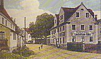
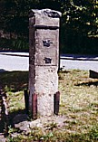
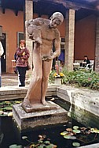
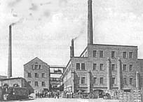
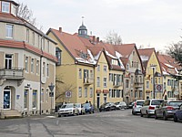
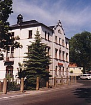
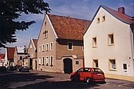

## Alfred-Reucker-Straße

Die Alfred-Reucker-Straße, eine kurze Nebenstraße im Neubaugebiet südlich der Dohnaer Straße, wurde 1994 angelegt und
nach dem früheren Generalintendanten der Sächsischen Staatsoper Prof. Dr. Alfred Reucker (1868-1958) benannt. Reucker hatte das Amt 1921 übernommen und wurde 1933 im Zusammenhang mit dem Skandal um Fritz Busch von den Nazis aus dem
Amt vertrieben. Bis zu seinem Tod wohnte er in Leubnitz-Neuostra auf der Spitzwegstraße 60.

## Altleubnitz

Altleubnitz bildet den Dorfkern des früheren Bauerndorfes und besitzt zahlreiche historische Bauerngüter, die heute unter
Denkmalschutz stehen. Bemerkenswert sind der frühere Pfarrhof (Nr. 1) aus dem 16. Jh. sowie die Dreiseithöfe Altleubnitz Nr.
9, 11, 31 und 38 mit beeindruckenden Toranlagen. Neben diesen Bauernhöfen sind auch einige Häusleranwesen erhalten, die
noch gut die ehemalige soziale Struktur des Dorfes verdeutlichen. Im Haus Nr. 2 befand sich früher die Dorfschmiede (erbaut
1717) und im Gebäude Nr. 14 die einstige Mühle. Wichtigstes historisches Gebäude ist jedoch das 1994 nach historischem Vorbild wiederaufgebaute “Steinerne Haus” des ehemaligen [Klosterhofes](../../../sudost/leubnitz-neuostra/klosterhof/) (Nr. 12). Heute befindet sich hier ein Hotel mit öffentlicher Gaststätte.

**_Foto:_** _Altleubnitz um 1900_

## Am Fuchsberg

Das Gebiet am Leubnitzer Fuchsberg war bereits im 11. Jh. besiedelt und ist der vermutete Standort einer slawischen
Wallanlage, von der bislang jedoch keine Spuren gefunden wurden. Diese Burg war Ausgangspunkt der Besiedlung der
Leubnitzer Flur. Um 1930 entstand an der Straße Am Fuchsberg eine einheitlich gestaltete Kleinhaussiedlung zwischen Heiligem
Grund und Friebelstraße. Bauherr war die Siedlungsgemeinschaft Festbesoldeter, der vorrangig Beamte und Lehrer angehörten.

## Am Pfaffenberg

Die Straße Am Pfaffenberg, benannt nach einem Leubnitzer Flurnamen, wurde im Zusammenhang mit dem Bau einer neuen
Wohnsiedlung auf der Leubnitzer Höhe angelegt. Zwischen 1999 und 2007 entstanden hier insgesamt 55 Reihen- und Doppelhäuser sowie 15 Einfamilienhäuser.

## Clausen-Dahl-Straße

Die in den Zwanziger Jahren angelegte Clausen-Dahl-Straße erinnert an den norwegischen Maler Johann Christian Clausen Dahl
(1788-1857), der ab 1818 in Dresden lebte und zum Freundeskreis um Caspar David Friedrich gehörte. Dahl, ab 1824
Professor an der Kunstakademie, schuf neben zahlreichen Naturdarstellungen auch einige Stadtansichten von Dresden. 1976/80
wurde das zuvor gärtnerisch genutzte Gelände an der Clausen-Dahl-Straße mit Neubaublocks bebaut und die ursprünglich ringförmige Straße dadurch unterbrochen.

## Corinthstraße

Die in den Zwanziger Jahren angelegte und heute zweigeteilte Straße erhielt ihren Namen nach dem impressionistischen
deutschen Maler und Graphiker Lovis Corinth (1858-1925). Die ersten Wohnhäuser entstanden 1928/29 im Bereich Tepltzer Straße. 1976-1980 wurden die verbliebenen Freiflächen mit Neubaublocks bebaut.

## [Dohnaer Straße](../../../sudost/strehlen/strassen_strehlen/dohnaer_strasse/)

## Feuerbachstraße

Die Feuerbachstraße wurde Anfang der 30er Jahre im Zuge des Wohngebietes Teplitzer Straße angelegt. 1935 wurde sie nach
dem Maler Anselm Feuerbach (1829-1880) Feuerbachstraße genannt. Feuerbach schuf vor allem antike Szenen und Porträts im neoklassizistischen Stil.

## Friebelstraße

Die Friebelstraße verbindet Leubnitz mit dem Nachbarort Gostritz. Noch bis zum Ersten Weltkrieg war
dieses Gebiet kaum bebaut und Standort einer von insgesamt vier Leubnitzer Ziegeleien. 1817 war hier der erste artesische Brunnen Sachsens abgeteuft worden, dessen Wasser für die Ziegelherstellung verwendet
wurde. 1919 wurde auf dem Gelände ein Sportplatz angelegt. Teile des ehemaligen Ziegeleibetriebes sind noch erhalten und werden heute zu Wohn- und Gewerbezwecken genutzt. Die angrenzenden Flächen dienen als Kleingärten.

Im Ortskern von Gostritz sind noch einige historische Bauerngüter erhalten geblieben. Bemerkenswert ist der Hof Friebelstraße 80, der nach 1813 entstand. Unweit davon befindet sich am Abzweig Friebelstraße/
Altgostritz eine historische Wegsäule von 1836 _(Foto)_. Im Wohnhaus Nr. 62 wohnte ab 1917 bis zu seinem Tod 1972 der Dresdner Maler Bernhard Kretzschmar, Träger des Andersen-Nexö-Kunstpreises der Stadt.

## Goppelner Straße

Die Goppelner Straße verbindet in Verlängerung der Wilhelm-Franke-Straße Leubnitz mit dem zu Bannewitz gehörenden
Ortsteil Goppeln. Als erstes Wohnhaus entstand 1909 die Villa Goppelner Straße 2, die dem Baumeister Merzdorf gehörte. Merzdorf plante um 1910 sogar die Anlage eines Flugplatzes auf der Leubnitzer Höhe, was jedoch auf Ablehnung der
Behörden stieß. Stattdessen schuf er eine ausgedehnte Gartenanlage mit Obstbäumen und Rosenstöcken, die weit über die
Ortsgrenzen hinaus bekannt wurde. 1927/28 wurde auf dem Gelände eine Holzhaussiedlung errichtet, für die der “Bund der
Tabakgegner” verantwortlich zeichnete. Die Siedler mussten sich verpflichten, auf Tabak- und Alkoholkonsum zu verzichten und eine gesunde Lebensweise zu praktizieren.

Pflastersteinfabrik Bruno Müller:
Das Unternehmen wurde 1873 vom Blasewitzer Baumeister Bruno Müller als Ziegelei gegründet und erhielt neben einem Wohn- und Geschäftshaus einen Ringbrennofen und mehrere Nebengebäude. Da die lokalen
Rohstoffvorräte für die Produktion von Mauerziegeln ungeeignet waren, entschied sich Müller für die Herstellung künstlicher
Pflastersteine. Ab 18. Juli 1901 firmierte der Betrieb offiziell als Pflastersteinfabrik Bruno Müller und stellte nach eigenem Patent
“Granulitpflastersteine” her, die auf Straßen und Plätzen in Dresden und Umgebung verwendet wurden. 1904 übernahm Sohn
Hermann Müller die Geschäftsleitung und wandelte den Betrieb 1908 in eine GmbH, zwei Jahre später in eine Aktiengesellschaft
um (Deutsche Pflastersteinwerke AG). Trotz einiger Modernisierungen und dem Kauf einer weiteren Lehmgrube im benachbarten Gostritz stellte des Unternehmen zum Ende des Ersten Weltkrieges seine Produktion ein. Gründe waren vor allem
die wirtschaftliche Entwicklung sowie ein Brand 1916, der einen Großteil der technischen Anlagen vernichtet hatte.

## Gostritzer Straße

Die Gostritzer Straße verbindet Leubnitz mit seinem Nachbarort Goppeln und nimmt ihren Ausgangspunkt an der Teplitzer
Straße. Im unteren Straßenteil dominieren Villen und Landhäuser, die meist nach der Jahrhundertwende 1900 entstanden. An
der Einmündung der Zschertnitzer Straße befand sich noch bis in jüngste Vergangenheit ein von der Leubnitzer Wasserleitung
gespeister Trinkbrunnen. Die bei Straßenbauarbeiten beseitigte Anlage soll jedoch rekonstruiert und an einem neuen Standort wieder aufgestellt werden

Atelier Edmund Moellers:
Im Haus Nr. 10 hatte bis zu seinem Tod 1950 der Bildhauer Edmund Moeller sein Atelier. Das Atelierhaus entstand 1927/28 und wurde von Moeller mit seinem Preisgeld für ein
Nationaldenkmal in Peru finanziert. Im Garten des Hauses, welches seit Moellers Tod 1958 von einer Künstlergenossenschaft genutzt wird, sind einige Plastiken seiner Hand erhalten geblieben.
Bemerkenswert ist ein in den Zwanziger Jahren geschaffener Brunnen mit Darstellung eines Silens _(Foto)_, der in der griechischen Mythologie als Waldgott ein Begleiter des Dionysos war. Eine gleichartige Plastik
hatte Moeller bereits 1911 für die Internationale Kunstausstellung in Rom geschaffen. Die später zum Bestand der Skulpturensammlung gehörende Bronzefigur befindet sich heute im Garten des Fachkrankenhauses Coswig.

Nach Verlassen der Leubnitzer Ortsflur führt die Gostritzer Straße weiter zum alten Dorfkern von [Gostritz](../../../sudost/gostritz/). Die Flächen wurden
bis in jüngere Vergangenheit meist landwirtschaftlich genutzt bzw. dienten als Betriebsgelände der Gostritzer Ziegelei.

Ziegelwerk Gostritz:
Die Gostritzer Ziegelei wurde 1894 vom Baumeister Hermann Richter gegründet und gehörte seinerzeit zu den größten und modernsten in Dresden. Nach teilweiser Zerstörung durch einen Brand entstand sie 1900 neu und blieb bis
1953 in Familienbesitz. Hergestellt wurden sowohl Dach- und Mauerziegel, aber auch Blumentöpfe für die zahlreichen Gärtnereien der Umgebung. Das Ziegelwerk besaß zwei Ringöfen, ein Pressenhaus, Verwaltungsgebäude und eine große
Lehmgrube, die unmittelbar an das Werksgelände angrenzte.

Als eines der wenigen Ziegelwerke blieb die Gostritzer Ziegelei auch während des Zweiten
Weltkrieges in Betrieb, wobei hier Zwangsarbeiter aus verschiedenen Ländern eingesetzt waren. Die Fabrikantenvilla diente 1945 zeitweise als sowjetische Ortskommandantur. Um
den Wiederaufbau zu forcieren, wurde bereits 1945 mit der Herstellung von Dachziegeln begonnen. Außerdem war die Ziegelei Richter einige Jahre Endstation einer Trümmerbahn,
mit deren Hilfe Schutt aus den zerstörten Stadtvierteln in die Lehmgrube transportiert werden konnte. 1953 übersiedelten die Besitzer in die Bundesrepublik, woraufhin der
Betrieb Teil des VEB (K) Ziegelwerke Dresden und zugleich deren Verwaltungssitz wurde

In den 60er Jahren wurde die Ziegelei nochmals modernisiert und 1961 auf Ölfeuerung umgestellt. Nach Erschöpfung der
Lehmvorkommen und wegen Mangel an Brennöls endete 1978 die Ziegelproduktion. Zuletzt wurden die Gebäude als Baustützpunkt und Lager der Gebäudeverwaltung Dresden genutzt. 1993 entstand auf dem Gelände ein Technologiezentrum.
Erhalten blieben die frühere Villa mit einigen Nebengebäuden sowie die hohe Esse, die als technisches Denkmal an die Ziegelherstellung im Dresdner Südraum erinnert. Die nach 1945 zum Großteil verfüllte Lehmgrube wurde 1996 als
Naturdenkmal “Alte Ziegelei Gostritz” unter Schutz gestellt.

## Heiligenbornstraße

Die Heiligenbornstraße verdankt ihren Namen, ebenso wie die benachbarte Brunnenstraße,
dem sagenumwobenen [Heiligen Born](../../../sudost/leubnitz-neuostra/heiliger_born/), der bereits im Mittelalter als Wasserquelle genutzt wurde. Da an dieser Straße 1907 das neue Leubnitzer [Schulhaus](../../../sudost/leubnitz-neuostra/) errichtet worden war, wurde die Straße bis zur Eingemeindung Schulstraße genannt. Seit 1902 befand sich hier
auch das Leubnitzer Wasserwerk, welches neben Leubnitz auch Torna und Reick versorgte. 1910 entstand die Wohnhausgruppe Heiligenbornstraße 1-11 _(Foto)_ mit Kleinwohnungen.

Von 1911 bis zu seinem Tod am 5. März 1945 bewohnte der Kunstmaler und Graphiker Felix Elßner das Gebäude Nr. 11.
Elßner schuf neben zahlreichen Postkartenmotiven verschiedene Illustrationen für den Dresdner Verlag Meinhold & Söhne.
Außerdem stammen von ihm einige Bilder in der Leubnitzer Kirche. Zum Freundeskreis der Familie gehörte der Maler Otto Griebel, der 1918 als Kriegsheimkehrer für einige Wochen im Hause Elßners wohnte.

## Heinrich-Heine-Straße

Die heutige Heinrich-Heine-Straße entstand in den Zwanziger Jahren im Zusammenhang mt dem Bau einer neuen Wohnsiedlung oberhalb des
Dorfkerns. Zunächst wurde sie Gorch-Fock-Straße genannt, wobei der durch seine Seefahrergeschichten bekannt gewordene norddeutsche Schriftsteller Gorch Fock (eigentlich Johann Wilhelm Kinau; 1880-1916) für die Benennung Pate
stand. Wegen seiner Nähe zur nationalsozialistischen und kriegsverherrlichenden Ideologie entschloss man sich nach 1945 zur
Umbenennung der Straße. Heinrich Heine (1797-1856) gehört zu den bekanntesten deutschen Dichtern der Romantik, war aber auch als kritischer Satiriker und Journalist tätig.

## Hoher Rand

Die Siedlung am Hohen Rand an der Kante des Elbtalhangs wurde nach dem Ersten Weltkrieg angelegt. Seit 1927 befindet sich
hier das “Höhencafé”, welches heute den Namen “Kästners Restaurant” trägt. Als Besonderheit in der Dresdner Gastronomie werden
Gerichte der sogenannten Crossover-Küche” angeboten, z.B. Fleisch in Kombination mit Krustentieren.

## Johannes-Paul-Thilman-Str.

Die Johannes-Paul-Thilman-Straße entstand in den 80er Jahren im Zusammenhang mit der Bebauung der Freiflächen südlich der
Dohnaer Straße. Benannt wurde die Straße nach dem Komponisten und Musikwissenschaftler Johannes Paul Thilman (gest.
1973). Thilmann wirkte ab 1946 als Dozent an der Palucca-Schule und war ab 1956 Professor der Dresdner Musikhochschule.
Für seine Verdienst beim Wiederaufbau des Musiklebens der Stadt erhielt er 1960 den Martin-Andersen-Nexö-Kunstpreis.

## Karl-Laux-Straße

Die Karl-Laux-Straße wurde Mitte der 80er Jahre im Zuge des Neubaugebietes Leubnitz südlich der Dohnaer Straße angelegt
und nach dem Musikkritiker Karl Laux (1896-1978) benannt. Ab 1934 arbeitete Laux als Kritiker für die “Dresdner Neuesten Nachrichten”, nach 1945 für die “Tägliche Rundschau”. Zwischen 1951 und 1962 war er Rektor der Musikhochschule.

## Kauschaer Straße

An der nach dem Leubnitzer Nachbarort [Kauscha](../../../sudost/kauscha/) führenden Kauschaer Straße befand sich noch bis ins 19. Jahrhundert der
Standort des Leubnitzer Galgens. Die ursprünglich zum Klostergut gehörige Richtstätte wurde nach dessen Auflösung vom Leubnitzer Ratsamt übernommen und 1619 erneuert. Noch 1821 wurde der Platz am Abzweig Kauschaer/ Goppelner Straße
als Gerichtsplatz bezeichnet. 1839 wurde an dieser Stelle eine noch erhaltene und 2006 sanierte Wegsäule aufgestellt.

Unweit dieser Stelle erinnert ein Steinkreuz an eine Bluttat aus dem Jahre 1525. Damals erschlug der Goppelner Bauer Wenzel Hantsch
seinen Nachbarn und musste zur Sühne neben einer Geldstrafe von 23 Schock 8 Groschen dieses Steinkreuz setzen lassen. Kreuz und Richtstätte gaben Anlass zur Sage vom gespenstigen Hund zu Leubnitz, der hier um Mitternacht den
Wanderer verfolgt und nur durch Bekreuzigung in die Flucht geschlagen werden kann.

## Klosterteichplatz

Der Klosterteichplatz erhielt seinen Namen nach dem einst hier gelegenen Teich, der zum Besitz des Klosterhofes gehörte und als Fischteich genutzt wurde. Nach dessen Verfüllung entstand ein kleiner
Platz, der sich zum “Zentrum” des Ortes entwickelte und vor dem Zweiten Weltkrieg Königsplatz genannt wurde.

1904 entstand hier das Gemeindehaus des Ortes _(Foto)_, welches neben Versammlungs- und
Verwaltungsräumen auch die Wohnung des Gemeindevorstandes beherbergte. Heute haben in dem Gebäude verschiedene öffentliche Einrichtungen ihren Sitz. Auf dem Platz wurde 1936 von
Leubnitzer Schülern eine Olympia-Gedenkeiche in Erinnerung an die im gleichen Jahr in Berlin veranstalteten Olympischen Spiele gepflanzt.

## Koloniestraße

Die Koloniestraße entstand 1934 auf der Leubnitzer Höhe. Für den Bau der Reihenhausanlage war der “Bund der
Tabakgegner” verantwortlich. Bewohner waren meist junge kinderreiche Familien, die hier ihre Vorstellungen von gesunder
Lebensweise ohne Tabak und Alkohol realisieren wollten. Beim Bau der Siedlung wurden mehrere Funde frühgeschichtlicher Keramik entdeckt. Die neu
angelegten Straßen erhielten ihre Namen nach Orten der Umgebung bzw. geographischen Flurnamen. Weitere Gebäude wurden bis zum Beginn des Zweiten Weltkrieges durch den Dresdner Spar- und Bauverein und
den Bauverein Gartenheim errichtet.

## Leiblstraße

Die kurze Leiblstraße an der Ecke Teplitzer/ Gostritzer Straße entstand 1925 im Zusammenhang mit dem Bau einiger neuer
Wohnhäuser. Ihren Namen verdankt sie dem Maler Wilhelm Leibl (1844-1900), der zu den Hauptvertretern des bürgerlichen Realismus gehört und zahlreiche Darstellungen des Arbeitslebens der Bauern schuf.

## Max-Klinger-Straße

Die bereits 1925 angelegte Wohngebietsstraße östlich der Gostritzer Straße wurde zwischen 1926 und 1927 mit einer
genossenschaftlichen Wohnsiedlung bebaut und ab 1929 Max-Klinger-Straße genannt. Max Klinger (1857-1920) gehört zu
den bedeutendsten deutschen Malern, Grafikern und Bildhauern seiner Zeit und schuf zahlreiche Gemälde und Plastiken. Einige seiner Werke befinden sich auch in der Dresdner Gemäldegalerie “Neue Meister”.

## Menzelgasse

Die Menzelgasse gehört zu den Straßen im alten Dorfkern und führt unmittelbar an der [Leubnitzer Kirche](../../../sudost/leubnitz-neuostra/leubnitzer_kirche/)
vorbei. Ursprünglich befand sich hier die Kantorei, an deren Stelle 1868 das Schulhaus des Dorfes entstand. Dieses Gebäude wurde bis zum
Schulneubau 1907 genutzt und beherbergt heute den Versammlungssaal der Kirchgemeinde. Die Straße erhielt ihren Namen nach dem früheren Kantor und Schullehrer Menzel. Unweit der Menzelgasse steht auch der nach Beschädigungen 1813
wiederaufgebaute alte Pfarrhof von Leubnitz.

## Neuostra

Die Straße Neuostra wurde 1569 auf Leubnitzer Flur für die nach hier umgesiedelten Bauern des ehemaligen Dorfes Ostra angelegt. Nachdem diese ihre Höfe für die Anlage des Ostravorwerkes
verlassen mussten, erhielten 12 Familien neues Land auf den ehemaligen Klosterhoffeldern in Leubnitz. 1569 wurden die “Neuen Vorwerksgüter” zum selbstständigen Dorf erhoben, welches den Namen Neuostra erhielt und erst 1898 mit
Leubnitz vereinigt wurde. Bis heute sind die zu beiden Seiten der breiten Dorfstraße angelegten Güter erhalten. An einigen Häusern erinnern Schrifttafeln an frühere Besitzer.

Müllers Gasthaus:
Der alte Dorfgasthof von Neuostra an der Ecke zur Spitzwegstraße war vor dem Ersten Weltkrieg neben der Klosterschänke beliebteste Einkehrstätte im Ort und wurde vor allem an den Wochenenden auch von den Dresdnern gern
besucht. Nach der Inhaberfamilie wurde der Gasthof auch als Hähnels, später Müllers Gasthaus bezeichnet. Das Lokal besaß
einen großen Gästegarten sowie einen Tanzsaal im Obergeschoss. Regelmäßig fanden Schlachtfeste, Gartenkonzerte und andere
Vergnügungen statt. 1945 waren im Saal sowjetische Soldaten untergebracht, die hier eine Sammelstelle für Kunstgüter
einrichteten, die zuvor aus Villen und Schlössern der Umgebung beschlagnahmt worden waren. Nach nach seiner Schließung wurde das Gebäude noch viele Jahre von einer Steppdeckenfabrik  genutzt und 1984 abgerissen.

## Ricarda-Huch-Straße

Die Ricarda-Huch-Straße wurde nach 1990 im Zusammenhang mit dem Bau einer kleinen Wohnsiedlung südlich des Leubnitzer
Dorfkerns angelegt. Mit der Namensgebung wird an die deutsche Erzählerin und Kunsthistorikerin Ricarda Huch (1864-1947) erinnert, die zahlreiche historische Romana, Essays und Erzählungen verfasste.

## Robert-Sterl-Straße

Die Mehrfamilienhäuser an der Robert-Sterl-Straße entstanden ab 1935 für die Eisenbahner-Wohnungsbaugenossenschaft. Drei
Gebäude fielen 1945 den Bomben zum Opfer, konnten jedoch bis 1955 wieder aufgebaut werden. 1977-79 wurden die
verbliebenen Freiflächen zwischen Robert-Sterl- und Zschertnitzer Straße mit Plattenbaublocks bebaut. Ihren Namen erhielt die
Straße nach dem Maler Robert Sterl (1867-1932), der zu den bekanntesten deutschen Impressionisten gehört und viele Jahre an der Dresdner Kunstakademie wirkte.

## Schilfteichstraße

Der Name Schilfteichstraße erinnert an einen heute verschwundenen Teich, der zu den Besitzungen des Klosterhofes diente und
zur Fischzucht genutzt wurde. Bis zur Eingemeindung wurde die Straße nach den hier gelegenen Gärtnereien Gartenstraße genannt.

## Schmalwiesenstraße

Die Schmalwiesenstraße, benannt nach einer Flurbezeichnung, wurde 1928 beim Bau einer kleinen Wohnanlage der
Heimstätten-Genossenschaft Dresden-Reick angelegt. In diesem Zusammenhang entstand auch das Wohn- und Geschäftshaus Wilhelm-Franke-Straße 29/29a mit einer Verkaufsstelle des Konsum-Vereins “Vorwärts”.

## Spitzwegstraße

Die heutige Spitzwegstraße trug ursprünglich den Namen Mockritzer Straße und wurde nach dem Ersten Weltkrieg nach dem
Maler der Romantik Carl Spitzweg (1808-1885) benannt. Die ersten Wohnhäuser entstanden kurz vor dem Ersten Weltkrieg.
Bauherr der landhausartigen Villen war die Architektengemeinschaft Rose & Röhle. Max Rose, Mitinhaber des Büros,
errichtete hier auch sein eigenes Wohnhaus. 1935-37 folgte eine kleine Wohnanlage des Bauvereins Gartenheim mit 104 Wohnungen, mit welcher die 1917 gegründete Genossenschaft ihre Bautätigkeit in Dresden abschloss. Im Wohnhaus
Spitzwegstraße 60 lebte viele Jahre der Generalintendant der Staatsoper Alfred Reucker, an den ein Gedenkstein im Garten der Villa erinnert. Später war das Haus beliebter Treffpunkt Dresdner Theaterleute.

## Thomas-Mann-Straße

Die Thomas-Mann-Straße geht auf einen alten Fußweg nach Torna zurück. Ende der 20er Jahre entstanden hier die ersten Siedlungshäuser.
Bis 1955 wurde die Straße Dietrich-Eckart-Straße genannt. Dietrich Eckart (1868-1923) gehörte als Verleger, Schriftsteller und Publizist zu den Mitbegründern der NSDAP und gilt als einer der geistigen Wegbereiter des
Nationalsozialismus. Ihren jetzigen Namen erhielt die Straße nach dem bekannten Schriftsteller Thomas Mann (1875-1955), der zu den wichtigsten Vertretern des kritischen Realismus in der Literatur gehört.

## Uhdestraße

Die Uhdestraße wurde als Lindenstraße kurz vor dem Ersten Weltkrieg angelegt und mit Mehrfamilienhäusern bebaut.. Ihren
jetzigen Namen erhielt sie nach dem Maler Fritz von Uhde (1848-1911), der vor allem sozialkritisch-religiöse Gemälde schuf.

## Wilhelm-Busch-Straße

Die an der Ortsgrenze zwischen Leubnitz und Mockritz verlaufende Wilhelm-Busch-Straße hieß früher Carolastraße und war ab
1922 Standort der Gärtnerei Dube, die noch bis 1969 in Betrieb war. 1926 wurde die Straße nach dem Zeichner Wilhelm
Busch (1832-1908) benannt, der durch seine satirischen Bildgeschichten (“Max und Moritz”, Fips, der Affe”) bekannt wurde. 1976 entstanden an der Wilhelm-Busch-Straße einige Neubauten.

## Wilhelm-Franke-Straße

Die heutige Wilhelm-Franke-Straße war einst Teil der wichtigen Fernverbindung nach Böhmen, die über Strehlen und Leubnitz
verlief und in der Nähe der Spitzwegstraße ostwärts abbog. Da sie zugleich als Weg der Leubnitzer Bauern nach Dresden
diente, wurde sie ursprünglich Dresdner Straße, ab 1927 Finckenfangstraße genannt. Namensgeber war eine Anhöhe bei
Maxen, auf der während einer Schlacht des Siebenjährigen Krieges 1759 der preußische General von Finck in Gefangenschaft geriet.

Ende des 19. Jahrhunderts erfolgte eine Verlagerung des Fernverkehrs von der Dresdner auf die Dohnaer Straße (heutige
B172). Daraufhin ließ der Leubnitzer Gemeindevorstand 1896 Gleise verlegen, um den Ort an das Dresdner Straßenbahnnetz
anzuschließen. Am 16. November 1902 verkehrte die erste Bahn von Strehlen kommend bis zum damaligen Carolaplatz vor dem “Edelweiߔ. 1974 wurde die Strecke stillgelegt und durch eine Buslinie ersetzt.

Der [Gasthof “Edelweiߔ](../../../sudost/leubnitz-neuostra/strassen_leubnitz/edelweiss/) war bereits 1882 eröffnet worden und entwickelte sich schnell zu einem beliebten Ausflugs- und
Vergnügungslokal. Die Gaststätte blieb noch bis 1982 geöffnet, ist heute jedoch leider stark verfallen. Weitere Wohnhäuser
entstanden bis zum Ersten Weltkrieg. 1912 wurde der obere Teil der Dresdner Straße als Ortsumgehung und Verbindung zur
Leubnitzer Höhe ausgebaut. Dieser steil ansteigende und kurvenreiche Abschnitt hieß früher Terrassenstraße. Um 1912 baute man hier die ersten Siedlungshäuser der sogenannten “Südostkolonie” mit dem beliebten Café “Hoher Rand”.

Nach 1945 wurde die Finckenfangstraße in Wilhelm-Franke-Straße umbenannt. Wilhelm Franke (1891-1945) arbeitete bis
1933 als Lehrer an der Leubnitzer Schule und gehörte als Stadtverordneter der SPD viele Jahre dem Dresdner Stadtrat an.
1945 kam er beim Bombenangriff in seiner Wohnung ums Leben. Auf dem Gelände einer früheren Gärtnerei gegenüber dem
“Edelweiߔ entstand 1995/97 das moderne Einkaufszentrum “Leubnitz-Passagen”. Unweit davon erinnert die mit historischen
Militärrequisiten ausgestattete Gaststätte “Zum General von Finck” an den früheren Namenspatron dieser Straße (Nr. 16).

## Wittenstraße

Die Wittenstraße entstand 1936 im Zusammenhang mit einer Mehrfamilienhaus-Wohnanlage der Eisenbahner-
Wohnungsbaugenossenschaft. Der Name erinnert an den Bildhauer Hans Witten, der u. a. die berühmte Tulpenkanzel im Freiberger Dom schuf.

## Zschertnitzer Straße

Die Zschertnitzer Straße verbindet die Stadtteile Leubnitz und Zschertnitz und überquert dabei den Kaitzbach auf einer mehrfach
erneuerten Brücke. Neben Wohnhäusern aus der Zeit nach 1900 befanden sich hier noch bis 1974 die beiden Gärtnereien Schleinitz und Schönert. 1975 wurden diese Grundstücke mit Neubaublocks des Gebietes Clausen-Dahl-Straße bebaut.
Gleichzeitig wurde auf früherem Ziegeleigelände an der Zschertnitzer Ortsgrenze das Seniorenheim “Olga Körner” seiner
Bestimmung übergeben. Weitere Neubauten entstanden 1999, wobei auch ein viele Jahre vom VEB PUROTEX genutztes historisches Lagerhaus in die Neugestaltung einbezogen wurde.

[Leubnitz-Neuostra auf OpenStreetMap](https://www.openstreetmap.org/search?query=Dresden+Leubnitz-Neuostra)

* * *

 \[ [Home](../../../index.html)\] \[ [Nord](../../../nord/)\] \[ [Nordwest](../../../nordwest/)\] \[ [Neustadt](../../../neustadt/)\] \[ [Nordost](../../../nordost/)\] \[ [West](../../../west/)\] \[ [Zentrum](../../../zentrum/)\] \[ [Südwest](../../../sudwest/)\] \[ [Süd](../../../sud/)\] \[ [Südost](../../../sudost/)\] \[ [Ost](../../../ost/)\] \[ [Register](../../../Register/register.html)\] \[ [Kontakt](../../../Kontakt/kontakt.html)\] \[ [Impressum](../../../impressum/)\]
