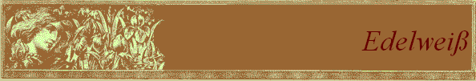
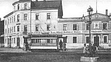

* * *

* * *

* * *

* * *

* * *

* * *

Die Gaststätte “Edelweiߔ entstand 1882 an der damaligen Dresdner Straße (heute
Wilhelm-Franke-Straße) und entwickelte sich schnell zum beliebten Treffpunkt der Leubnitzer, aber auch vieler Ausflugsgäste. Maßgeblich zum Aufschwung des Lokals trug
die 1902 eröffnete Straßenbahnlinie bei, die vor dem Gasthof ihren Endpunkt hatte. Bauherr des Gebäudes war Ernst Bach, der im Haus bis 1930 eine Bäckerei betrieb. Die
Gaststättenräume verpachtete er zunächst an den Gastwirt Carl Guhr, später an die Familie Hieckmann und den Schankwirt Bruno Becker. Nach 1932 wechselten mehrfach die Besitzer, ohne jedoch am
Grundkonzept des Gasthofes etwas zu verändern. Neben dem Lokal befand sich im Haus auch ein Ladengeschäft,
welches zunächst als Rasiersalon, nach 1933 als Uhrmacherwerkstatt und später als Elektrofachgeschäft genutzt wurde. Im Obergeschoss gab es mehrere Wohnungen.

Um 1900 bestand das “Edelweiߔ aus Restaurant mit Gästegarten, Café, einem Billardsalon, Versammlungsräumen und einer Radfahrerstation _(Foto)_
. In einem Anbau war eine Kegelbahn untergebracht, die 1940 jedoch dem Bau der Villa Spitzwegstraße 65 weichen musste. Gern wurde die Gaststätte von Wochenendausflüglern, Wandergruppen und Vereinen
besucht, die hier ihre Versammlungen abhielten. Erst mit Beginn des Zweiten Weltkriegs gingen die Besucherzahlen zurück, was zu Einschränkungen des Gastronomiebetriebes führte.

Die vom Luftangriff
verschonte Gaststätte blieb jedoch auch nach 1945 weiterhin geöffnet. In den ersten Monaten nach Kriegsende belegte eine “Trophäen-Kommission” der sowjetischen Armee das Haus, um hier beschlagnahmte
Kunstschätze für ihren Abtransport vorzubereiten. 1951 übernahm das Ehepaar Lorenz, bis 1945 Inhaber der “Großen
Wirtschaft” im Großen Garten, das “Edelweiߔ. Nach dem Verhandlungen über einen Verkauf des Gebäudes gescheitert
waren und zunehmende staatliche Eingriffe die Bewirtschaftung des Hauses erschwerten, übergab die Familie die
Gaststätte 1965 an einen neuen Gastwirt. Dieser führte das “Edelweiߔ noch bis 1972 und eröffnete wenig später das beliebte Eiscafé Leuner an der Dohnaer Straße.

1972 wurde das “Edelweiߔ in eine HO-Gaststätte umgewandelt. Bauliche Mängel führten jedoch schon bald zu deutlichen Einschnitten im Gastronomiebetrieb. Schankstube und mehrere Gasträume mussten wegen Einsturzgefahr
gesperrt werden, so dass zuletzt nur noch in der “Kutscherstube” an der Wilhelm-Franke-Straße ausgeschenkt wurde. Mit
Einstellung der Straßenbahn 1974 verlor das “Edelweiߔ weitere Stammgäste und wurde 1982 endgültig geschlossen.Die
Räume nutzte fortan die PGH Siebdruck als Lager.  1997 erwarb eine Dresdner Firma das Grundstück. Leider scheiterten
bislang alle Pläne, das historische Gebäude zu sanieren, so dass das “Edelweiߔ bis heute in ruinösem Zustand leer steht.

* * *

 \[ [Home](../../../../index.html)\] \[ [Nord](../../../../nord/)\] \[ [Nordwest](../../../../nordwest/)\] \[ [Neustadt](../../../../neustadt/)\] \[ [Nordost](../../../../nordost/)\] \[ [West](../../../../west/)\] \[ [Zentrum](../../../../zentrum/)\] \[ [Südwest](../../../../sudwest/)\] \[ [Süd](../../../../sud/)\] \[ [Südost](../../../../sudost/)\] \[ [Ost](../../../../ost/)\] \[ [Register](../../../../Register/register.html)\] \[ [Kontakt](../../../../Kontakt/kontakt.html)\] \[ [Impressum](../../../../impressum/)\]
