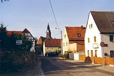
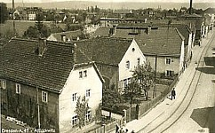
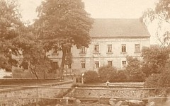
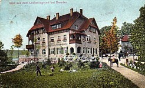
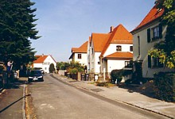
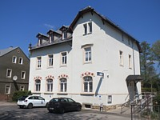
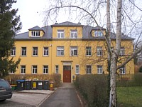
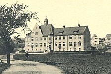
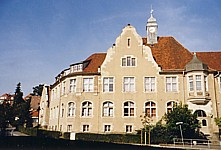
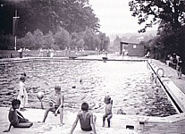

* * *

**Gemeindesiegel von Lockwitz**

* * *

* * *

**Stadtteilseite Lockwitz**

* * *

**Vereine in Lockwitz:**

Das Gebiet um Lockwitz und Nickern war bereits in der Bronzezeit besiedelt, wie entsprechende Funde auf Nickerner Flur beweisen. Die aus zwei Siedlungskernen entstandene slawische Siedlung Lockwitz entstand vermutlich im 10. Jahrhundert am gleichnamigen [Lockwitzbach](../../sudost/lockwitz/lockwitzbach/) und wurde 1288 erstmals als Lucawitz urkundlich erwähnt. Der Name bedeutet übersetzt “Ort am
Wiesenbach” und wurde sowohl für Groß- als auch Kleinlockwitz verwendet. Später unterschied man die beiden Ortsteile Niederlockwitz mit dem Rittergut und Oberlockwitz, womit die Siedlung am Galgenberg gemeint war. Frühgeschichtliche Funde belegen die Besiedlung der Lockwitzer Flur im 10./11. Jahrhundert. In diesem Zeitraum entstand auch eine Wallanlage im Südwesten des Ortes, von der jedoch keine Reste mehr vorhanden sind.

Der Ort unterstand ursprünglich dem Markgrafen von Meißen und kam gemeinsam mit einigen anderen Dörfern 1311 zum Dresdner Brückenamt. Zinsrechte besaß um 1400 auch das Maternihospital. 1349 ist erstmals ein Rittergut erwähnt, welches zunächst der Familie Karas, ab 1411 der Dresdner Bürgerfamilie Ziegler, ab 1511 komplett der Freiberger Patrizierfamilie Alnpeck gehörte. 1621/22 entstand an seiner Stelle das noch heute erhaltene [Schloss](../../sudost/lockwitz/schloss_lockwitz/) und die baulich mit ihm verbundene [Kirche](../../sudost/lockwitz/lockwitzer_kirche/). Eine größere Dorferweiterung erfolgte 1685/95 Am Plan an Stelle einer abgetragenen Schanze. Eine Besonderheit von Lockwitz war, dass das hiesige Rittergut neben den Niedergerichten auch die Obere Gerichtsbarkeit besaß, und somit auch Todesurteile bei schweren Verbrechen verhängen durfte.

Schwer betroffen war Lockwitz im Dreißigjährigen Krieg, wo der Überlieferung nach die Lockwitzer Einwohner ihre Mehl- und Brotwagen mit Steinen erfolgreich gegen die Angreifer verteidigten. Bereits zuvor hatte man den Ort teilweise mit einer Schanze umgeben, was Plünderungen jedoch nicht verhindern konnte. Am Krähenhügel kam es wenig später zu einem Gefecht zwischen kaiserlichen und schwedischen Truppen. Auch im Nordischen Krieg 1706/07 hatten die Bewohner unter Kontributionen und Einquartierungen zu leiden, ebenso im Siebenjährigen Krieg, wo Preußenkönig Friedrich II. für einige Wochen im Lockwitzer Schloss sein Hauptquartier einrichtete.

Im 18./19. Jahrhundert wechselten die Besitzer des Dorfes häufig. Bedeutendster Grundherr war ab 1813 Johann Gottlob Preußer, der seinen Bauern freiwillig Fronen und Zinsen erließ und zu den Wegbereitern der bürgerlichen Reformen in Sachsen gehörte. Diese brachten auch für Lockwitz Veränderungen mit sich. Neben der bislang dominierenden Landwirtschaft und dem Obstanbau entstanden erste gewerbliche Unternehmen, meist in früheren Mühlen im [Lockwitzgrund](../../sudost/lockwitz/strassen_lockwitz/) _(Foto: Hänichenmühle)_. Wichtige Erwerbszweige waren neben dem Müllerhandwerk die Brotbäckerei sowie die Strohflechterei, die in Heimarbeit betrieben wurde. Außerdem gab es in Lockwitz sieben Destillationsbetriebe, eine [Ziegelei](../../sudost/lockwitz/strassen_lockwitz/ziegelwerk_lockwitz/) und eine 1837 gegründete Zuckerfabrik. Die frühere Hänichenmühle diente ab 1838 der Spiritusherstellung, die Schmidtmühle ab 1868 als Papierfabrik. Später entstand hier eine Produktionsstätte für Nudeln und andere Teigwaren. Bedeutendstes Lockwitzer Unternehmen war jedoch die 1885 entstandene [Schokoladenfabrik Rüger](../../sudost/lockwitz/strassen_lockwitz/schokoladenfabrik_ruger/). Eine Zählung von 1876 vermerkte außerdem für den Ort neben dem Rittergut neun Bauerngüter und 116 Häuser für insgesamt 1.573 Einwohner. Drei Jahre zuvor hatte der Gemeinderat die Schaffung einer ersten Straßenbeleuchtung beschlossen. Ab 6. Mai 1878 besaß Lockwitz zudem eine eigene Gemeindesparkasse.

Zu den wichtigsten Abnehmern der um Lockwitz ansässigen Obstbauern gehörte die 1893 durch Emil Donath gegründete [Obstsaftkelterei](../../sudost/lockwitz/strassen_lockwitz/kelterei_lockwitzgrund/), die zu den Pionieren der Branche in Deutschland gehörte und noch bis 1994 im Lockwitzgrund ansässig war _(Bild rechts)_. Diese Industrialisierung führte auch zum Bau neuer Wohnhäuser im Ort. Noch vor dem Ersten Weltkrieg entstanden Am Galgenberg Ein- und Mehrfamilienhäuser. Zur Verbesserung der Verkehrsverbindung nach Kreischa und Niedersedlitz trug die 1906 eröffnete elektrische [Lockwitztalbahn](../../sudost/lockwitz/lockwitztalbahn/) bei, die 1977 stillgelegt wurde.

Auch nach dem Ersten Weltkrieg setzte sich die positive Entwicklung des Ortes fort. Neue Wohnsiedlungen wurden in den Zwanziger Jahren an der Nickerner Straße, Auf dem Pläner und an der Gerberstraße _(Foto links)_ errichtet. 1920 konnte am Gückelberg ein Freibad eröffnet werden, welches jedoch nur bis 1945 existierte und dann als Lagerplatz der Kelterei genutzt wurde. Nachdem 1923 der Nachbarort Nickern nach Lockwitz eingemeindet worden war, kamen beide Orte am 1. Januar 1930 als Stadtteile zu Dresden. Kurz zuvor war 1927 ein vollautomatisches Stauwehr des Lockwitzbaches in Betrieb genommen worden, welches künftige Hochwasserschäden vermeiden sollte. Solche sind für Lockwitz u. a. 1897, 1924 und 1925 verbürgt. Leider wurde dieses Wehr beim schweren Sommerhochwasser im August 2002 teilweise zerstört, inzwischen jedoch wieder repariert.

Das frühere Rittergut Lockwitz, welches sich ab 1867 im Besitz der Familie Kap-herr befunden hatte, wurde 1946 an 23 Neubauern aufgeteilt. Diese gründeten am 21. September 1952 die erste Landwirtschaftliche Produktionsgenossenschaft im Dresdner Stadtgebiet. 1958/62 wurde diese mit einigen Nachbar-LPG\`s vereinigt. Bis heute blieb Lockwitz ein bevorzugter Wohnstandort, was nach 1990 zum Bau neuer Siedlungen zwischen dem Dorfkern und Nickern führte.

Postwesen in Lockwitz:

Am 1. Oktober 1857 wurde in Lockwitz die erste Postexpedition eingeweiht, nachdem die Post zuvor nur über Boten und Fuhrleute befördert worden war. Die Räume der Poststelle lagen im Rittergut und waren auch für die umliegenden Orte im Lockwitztal sowie für Reick und Prohlis zuständig. Die Sendungen kamen in der Regel per Zug aus Dresden oder Pirna und wurden vom Ortsbriefträger am Niedersedlitzer Bahnhof in Empfang genommen. 1877 erhielt der Ort erstmals Telegraphenanschluss. Später hatte das Postamt Lockwitz seinen Sitz auf der Tögelstraße 6 _(Foto)_. Heute befindet sich in den Räumen die Neuapostolische Kirche.

Zur Beförderung der Postgüter nutzte das Lockwitzer Postamt zunächst eine Postkutsche, deren regelmäßiger Verkehr erst 1906 mit Eröffnung der Lockwitztalbahn eingestellt wurde. Diese übernahm dann den Transport, wobei ein eigens angeschaffter Postbeiwagen an die regulären Züge angehängt wurde. Erst in der Nachkriegszeit nach 1945 wurde diese Art der Postbeförderung eingestellt.

Schulen in Lockwitz:

Die erste Dorfschule entstand 1623 in Niederlockwitz und blieb bis Mitte des 19. Jahrhunderts in Betrieb. Im gleichen Jahr war der Ort zur selbstständigen Kirchgemeinde erklärt worden, wodurch der lange Schul- und Kirchweg nach Leubnitz entfiel. 1868 wurde ein Schulneubau an der Tögelstraße 23 eingeweiht _(Foto rechts)_. Das Gebäude besaß im Erdgeschoss drei Klassenzimmer, in der oberen Etage befanden sich Wohnungen für die beiden Lehrer. Seit Fertigstellung der neuen Schule an der Urnenstraße dient das Gebäude als Wohnhaus.

Um der gewachsenen Schülerzahl Rechnung zu tragen, errichtete die Gemeinde 1906 an der Urnenstraße ein neues Schulgebäude mit Turnhalle _(Foto links)_. Erweiterungsbauten erfolgten in den 1930er und 1970er Jahren. Im Dachgeschoss war zwischen 1926 und 1929 das vom Volksschullehrer und Heimatforscher Gerhardt Müller gegründete Lockwitzer Ortsmuseum untergebracht. Danach kam die seit 1945 verschollene Sammlung ins Schloss. Bereits 1858 hatte der Lehrer Julius Hermann Tögel hier eine Schul- und Volksbibliothek eingerichtet.

Nach dem Zweiten Weltkrieg gehörte die Lockwitzer Schule als 79. Polytechnische Oberschule zum Dresdner Schulnetz. Ab 1991 befand sich hier bis zur Schließung im Sommer 2008 die 79. Mittelschule _(Foto)_. Nach mehrjährigen Leerstand zog hier im Herbst 2017 die SRH Oberschule Dresden ein, eine private Bildungseinrichtung, die nach dem Konzept des selbstorganisierten Lernens unterrichtet. In diesem Zusammenhang erfolgte eine komplette Sanierung des Gebäudes, welches künftig noch um einen modernen Anbau und eine neue Turnhalle ergänzt werden soll.

Freibad Lockwitz:

Die erste Bademöglichkeit im Ort existierte bereits seit 1916, nachdem der Besitzer der Dampfmühle Lockwitz, Paul
Blischke, den Vorfluter des Mühlgrabens zu Badezwecken freigegeben hatte. Zunehmende Sicherheits- und hygienische
Bedenken sowie die verbreitete Praxis des “wilden” Badens in der Lockwitz führten zu Überlegungen der Gemeinde, ein
eigenes Freibad zu errichten. Nach Abschluss eines Pachtvertrages mit dem Schlossbesitzer von Kap-herr entstand
1927/28 ein kleines Schwimmbecken mit einer Größe von ca. 33 x 17 Metern, welches am 16. Juni 1928 offiziell als Freibad der Bevölkerung übergeben wurde.

Nach der Eingemeindung des Ortes erwarb die Stadt Dresden 1930 das
Grundstück und ließ das Bad 1936 mit Umkleidekabinen aus dem stillgelegten Kleinzschachwitzer Elbebad ausstatten. Mangelnde Pflege in der Kriegs- und
Nachkriegszeit sowie Überschwemmungen durch den Lockwitzbach führten nach 1945 zur Schließung und der Übergabe des Areals an die “Jugendheim GmbH”.
Diese wollte die verbliebenen Baulichkeiten als Versammlungs- und Unterkunftsräume nutzen und das trockenliegende Schwimmbecken verfüllen. Dazu
kam es jedoch nicht, so dass der Pachtvertrag 1950 aufgelöst und das Grundstück der Kelterei Lockwitzgrund überlassen wurde. Diese nutzte es für ihre
Betriebssportgemeinschaft “BSG Lockwitzgrund”, später als Lagerfläche. Pläne für einen Wiederaufbau des Freibades an anderer Stelle kamen nicht zustande.

[_Weiterführende Literatur und Quellen_](../../impressum/quellenverzeichnis/)

 \[ [Home](../../index.html)\] \[ [Nord](../../nord/)\] \[ [Nordwest](../../nordwest/)\] \[ [Neustadt](../../neustadt/)\] \[ [Nordost](../../nordost/)\] \[ [West](../../west/)\] \[ [Zentrum](../../zentrum/)\] \[ [Südwest](../../sudwest/)\] \[ [Süd](../../sud/)\]
 \[ [Südost](../../sudost/)\] \[ [Ost](../../ost/)\] \[ [Register](../../Register/register.html)\] \[ [Kontakt](../../Kontakt/kontakt.html)\] \[ [Impressum](../../impressum/)\]
