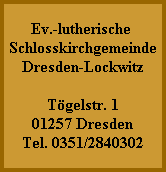
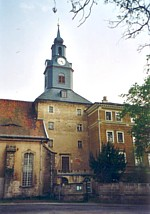
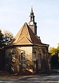

* * *

* * *

* * *

* * *

* * *

* * *

Die Kirche von Lockwitz geht auf eine alte katholische Schlosskapelle zurück, die nach der Reformation wegen Pfarrermangels geschlossen wurde und über 80 Jahre lang leer stand. Erst 1622 richtete der Rittergutsbesitzer Johann Georg von Osterhausen an ihrer Stelle eine evangelische Kirche ein. 1623 wurden Ober- und Niederlockwitz sowie Nickern zur selbstständigen Kirchgemeinde erklärt, womit die bisherige Zuordnung zur Leubnitzer bzw. Röhrsdorfer Kirche erlosch. Die Weihe erfolgte noch nach alter Kalenderrechnung am 1. Oktober 1623. Mehrfach wurde das Gebäude umgebaut und erweitert, bevor zwischen 1699 und 1703 an Stelle der alten Kirche ein barocker Neubau entstand.

Initiator des Baus war Gotthelf Friedrich von Schönberg, der 1692 das Rittergut Oberlockwitz erworben hatte und nun dem Bevölkerungszuwachs in seiner Gemeinde Rechnung tragen musste. Am Pfingstsonntag des Jahres 1703 hielt Ortspfarrer Christian Gerber den ersten Gottesdienst in der neuen Kirche. Bereits im August 1700 konnten zum ersten Mal die Glocken des neuen Kirchturms geläutet werden. Dieser stellt eine architektonische Besonderheit dar, da er baulich direkt mit dem [Schloss](../../../sudost/lockwitz/schloss_lockwitz/) verbunden wurde, so dass beide Gebäude bis heute eine Einheit bilden _(Bild oben um 1840)_. 1825 erhielt der Kirchturm eine neue Spitze. Bereits 1757 war auf dem unweit der Kirche an der Maxener Straße gelegenem Friedhof die erste Bestattung erfolgt.

Die ursprünglich vorhandenen Bronzeglocken mussten im Ersten Weltkrieg zum Einschmelzen abgegeben werden und wurden 1924 durch ein Stahlgeläut ersetzt. 1941 wurde in der Kirche eine Orgel der Dresdner Firma Jehmlich geweiht, wobei einige Teile des Vorgängerinstruments Verwendung fanden. Bereits ein Jahr zuvor war mit Kathrin Kretschmar zum ersten Mal im Dresdner Raum eine Frau als Kantorin eingesetzt worden. Sie blieb bis 1972 im Dienst und erwarb sich große Verdienste um das kirchenmusikalische Leben in der Nachkriegszeit. 1994 begann eine umfassende Sanierung der Lockwitzer Kirche, für die auch die Turmhaube abgenommen wurde. 2011 wurde diese mit der Übergabe der restaurierten Kanzel abgeschlossen.

Zur Innenausstattung gehören eine zweigeschossige Empore sowie eine separate Orgelempore und die einst den Rittergutsbesitzern vorbehaltene Patronatsloge. Der Altar _(Foto)_ entstand aus einem Epitaph von 1627 sowie einem Aufbau von 1660 und wurde 1823 um zwei seitliche Reliefs ergänzt. Schöpfer war der Bildhauer Wenzel Lindener. Wappen und Initialen Hans Georg von Osterhausens erinnern an den Kirchenstifter. Die Holzkanzel stammt aus dem 17. Jahrhundert, die hölzerne Taufe aus dem Jahr 1823

* * *

 \[ [Home](../../../index.html)\] \[ [Nord](../../../nord/)\] \[ [Nordwest](../../../nordwest/)\] \[ [Neustadt](../../../neustadt/)\] \[ [Nordost](../../../nordost/)\] \[ [West](../../../west/)\] \[ [Zentrum](../../../zentrum/)\] \[ [Südwest](../../../sudwest/)\] \[ [Süd](../../../sud/)\] \[ [Südost](../../../sudost/)\] \[ [Ost](../../../ost/)\] \[ [Register](../../../Register/register.html)\] \[ [Kontakt](../../../Kontakt/kontakt.html)\] \[ [Impressum](../../../impressum/)\]
