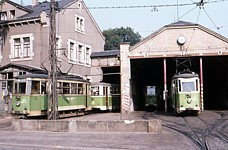
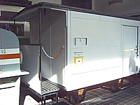
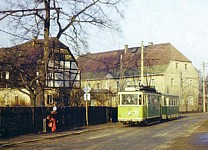
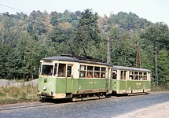

* * *

* * *

Die Lockwitztalbahn wurde 1905/06 durch den Gemeindeverband Niedersedlitz - Lockwitz - Kreischa erbaut, nachdem bereits zuvor Projekte für eine Eisenbahnstrecke von Niedersedlitz durch das Lockwitztal aufgekommen waren. Die meterspurige elektrisch betriebene Straßenbahn entstand in nur knapp sechsmonatiger Bauzeit und verband die im Lockwitzgrund gelegenen Orte mit dem Niedersedlitzer Bahnhof. Hier gab es außerdem Anschluss an die ebenfalls schmalspurige [Dresdner Vorortbahn](../../../ost/niedersedlitz/dresdner_vorortbahn/) in Richtung Leuben und Kleinzschachwitz. Die offizielle Einweihung der 9,15 km langen Strecke fand am 3. März 1906 statt. Bereits im ersten Jahr konnten 372.000 Fahrgäste registriert worden, die das neue Verkehrsmittel vor allem an den Wochenenden rege nutzten. Dafür standen zunächst sechs Trieb- und zwei Beiwagen zur Verfügung. 1908 wurde der Fahrzeugpark um zwei weitere Wagenzüge erweitert.

Neben Personen wurden in den Anfangsjahren auch Güter und Post befördert. So nutzten ab 1911 die [Kelterei Donath](../../../sudost/lockwitz/strassen_lockwitz/kelterei_lockwitzgrund/), [Rügers Schokoladenfabrik](../../../sudost/lockwitz/strassen_lockwitz/schokoladenfabrik_ruger/) und die
zahlreichen Kleinbetriebe der Kreischaer Industrie die Bahn zum Transport ihrer Produkte zum Niedersedlitzer Bahnhof. Außerdem begünstigte die Straßenbahn
den in Kreischa aufkommenden Kurbetrieb. Hier befand sich auch der Straßenbahnhof, in dem die Fahrzeuge untergestellt wurden. Neben den für den Güter- und Personentransport bestimmten Wagen gab es auch einen eigenen
Bahnpostwagen _(Foto)_, der an die Züge bei Bedarf angehängt wurde.

Obwohl die Lockwitztalbahn von den Anliegern angenommen wurde, geriet der Gemeindeverband nach dem Ersten
Weltkrieg in wirtschaftliche Schwierigkeiten. Um einen Konkurs zu vermeiden, musste die Bahn am 1. Januar 1929 an
die Dresdner Überland-Verkehrsgesellschaft (DRÜVEG) abgegeben werden, die fortan den Betrieb organisierte. Am 1. August 1941 wurde die Lockwitztalbahn als einzige Schmalspurstraßenbahn der Stadt durch die Dresdner Straßenbahn übernommen und trug fortan die Liniennummer 31.

**_Foto:_** _Die Lockwitztalbahn im alten Lockwitzer Dorfkern (Mario Schatz)_

Wegen der hier eingesetzten rot lackierten Fahrzeuge trug die Bahn viele Jahre den Spitznamen “die rote Fliege”. Erst im Zuge eines Modernisierungsprogramms wurden ab 1968 auf dieser Strecke modernere Fahrzeuge in grün-gelber Farbgebung eingesetzt. Trotz dieser Bemühungen erwies sich die Strecke als unrentabel, vor allem wegen des hohen Wartungsaufwandes durch den “Inselbetrieb”. Aus diesem Grund wurde die Lockwitztalbahn am 18. Dezember 1977 trotz heftiger Proteste der Anwohner eingestellt. Seit diesem Zeitpunkt verkehrt eine Buslinie der DVB durch das Lockwitztal nach Kreischa.

Die nicht mehr benötigten Fahrzeuge der Lockwitztalbahn wurden nach der Stillegung an andere Verkehrsbetriebe der DDR verkauft. Ein historischer Triebwagen blieb erhalten und gehört heute zum Museumsfahrzeugbestand der Kirnitzschtalbahn in der Sächsischen Schweiz. Nach 1990 konnten Kreischaer Straßenbahnfreunde zwei Triebwagen zurückerwerben und diese im Ortszentrum von Kreischa aufstellen. Pläne, für touristische Zwecke zumindest ein Teilstück der Bahn wiederaufzubauen, scheiterten jedoch an den hohen Kosten. Da es zudem an einer geeigneten Unterstellmöglichkeit für die beiden Straßenbahnen mangelte, entschloss man sich 2007, diese nach Erfurt und an das Straßenbahnmuseum Dresden abzugeben. Der frühere Straßenbahnhof Kreischa dient heute als Lebensmittelmarkt.

* * *

 \[ [Nord](../../../nord/)\] \[ [Nordwest](../../../nordwest/)\] \[ [Neustadt](../../../neustadt/)\] \[ [Nordost](../../../nordost/)\]
 \[ [West](../../../west/)\] \[ [Zentrum](../../../zentrum/)\] \[ [Südwest](../../../sudwest/)\] \[ [Süd](../../../sud/)\] \[ [Südost](../../../sudost/)\] \[ [Ost](../../../ost/)\] \[ [Register](../../../Register/register.html)\] \[ [Kontakt](../../../Kontakt/kontakt.html)\] \[ [Impressum](../../../impressum/)\]
