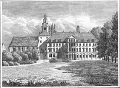
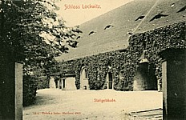
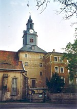
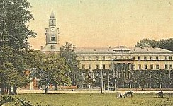
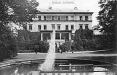
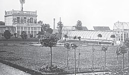
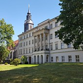
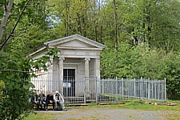

* * *

* * *

* * *

* * *

* * *

* * *

Schloss Lockwitz _(Bild um 1840)_ geht auf ein 1349 erstmals erwähntes Rittergut zurück, welches zunächst mit der Dresdner Alexiuskapelle und Heinrich Karras zwei Besitzern gehörte. Von 1411 bis 1512 besaß die Dresdner Bürgerfamilie Ziegler einen Anteil am Gut, der übrige gehörte seit Ende des 15. Jahrhunderts dem Freiberger Patriziergeschlecht von Alnpeck. Stefan Alnpeck (1456-1521) war als Münzmeister und Amtshauptmann zu Freiberg zu erheblichem Wohlstand gekommen und Gründer der Saigerhütte Grünthal.

Ab 1512 war Georg von Alnpeck (1462- 1523) alleiniger Besitzer des Gutes. An ihn erinnert ein noch heute in der [Leubener Kirche](../../../ost/leuben/himmelfahrtskirche/) erhaltenes Glasfenster mit dem Familienwappen. 1523 teilte er seinen Besitz unter seinen beiden Söhnen Wenzel (+ 1551) und Hieronymus (1511-1576) auf, wodurch die beiden Rittergüter Niederlockwitz und Oberlockwitz entstanden. Zu den umfangreichen Besitzungen des Rittergutes Oberlockwitz gehörten neben der Hälfte von Lockwitz die Orte Nickern, Rippien, Kleinluga und Teile von Leuben. Niederlockwitz waren neben dem anderen Dorfteil Kauscha, Gaustritz, Nöthnitz, Rosentitz und Teile von Niedersedlitz und Zschachwitz zugeordnet. Einige Grabsteine und Epitaphien von Familienangehörigen befinden sich heute noch in der [Leubnitzer Kirche](../../../sudost/leubnitz-neuostra/leubnitzer_kirche/), zu der Lockwitz einst gehörte.

1620 erwarb der kurfürstlich-sächsische Hofmarschall Johann Georg von Osterhausen (1577- 1627) die Rittergüter Lockwitz und Nickern. Osterhausen stammte aus einer thüringischen Adelsfamilie, besaß zuvor bereits das Rittergut in Reinhardtsgrimma und war Oberkammerrat und Vorstand der Landrentenkammer sowie ab 1611 Hofmarschall Johann Georg I. Der Kaufkontrakt sah eine Zahlung von insgesamt 36.500 Meißnischen Gulden an die Verkäufer Ernst und Ernst Albrecht Alnpeck vor. Neben den beiden Rittergütern gehörte auch ein "Hofreuthe" genanntes Bauerngut und verschiedenes Inventar des Rittergutes Oberlockwitz sowie dessen Viehbestände, die aus "15 melkenden Kühen, 5 tragenden Kalben und 150 Schaf-Rößern" bestanden, dazu. Niederlockwitz war zu diesem Zeitpunkt an Ursula von Maltitz verpachtet und ging mit seinem gesamten Inventar ebenfalls an Osterhausen über. Hinzu kam das Gutsarchiv mit allen Lehnsbriefen, Kontrakten und Urkunden.

Das Herrenhaus des Lockwitzer Rittergutes wurde 1621 zum Schloss umgebaut und dabei erheblich vergrößert. Gleichzeitig entstand an Stelle der früheren Schlosskapelle eine [Kirche](../../../sudost/lockwitz/lockwitzer_kirche/), die seit 1623 eine eigene Kirchgemeinde bildete. Ein besonderes Kuriosum ist der Turm, der beide Gebäude miteinander verbindet, baulich jedoch zur Kirche gehört _(Foto links)_. Nach dem Tod Johann Georg von Osterhausens gingen Ober- und Niederlockwitz mit Nickern auf seine beiden Söhne Johann Georg und Hans von Osterhausen über und blieben bis 1680 in Familienbesitz.

In diesem Jahr wurde zunächst Niederlockwitz an Geheimrat Gotthelf Friedrich von Schönberg verkauft. Zwei Jahre später folgte Nickern. 1692 erwarb Schönberg auch das überschuldete Rittergut Oberlockwitz. Zwischen 1699 und 1702 ließ er umfassende Erneuerungsarbeiten an Schloss und Gutsgebäuden vornehmen. Weitere Umbauten erfolgten um 1770 unter Johann Friedrich Graf von Dallwitz. Von 1785 bis 1800 gehörten Schloss und Herrschaft Carl Theodor Reichsgraf von Schall.

Ein prominenter Gast des Schlosses war 1757 der preußische König Friedrich II., der hier während des Siebenjährigen Krieges ab 24. März sein Hauptquartier nahm. Eine Legende besagt, dass Friedrich der Große in Lockwitz Opfer eines Giftanschlages durch seinen Kammerdiener Glasow werden sollte. Nur der Aufmerksamkeit eines Knaben, welcher die Giftmischerei beobachtete und dem König meldete, rettete ihm das Leben. Historisch ist diese Geschichte jedoch nicht verbürgt. In den Befreiungskriegen 1813 befand sich im Schloss ein Lazarett für preußische und russische Soldaten, die im Kampf gegen Napoleon verwundet worden waren.

Anfang des 19. Jahrhundertes wechselten mehrfach die Besitzer des Schlosses. Ab 1800 gehörte es für fünf Jahre Johann Sebastian von Wirsing, danach von 1805 bis 1810 Johann Christian Gottlob von Steinhäußer, bevor ein Sequester das überschuldete Rittergut verwaltete. 1833 erwarb Johann Gottlob Preußer das Gebäude mit dem zugehörigen Rittergut. Preußer galt als einer der fortschrittlichsten Adligen seiner Zeit und erließ freiwillig seinen Bauern sämtliche Fron- und Zinsleistungen.

Das Gut wurde 1866 an den kaiserlich-russischen Staatsrat und Bankier Heinrich Christian Kap-herr verkauft, der das Schloss seinem Sohn Carl Johann zur Nutzung überließ. Wenig später begann ein Umbau des Gebäudes im Stil der italienischen Renaissance, wodurch der Bau im Wesentlichen sein bis heute überliefertes Aussehen erhielt. Das barocke Mansarddach wurde durch ein weiteres Obergeschoss ersetzt und der Bau mit einem flachen Walmdach abgeschlossen. Geleitet wurden die Arbeiten von den Lockwitzer Baumeistern Carl Kirsten und Otto Kreyssig. Wenig später entstand die Schlossgärtnerei mit Orangerie zur Pflege des ausgedehnten Schlossparks _(Foto um 1910)_. Die Familie Kap-herr nutzte das Lockwitzer Schloss bis zum Ende des Zweiten Weltkrieges als Wohnsitz. Im Speisesaal wurde 1929 ein kleines Heimatmuseum eingerichtet, dessen Exponate in den Wirren der Nachkriegszeit verschwanden.

Schloss Lockwitz wurde mit dem zugehörigen Rittergutsland 1946 durch die Bodenreform enteignet und an Neubauern aufgeteilt. Die früheren Besitzer deportierte man auf die Insel Rügen, von wo aus sie später in die Westzonen flohen. Im Schloss entstand 1946 zunächst eine Staatliche Feuerwehrschule. Nach deren Verlegung 1965 wurde zwei Jahre später in den Räumen eine Ausbildungsstätte für angehende Kartographen und Geodäten eingerichtet. Diese wurde nach 1990 als Vermessungsschule des Landesvermessungsamtes Sachsen fortgeführt und erst 2001 geschlossen. 1994 begann mit Abnahme der Turmhaube eine Sanierung der Anlage von Schloss und Kirche. Seit 2007 befindet sich das Gebäude in Privatbesitz und wurde im Anschluss zu Wohnzwecken umgebaut. Dazu wurden auch die vorhandenen Nebengebäude saniert und um einige Eigenheime ergänzt. Das Schlossgelände kann deshalb nur von außen besichtigt werden.

Mausoleum:

Das Mausoleum entstand 1871/72 abseits des Ortes am Krähenhügel. Der im Stil eines klassizistischen griechischen Tempels gestaltete Bau wurde von Bernhard Schreiber für die Bankiersfamilie von Kap-herr entworfen und diente als Begräbnisort der Schlossbesitzerfamilie. Die Bauausführung übernahmen die Maurermeister Kreysig und Kirsten. 1944 wurde Baron Hermann von Kap-herr als letzter in der Gruft beigesetzt. Nach Enteignung des Rittergutes verfiel das Mausoleum und wurde teilweise mutwillig beschädigt. Nachdem mehrfach Gräber aufgebrochen worden waren, sollte das Gebäude in den 1980er Jahren sogar gesprengt werden, was jedoch von engagierten Bürgern verhindert werden konnte. Das Mausoleum blieb so bis heute erhalten und wurde in den letzten Jahren saniert _(Foto 2016)_.

* * *

 \[ [Home](../../../index.html)\] \[ [Nord](../../../nord/)\] \[ [Nordwest](../../../nordwest/)\] \[ [Neustadt](../../../neustadt/)\] \[ [Nordost](../../../nordost/)\] \[ [West](../../../west/)\] \[ [Zentrum](../../../zentrum/)\] \[ [Südwest](../../../sudwest/)\] \[ [Süd](../../../sud/)\] \[ [Südost](../../../sudost/)\] \[ [Ost](../../../ost/)\] \[ [Register](../../../Register/register.html)\] \[ [Kontakt](../../../Kontakt/kontakt.html)\] \[ [Impressum](../../../impressum/)\]
