## Altlockwitz

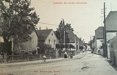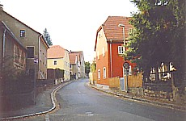Die im alten Ortskern von Unterlockwitz befindliche Straße wurde ursprünglich Schloßstraße genannt, da sie unmittelbar am [Lockwitzer Schloss](../../../sudost/lockwitz/schloss_lockwitz/) vorbeiführt. Nach der Eingemeindung erhielt sie 1930 den Namen Altlockwitz. Der Abschnitt zwischen Dohnaer Straße und der Flurgrenze zu Niedersedlitz wurde 1950 in Lockwitztalstraße umbenannt. Von den Gebäuden entlang der Straße stehen zahlreiche Häuser unter Denkmalschutz. Die meisten entstanden nach dem Dorfbrand von 1717, der auch Anlass für die Gründung der ersten Freiwilligen Feuerwehr des Ortes war. Im 19. Jahrhundert entwickelte sich die Straße zu einem kleinen Ortszentrum mit mehreren Läden. Hier befand sich auch das alte Lockwitzer Gemeindeamt (Nr. 33). Von 1906 bis 1977 verkehrte die schmalspurige
[Lockwitztalbahn](../../../sudost/lockwitz/lockwitztalbahn/) über die enge Straße.

Musikverlag Johannes Förster: Der Verlag wurde Anfang des 20. Jahrhunderts vom Lockwitzer Musiklehrer Theodor Johannes Förster gegründet und hatte seinen Sitz im Mietshaus Altlockwitz 71 G (heute Lockwitztalstraße 55) unmittelbar neben dem Unteren Gasthof. Zugleich betrieb Förster hier eine Musikalienhandlung. Zur Popularität seines Unternehmens trugen zahlreiche Postkarten mit patriotisch-volkstümlichen Liedern bei, die er in der Niedersedlitzer Kunstanstalt [Krey & Sommerlad](../../../ost/niedersedlitz/strassen_niedersedlitz/) herstellen ließ. Zu den seinerzeit populären Künstlern, die bei Förster verlegten, gehörte u.a. Hans Bastyr (1873-1928), dessen Lied "Das Bergmannskind" noch heute zum Repertoire bergmännischer Chöre gehört _(Postkarte um 1910)_.

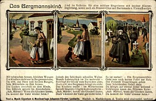

Um ca. 1912 verlegte Förster Laden und Verlag nach Pirna in das Eckhaus Dohnaische Straße/Schössergasse. 1916 musste das Unternehmen Insolvenz anmelden, die Verlagsrechte gingen an den Leipziger Musikverlag Gebrüder Reinecke über.

## Am Burgwall

Die oberhalb des Lockwitzgrundes gelegene Straße Am Burgwall erinnert an die im 10./11. Jahrhundert entstandene Wehranlage von Lockwitz. Diese wird auch als Sorbenwarte bezeichnet und diente der slawischen Bevölkerung als zum Schutz in Kriegszeiten. Sie bestand aus einem ca. 70 Meter langen Ringwall, von dem heute nur noch wenige Reste erhalten sind. Funde aus den 1920er Jahren belegen eine Nutzung der Anlage zwischen dem 10. und 12. Jahrhundert. Im Mittelalter gehörte das Areal dem Maternihospital und wurde zeitweise als Weinberg genutzt. Große Teile der Anlage fielen der späteren landwirtschaftlichen Nutzung bzw. einem Granitsteinbruch zum Opfer. Nach dem Ersten Weltkrieg wurden am Burgwall Einfamilienhäuser errichtet.

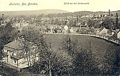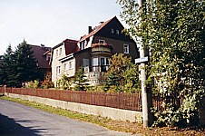

**_Fotos:_** _Blick von der Sorbenwarte zum Ortskern um 1920 (rechts) - Villensiedlung am Burgwall (2003)_

## Am Galgenberg

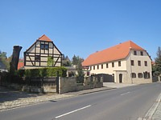Die Siedlung Am Galgenberg wurde früher im Gegensatz zum Niederdorf am Plan als Oberlockwitz bezeichnet. Der Ort entwickelte sich aus zwei Dorfkernen, die erst Ausgang des Mittelalters zusammenwuchsen. Der Straßenname erinnert an den einst hier stehenden Galgen. Die Lockwitzer Rittergutsherrschaft besaß als eine der wenigen im ländlichen Raum auch die Obere Gerichtsbarkeit, was zur Verhandlung von schweren Straftaten und zur Verhängung von Todesurteilen berechtigte. Zu den hier hingerichteten Personen gehörte 1807 der Brandstifter von Reick, dessen Tat einen Großteil dieses Dorfes vernichtet hatte.

Ursprünglich gab es am Galgenberg nur wenige Gebäude, darunter ein seit 1623 dem amtierenden Ortspfarrer gehörendes Gehöft. Noch vor dem Ersten Weltkrieg entstanden Am Galgenberg und seinen neu angegten Nebenstraßen neue Ein- und Mehrfamilienhäuser. 1930 folgte eine größere Wohnsiedlung. Das Wohnhaus Am Galgenberg 86 steht unter Denkmalschutz, ebenso wie die beiden Bauernhöfe Am Galgenberg Nr. 90 _(Foto rechts)_ und 97.

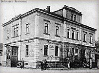Gewürzmühle (Nr. 99): Trotz seines Namens beherbergte dieses Gebäude nie eine echte Mühle, sondern wurde 1894 als Wohn- und Geschäftshaus errichtet. Ursprünglich befand sich hier "Bellmanns Restaurant" mit Wander- und Radfahrstation. Inhaber war um 1900 Reinhard Kultsch. Nach einem Besitzerwechsel wechselte der Name in "Emmrichs Familiengaststätte". Um 1930 firmierte das Lokal unter dem Namen "Uhligs Tee- und Kräutermühle". 1990 erwarb die Familie Keller das stark verfallene Haus und ließ es zu einem Hotel mit öffentlicher Gaststätte umbauen. In Anlehnung an die einstige "Tee- und Kräutermühle" wird es heute unter dem Namen "Zur Gewürzmühle" betrieben.

## Am Gückelsberg

Die Straße Am Gückelsberg verläuft unterhalb des Lockwitzer Friedhofes vom Lockwitzgrund bis zur Röhrsdorfer Straße. Benannt wurde sie nach dem nahegelegenen Gückelsberg. Die Wohnhäuser Nr. 1 und Nr. 4 stehen unter Denkmalschutz.

## Am Hofegarten

Der Name der Straße Am Hofegarten erinnert an einen früher hier gelegenen Obstgarten, der zum Besitz des Rittergutes Oberlockwitz gehörte. Hier befand sich viele Jahre auch ein gleichnamiges Hotel. 2016 wurde das Gebäude zur ersten notariell beglaubigten Nichtraucher-Wohnanlage Deutschlands umgebaut.

## [Am Plan](../../../sudost/lockwitz/strassen_lockwitz/am_plan/)

## Am Trutzsch

Die kleine Straße Am Trutzsch entstand im Zusammenhang mit der Bebauung der Flächen am Galgenberg und wurde nach
der nahegelegenen 200 Meter hohen Erhebung Trutzsch benannt. Vom Gipfel des Berges, der bereits auf Nickerner Flur
liegt, bietet sich eine schöne Aussicht über das Elbtal. Vor der deutschen Besiedlung der Region soll sich hier eine slawische
Wehranlage befunden haben. Im Mittelalter stand an der Lockwitzer Seite des Hügels der Galgen des Rittergutes, welches
die höhere Gerichtsbarkeit zur Verhängung der Todesstrafe bei schweren Verbrechen besaß. Im Volksmund wurde dieser Teil deshalb Galgenberg genannt.

## Am Viertelacker

Die Straße Am Viertelacker führt vom sogenannten Krähenhügel in nordöstliche Richtung bis zur Köttewitzer Straße. Hier standen einst die letzten Häuser des Dorfes. Gegenüber lag ein Acker mit einer Fläche von einer Viertel Hufe (entspricht ca. 4,2 Hektar), nach dem die Straße später ihren Namen erhielt. Neben einigen Wohnhäusern gibt es hier heute mehrere Gewerbebetriebe, u.a. die Lockwitzer Frischfrucht GmbH. Oberhalb der Straße befindet sich das unter Denkmalschutz stehende [Mausoleum<](../../../sudost/lockwitz/schloss_lockwitz/) der früheren Schlossbesitzerfamilie Kap-herr.

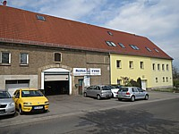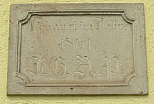

**_Fotos:_** _ehemaliger Hof Am Viertelacker 21 mit Schrifttafel von 1861_

## Am Wehr

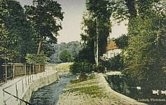Die kleine Straße Am Wehr in der Nähe des Lockwitzer Dorfkerns erhielt ihren Namen 1930 nach dem hier befindlichen Wehr, welches einst den [Lockwitzbach](../../../sudost/lockwitz/lockwitzbach/) aufstaute, um dessen Wasserkraft für den Betrieb der unterhalb gelegenen Mühlen zu nutzen. Zuvor wurde sie Jacobsplatz genannt. 2002 wurde die historische Wehranlage beim Hochwasser zerstört, inzwischen jedoch wieder hergestellt. Unmittelbar an der nahegelegenen Brücke steht seit 1913 der [„Lockwitzer Frosch“](../../../sudost/lockwitz/strassen_lockwitz/am_plan/), Wahrzeichen des Ortes.

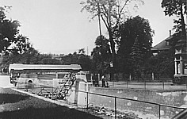Lockwitzer Wehr: Das Wehr am Mühlgraben des Lockwitzbaches wurde 1926/27 zur Versorgung der unterhalb gelegenen [Hänichenmühle](../../../sudost/lockwitz/strassen_lockwitz/hanichenmuhle/), der Niedermühle und der Dankelmannmühle angelegt. Gleichzeitig sollte es dem Hochwasserschutz dienen, da der Lockwitzbach immer wieder zu großen Überschwemmungen im Ort geführt hatte. Anlass des Baus waren die Hochwasserereignisse im September 1924 und im Mai 1925, die zur Entscheidung für den Bau führten.

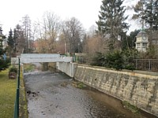Für die Errichtung des neuen Wehrs musste zunächst das alte Stauwehr und der „Pferdetumb“, eine grasbewachsene Insel im Flussbett, beseitigt werden. Nach einem Patent der Züricher Stauwerke errichtete die Firma Eisenbau Wyhlen AG aus Baden ein modernes Schwingwehr mit regelbarem Segmentschütz, der eine Regulierung von Staumenge und Durchfluss ermöglicht. Das Wehr hat eine lichte Weite von 8,50 Meter und eine maximale Stauhöhe von 1,50 Meter _(Foto um 1928)_. Seine erste große Bewährungsprobe erhielt es beim Hochwasser 1942. Da es einziges seiner Art auf dem Gebiet der DDR war, wurde es 1981 als technisches Denkmal unter Schutz gestellt. Beim bislang schwersten Hochwasser in August 2002 wurden Wehr und Stützmauern schwer beschädigt, später jedoch repariert.

Kindergarten: Im Haus Nr. 21 befindet sich seit 1895 der Lockwitzer Kindergarten, welcher zwei Jahre zuvor auf Anregung der Ehefrau des [Schokoladenfabrikanten Rüger](../../../sudost/lockwitz/strassen_lockwitz/schokoladenfabrik_ruger/), Amalie Rüger, gegründet worden war. Träger der Einrichtung war die "Amalie-Rüger-Gedächtnis-Stiftung". Die Kinderbewahranstalt Lockwitz sollte auch Müttern mit kleinen Kindern die Arbeit in der Fabrik ermöglichen und besteht bis heute. Seit 2009 wird die Kita vom Verbund Sozialpädagogischer Projekte betrieben.

## An der Malte

Die Straße An der Malte geht auf einen früheren Feldweg zurück, der von der Dohnaer Straße nach Borthen und zur Lehmgrube nach Luga führte. Beim Bau der Autobahn A 17 wurde dieser Hohlweg als Autobahnzubringer ausgebaut. Der Name Malte geht auf die altdeutsche Bezeichnung für „hoch“ zurück und weist auf die Lage des auf der Höhe verlaufenden Weges hin. Bis zum Beginn des 19. Jahrhunderts gab es hier die Ziegelei Malte, deren Areal sich bis zur Dohnaer Straße erstreckte.

## An der Niedermühle

Die Straße An der Niedermühle verbindet Lockwitz mit dem benachbarten Niedersedlitz und führt dabei zum Großteil unmittelbar am [Lockwitzbach](../../../sudost/lockwitz/lockwitzbach/) entlang. Ursprünglich wurde diese Straße Sedlitzer Weg genannt.

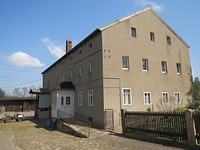Niedermühle: Die namensgebende Niedermühle steht unmittelbar an der Flurgrenze zu Niedersedlitz (An der Niedermühle 6) und wurde 1695 nach Plänen des Müllers Martin Meißner errichtet. Erbherr der jüngsten von einst fünf Lockwitzer Mühlen war der Rittergutsbesitzer Gotthelf Friedrich von Schönberg. Sie besaß ursprünglich zwei oberschlächtige Wasserräder, einen Mahl- und einen Schneidegang. Zugeleitet wurde das Wasser des Lockwitzbachs über einen Mühlgraben, der an der Tögelstraße in der Nähe des Lockwitzer Wehrs beginnt und zunächst unterirdisch unter dem Lockwitzer Plan entlang führt, bevor er gegenüber der Kirche wieder das Tageslicht erreicht. 1819 ist die Mühle als "rothe Mühle", nach 1850 nach einem Besitzerwechsel als "Voigts Mühle" in Plänen verzeichnet. Mit wachsender Konkurrenz moderner Großmühlen endete der Mahlbetrieb 1898.

Nach langjährigem Stillstand erwarb 1927 der Fabrikant Theodor Hugo Gottschalk die Niedermühle und baute diese zur Hornmehlmühle um. Der Mahl- und Schneidegang wurde dabei durch ein Hammerwerk ersetzt. 1955 erhielt sie einen Elektroantrieb, so dass zehn Jahre später das Wasserrad demontiert werden konnte. 1991 wurde der Betrieb endgültig eingestellt.

## An der Obermühle

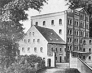 Der Name An der Obermühle erinnert an die einst größte Wassermühle im Ort. Die wahrscheinlich älteste Mühle in Lockwitz wurde 1612 erstmals urkundlich erwähnt und nach ihrem Besitzer im 19. Jahrhundert auch Adams Mühle genannt. Nach mehreren Umbauten besaß sie drei Mahlgänge und eine Hirsestampfe. 1630 befand sie sich im Besitz der Familie von Kannewurff, die sie 1665 an Erhard Birkner aus Dresden verkaufte. Um 1860 erfolgte ein kompletter größerer Neubau. 1903 erwarb Paul Blischke die Obermühle und baute sie zur Dampfmühle mit sechs Mahlgängen um. Zuvor wurde sie mit Wasserkraft betrieben, wobei ein angestauter Vorfluter der Regulierung des Wasserstandes diente. Dieser nun nicht mehr benötigte Teich wurde 1916 zum Freibad umgewandelt. 1927 zerstörte ein Großbrand Teile der Anlage, die jedoch bereits wenige Monate später wieder repariert waren.

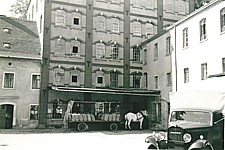1946 stellte die Obermühle ihren Betrieb komplett ein. Die Räume wurden nun als Lager des VEB Polstermöbel Rabenau genutzt. Im Erdgeschoss gab es eine Ankaufstelle für Obst und Gemüse. Außerdem nutzten die Sportler der BSV Lockwitzgrund einige Räume als Umkleidemöglichkeit. 1995 erfolgte der Abriss der Mühlengebäude. Ein Seitenflügel dient seit seinem Umbau als Wohnhaus. Das Restgrundstück wurde mit Eigenheimen bebaut. Auch die einstige Fabrikantenvilla Paul Blischkes, zu DDR-Zeiten als Clubhaus der Kelterei Lockwitzgrund genutzt, ist noch erhalten. Von den Wohnhäusern der Straße steht das Haus An der Obermühle 1 unter Denkmalschutz.

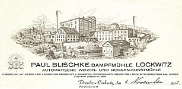

**_Bild:_** _Briefkopf der Dampfmühle Paul Blischke (1932)_

## An der Schlossgärtnerei

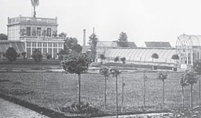
Die kleine Nebenstraße An der Schlossgärtnerei in der Nähe des [Lockwitzer Schlosses](../../../sudost/lockwitz/schloss_lockwitz/) verdankt ihren Namen der hier gelegenen früheren Schlossgärtnerei. Diese entstand Anfang des 18. Jahrhunderts auf Initiative des Rittergutsbesitzers
Gotthelf Friedrich von Schönberg (1681–1746). Nachdem Erwerb der Herrschaft Lockwitz durch die Familie Kap-herr 1866 wurde sie um eine große Orangerie erweitert und mit einer Mauer umgeben.

**_Foto:_** _Schlossgärtnerei und Orangerie um 1906_

## Auf dem Pläner

Die Straße Auf dem Pläner entstand um 1930, als im westlichen Teil von Lockwitz an der Nickerner Straße mehrere Eigenheime errichtet wurden. 1931 ist sie erstmals im Adressbuch genannt. Der Name nimmt Bezug auf die im Dresdner Raum häufig vorkommende Gesteinsart Pläner (abgeleitet vom Ortsnamen Plauen).

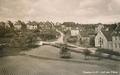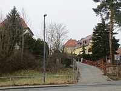

**_Fotos:_** _Blick auf das Wohnviertel Auf dem Pläner um 1950 und 2018_

## Auf der Scholle

Die Straße Auf der Scholle wurde Anfang der 1930er Jahre beim Bau einer Eigenheimsiedlung an der Nickerner Straße
angelegt. 1931 ist sie erstmals im Adressbuch verzeichnet.

## Christian-Sültze-Straße

Die kurz vor Beginn des Ersten Weltkriegs angelegte Christian-Sültze-Straße erhielt ihren Namen nach dem früheren Lockwitzer Gemeindevorstand und Ortsrichter Christian Sültze, der 1666 in Nickern geboren wurde und auch als Ortschronist des Dorfes tätig war. 1713 leitete er den Umbau der ersten Lockwitzer Schule.

## [Dohnaer Straße](../../../sudost/strehlen/strassen_strehlen/dohnaer_strasse/)

## Gebergrundweg

Der Gebergrundweg wurde Anfang der 1990er Jahre im Zusammenhang mit der Bebauung des früheren Kasernengeländes
der Alten Kaserne angelegt. Der Name erinnert an den Gebergrund, ein vom Geberbach durchflossenes Tal zwischen Goppeln, Kauscha und Nickern.

## Gerberstraße

Die Gerberstraße wurde nach dem Lockwitzer Pfarrer Christian Gottlob Gerber (1686-1764) benannt. Gerber war ab 1731 Pfarrer der Lockwitzer Schlosskirche und befasste sich als Verfasser der Ortschronik "Altes und Neues von Lockwitz und Nickern" auch mit der Geschichte seines Heimatdorfes. In den Zwanziger Jahren entstanden an der Gerberstraße die ersten Einfamilienhäuser.

## Gommernsche Straße

Die Gommernsche Straße befindet sich im nördlich der Dohnaer Straße gelegenen Unterlockwitz und erhielt ihren Namen nach dem kleinen Ort Gommern, heute ein Ortsteil von Heidenau. Gommern liegt unmittelbar an der Dresdner Stadtgrenze und grenzt mit seinen Fluren an die Dresdner Stadtteile Sporbitz, Kleinluga und Großluga.

## Gorknitzer Straße

Die Gorknitzer Straße entstand im Zusammenhang mit dem Siedlungsbau am Lockwitzer Galgenberg. Benannt wurde sie nach dem Dorf Gorknitz oberhalb des Lockwitztales, welches später als Ortsteil zu Röhrsdorf kam und heute zu Dohna gehört.

## Grohmannstraße

Die Grohmannstraße in Oberlockwitz erhielt ihren Namen nach dem Lockwitzer Schneidermeister, Ortschronisten und Heimatkundler Johann Samuel Grohmann (1759-1835). Sie entstand Anfang des 20. Jahrhunderts im Zusammenhang mit der Bebauung der Flächen am Galgenberg.

## Hänichenweg

Der Hänichenweg, südlich des alten Ortskern von Lockwitz gelegen, erinnert an die frühere [Hänichenmühle](../../../sudost/lockwitz/strassen_lockwitz/hanichenmuhle/). Diese war eine von zahlreichen Mühlen am Lockwitzbach und befand sich ab 1838 im Besitz der Familie Hänichen. Bereits vier Jahre zuvor hatte Traugott Heinrich Hänichen die Lockwitzer Mittelmühle gepachtet und dort eine Kornbrennerei eingerichtet. Bekanntestes Familienmitglied war Felix Oskar Hänichen (1865-1946), welcher zeitweise als Abgeordneter der Deutschen Reformpartei dem Reichstag angehörte. Das auch als Kornbrennerei und Likörfabrik, Lager und Bürohaus genutzte Areal der früheren Wassermühle dient seit seiner Sanierung 2001 als Wohnanlage und steht unter Denkmalschutz.

## Hermann-Conradi-Straße

Die Hermann-Conradi-Straße wurde nach dem Schriftsteller und Redakteur Hermann Conradi (1862-1890) benannt. Conradi gilt als Vertreter des frühen Naturalismus in der Literatur. Der in ständigen finanziellen Nöten und gesundheitlichen Problemen leidende Autor weilte im Herbst 1888 auf Einladung der Mutter seines Freundes Felix Oskar Hänichen (1865-1946) für zwei Monate zur Erholung in Lockwitz. Die Wohnhäuser an dieser Straße entstanden in den Jahren nach dem Ersten Weltkrieg.

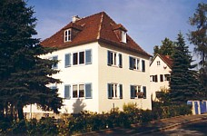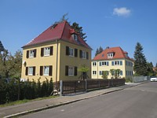

**_Fotos:_** _Wohnhäuser an der Hermann-Conradi-Straße_

## Hohles Tor

Die Straße Hohles Tor wurde im Zuge der Bebauung am Galgenberg Anfang des 20. Jahrhunderts angelegt und verläuft unterhalb des Trutzsch. Der Hohlweg war einst Zugang zu einer frühgeschichtlichen Slawenburg oberhalb des Lockwitztales. Später wurde dieser Burgberg auch Sorbenwarte oder Donath's Berg (nach den Besitzern der Kelterei Donath) genannt. Von der ehemaligen Burg sind heute keine Überreste mehr zu finden.

## Kap-Herr-Weg

Der Kap-herr-Weg, unmittelbar hinter dem Schloss gelegen, erinnert an eine einst im Ort ansässige Adelsfamilie. Hermann
Christian Kap-herr besaß ab 1867 die Gutsherrschaft Lockwitz und kaufte wenig später die Rittergüter in Bärenklause und im
benachbarten Prohlis. Seine Nachkommen erwarben sich Verdienste um das soziale und kulturelle Leben im Ort und wohnten
noch bis nach 1945 im Schloss. Mit dem Tod Victor Kap-herrs 1948 endete die Geschichte der Familie im Dresdner Raum. Erhalten blieb neben dem Schloss Lockwitz das Familienmausoleum am Krähenhügel unweit des Kap-herr-Weges.

## Lockwitzgrund

Der Lockwitzgrund verbindet Lockwitz mit Kreischa und war einst Standort mehrerer Mühlen. Später entwickelten sich diese meist zu Industriebetrieben. So wurde bereits 1838 in der früheren Hänichenmühle eine Spiritusfabrik gegründet. Die Niedermühle, später als Strohbleiche genutzt, wurde Mitte des 19. Jahrhunderts zur Chemischen Fabrik. 1928 gründeten die Besitzer hier eine Hornmehlfabrik.

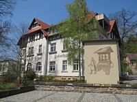Wechselhaft war auch die Nutzung der einstigen Schmidtmühle. 1621 hatte der Lockwitzer Rittergutsbesitzer Johann Georg von Osterhausen die alte Hintermühle des Rittergutes abreißen und an neuem Standort wiederaufbauen lassen. Beim Bau des Mühlgrabens wurde von Freiberger Bergleuten hinter der Mühle ein Stollen in der Hoffnung angelegt, hier auf eine Silberader zu stoßen. Wenig später stellte man das Vorhaben wegen Erfolglosigkeit ein. Nach einem Brand wurde die Schmidtmühle 1868 in eine Papiermühle umgewandelt und nach deren Konkurs 1877 als Teigwaren- sowie als Polstermöbelfabrik genutzt. Auch die alte Dampfmühle (Lockwitzgrund 10) diente zeitweise als Möbelfabrik. In der Hintermühle gründete 1895 Otto Rüger seine bekannte [Schokoladenfabrik](../../../sudost/lockwitz/strassen_lockwitz/schokoladenfabrik_ruger/). Zweites überregional bekanntes Lockwitzer Unternehmen war die 1893 entstandene [Kelterei Donath](../../../sudost/lockwitz/strassen_lockwitz/kelterei_lockwitzgrund/) _(Foto)_.

1906 wurde zwischen Lockwitz, Niedersedlitz und Kreischa eine elektrische [Überlandstraßenbahn](../../../sudost/lockwitz/lockwitztalbahn/) in Betrieb genommen, die bis zu ihrer Einstellung 1977 durch das Lockwitztal verkehrte. Einige Wohnhäuser entstanden in den Jahren zwischen dem Ersten und Zweiten Weltkrieg. Zu den größten Bauvorhaben der jüngsten Zeit gehört die neue Autobahnbrücke über das Lockwitztal, die 2005 fertiggestellt werden konnte.

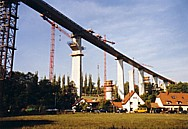

**_Foto:_** _Die Lockwitztalbrücke der Autobahn Dresden-Prag im Bau (Sommer 2003)_

## Preußerstraße

Die Preußerstraße im Dorfkern von Niederlockwitz erinnert an den früheren Rittergutsbesitzer Johann Gottlob Preußer, der sich als sächsischer Landtagsabgeordneter bereits 1810 für die Abschaffung der Lasten der Landbevölkerung einsetzte. Preußer erließ auf freiwilliger Basis seinen Bauern die bestehenden Fronen und Abgaben und trug so wesentlich zur wirtschaftlichen Entwicklung des Ortes bei.

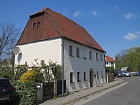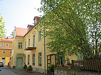

**_Fotos:_** _Wohnhaus Preußerstraße 5 (links) und ehemalige Lockwitzer Mühle (Nr. 8/10)_

## Röhrsdorfer Straße

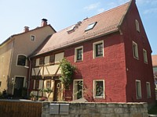Die Röhrsdorfer Straße verbindet Lockwitz mit dem benachbarten Ort Röhrsdorf, heute Ortsteil von Dohna. Früher wurde sie Röhrsdorfer Gasse, im Volksmund auch Röhrsdorfer Leichenweg genannt, da einige Häuser von Lockwitz zur Röhrsdorfer Kirche gehörten und deren Bewohner auch den dortigen Friedhof nutzten. Bis heute haben sich hier einige kleinere Bauern- und Tagelöhnerhäuser erhalten.

_Foto links: Röhrsdorfer Straße 8._

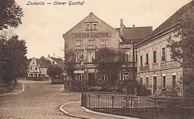Oberer Gasthof: An der Röhrsdorfer Straße befand sich einst der schon 1537 erstmals erwähnte Gasthof. Zur besseren Unterscheidung zum Unteren Gasthof an der Dohnaer Straße wurde dieser später als Oberer Gasthof Lockwitz bezeichnet. Das Lokal schloss nach 1945 seine Pforten und wurde später abgerissen. In der Nachkriegszeit gab es Pläne, hier ein Kino einzurichten, was jedoch nicht realisiert wurde. Die historische Postkarte zeigt den Oberen Gasthof in der Zeit um 1930, rechts im Bild die frühere Bäckerei Gehre.

## Theilestraße

Die Theilestraße verdankt ihren Namen dem Arzt Friedrich Theile, der 1849 am Dresdner Maiaufstand teilgenommen hatte. Theile ließ sich später in Lockwitz nieder und befasste sich hier mit politisch-historischen Themen. 1878 gründete er die heimatkundliche Zeitung “Lockwitzer Nachrichten aus alter und neuer Zeit” und befasste sich mit der Geschichte des Ortes und seiner Umgebung. Zeitweise war Theile auch Mitglied des Gemeindevorstandes.

## Tögelstraße

Die Tögelstraße im Lockwitzer Dorfkern erinnert an den früheren Lehrer und Kantor Christoph Gottlob Tögel (1791-1845) und dessen Sohn Julius Hermann Tögel (1822-1893). Beide waren auch als Ortschronisten der Gemeinde aktiv und verfassten verschiedene Schriften zu diesem Thema. 1868 entstand an der Tögelstraße die neue [Schule](../../../sudost/lockwitz/) des Dorfes. Das Gebiet zwischen Tögelstraße und Lockwitzbach war bereits vor Entstehung von Lockwitz Standort einer altslawischen Siedlung, von der mehrere Funde gemacht wurden. In den Räumen der heutigen Neuapostolischen Kirche (Nr. 6) befand sich einst das Lockwitzer Postamt, weshalb die Tögelstraße bis zur Eingemeindung Poststraße genannt wurde.

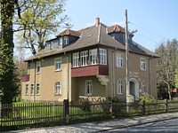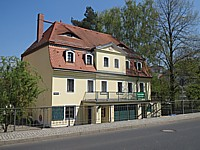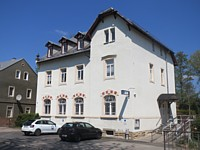

**_Fotos:_** _Impressionen der Tögelstraße - links das Pfarramt (Nr. 1),_

_in der Mitte Haus Nr. 2, rechts die ehemalige Post (Neuapostolische Kirche - Nr. 6)_

## Urnenstraße

Die Urnenstraße entstand mit der Erschließung des neuen Wohngebietes Am Galgenberg und erhielt ihren Namen 1906. Vermutlich wurde die Bezeichnung nach hier gemachten archäologischen Funden aus der slawischen Zeit gewählt. 1906 entstand an der Urnenstraße das heute von der 79. Grundschule genutzte [Lockwitzer Schulhaus](../../../sudost/lockwitz/).

[Lockwitz auf OpenStreetMap](https://www.openstreetmap.org/search?query=Dresden+Lockwitz)

* * *

 \[ [Home](../../../index.html)\] \[ [Nord](../../../nord/)\] \[ [Nordwest](../../../nordwest/)\] \[ [Neustadt](../../../neustadt/)\] \[ [Nordost](../../../nordost/)\] \[ [West](../../../west/)\] \[ [Zentrum](../../../zentrum/)\] \[ [Südwest](../../../sudwest/)\] \[ [Süd](../../../sud/)\] \[ [Südost](../../../sudost/)\] \[ [Ost](../../../ost/)\] \[ [Register](../../../Register/register.html)\] \[ [Kontakt](../../../Kontakt/kontakt.html)\] \[ [Impressum](../../../impressum/)\]
