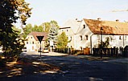
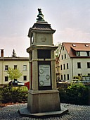

* * *

Der Platz Am Plan _(Foto)_ war einst eine unbebaute Fläche am Rande des Dorfkerns von Niederlockwitz. Hier befand sich eine Furt zur Durchquerung des [Lockwitzbaches](../../../../sudost/lockwitz/lockwitzbach/)
. Zu deren Sicherung erfolgte während des Dreißigjährigen Krieges 1638 der Bau einer Schanze. Als diese nicht mehr benötigt wurde, ließen die Rittergutsbesitzer die Befestigungen abtragen und an ihrer Stelle
zwischen 1668 und 1695 die ersten Häuser errichten. Die Furt wurde 1696 durch eine mittlerweile mehrfach erneuerte Brücke ersetzt. Im Zuge dieser Arbeiten erhielt der Plan sein heutiges Aussehen und bildet den Kern des
Niederdorfes. Hier befand sich ab 1623 auch die erste Dorfschule des Ortes.

Im 19. Jahrhundert entwickelte sich der Plan zum eigentlichen Lockwitzer Ortszentrum. Im Haus Nr. 1 war bis zur
Eingemeindung das Gemeindeamt des Ortes untergebracht (heute Sparkassen-Filiale). Ab 1906 befand sich davor die
Haltestelle der Lockwitztalbahn. Diese dient heute als Umsteigepunkt zwischen mehreren Buslinien. Einige Gebäude,
so das Wohnhaus Am Plan Nr. 5 und der Dreiseitenhof Am Plan 6 stehen unter Denkmalschutz. Letzterer war bis 1990 Sitz der PGH "Ausbau Lockwitzgrund" und wurde später zur Wohnanlage ausgebaut.

**_Foto:_** _Der Lockwitzer Plan um 1910_

Wilhelms Gaststätte:Die zu den einst zahlreichen Lokalitäten des Ortes gehörende kleine Schänke befand sich bis 1973 im Familienbesitz und wurde
deshalb Wilhelms Gaststätte genannt. Nachdem die letzten Besitzer das Lokal aus Altersgründen aufgaben, nutzten die Mitglieder der Freiwilligen Feuerwehr die Räume bis 2001 als Vereinshaus. 2007 begann der Umbau
des Gebäudes zum Hotel Garni „Am Schloss“. Das am 21. Juni 2009 eröffnete Haus besitzt 23 Betten sowie einen Veranstaltungssaal.

Lockwitzer Wetterfrosch:
Das kleine Wetterhäuschen wurde 1913 unmittelbar an der Brücke aufgestellt und ist seitdem originelles Wahrzeichen von Lockwitz. Das Bauwerk
wurde nach einem Entwurf von Jean Pape gestaltet und erhielt als Bekrönung einen Frosch. An den Seiten symbolisieren Tiere wie Hahn, Bienenkorb, Fledermaus und Eule den
Tagesablauf. Außerdem informiert eine Wanderkarte über Ausflugsziele der Umgebung. Im Inneren des kleinen Bauwerks befinden sich verschiedene meteorologische Instrumente und eine Uhr.

Während des Zweiten Weltkriegs gingen einige Instrumente verloren, konnten jedoch später wieder ergänzt werden. 1965/67 erfolgte eine Erneuerung des Häuschens. Leider fiel dieses
Gebäude im August 2002 dem Hochwasser zum Opfer, wobei lediglich die Froschplastik und drei Reliefplatten gerettet werden konnten. 2004 wurde es unter Verwendung der geborgenen Originalteile wieder hergestellt.

* * *

 \[ [Home](../../../../index.html)\] \[ [Nord](../../../../nord/)\] \[ [Nordwest](../../../../nordwest/)\] \[ [Neustadt](../../../../neustadt/)\] \[ [Nordost](../../../../nordost/)\] \[ [West](../../../../west/)\] \[ [Zentrum](../../../../zentrum/)\] \[ [Südwest](../../../../sudwest/)\] \[ [Süd](../../../../sud/)\] \[ [Südost](../../../../sudost/)\] \[ [Ost](../../../../ost/)\] \[ [Register](../../../../Register/register.html)\] \[ [Kontakt](../../../../Kontakt/kontakt.html)\] \[ [Impressum](../../../../impressum/)\]
