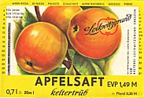
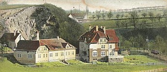
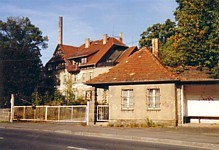

* * *

* * *

* * *

* * *

* * *

* * *

Die Kelterei Lockwitzgrund wurde 1893 von Emil Donath (1868-1945) in Laubegast gegründet. Donath war Sohn des aus dem Erzgebirge stammenden Drechslers Christian Herrmann Donath und einer Posamentennäherin. Später besaßen seine Eltern den bekannten Tanzgasthof [“Donaths Neue Welt”](../../../../ost/tolkewitz/strassen_tolkewitz/alttolkewitz/donaths_neue_welt/) in Tolkewitz. Sein Onkel Rinaldo betrieb auf der Waisenhausstraße eine Konservenhandlung. Hier befasste sich Emil Donath mit der Herstellung haltbarer Fruchtsäfte. Im Ergebnis gelang ihm die erstmalige industrielle Anwendung des Kelterverfahrens, so dass Donaths Kelterei erste Fabrik zur Herstellung alkoholfreier Getränke in Deutschland war. Zunächst ließ er sich in der Nähe des elterlichen Gasthofs in Laubegast nieder. Für seinen keltertrüben Apfelsaft erhielt er 1896 eine Goldmedaille der Internationalen Gartenbauausstellung. 1906 wurde das Unternehmen aud das Areal eines stillgelegten Steinbruchs nach Lockwitz verlegt.

Im ausgedehnten Gebäudekomplex im Lockwitzgrund entstanden nun moderne Anlagen zur Früchteverarbeitung und Abfüllung des Süßmostes. Hergestellt wurden aber auch Fruchtsaftgetränke, Schaumwein und sogar pharmazeutische Erzeugnisse. Der Transport der Ware erfolgte per Straßenbahn nach Niedersedlitz, von wo die Säfte in alle Welt exportiert wurden. Zum Betrieb gehörte auch eine Schankwirtschaft, die sich schnell großer Beliebtheit erfreute. Das unter dem Namen “Donaths Obstkelterei” firmierende Unternehmen ging 1935 in den Besitz seiner Söhne Fritz und Erhard über. 1945 wurde die Familie enteignet und der Betrieb in Volkseigentum überführt. Fritz Donath verließ daraufhin Lockwitz und ging nach Erding bei München, wo das Unternehmen unter seinem alten Namen weitergeführt wurde. Die Lockwitzer Kelterei blieb als VEB “Lockwitzgrund” jedoch auch weiterhin in Betrieb und war mit insgesamt sieben Zweigwerken bedeutendster Fruchtsaftproduzent in der DDR. Neben dem traditionellen Most wurden auch Fruchtsirup, Obstsaftkonzentrat und ähnliche Erzeugnisse produziert. Zu Spitzenzeiten zählte der Betrieb ca. 500 Angestellte. 1964 erwarb die Firma das Grundstück der benachbarten Gärtnerei Ebert und ließ hier eine weitere Lagerhalle, Kesselhaus und eine moderne Abfüllanlage errichten. Der Betrieb besaß zudem eine eigene Sanitätsstelle und einen Betriebskindergarten sowie ein Ferienheim in Schellerhau. Die ehemalige Villa der Familie diente ab 1952 als Klubhaus für Tagungen und Familienfeiern.

Nach 1990 erhielten die Erben das Familienunternehmen zurück. Aus Platzgründen musste die Lockwitzer Produktionsstätte jedoch 1994 geschlossen werden. Das Unternehmen vereinigte sich daraufhin mit einigen anderen sächsischen Fruchtsaftherstellern und verlegte seinen Firmensitz nach Ablaß bei Oschatz. Die Markenrechte gehören heute einem Betrieb in Sohland/Spree. In den Kellerräumen der einstigen Kelterei entstand 2003 der House- und Disco-Club “Grotte”, heute “Unterirdische Welten” genannt. Die Räumlichkeiten können jedoch auch für private Veranstaltungen gemietet werden. Seit 2011 gibt es zudem einen Salzstollen _(Foto)_, in dem Patienten mit Husten- und Asthmaerkrankungen behandelt werden. Im Hauptgebäude ist seit einigen Jahren eine Augenlaserklinik untergebracht.

* * *

 \[ [Home](../../../../index.html)\] \[ [Nord](../../../../nord/)\] \[ [Nordwest](../../../../nordwest/)\] \[ [Neustadt](../../../../neustadt/)\] \[ [Nordost](../../../../nordost/)\] \[ [West](../../../../west/)\] \[ [Zentrum](../../../../zentrum/)\] \[ [Südwest](../../../../sudwest/)\] \[ [Süd](../../../../sud/)\] \[ [Südost](../../../../sudost/)\] \[ [Ost](../../../../ost/)\] \[ [Register](../../../../Register/register.html)\] \[ [Kontakt](../../../../Kontakt/kontakt.html)\] \[ [Impressum](../../../../impressum/)\]
