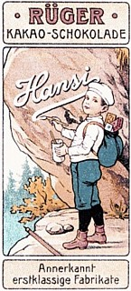
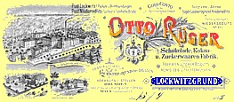

* * *

Die ehemalige Schokoladenfabrik Lobeck in Sobrigau wurde 1858 von Otto Rüger gepachtet. Die bereits seit 1691 in Dresden ansässige Familie war ursprünglich im Kolonialwarenhandel tätig und stieg erst mit
Otto Rüger in die Schokoladenherstellung ein. Bereits 1859 erwarb Rüger das Fabrikgelände und ließ es deutlich vergrößern. Zu Beginn des 20. Jahrhunderts gehörte die Firma zu den bekanntesten Dresdner
Schokoladenfabriken und stellte neben Schokolade auch Pralinen und andere Kakaoprodukte her. Bekannt wurden die Rüger-Werke durch ihr Firmenmaskottchen “Hansi”, welches auf allen Produkten abgebildet war _(Bild links)_. Für dieses soll Rügers Sohn Modell gestanden haben.

Um die Transportbedingungen für sein Unternehmen zu verbessern, ließ Rüger ab 1860 die Lockwitztalstraße ausbauen und setzte sich für den Bau einer
Eisenbahnstrecke zwischen Dresden und Kreischa ein. Der vielseitig engagierte Unternehmer wurde 1881 zum Vorsitzenden des Verbandes der deutscher Schokoladenfabrikanten gewählt. Rüger war nicht nur wirtschaftlich
erfolgreich, sondern setzte sich auch für soziale Belange ein. U.a. besaß das Unternehmen eine eigene Sozialkasse zur Altersversorgung der Mitarbeiter und eine firmeneigene Kinderbewahranstalt. 1885 entstand in der
früheren Lockwitzer Hintermühle eine Außenstelle. Weitere Filialen existierten in Bodenbach (heute Tschechien) und als Verkaufsniederlassungen in zahlreichen Ländern.

Nach dem Ersten Weltkrieg wurde das Familienunternehmen in eine Kommanditgesellschaft umgewandelt. Da die
örtlichen Möglichkeiten nicht mehr den modernen Produktionsanforderungen genügten, wurde die Sobrigauer Fabrik
1928, die Lockwitzer Fabrik 1938 geschlossen. Bis 1945 stellte das Unternehmen in Bodenbach seine Produkte her, bevor in Folge der Ergebnisse des Zweiten Weltkrieges die Firma Rüger nach Hamburg zog.
Das ehemalige Werksgelände im Lockwitztal diente nach Stilllegung weiterhin Wohn- und Gewerbezwecken. 1996/97 wurden die vorhandenen Fabrikgebäude zum Großteil saniert und in einen Wohnpark umgestaltet.

* * *

 \[ [Home](../../../../index.html)\] \[ [Nord](../../../../nord/)\] \[ [Nordwest](../../../../nordwest/)\] \[ [Neustadt](../../../../neustadt/)\] \[ [Nordost](../../../../nordost/)\] \[ [West](../../../../west/)\] \[ [Zentrum](../../../../zentrum/)\] \[ [Südwest](../../../../sudwest/)\] \[ [Süd](../../../../sud/)\] \[ [Südost](../../../../sudost/)\] \[ [Ost](../../../../ost/)\] \[ [Register](../../../../Register/register.html)\] \[ [Kontakt](../../../../Kontakt/kontakt.html)\] \[ [Impressum](../../../../impressum/)\]
