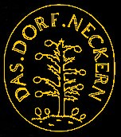
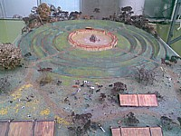
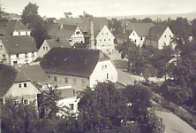
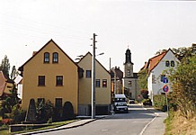
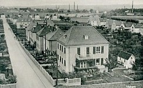
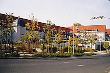
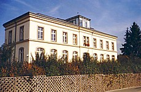

* * *

**Gemeindesiegel von Nickern**

* * *

**Nickerner Vereine:**

Bereits im 5. Jahrtausend vor Christi war das Gebiet um Nickern von stein- und bronzezeitlichen Stämmen besiedelt. Bemerkenswerte archäologische Funde brachten Grabungen an der Fritz-Meinhardt-Straße und der Langobardenstraße zu Tage, wo Ende des 19. Jahrhunderts Germanengräber mit wertvollen Grabbeigaben entdeckt wurden. An der heutigen Fritz-Meinhardt-Straße lag einst eine Dorfanlage der bandkeramischen Kultur, wobei die Forschungen hierzu noch nicht abgeschlossen sind. Bereits 1976 waren auf Nickerner Flur jungsteinzeitliche Siedlungsfunde gemacht worden. Gezielte Grabungen erfolgten im Zusammenhang mit dem Bau des Gewerbegebietes an der Dohnaer Straße 1993/94 und im Zuge des Autobahnbaus. Dabei entdeckten die Archäologen Überreste einer aus vier kreisförmigen Gräben mit einem Gesamtdurchmesser von 125 Metern bestehenden Anlage, deren einstige Bedeutung unklar ist. Das Foto (links) zeigt ein Modell diese Anlage.

Die slawische Siedlung Nickern wurde 1288 erstmals als Nicur erwähnt, wobei der Ortsname wohl vom Stammesältesten abgeleitet ist (Ort des Nicur). Der kleine Gutsweiler war Standort einer Wasserburg und eng mit dem benachbarten Rittergut Oberlockwitz verbunden, welches auch die Gerichtsbarkeit und Zins- und Dienstrechte für Nickern besaß. Ab 1349 gehörte dieses den Brüdern Heinrich und Hermann Karas, ab 1402 der Dresdner Bürgerfamilie Ziegler. 1511 erwarb Georg von Alnpeck (1462- 1523) die Herrschaft, der durch seine Tätigkeit als Freiberger Bürgermeister und Mitbegründer der Kupferhütte Grünthal zu erheblichem Wohlstand gekommen war. Die Bewirtschaftung der Rittergutsfelder übernahmen Häusler und Tagelöhner, welche sich am Geberbach angesiedelt hatten.

Nach mehrfachem Besitzwechsel wurden die Rittergüter Oberlockwitz und Nickern 1681 getrennt. Durch Umbau der einstigen Wasserburg entstand das [Nickerner Schloss](../../sudost/nickern/schloss_nickern/), welches 1622 von Johann Georg von Osterhausen erweitert und 1693 nochmals umgestaltet wurde. Das Dorf selbst bestand nur aus wenigen Bauerngütern und einigen Häusleranwesen. Teile der Anlage sind noch in [Altnickern](../../sudost/nickern/strassen_nickern/) _(Fotos vor und nach 1945)_ und an der Straße Am Geberbach erhalten. Kirchlich unterstand Nickern der Leubnitzer Kirche, nach Abspaltung der Lockwitzer Gemeinde 1623 der dortigen Schlosskirche. Zu den bedeutenden Persönlichkeiten, die einst im Ort lebten, gehören die Brüder Gottfried Josef Horn (1739-1797)und Johann Gottfried Horn (1748-1796), die als Klavier- bzw. Orgelbauer im Dresdner Raum tätig waren.

 Im 19. Jahrhundert entwickelte sich das einstige Bauerndorf zum Arbeiter- und Handwerkerwohnort. 1875 zählte der Ort 583 Einwohner und bestand neben dem Rittergut aus fünf Bauerngütern und 59 Häusern. An Gewerbebetrieben wird u.a. die Ziegelei Wackwitz und die Brauerei Rühle genannt. Außerdem gab es einen Gasthof mit Tanzsaal, die Restauration Domscke sowie eine Bierschänke an der Straße nach Lockwitz. Um 1890 lebten neben Kleingewerbetreibenden und Händlern auch 25 Arbeiter im Ort, die meist in den nahegelegenen Ziegeleien beschäftigt waren. Eine Vergrößerung des Rittergutes auf Kosten des Bauernlandes brachte einen weiteren Rückgang der Landwirtschaft mit sich. Von Bedeutung blieb jedoch bis in jüngste Zeit der Obstanbau. 1923 wurde Nickern nach Lockwitz eingemeindet und kam 1930 als Stadtteil zu Dresden. In dieser Zeit entstanden auf früherem Rittergutsland mehrere Ein- und Zweifamilienhäuser **_(Foto:_** _die Siedlung Nickern um 1935)_. Nach Machtübernahme der Nazis wurde bei Nickern 1939/40 ein ausgedehnter [Kasernenkomplex](../../sudost/nickern/kaserne_nickern/) der Luftwaffe errichtet. Dieser wurde 1945 von der Roten Armee besetzt und bis zu deren Abzug 1992 durch Panzertruppen genutzt.

Nach 1945 legte man auf den enteigneten Rittergutsfeldern ausgedehnte Obstplantagen an. Die verbliebenen Bauern des Dorfes schlossen sich zur LPG "Florian Geyer" zusammen. Das Schloss diente nun Wohnzwecken und wurde in den 1980er Jahren zum Kulturzentrum umgebaut. Ab 1990 erfolgten umfangreiche Baumaßnahmen auf Nickerner Flur, welche auch zur Anlage einer Reihe neuer Straßen führten. Viele von ihnen wurden nach bekannten Dresdner Künstlern benannt. Im nördlichen Teil entstand an der Dohnaer Straße ein am 2. September 1996 eröffnetes großes Einkaufszentrum (Kaufpark Nickern) mit verschiedenen Märkten. Das ehemalige Militärgelände wurde unter Einbeziehung der denkmalgeschützten Kasernenbauten ab 1996 zum Wohnpark umgestaltet _(Foto)_. Außerdem entstanden in den Folgejahren zahlreiche weitere Einfamilien- und Reihenhäuser.

Schulen in Nickern:

Ursprünglich besuchten die Nickerner Kinder die Schule im benachbarten Lockwitz, zu welchem der Ort seit 1623 auch kirchlich gehörte. Erst 1884 entstand an der heutigen Fritz-Meinhardt-Straße ein eigenes Schulhaus. Der Bau wurde mittels eines Vermächtnisses des Kaiserlich-russischen Staatsrates Dr. Wilhelm Büttig und seines Neffen Ernst Leberecht Büttig finanziert, die als Staatsbeamte zu einem beträchtlichen Vermögen gekommen waren. Das noch erhaltene Gebäude dient seit 1983 als Kindertagesstätte.

**_Foto:_** _das alte Nickerner Schulhaus (heute Kita “Fritzi”)_

## [Nickerner Straßen](../../sudost/nickern/strassen_nickern/)

[_Weiterführende Literatur und Quellen_](../../impressum/quellenverzeichnis/)

 \[ [Home](../../index.html)\] \[ [Nord](../../nord/)\] \[ [Nordwest](../../nordwest/)\] \[ [Neustadt](../../neustadt/)\] \[ [Nordost](../../nordost/)\] \[ [West](../../west/)\] \[ [Zentrum](../../zentrum/)\] \[ [Südwest](../../sudwest/)\] \[ [Süd](../../sud/)\]
 \[ [Südost](../../sudost/)\] \[ [Ost](../../ost/)\] \[ [Register](../../Register/register.html)\] \[ [Kontakt](../../Kontakt/kontakt.html)\] \[ [Impressum](../../impressum/)\]
