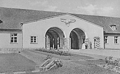
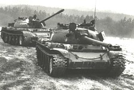
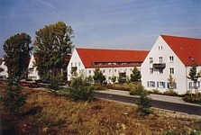

* * *

 Die Geschichte des Nickerner Kasernenkomplexes begann Mitte der 1930er Jahre. Entgegen den Bestimmungen des Versailler Vertrages hatte Deutschland damals begonnen, ein Netz von Militärflugplätzen aufzubauen, um dort Mittelstreckenbomber und Jagdflugzeuge zu stationieren. In diesem Zusammenhang war in Nickern ein Feldflugplatz der Luftwaffe geplant. Hermann Göring hatte im November 1937 den Bau solcher Stützpunkte angewiesen, um im Mobilmachungsfall die Tschechoslowakei schnell besetzen zu können. Noch im gleichen Jahr begann der Bau der Kaserne und des Flugfeldes auf zuvor landwirtschaftlich genutztem Gelände. Während die Mannschaften direkt in der Nickerner Kaserne untergebracht waren, wohnten die Offiziere meist in Leubnitz. Nach der Besetzung der Tschechoslowakei wurde der Flugplatz jedoch obsolet und dessen weiterer Ausbau gestoppt. Stattdessen bezogen Einheiten der Luftwaffe das Areal und nutzten es zu Ausbildungszwecken für Waffentechniker, Feuerwerker und Luftwaffenhelferinnen. Zudem befand sich bis 1945 in Nickern die Militär-Lagerverwaltung des Kfz-Bestandslagers der Luftwaffe und eine Außenstelle des Luftgaukommandos 3. Außerdem war hier ein Luftnachrichtenregiment der Wlassow-Truppen stationiert.

Obwohl auch im Dresdner Süden einige Bombenabwürfe zu verzeichnen waren, blieb die Kaserne beim Luftangriff am 13./14. Februar 1945 unbeschädigt. Zuletzt befand sich hier zu Kriegsende ein Sammelpunkt des Fallschirmjäger-Panzer-Korps "Hermann Göring", bevor das Gelände am 8. Mai von sowjetischen Truppen besetzt wurde. Diese stationierten hier das 249. Garde-Motor-Schützen-Regiment, eine Einheit der elften Garde-Panzer-Division. Fortan lebten auf dem Areal ca. 2500 Soldaten, die für die Einsatzbereitschaft der bis zu 100 Panzer verantwortlich waren. Die Fahrzeuge wurden in von außen nicht einsehbaren Hallen untergestellt. Hinzu kamen Mot-Schützen, Nachrichten-, Pionier- und Stabskompanie. In den 1970er Jahren kam es zu einigen Erweiterungsbauten. U.a. entstand im Westteil des Kasernengeländes eine Wohnsiedlung für sowjetische Offiziere mit 215 Wohnungen sowie ein Barackenlager mit Sanitär- und Duschräumen. Als Schießplatz diente eine Fläche am Alten Postweg in Richtung Kauscha.

Mit der deutschen Wiedervereinigung und den Zwei-plus-Vier-Verträgen endete die Stationierung russischer Soldaten in Deutschland. 1992 räumten die Streitkräfte der GUS das Gelände und übergaben die Nickerner Kaserne an die Entwicklungsgesellschaft STESAD. Ein Großteil der vorhandenen Bauten wurde ab 1995 abgerissen. Teile des Grundstücks dienen seit 1997 als Kleingärten. 1998 began die Sanierung der Kaserne von 1940 und deren Umbau zur Wohnanlage. Später wurde diese um eine Wohnsiedlung mit Ein- und Mehrfamilienhäusern erweitert. Die dabei entstandenen neuen Straßen wurden überwiegend nach Musikern der Dresdner Staatsoper benannt.

* * *

 \[ [Home](../../../index.html)\] \[ [Nord](../../../nord/)\] \[ [Nordwest](../../../nordwest/)\] \[ [Neustadt](../../../neustadt/)\] \[ [Nordost](../../../nordost/)\] \[ [West](../../../west/)\] \[ [Zentrum](../../../zentrum/)\] \[ [Südwest](../../../sudwest/)\] \[ [Süd](../../../sud/)\] \[ [Südost](../../../sudost/)\] \[ [Ost](../../../ost/)\] \[ [Register](../../../Register/register.html)\] \[ [Kontakt](../../../Kontakt/kontakt.html)\] \[ [Impressum](../../../impressum/)\]
