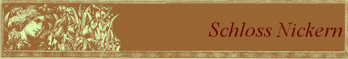
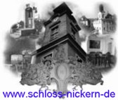
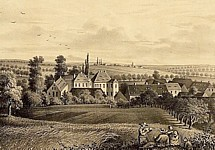
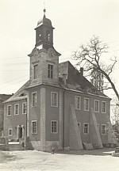
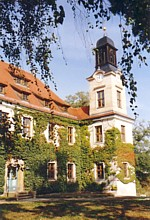
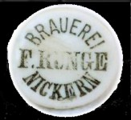

* * *

* * *

* * *

* * *

* * *

* * *

Das heutige Nickerner Schloss geht auf die Anlage einer Wasserburg aus dem 12. Jahrhundert zurück. 1350 befand sich diese im Besitz der Ritter Heinrich und Hermann von Karras, ab 1402 in dem der Dresdner Bürgerfamilie Ziegler. Ursprünglich vermutlich nur ein Vierhufengut wurde dieses später zum schriftsässigen Rittergut erhoben und erhielt damit auch die Gerichtsbarkeit. Die näheren Umstände sind unbekannt, da keine Unterlagen aus dieser Zeit mehr existieren. 1511 erwarb der damalige Bürgermeister von Freiberg, Georg von Alnpeck (1462- 1523) die Herrschaft Lockwitz mit Nickern und ließ die Burg zum Renaissanceschloss umbauen. Die einst vorhandenen Gräben wurden dabei verfüllt und planiert. Georgs Sohn Hieronymus (1511-1576), der im Zuge einer Erbteilung Besitzer von Oberlockwitz geworden war, lebte selbst in Nickern.

1622 wurden Oberlockwitz und Nickern an den Oberkammer- und Bergrat Johann Georg von Osterhausen veräußert und das Nickerner Schloss nochmals erweitert. In diesem Zusammenhang entstand ein neues Herrenhaus mit Uhr und Glocke, von dem heute nur noch das Erdgeschoss erhalten ist. Bis 1681 bildeten Nickern und Oberlockwitz ein einheitliches Rittergut. 1682 erwarb Gottfried Wiesener, kurfürstlich-sächsischer Rat und Leibmedicus, das Schloss mit allen zugehörigen Besitzungen. Ihm folgte 1686 Carl Rudolf von Carlowitz, 1691 die Familie von Bose

1693 ließ Hans von Bose, Geheimer Staatsrat und sächsischer Oberhofmeister, das von ihm zwei Jahre zuvor erworbene eingeschossige Herrenhaus aufstocken und wandelte es zum Wohnschloss um. Dabei erhielt das Gebäude unter Wahrung der ursprünglichen Struktur Stilelemente des ländlichen Barocks sowie einen als Rittersaal bezeichneten Festsaal im Obergeschoss. Erst 1870 bekam der schlichte Bau durch den Lockwitzer Baumeister Kreyßig seinen Glockenturm und somit sein heutiges Aussehen _(Foto um 1955 - SLUB/Fotothek)_. Eigentümer war zu diesem Zeitpunkt Friedrich August Winkler. Letzter Besitzer des Schlosses vor 1945 war Georg Bennewitz, der es 1929 erworben hatte. Ab 1933 war der der NSDAP und der SS angehörende Bennewitz Leiter der Hauptabteilung II in der Landesbauernschaft Sachsen und zugleich Kreisbauernführer des Kreises Dresden. Zudem wirkte er als stellvertretender kommissarischer Leiter der Landwirtschaftskammer Sachsen.

1945 wurde das Gut enteignet und diente fortan Wohnzwecken. Die bei einem Brand 1960 entstandenen Schäden konnten relativ schnell wieder behoben werden. In den 1980er Jahren erfolgte eine Umgestaltung zum Klub- und Kulturhaus, welches bis 2000 von der Interessengemeinschaft Schloss Nickern betrieben wurde. Dieser Verein war auch Initiator der regelmäßig durchgeführten Schlossfeste, welche weit über den Ortsteil hinaus bekannt wurden. Nach Schließung der im Schloss verbliebenen Gaststätte Anfang 2004 wurde das Gebäude an einen privaten Investor verkauft, der hier künftig Theateraufführungen und ähnliche Veranstaltungen organisieren will. Auch die Einrichtung eines kleinen Heimatmuseums ist vorgesehen. Im Sommer 2005 konnte im Erdgeschoss bereits die Gaststätte “Altnickerner Schloßstübel” eröffnet werden.

Schlossbrauerei Nickern:

Zum Rittergut gehörten neben einigen Nebengebäuden und Gehöften im Ort auch ausgedehnte Felder und Obstplantagen sowie eine 1683 erstmals erwähnte Brauerei, die über die Ortsgrenzen hinaus einen guten Ruf besaß und auch Bier nach Dresden lieferte. Ein Neubau dieser Braustätte entstand 1726. Berichte vom Ende des 19. Jahrhunderts weisen auf einen rätselhaften schachtartigen Gang unter dem Pichschuppen hin, der nach einiger Länge in einem mit Wasser gefüllten Schacht endete. Der Zweck dieses Stollens ist unklar, der Sage nach soll er einst bis nach Leubnitz geführt haben. 1875 war Georg August Rühle Pächter die Nickerner Schlossbrauerei. 1899 übernahm August Grosse die Brauerei, ihm folgte 1907 Olga Bertha Müller und 1920 Fritz Müller. Beim Tagesangriff am 14. Februar 1945 wurde die Schloßbrauerei, ebenso wie weitere Häuser im Dorf völlig zerstört. Der Brauteich diente später als Mistablageplatz und wurde danach mit Trümmerschutt verfüllt.

* * *

 \[ [Home](../../../index.html)\] \[ [Nord](../../../nord/)\] \[ [Nordwest](../../../nordwest/)\] \[ [Neustadt](../../../neustadt/)\] \[ [Nordost](../../../nordost/)\] \[ [West](../../../west/)\] \[ [Zentrum](../../../zentrum/)\] \[ [Südwest](../../../sudwest/)\] \[ [Süd](../../../sud/)\] \[ [Südost](../../../sudost/)\] \[ [Ost](../../../ost/)\] \[ [Register](../../../Register/register.html)\] \[ [Kontakt](../../../Kontakt/kontakt.html)\] \[ [Impressum](../../../impressum/)\]
