## Alnpeckstraße

Die nördlich des Dorfkerns gelegene Alnpeckstraße verdankt ihren Namen der Familie von Alnpeck, die zwischen 1512 und 1620 Besitzer der Rittergüter Oberlockwitz und Nickern war. Georg Alnpeck war Bürgermeister der reichen Bergstadt Freiberg und hatte 1512 die Gutsherrschaft erworben. Neben den Schlössern Lockwitz und Nickern erinnern auch einige historische Grabdenkmale in der [Leubnitzer Kirche](../../../sudost/leubnitz-neuostra/leubnitzer_kirche/) und ein Glasfenster mit Familienwappen in der [Kirche von Leuben](../../../ost/leuben/himmelfahrtskirche/) an diese Familie. Benannt wurde die Alnpeckstraße im Jahr 1933.

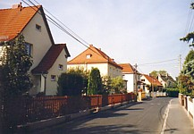

**_Foto:_** _Blick in die Alnpeckstraße_

__

Die heute Alter Postweg genannte Straße ist Teil eines früheren historischen Postweges, welcher von Dresden über Nickern und Babisnau nach Böhmen führte. Der Weg beginnt in Altnickern und verläuft von dort unterhalb des Trutzsch weiter in Richtung Sobrigau. Nach 1945 war er durch das Kasernengelände unterbrochen und wurde erst 1995 wieder als Wanderweg ausgebaut. An die einstige Nutzung erinnert noch eine historische Wegsäule am Abzweig des Hohlweges “Hohles Tor” nach Lockwitz. Auf dem ehemaligen Kasernengelände wurden in den 1990er Jahren moderne Reihenhäuser errichtet.

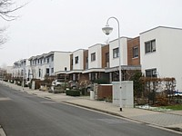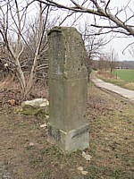

**_Fotos:_** _Neubauten am Alten Postweg - alte Wegsäule am "Hohlen Tor"_

## Altnickern

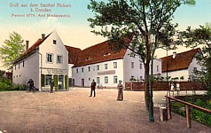Als Altnickern wird seit der Eingemeindung des Ortes der frühere Dorfplatz bezeichnet. Ursprünglich bestand dieser aus fünf Bauerngütern und einigen Häusleranwesen. Bauliche Veränderungen erfolgten nach 1622 bei der Umgestaltung des Rittergutskomplexes. Das Straßenbild prägten ursprünglich mehrere Drei- und Vierseithöfe. Außerdem gab es hier den Dorfgasthof (Nr. 9) mit Tanzsaal und Gästegarten _(Foto)_ sowie die Schlossmühle (Nr. 2). Heute ist nur noch ein Gehöft erhalten geblieben (Nr. 16). Weitere Gebäude, darunter der alte Gasthof, fielen 1945 einem Luftangriff zum Opfer bzw. wurden in den Nachkriegsjahren bei einem Brand zerstört. Unter Denkmalschutz stehen auch die Wohnhäuser Nr. 10 und 11 sowie Nr. 15.

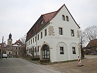Herrenmühle (Nr. 2): Die vermutlich im 13. Jahrhundert entstandene Wassermühle gehörte zum Besitz des Ritterguts und war vermutlich älteste der drei Nickerner Mühlen. Ihr Standort befand sich am Rande des Burgareals, wo einst der Wassergraben in den Dorfbach mündete. Ausgestattet war sie mit einem oberschlächtigen Wasserrad, das den einzigen Mahlgang trieb. Später wurde sie auch als Malzmühle genutzt, nachdem das Rittergut Nickern 1682 das Braurecht erhalten hatte. 1945 fielen sowohl die Schlossbrauerei als auch die Mühle den Bomben zum Opfer. Erhalten blieb das Wohngebäude Nr. 2, durch eine Schrifttafel an der Fassade auf 1613 datiert _(Foto)_.

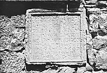Nr. 12: Zu den heute nicht mehr vorhanden Gebäuden gehört das Bauerngut Altnickern 12 (ehemals Nr. 14), welches im Kern noch aus dem 15. Jahrhundert stammte. An der Steinmauer neben dem Eingangstor befand sich eine Schrifttafel mit der Inschrift:

WIR BAUEN ALLE GERNE VESTE UND SIND DOCH FREMDE GESTE

DA WIR SOLLEN EWIG SEIN DA BAUEN WIR GAR WENIG EIN

WER ABER GOT VERTRAUT DER HAT WOL GEBAUT.

ANNO 1605 HANS HEGER BAUHERR BALTHASAR IENICHEN. BAM.

Das Gehöft wurde 1945 zerstört. An seiner Stelle steht heute ein Einfamilienhaus _(Bild von 1915 - SLUB/Fotothek)_. Zudem sind noch Ruinen der Vorgängerbauten vorhanden.

Nr. 16: Der 1794 erwähnte Vierseithof gehört zu den wenigen erhaltenen Gütern des Ortes. Ursprünglich gehörte er als Beigut zum Nickerner Rittergut. Wohnstallhaus, Seitengebäude, Scheune und Torpfeiler stehen unter Denkmalschutz.

Mittlere Wassermühle: Die nach ihrer Lage im Ortszentrum mittlere Wassermühle bzw. Bäckermühle genannte Mühle wurde 1522 erstmals erwähnt und diente vorrangig dem Bedarf der Hausbäckerei der Bewohner. Ihr genauer Standort ist unbekannt, wird jedoch auf dem Grundstück der späteren Landbäckerei Gehre vermutet. Sie besaß nur einen Mahlgang und ist im 18. Jahrhundert letztmals in der Chronik des Heimatforschers Gottlob Gerber "Altes und Neues von Lockwitz und Nickern" genannt.

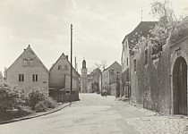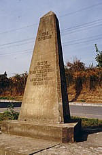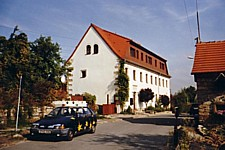

**_Fotos:_** _Der Dorfkern Altnickern um 1955(Walter Möbius - SLUB/Fotothek) und heute_

_mit Gedenkstein für die Opfer des 13. Februars 1945_

Gedenkstein 13. Februar 1945: Der Obelisk am Nickerner Dorfplatz wurde 1920 ursprünglich als Kriegerdenkmal für die Gefallenen des Ersten Weltkriegs aufgestellt. Nach 1945 war zunächst seine Beseitigung geplant, bevor man sich entschied, das Denkmal in eine Erinnerungsstätte für die Opfer des Luftangriffs vom 13. Februar 1945 umzuwandeln. In diesem Zusammenhang brachte man an den Seiten veränderte Inschriften an, u.a. die Worte: "Wir gedenken der Opfer des anglo-amerikanischen Bombenterrors". Wegen dieser Formulierung entstand 2015/16 eine Diskussion um die erneute Veränderung des Steins, nachdem dieser Aufmarschort der rechtsextremen NPD geworden war.

## Am Geberbach

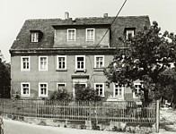Die Straße schließt den alten Nickerner Dorfkern nach Süden ab und trägt ihren Namen nach dem Geberbach, der oberhalb von Kauscha entspringt und im Anschluss den reizvollen Gebergrund durchfließt. Ursprünglich wurde die hier gelegene Häuslersiedlung Auf dem Hahne (Hahne = Hain) genannt. Seit 1931 werden die Gebäude postalisch unter Am Geberbach geführt.

Historisch interessant ist das Wohnstallhaus Nr. 1, Überrest eines spätmittelalterlichen Dreiseithofes, welcher vermmutlich als Vorwerk diente. Die jetzigen Gebäude wurden um 1720 auf dessen Fundamenten und Kellern errichtet Unter dem Hinterhaus befindet sich ein zweigeschossiger Lagerkeller, zudem gibt es einen ca. 15 Meter tiefen Brunnen. Verwendung vermutlich als Vorwerk. Unter Denkmalschutz stehen auch die Wohnhäuser Am Geberbach Nr. 2 und Nr. 7 _(Foto von 1992 - SLUB/Fotothek)_.

## Arno-Schellenberg-Straße

Die Arno-Schellenberg-Straße entstand 1999 im Zusammenhang mit der Erschließung einer Einfamilienhaussiedlung südlich des Nickerner Dorfkerns. Benannt ist die Straße nach dem Opernsänger Arno Schellenberg (1903-1983), welcher zwischen 1933 und 1974 an der Staatsoper engagiert war. Schellenberg wirkte in dieser Zeit an zahlreichen Uraufführungen und Premieren mit und war ab 1956 auch als Professor an der Musikhochschule tätig.

## Bernd-Aldenhoff-Straße

Die im Zusammenhang mit dem Bau einer neuen Wohnsiedlung am Trützsch angelegte Straße erhielt ihren Namen 2006 in Erinnerung an den Opernsänger Bernd Aldenhoff (1908-1959), der zwischen 1943 und 1951 zum Ensemble der Dresdner Staatsoper gehörte. Bekannt wurde er als langjähriger Wagner-Interpret in Bayreuth.

## Büttigstraße

Die Büttigstraße erinnert an den früheren Staatsrat Wilhelm August Büttig (1809-1879) und dessen Neffen Ernst Leberecht Büttig, welche Ende des 19. Jahrhunderts ein Vermächtnis zum Bau einer Schule errichteten. 1884 konnte dieses neue Schulhaus an der Fritz-Meinhardt-Straße eingeweiht werden. Wilhelm August Büttig, geboren in Nickern, studierte in Leipzig Medizin und war später Leibarzt des Großfürsten Konstantin Nikolajewitsch Romanow in St. Petersburg. Bereits vor dem Zweiten Weltkrieg hatte es in Nickern eine Büttigstraße gegeben, die jedoch 1947 in Fritz-Meinhardt-Straße umbenannt wurde. Im Zusammenhang mit dem Bau einer neuen Eigenheimsiedlung entstand Anfang der 1990er Jahre die neue Büttigstraße.

## Dora-Zschille-Straße

Die im Zusammenhang mit dem Bau einer Eigenheimsiedlung Ende der 1990er Jahre angelegte Straße verdankt ihren Namen der Opernsängerin Dora Anna Zschille-Weydling (1906-1997), die viele Jahre an der Dresdner Staatsoper wirkte. Zuvor gehörte das Areal zur in den 1930er Jahren errichteten [“Alten Kaserne”](../../../sudost/nickern/kaserne_nickern/), welche von 1945 bis zum Abzug 1991 von sowjetischen Armeeeinheiten genutzt wurde.

## Elfride-Trötschel-Straße

Die Elfride-Trötschel-Straße im 1998 angelegten Nickerner Wohnpark wurde nach der Kammersängerin Elfride Trötschel (1913-1958) benannt, die als junge Sopranistin 1934 von Karl Böhm an die Dresdner Oper verpflichtet wurde. Als Mitglied des Ensembles wurde sie später weltberühmt und trat auf Gastspielreisen in aller Welt auf.

## Elsternstraße

Die Elsternstraße entstand um 1932 im Zusammenhang mit einem neuen Wohngebiet nordwestlich der Büttigstraße (heute Fritz-Meinhardt-Straße). 1934 ist sie erstmals im Adressbuch verzeichnet. Benannt wurde sie nach der Vogelart Elster.

## Erna-Sack-Straße

Die Erna-Sack-Straße im Wohnpark Nickern, Mitte der 1990er Jahre westlich des Alten Postweges angelegt, erinnert an die auch als “deutsche Nachtigall” bekannt gewordene Opernsängerin Erna Dorothea Luise Sack (1898-1972), die ab 1935 zum Ensemble der Dresdner Staatsoper gehörte und eine der gefragtesten Sopranistinnen ihrer Zeit war. U.a. wirkte sie bei der Uraufführung der Oper “Die schweigsame Frau” von Richard Strauss 1935 mit und trat auf zahlreichen internationalen Bühnen auf. 1972 verstarb Erna Sack in Mainz.

## Fritz-Meinhardt-Straße

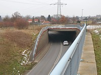Die Fritz-Meinhardt-Straße führt von der Dohnaer Straße nach Goppeln und durchquert dabei die Dorfkerne von Nickern und Kauscha. Als eines der ersten Gebäude entstand 1884 das Nickerner Schulhaus, welches heute als Kindertagesstätte dient. Nach dem Stifter dieser Schule, dem Staatsrat Wilhelm August Büttig (1809-1879), erhielt die Straße den Namen Büttigstraße. Weitere Häuser wurden in den Jahren nach dem Ersten Weltkrieg errichtet. 1947 wurde die Büttigstraße nach dem jüdischen Antifaschisten Fritz Meinhardt (1899–1943) benannt, der ab 1927 der KPD angehörte und von den Nazis inhaftiert wurde. Fritz Meinhardt lebte ab 1903 auf der Büttigstraße 22 und kam 1943 in der Haft ums Leben. Mit der Eingemeindung von Kauscha 1999 übertrug man den Namen Fritz-Meinhardt-Straße auch auf die dortige Dresdner Straße.

In den Jahren nach 1990 wurde an der Fritz-Meinhard-Straße ein Gewerbegebiet angelegt und die Straße zum Autobahnzubringer ausgebaut _(Foto)_. In diesem Zusammenhang entstand 2003 ein ca. 500 Meter langer Tunnel, der überwiegend dem Lärmschutz dient. Zuvor mussten für den Bau mehrere Wohnhäuser, darunter auch einige erst nach 1990 errichtete, abgerissen werden. Tunnel und Zubringer wurden am 25. November 2004 freigegeben.

## Gaustritzer Straße

Die Gaustritzer Straße befindet sich im nördlichen Teil von Nickern und wurde erst 1931 benannt. Zuvor waren die hier befindlichen Gebäude dem Nickerner Dorfplatz zugeordnet. Ihren Namen erhielt sie nach der kleinen Ortschaft Gaustritz, einem Ortsteil von Bannewitz.

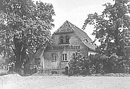Alte Mühle: Die Alte Mühle hatte ihren Standort auf dem Grundstück Gaustritzer Straße 4-6. 1527 wurde sie im Zusammenhang mit Brot- und Mehllieferungen nach Dresden während einer Pestepedemie erstmals urkundlich erwähnt, existierte zu diesem Zeitpunkt jedoch vermutlich schon länger. Ein beim Abbruch der Gebäude geborgener Türschlussstein weist auf 1554 als Baujahr des Hauptgebäudes hin.

Die vom Geberbach angetriebene Wassermühle besaß im 18. Jahrhundert nur einen Mahlgang, wurde zuvor jedoch auch als Sägemühle genutzt. Darauf weist zumindest der in alten Akten zu findende Name "Greischmühle" (nach dem Kreischen der Säge) hin. 1682 erneuerte die kurfürstliche Kammer das für Nickern geltende Privileg des Brot- und Mehlhandels nach Dresden.

Beim Luftangriff auf Dresden, der am 14. Februar 1945 auch den Dorfkern von Nickern traf, wurde die alte Mühle schwer beschädigt. Nach dem teilweisen Wiederaufbau diente das Haus als Restaurant und Cafe "Zur Alten Mühle". Ein Brand besiegelte 1979 das Schicksal der Mühle, deren Gebäude daraufhin vollständig abgetragen wurden. Heute stehen auf dem Areal moderne Wohnhäuser.

## Heinz-Bongartz-Straße

Die Heinz-Bongartz-Straße entstand Ende der 1990er Jahre im Zusammenhang mit der Erschließung des neuen Nickerner Wohnparks auf ehemaligem Militärgelände. Ihren Namen erhielt sie nach dem Komponisten und früheren Chefdirigenten der Dresdner Philharmonie Heinz Bongartz (1894-1978), der dieses Amt 1947 übernahm und das renommierte Orchester in der Nachkriegszeit wieder zu neuer Qualität führte.

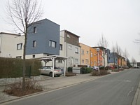

**_Foto:_** _Neubauten an der Heinz-Bongartz-Straße_

## Helena-Rott-Straße

Mit der Namensgebung Helena-Rott-Straße wird an die Kammersängerin und Altistin Helena Rott (1908-1991) erinnert, die viele Jahre dem Ensemble der Dresdner Staatsoper angehörte. Auch diese Straße im “Musikerviertel” entstand 1999 im Zusammenhang mit der Umwandlung des ehemaligen Nickerner Kasernengeländes zum Wohnpark. Eine Bebauung mit Eigenheimen begann jedoch erst 2015.

## Herbert-Collum-Straße

Die Herbert-Collum-Straße im Wohnpark zwischen Nickern und Lockwitz entstand Ende der 1990er Jahre und erhielt ihren Namen nach dem bekannten Organisten Herbert Collum (1914-1982), der ab 1935 bis zu seinem Tod an der Kreuzkirche in Dresden tätig war. Collum erwarb sich große Verdienste um die Pflege der Kirchenmusik in der Stadt und war Leiter des von ihm 1946 gegründeten Collum-Chores. 1960 wurde er Professor an der Musikhochschule.

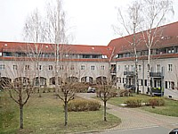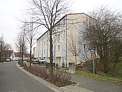

**_Fotos:_** _Blick in die Herbert-Collum-Straße mit der umgebauten Alten Kaserne_

_und Neubauten aus den 1990er Jahren_

## Inger-Karén-Straße

Die kurze Inger-Karén-Straße im Wohnpark Nickern verdankt ihren Namen der Opernsängerin Inger Karén von Zarembskij (1908-1972), die ab 1935 zum Ensemble der Dresdner Staatsoper gehörte. Bis 1963 war sie als eine der wenigen Altistinnen ununterbrochen Mitglied des Ensembles und so am Wiederaufbau des Kulturlebens nach 1945 beteiligt. Ende der 1990er Jahre entstanden hier Reihenhäuser.

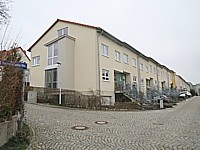

**_Foto:_** _Blick in die Inger-Karén-Straße_

## Joseph-Keilberth-Straße

Die 1998 im nördlichen Teil des Wohnparks Nickern angelegte Joseph-Keilberth-Straße erinnert an den Dirigenten und früheren Generalmusikdirektor der Dresdner Staatskapelle Joseph Keilberth (1908-1968). Keilberth war erster Leiter des Orchesters nach 1945 und maßgeblich am Wiederaufbau des Musiklebens in der Stadt beteiligt.

## Kautzscher Straße

Die Kautzscher Straße entstand 1932 beim Bau der Wohnsiedlung nordwestlich der Fritz-Meinhardt-Straße und verbindet die Schönberg- mit der Elsternstraße. Die 1934 erstmals im Adressbuch genante Straße erhielt ihren Namen nach dem nördlich von Kreischa gelegenen Dorf Kautzsch.

## Kurt-Böhme-Straße

Die Kurt-Böhme-Straße an der Ortsgrenze zu Lockwitz wurde Ende der 1990er Jahre im Wohnpark Nickern angelegt und
nach dem Kammersänger Kurt Gerhard Böhme (1908-1989) benannt. Böhme gehörte ab 1930 dem Ensemble der Dresdner Staatsoper an und trat hier in zahlreichen verschiedenen Rollen auf.

## Langobardenstraße

Die Langobardenstraße geht auf einen alten, später durch den Ziegeleibetrieb unterbrochenen Verbindungsweg zwischen
Nickern und Torna zurück. Nachdem hier Ende des 19. Jahrhunderts zwei germanische Gräber aus dem 6. Jahrhundert entdeckt worden waren, erhielt dieser Weg den Namen Langobardenstraße nach dem germanischen Stamm der
Langobarden, welcher sich um 500 im oberen Elbtal angesiedelt hatte.

## Liesel-von-Schuch-Straße

Die Liesel-von-Schuch-Straße entstand als eine der letzten neuen Straßen im Wohnviertel auf dem Areal der ehemaligen [Kaserne](../../../sudost/nickern/kaserne_nickern/) und wurde 2016 nach der Opernsängerin Liesel von Schuch benannt. Elisabeth von Schuch-Ganzel (1891-1990) war Tochter des Dirigenten Ernst von Schuch und gab 1913 ihr Debüt auf der Opernbühne. Bis 1935 gehörte sie dem Ensemble der Sächsischen Staatsoper an und arbeitete nach dem Zweiten Weltkrieg als Gesangspädagogin an der Dresdner Musikhochschule in Dresden. 1988 erhielt sie den Titel einer Ehrenbürgerin von Dresden.

## Michaelisstraße

Die nach 1990 im Gewerbegebiet Nickern angelegte Michaelisstraße verdankt ihren Namen dem Naturwissenschaftler
Johann Gottlieb Michaelis (1704-1740). Michaelis war viele Jahre Inspektor des Dresdner Mineralienkabinetts und gilt als Begründer des Mathematisch-Physikalischen Salons.

## Nickerner Weg

Der Nickerner Weg verbindet die Dohnaer Straße mit dem in den Dreißiger Jahren angelegten und nach 1990 zu einem Wohnviertel umgestalteten [Kasernenkomplex](../../../sudost/nickern/kaserne_nickern/) am Ortsrand. Das Areal des Gewerbegebietes zwischen Nickerner Weg und Gebergrund prägen vor allem die Hallen des ehemaligen VEG Obstproduktion Borthen. Aus dem früherem Betriebslokal ging nach 1990 die Gaststätte “Obstgarten” hervor. Überregional bekannt wurde diese 2009 durch einen Besuch des Sternekochs Christian Rach für dessen TV-Sendung “Rach - der Restauranttester”. Nach der Insolvenz zum Jahresende übernahmen neue Betreiber das Lokal, welches neben einem großen Biergarten bis zur Schließung auch zu regelmäßigen Tanzveranstaltungen einlud. Heute wird hier nur noch die "Kantine zum Obstgarten" bewirtschaftet.

## Osterhausenstraße

Die Osterhausenstraße entstand 2016 im Wohnpark an der ehemaligen Kaserne. Im gegensatz zu vielen benachbarten Straßen entschied man sich bei der Namensgebung nicht für einen Dresdner Musiker, sondern eine mit der Ortsgeschichte verbundene Person. Johann Georg von Osterhausen (1578-1627) war Besitzer der Grundherrschaft Lockwitz und Bauherr des [Schlosses Lockwitz](../../../sudost/lockwitz/schloss_lockwitz/). Zudem ließ er das [Schloss Nickern](../../../sudost/nickern/schloss_nickern/) erweitern.

## Rudolf-Dittrich-Straße

Die nach 1990 an der Ortsgrenze zu Lockwitz im Wohnpark Nickern angelegte Rudolf-Dittrich-Straße wurde nach dem
Tenor Rudolf Dittrich (1903-1990) benannt, der 1929 als Opernsänger nach Dresden kam. Als Mitglied des Staatstheaters
und Gesangslehrer an der Musikhochschule gehörte Dittrich zu den Persönlichkeiten des Dresdner Musiklebens, die aktiv an der Wiederherstellung der Kultur in der zerstörten Stadt beteiligt waren.

## Rudolf-Kempe-Straße

Die kurze Rudolf-Kempe-Straße entstand Ende der 1990er Jahre im Wohnpark Nickern. Ihren Namen erhielt sie nach dem Dirigenten Rudolf Kempe (1910-1976), der 1950-1953 Generalmusikdirektor der Staatskapelle war. Auch nach seinem Wechsel nach München blieb Kempe bis zu seinem Tod eng mit der Dresdner Staatskapelle verbunden. Auf seine Initiative geht die Tradition des “Dresdner Requiems” in Erinnerung an den 13. Februar 1945 zurück.

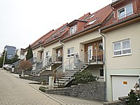

**_Foto:_** _Reihenhäuser an der Rudolf-Kempe-Straße_

## Schönbergstraße

Die Schönbergstraße wurde 1936 im Zusammenhang mit dem Bau einer neuen Wohnsiedlung nördlich des Nickerner
Dorfkerns angelegt. Ihren Namen verdankt sie dem Geheimen Rat und Appelationsgerichtspräsidenten Gotthelf Friedrich von Schönberg, der 1692 das Rittergut Oberlockwitz erworben hatte und auch Bauherr der Lockwitzer Schlosskirche war.

## Tschirnhausstraße

Auch die Tschirnhausstraße am Kaufpark Nickern wurde zur Erschließung des neuen Gewerbegebietes Mitte der 90er
Jahre angelegt. Sie erinnert an den Naturwissenschaftler Ehrenfried Walther von Tschirnhaus (1651-1708), der zu den
bedeutendsten Gelehrten seiner Zeit gehörte. Tschirnhaus befasste sich mit zahlreichen physikalischen Problemen und gilt als “geistiger Vater” des europäischen Porzellans.

[Nickern auf OpenStreetMap](https://www.openstreetmap.org/search?query=Dresden+Nickern))/spdd.aspx)

* * *

 \[ [Home](../../../index.html)\] \[ [Nord](../../../nord/)\] \[ [Nordwest](../../../nordwest/)\] \[ [Neustadt](../../../neustadt/)\] \[ [Nordost](../../../nordost/)\] \[ [West](../../../west/)\] \[ [Zentrum](../../../zentrum/)\] \[ [Südwest](../../../sudwest/)\] \[ [Süd](../../../sud/)\] \[ [Südost](../../../sudost/)\] \[ [Ost](../../../ost/)\] \[ [Register](../../../Register/register.html)\] \[ [Kontakt](../../../Kontakt/kontakt.html)\] \[ [Impressum](../../../impressum/)\]
