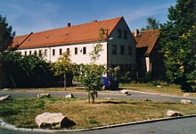
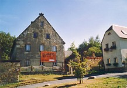
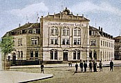

* * *

**Gemeindesiegel von Großluga**

* * *

**Schulen in Luga:**

## [Homepage der 90. Grundschule](http://marvin.sn.schule.de/~gs90dd)

Großluga entstand als slawischer Rundweiler und wurde 1321 erstmals als Luge erwähnt.
Zur besseren Unterscheidung zum benachbarten Kleinluga erhielt der Ort schon bald den Namen Groß-Luga, der sich 1378 zum ersten Mal in den Urkunden findet (luck major).
Übersetzt bedeutet Luga “Ort mit einer feuchten Niederung”, was auf die örtlichen Gegebenheiten hindeutet. Ursprünglich gehörte das Dorf den Burggrafen zu Dohna, die
jedoch 1321 ihre Zinsrechte an das Kloster Altzella übertrugen. Später kam der Ort zum Amt Pirna und war kirchlich der Dohnaer Kirche zugeordnet. 1408 vergab Friedrich der
Strenge Großluga an vier Dresdner Bürger als Lehen, denen 1436 die Röhrsdorfer Familie Lange als Lehns- und Gerichtsherren folgte. 1501 gehörte das Dorf der in Zehista ansässigen Adelsfamilie von Staupitz.

Der nur aus wenigen Gehöften bestehende Ort entwickelte sich bis zum 19. Jahrhundert kaum weiter und lebte vorrangig
von der Landwirtschaft. Zentrum war der heutige Lugaer Platz mit seiner noch erhaltenen Dorflinde. Erst nach dem Bau
der Eisenbahnstrecke nach Pirna entstanden um 1890 neue Mietshäuser an der Kleinlugaer Straße. Auf Großlugaer Flur
siedelte sich auch das Eisenwerk Kelle & Hildebrandt an, welches später unter dem Namen Sächsischer Brücken- und Stahlhochbau bekannt wurde. Hergestellt werden vor allem Förderanlagen und Bühnentechnik.

1920 wurden Groß- und Kleinluga zu einer Landgemeinde vereinigt, die den Namen Luga
erhielt. Dieser Ort konnte seine Selbstständigkeit jedoch nur zwei Jahre bewahren und wurde 1922 nach Niedersedlitz eingemeindet. Gemeinsam mit diesem kam auch Großluga
1950 als Stadtteil zu Dresden. 1953 entstand die nach 1990 aufgelöste LPG “1. Mai”, der seit 1958 bzw. 1962 auch Lockwitzer und Nickerner Bauern angehörten. Heute ist
Großluga vor allem Wohnort mit einigen bedeutenden gewerblichen Unternehmen, darunter dem Hauptumspannwerk für Dresden-Süd. Sehenswert ist der gut erhaltene
Dorfplatz mit seinen Bauernhäusern aus dem 18. und 19. Jahrhundert. _(Fotos)_.

Schulen in Großluga:

1841 gründeten die Gemeinden Groß- und Kleinluga gemeinsam mit den heutigen Heidenauer Ortsteilen Gommern, Wölkau und Meuscha einen gemeinsamen Schulverband mit dem Ziel, ein eigenes Schulhaus zu errichten. Dieses wurde
auf Großlugaer Flur erbaut und am 26. Oktober 1841 eingeweiht. Nach dem Ausscheiden von Gommern aus dem
Verband besuchten ab 1896 nur noch Kinder aus Groß- und Kleinluga diese Schule. Das erhaltene Gebäude dient heute als Wohnhaus.

1898 beschlossen die verbliebenen Gemeinden einen Schulneubau, um der gewachsenen Einwohnerzahl Rechnung zu
tragen. Mit dem Entwurf wurde der Copitzer Architekt Welz beauftragt. Bereits am 23. Oktober 1899 konnte diese neue
Schule an der Kleinlugaer Straße 25 eröffnet werden. Neben mehreren Klassenräumen beherbergte das Gebäude auch eine Aula und eine Wohnung für Lehrer. Heute nutzt die 90. Grundschule das Haus. 2012 entstand eine neue
Schulturnhalle.

Gasthof Großluga:

Der
Gasthof an der Kleinlugaer Straße entstand um 1900 und sollte den Auftakt für eine vorstädtische Entwicklung des
Ortes bilden. Allerdings blieb Luga ein unbedeutendes Dorf, was schon bald zu wirtschaftlichen Problemen der Inhaber
führte. Neben den Gasträumen besitzt das Gebäude an der Ecke zur Dohnaer Straße auch einen großen Ballsaal. Bereits
1933 wurde der Gasthof geschlossen und diente ab 1941 als Unterkunft für ukrainische Zwangsarbeiterinnen. 1945
übernahm das Sachsenwerk in Niedersedlitz das leerstehende Gebäude und nutzte es viele Jahre für Lagerzwecke.
Zeitweise gab es hier auch einen Jugendclub, einen Kindergarten sowie den Klub der Volkssolidarität. Nach 1990 stand der Gasthof viele Jahre leer und wurde 2014 zu Wohnzwecken umgebaut.

**_Foto:_** _Der frühere Gasthof Großluga auf einer historischen Ansichtskarte_
