* * *

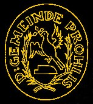

**Gemeindesiegel von Prohlis**

Bürgerbüro prohlis prohliser allee 10 01239 dresden  tel. 0351/4888444

Stadtteilbüro prohlis prohliser allee 33  öffnungszeiten: mo. 10-13 uhr di. 13-17 uhr do. 10-16 uhr

* * *

**Prohliser Stadtteilseiten:**

[Prohlis-online  die prohliser stadtteilseite](http://www.prohlis-online.de)

[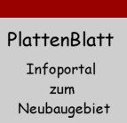](http://www.plattenblatt.wg.am)

* * *

**Bildungseinrichtungen**

**in Prohlis:**

[Bibliothek prohlis prohliser allee 10 01239 dresden tel. 0351/2841256](http://www.bibo-dresden.de)

[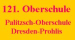](http://marvin.sn.schule.de/~ms121dd)

## [Homepage der 122. Grundschule](http://www.122grundschule.de)

[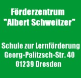](http://www.sn.schule.de/~fzas)

Das kleine Rundplatzdorf Prohlis wurde von slawischen Siedlern gegründet und 1288 erstmals als Proles erwähnt. Der aus dem Sorbischen stammende Ortsname ist von “prolos” abgeleitet, was übersetzt soviel wie Aue, Busch- oder Wiesenland bedeutet. 1311 erwarb das Dresdner Brückenamt Anteile in Prohlis, in dem zu diesem Zeitpunkt bereits das Meißner Lorenzhospital Zinsrechte besaß. Zwei Jahre später schenkte die Witwe Heinrich des Erlauchten, Markgräfin Elisabeth, ihren ererbten Anteil am Dorf dem Leubnitzer Klosterhof. Nachdem Markgraf Friedrich 1315 weitere Teile des Ortes mit einem Vorwerk dem Dresdner Maternihospital übereignete, befand sich Prohlis nun bis zur Reformation im Besitz dreier Grundherren. 1491 verzichtete das Brückenamt für zehn Jahre auf die ihm zustehenden Dienste und löste diese mit Geldzahlungen ab, um den Wiederaufbau Dresdens nach dem großen Stadtbrand finanzieren zu können. Erst im Zuge der Reformation kam der gesamte Ort 1550 in den Besitz der Stadt Dresden. Als Brückenamtsdorf genossen die Bewohner verschiedene Privilegien, zu denen auch die Zollfreiheit auf der Dresdner Elbbrücke gehörte. Kirchlich gehörte Prohlis bis 1674 zur Frauenkirche, danach zu Leubnitz.

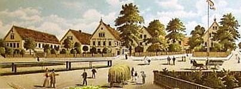

Der kleine Ort blieb bis Mitte des 20. Jahrhunderts vor allem ein Bauerndorf mit mehreren Gehöften, die sich an der heutigen Gamigstraße, Am Anger und der Georg-Palitzsch-Straße befanden. Hier lebte im 18. Jahrhundert der gelehrte Bauer Johann Georg Palitzsch (1723-1788), der sich in seiner Freizeit mit Mathematik, Astronomie, Physik und Botanik befasste. Palitzsch baute als einer der ersten Bauern im Dresdner Raum Kartoffeln an und installierte auf dem Dresdner Schloss den ersten Blitzableiter der Stadt. Bekannt wurde er jedoch vor allem als Astronom, der am 25. 12. 1758 den Halleyschen Kometen wiederentdeckte und für seine Leistungen vielfach geehrt wurde. 1875 bestand Prohlis aus acht Bauerngüter und acht weiteren Wohnhäusern und zählte 215 Einwohner.

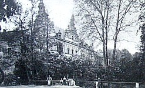Zwischen 1871 und 1900 siedelten sich auf Prohliser Flur sechs Ziegeleien an, die die Lehmvorkommen des Ortes nutzten. Weitere Industriebetriebe blieben jedoch fern. Lediglich eine Schmiede bestand bis zum Abriss 1979 an der Gamigstraße. 1868 erwarb die Familie von Kap-herr ein Prohliser Gut und errichtete an seiner Stelle das [Schloss](../../sudost/prohlis/schloss_prohlis/) _(Foto)_, welches nach einem Brand 1985 abgerissen wurde. Ende des 19. Jahrhunderts kamen Pläne zum Bau einer Eisenbahnstrecke von Reick über Prohlis nach Kreischa und von dort bis nach Dippoldiswalde auf. Diese wurden jedoch ebensowenig realisiert wie der vorgesehene Bau neuer Straßen, Plätze und Wohnviertel. Am 1. Juni 1921 wurde Prohlis nach Dresden eingemeindet, nachdem ein zuvor geplanter Anschluss an Niedersedlitz nicht zustande gekommen war.

Wenige Jahre später, zwischen 1926 und 1930 entstand in Prohlis eine aus 50 Gebäuden bestehende Holzhaussiedlung südlich der Straße Am Anger. Die Doppelhäuser wurden von den Firmen Höntsch & Co. Niedersedlitz und den Deutschen Werkstätten Hellerau hergestellt und als Eigenheime bevorzugt an kinderreiche Familien verkauft. Weitere Wohngebäude entstanden an der Ortsgrenze zu Reick im Bereich Tornaer Straße.

Die Luftangriffe des Jahres 1945 richteten in Prohlis erhebliche Zerstörungen an. Während der alte Dorfkern nahezu unversehrt blieb, fielen bis auf eine Ausnahme sämtliche Holzhäuser den Flammen zum Opfer. Ab 1950 wurden diese durch massive Einfamilien- und Reihenhäuser ersetzt. Auch die Ziegeleien stellten ihren Betrieb ein. Bereits 1923 war aus einem ehemaligen Restloch das Prohliser Bad entstanden. Eine frühere Kiesgrube bildet heute den [Naturpark Prohlis](../../sudost/prohlis/strassen_prohlis/ziegelei_kunath/) mit verschiedenen seltenen Pflanzen und Tieren.

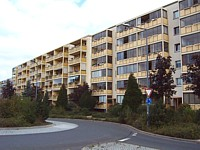Einen Einschnitt in der Geschichte des Stadtteiles bildete der Beschluss zum Bau des bislang größten Dresdner Neubaugebietes, welches zwischen 1976 und 1985 auf Prohliser Flur gebaut wurde (Grundsteinlegung am 26. Februar 1976). Den Baumaßnahmen fielen mit einer Ausnahme sämtliche Bauerngüter des Ortes zum Opfer. Stattdessen entstanden auf einem Areal von ca. 140 Hektar Plattenbauten mit ca. 10.700 Wohnungen, so dass die Einwohnerzahl von Prohlis bis Mitte der 1980er Jahre auf fast 30.000 Menschen anstieg. Hinzu kamen mehrere Schulen und Kindergärten, Kaufhallen sowie die Wohngebietsgaststätte “Stern” mit Restaurant- und Klubräumen. Vernachlässigt wurde jedoch der ursprünglich vorgesehene Bau von weiteren kulturellen Einrichtungen und Versorgungszentren, so dass sich Prohlis den Ruf einer monotonen Schlafstadt erwarb, der dem Stadtteil bis heute anhängt. Zur besseren Verkehrsverbindung entstand eine Straßenbahnlinie in die Innenstadt. Trotz aller Mängel galt das neue Wohngebiet als gelungenes Beispiel des sozialistischen Städtebaus, weshalb dem Projektantenteam um Gerhard Landgraf 1979 der Architekturpreis der DDR verliehen wurde. 1982 wurde an der Georg-Palitzsch-Straße ein modernes [Kirchgemeindezentrum](../../sudost/prohlis/kirchgemeinde_prohlis/) eingeweiht.

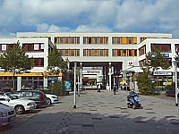In den Jahren nach der Wende wurde mit vielfältigen Maßnahmen versucht, das Neubaugebiet Prohlis attraktiver zu machen. In der Nähe der Gleisschleife entstand ein modernes Einkaufszentrum mit zahlreichen Geschäften. Als neues Ortszentrum wurde der Jacob-Winter-Platz ausgebaut, wo seit 2002 auch das Ortsamt Prohlis seinen Sitz hat. Außerdem begann die Sanierung der vorhandenen Plattenbauten. Weitere Gebäude wurden zugunsten von Park- und Grünflächen abgerissen, darunter die “Sternhäuser” an der Flurgrenze zu Niedersedlitz.

Schulen in Prohlis:

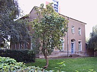Dorfschule:
Die Prohliser Kinder besuchten ab 1674 die Leubnitzer Kirchschule, nachdem der Ort von der Frauenkirche nach Leubnitz gepfarrt worden war. Diese
Schule wurde auch von Johann Georg Palitzsch besucht, dessen Sohn 1803 eine bis heute bestehende Stiftung zur Förderung der Prohliser Schulkinder ins Leben rief.
Erst 1889 entstand an der Prohliser Straße 34 ein eigenes Schulhaus für den Ort, welches am 8. Oktober 1890 geweiht wurde. Die Innenausstattung wurde von der
Familie Kap-herr gestiftet; die Bauausführung oblag dem Lockwitzer Baumeister Karl Kirsten.

1929 wurde die alte Dorfschule geschlossen, nachdem in Reick ein moderner Neubau an der Hülßestraße entstanden
war. Die Räume wurden nun als Kirchgemeindesaal, nach 1945 als Jugendheim genutzt. 1952 entstand hier ein Kindergarten. Seit 1997 dient das Gebäude dem Heinrich-Schütz-Konservatorium als Außenstelle.

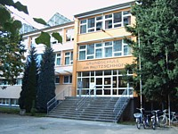Neue Schulen:

Im Zuge des Neubaugebietes entstanden in Prohlis zwischen 1976 und 1985 sechs moderne Schulneubauten sowie eine Sonderschule. Nach 1990 wurden diese Schulgebäude vom Erich-Wustmann-Gymnasium (2004 geschlossen), zwei Mittel- und zwei Grundschulen genutzt _( **Foto:** Grundschule “Am Palitzschhof”)_.

118./119. Polytechnische Oberschule: Der Doppelstandort an der Wilhelm-Koenen-Straße 1 - 3 (heute Boxberger Straße) wurde 1976 mit zwei Schulneubauten vom Typ "Dresden Atrium" bebaut. Als erste Prohliser Schule öffnete hier im Oktober 1976 die 118. POS, ein Jahr später die 119. POS. Beide Schulen waren baulich miteinander verbunden, blieben jedoch organisatorisch eigenständig. In den 1980er Jahren erhielten sie nach zwei Widerstandskämpfern gegen das NS-Regime die Namen "Georg Schilling" (118. POS) und "Herbert Warnke" (119. POS). 1991 wurden sie im Zuge der Neugliederung des Bildungssystems zur 118. Grund- bzw. 119. Mittelschule und 1995 geschlossen. Eines der beiden Schulgebäude dient seitdem als Auslagerungsstandort bei Sanierungsarbeiten, das andere wurde 2015 in eine Asylbewerberunterkunft umgewandelt.

120\. Polytechnische Oberschule: Das Schulhaus von Typ "Dresden Atrium" entstand Ende der 1970er Jahre im Zusammenhang mit der Bebauung an der Trattendorfer Straße (Nr. 1). Am 3. April 1982 erhielt die Schule den Namen des sozialdemokratischen Politikers Wilhelm Koenen (1886-1963), Mitbegründer der Bewegung “Freies Deutschland”. 1991 wurde die POS in eine Grundschule umgewandelt und wird heute 120. Grundschule "Am Geberbach" genannt.

Albert-Schweitzer-Schule:
Die Einrichtung wurde 1922 als “Hilfsschule Striesen” im Gebäude der 25. Volksschule auf der Wormser Straße gegründet und widmet sich
seither der Förderung lernbehinderter Schüler. Zwischen 1939 und 1945 war sie auf der Gustav-Freytag-Straße (32. Volksschule), danach bis 1959 auf der Junghansstraße untergebracht. Dann wurde das
Gebäude der ehemaligen Reicker Volksschule genutzt, bevor 1979 ein moderner Neubau in Prohlis bezogen werden konnte. Seit 2008 ist die heute als Förderzentrum “Albert Schweitzer” bezeichnete Schule in den Räumen der
ehemaligen 123. Mittelschule Georg-Palitzsch-Straße 42 untergebracht.

Heimat- und Palitzschmuseum:

Das Prohliser Heimat- und Palitzschmuseum befindet sich im letzten erhaltenen Gehöft des alten Dorfkerns. Ursprünglich war dieser Hof im Besitz der Familie Hünichen und erhielt sein heutiges Aussehen nach den Zerstörungen von 1813. Am 9. März 1839 trat in diesem Gebäude der erste Prohliser Gemeinderat zusammen und wählte Johann Christian Hünichen zum Gemeindevorstand. Über dem Eingang des Wohnhauses erinnert eine Gedenktafel von 1851 an diesen Besitzer.

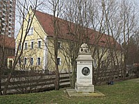Der historische Dreiseithof an der Gamigstraße wurde als einziges Prohliser Bauerngut nicht abgerissen und stellt deshalb ein besonderes Zeugnis der Ortsgeschichte dar. Lediglich die Scheune fiel 1982 dem Abbruch zum Opfer. Die beiden verbliebenen Flügel wurden zunächst als Wäscherei und Dienstleistungsservice für das Neubauviertel genutzt, später rekonstruiert und zum Stadtteilzentrum umgebaut. Seit 6. Juni 1988 befindet sich hier das Prohliser Heimatmuseum, welches neben Dokumenten und Exponaten zur Ortsgeschichte auch an Johann Georg Palitzsch und seine wissenschaftliche Arbeit erinnert. Außerdem sind frühgeschichtliche Besiedlungsfunde zu sehen, die durch den Ziegeleibetrieb bzw. bei Bauarbeiten entdeckt wurden und die 7000-jährige Besiedlung des Gebietes dokumentieren. Weitere Räume zeigen u.a. eine historische Handweberei von 1900 bzw. dienen als Arbeits- und Veranstaltungsräume für verschiedene kulturelle Initiativen. In Kooperation mit der Jugend&KunstSchule werden für Interessierte auch Webereikurse angeboten. 2007 - 2010 wurde das Museum neu gestaltet.

Unweit des Gehöftes steht seit 2006 eine originelle Sonnenuhr in Form einer Kartoffel. Johann Georg Palitzsch hatte im 18. Jahrhundert den Kartoffelanbau im Dresdner Raum eingeführt. Initiatoren waren die Prohliser Petra Schulze und Andreas Damme, die ihr Vorhaben gemeinsam mit dem Künstler Manfred Eisen-Graf und der Palitzsch-Gesellschaft umsetzten.

[Heimat- und palitzschmuseum dresden-prohlis gamigstraße 24, 01239 dresden tel. 0351-7967249](http://museen-dresden.de/index.php?lang=de&node=palitzschmuseum)

Freibad Prohlis:

Das Gelände des heutigen Prohliser Freibads wurde bis 1906 von der Ziegelei Pahlisch & Voigt (Dohnaer Straße 135)
als Lehmgrube genutzt. 1933 verpachtete Max Pahlisch das Areal zur Anlage eines Familienbades. Zu diesem Zeitpunkt
waren die früheren Ziegeleigebäude mit Ausnahme des Wohnhauses und eines Wirtschaftsgebäudes bereits abgerissen. Den Betrieb übernahm als Pächter Kurt Thomas, der auf dem Grundstück ein Schwimmbecken und eine große
Liegewiese anlegte _(Foto)_. Bis Ende der 50er Jahre blieb das Bad in Privatbesitz.

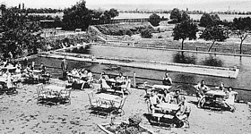

Erst 1959 übernahm die Stadt Dresden das Freibad auf Pachtbasis und erwarb schließlich 1967 das Grundstück per Kaufvertrag.
Zu dieser Zeit hatte man bereits neue Sanitäranlagen, eine “Kulturbaracke” und mehrere Campinghäuser für ein internationales Touristenlager errichtet. 1968/69 entstanden zwei neue Schwimmbecken für Schwimmer und
Nichtschwimmer, welche zum Saisonbeginn 1970 am 1. Juni übergeben wurden. Die Wasserzufuhr erfolgt seitdem über
zwei neue Brunnen, als Abfluss dient der Geberbach. Durch den Bau des benachbarten Neubaugebietes Prohlis stiegen
die Besucherzahlen des Freibades deutlich an. 1988 wurde in unmittelbarer Nachbarschaft eine Schwimmhalle errichtet. Seit 1994 betreibt der Städtische Bäderbetrieb beide Einrichtungen gemeinsam als Kombibad.

Freibad prohlis schwimmhalle prohlis senftenberger str. 58 tel. 0351/2843161

## [Prohliser Straßen](../../sudost/prohlis/strassen_prohlis/)

[_Weiterführende Literatur und Quellen_](../../impressum/quellenverzeichnis/)

 \[ [Home](../../index.html)\] \[ [Nord](../../nord/)\] \[ [Nordwest](../../nordwest/)\] \[ [Neustadt](../../neustadt/)\] \[ [Nordost](../../nordost/)\] \[ [West](../../west/)\] \[ [Zentrum](../../zentrum/)\] \[ [Südwest](../../sudwest/)\] \[ [Süd](../../sud/)\]
 \[ [Südost](../../sudost/)\] \[ [Ost](../../ost/)\] \[ [Register](../../Register/register.html)\] \[ [Kontakt](../../Kontakt/kontakt.html)\] \[ [Impressum](../../impressum/)\]
