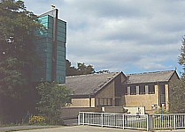

* * *

* * *

* * *

* * *

* * *

* * *

Die erste Prohliser Kirche, von der jedoch keinerlei Belege erhalten blieben, soll
bereits kurz nach Entstehung des Ortes Am Anger existiert haben. Nachgewiesen ist 1418 ein Niclas von Prohlis, der zu diesem Zeitpunkt Domherr in Meißen war.
Der wahrscheinlich aus der gleichen Familie stammende Andreas Proles gehörte zu den Vorkämpfern der Reformation in Deutschland und war um 1500 Ordensoberer des Augustinerordens. Da die erwähnte Kapelle zu diesem
Zeitpunkt nicht mehr existierte, besuchten die Prohliser die Frauenkirche in Dresden. Erst 1674 wurde Prohlis nach Leubnitz eingepfarrt.

Am 1. Mai 1931 wurde die Prohliser Kirchgemeinde
als Außenstelle von Leubnitz abgespalten und mit der Stelle eines Hilfsgeistlichen ausgestattet. Die Gottesdienste fanden in der früheren Dorfschule statt, ab 1939 im Gasthof Prohlis. Um
die Bedingungen zu verbessern, wurde der Architekt Johannes Blauert 1936 mit dem Entwurf eines Gemeindezentrums
mit Kirche, Gemeindehaus und einem Ehrenmal für die Gefallenen des Ersten Weltkriegs beauftragt. Der Beginn des Zweiten Weltkrieges und die folgende gesellschaftliche Entwicklung verhinderten jedoch den Bau.

Ab 1946 nutzte die Prohliser Gemeinde einen Saal des [Schlosses](../../../sudost/prohlis/schloss_prohlis/) als Ort für Gottesdienste. Erst die baupolizeiliche
Sperrung des Gebäudes 1977 und die Zerstörung durch einen Brand 1980 beendeten dieses Provisorium. Nach einigen Ausweichquartieren konnte die seit 1978 selbstständige Gemeinde am 10. Oktober 1982 ein modernes
Gemeindezentrum an der Georg-Palitzsch-Straße 2 beziehen. Architekt des Gebäudes, dessen Grundstein am 23. August 1980 gelegt wurde, war Heiner Göpfert. 1988 erwarb die Gemeinde eine Orgel der Firma Jehmlich.

Erst nach der politischen Wende konnte die Gemeinde den Bau des zu DDR-Zeiten nicht genehmigten Glockenturmes vorbereiten, wofür 2003 ein Architektenwettbewerb ausgeschrieben wurde. Am 21. Oktober 2005 erfolgte die
Grundsteinlegung zu diesem modernen, 30 Meter hohen Turm, dessen Entwurf von Eberhard Bauer stammt. Außerdem wurden in Passau zwei neue Glocken gegossen. Die bereits vorhandene Glocke von 1672 stammt
ursprünglich aus Kreischa und hing bis zum Abriss im Turm des Prohliser Schlosses. Später wurde sie vor dem
Pfarrhaus aufgehängt. Neben der historischen “Friedensglocke” tragen die beiden Glocken die Namen “Liebesglocke” (Inschrift: _“Gott ist die Liebe”_) und “Glaubensglocke” (Inschrift: _“Haltet an am Gebet”_
). Die feierliche Einweihung des Glockenturmes fand am 22. Januar 2006 statt.

* * *

 \[ [Home](../../../index.html)\] \[ [Nord](../../../nord/)\] \[ [Nordwest](../../../nordwest/)\] \[ [Neustadt](../../../neustadt/)\] \[ [Nordost](../../../nordost/)\] \[ [West](../../../west/)\] \[ [Zentrum](../../../zentrum/)\] \[ [Südwest](../../../sudwest/)\] \[ [Süd](../../../sud/)\] \[ [Südost](../../../sudost/)\] \[ [Ost](../../../ost/)\] \[ [Register](../../../Register/register.html)\] \[ [Kontakt](../../../Kontakt/kontakt.html)\] \[ [Impressum](../../../impressum/)\]
