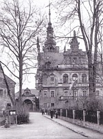
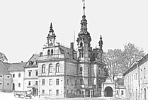

* * *

Bereits um 1200 existierte in Prohlis ein befestigter Herrenhof mit einer Wallanlage am Geberbach. Über diese Wasserburg ist nur wenig bekannt, da die einstigen Wallgräben später planiert und verfüllt wurden. Lediglich auf dem Areal des Schlossparks erinnern flache Böschungen an diese frühgeschichtliche Befestigungsanlage. In einer alten Rechnung des Dresdner Brückenamtes von 1463 ist als Besitzer dieses Hofes, urkundlich als “Villa Proleߔ erwähnt, ein gewisser Hans Henchen genannt. Jahrhundertelang bewirtschaftete diese Familie das Anwesen, welches sich nur wenig von den übrigen Prohliser Bauerngütern unterschied. Allerdings errichteten die Besitzer im 18. Jahrhundert ein bescheidenes barockes Landhaus, welches bis Mitte des 19. Jahrhunderts Zentrum der Anlage blieb.

1868 erwarb Freiherr Johann Christian von Kap-herr den Hof Hänichen und ließ umfangreiche Um- und Erweiterungsbauten vornehmen. Der Baron war als Papierfabrikant in St. Petersburg zu erheblichem Wohlstand gekommen und kaufte das Anwesen als Geschenk für einen seiner Söhne. Höhepunkt war 1887/88 der Bau eines repräsentativen Schlosses im Neorenaissancestil, der von Bernhard Schreiber unter Mitwirkung der Architekten Carl Kirsten und Otto Kreyhsig ausgeführt wurde _(Foto)_. Das Gebäude wurde auch im Inneren prunkvoll ausgestaltet und mit wertvollen Möbeln, Gemälden und Kunstgegenständen eingerichtet. Gleichzeitig entstand der Schlosspark mit verschiedenen exotischen Gehölzen, vermutlich nach Plänen des Gartenarchitekten Friedrich Bouché. Bouché hatte kurz zuvor auch die Erweiterung des Großen Gartens vorgenommen. 1884 konnte Kap-herr noch das benachbarte Palitzsch-Gut erwerben, welches an den Schlossgärtner verpachtet wurde. Bis 1945 blieben Schloss und Park mit insgesamt 63 Hektar Grundfläche im Besitz der Familie.

1945 besetzten sowjetische Soldaten das Prohliser Schloss. Die Besitzer durften zunächst in einigen Räumen wohnen bleiben, verließen Prohlis jedoch wenig später. Nachdem einquartierte Flüchtlinge Teile der wertvollen Einrichtung geplündert hatten, verpachtete der letzte Schlossherr Victor von Kap-herr das Schloss 1947 an die Kirchgemeinde Leubnitz-Neuostra, die hier einen Gemeindesaal für Prohlis einrichtete. Die landwirtschaftlichen Nebengebäude wurden ab 1954 vom VEG Pillnitz als Schweine- und Rindermastanlage genutzt. Infolge fehlender Werterhaltung verfielen diese immer mehr und mussten 1978 baupolizeilich gesperrt werden. Das Schloss selbst wurde noch bis zu diesem Zeitpunkt von der Kirche genutzt.

Im Zusammenhang mit dem Bau des Neubaugebietes wurden fast sämtliche Gebäude des alten Dorfkerns, darunter auch Teile der Schlossanlage abgerissen. Das Hauptgebäude sollte nach den Vorstellungen des Generalinvestors für Prohliszu einem Kulturzentrum des Neubaugebietes ausgebaut werden. Diesen nicht unumstrittenen Plänen setzte eine vermutlich unter Mitwirkung höherer staatlicher Stellen inszenierte Brandstiftung am 17. Dezember 1980 ein Ende. Dabei wurde ein Großteil der Innenräume und der Dachstuhl des Schlosses zerstört. Alle Versuche zur Rettung der Brandruine für einen späteren Wiederaufbau scheiterten. Im März 1985 wurde das Prohliser Schloss abgerissen. Heute erinnern nur noch wenige Reste und eine 2007 aufgestellte Gedenktafel an den früheren Standort. Erhalten blieb jedoch der Schlosspark, der in den letzten Jahren in Anlehnung an sein früheres Aussehen wiederhergestellt wurde. Dieses Gelände gehört seit 1990 wieder den Erben der früheren Schlossbesitzer.

* * *

 \[ [Home](../../../index.html)\] \[ [Nord](../../../nord/)\] \[ [Nordwest](../../../nordwest/)\] \[ [Neustadt](../../../neustadt/)\] \[ [Nordost](../../../nordost/)\] \[ [West](../../../west/)\] \[ [Zentrum](../../../zentrum/)\] \[ [Südwest](../../../sudwest/)\] \[ [Süd](../../../sud/)\] \[ [Südost](../../../sudost/)\] \[ [Ost](../../../ost/)\] \[ [Register](../../../Register/register.html)\] \[ [Kontakt](../../../Kontakt/kontakt.html)\] \[ [Impressum](../../../impressum/)\]
