* * *

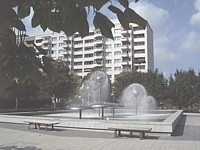Der Platz wurde im Zusammenhang mit dem Bau des Neubaugebietes angelegt und erhielt
zunächst den Namen Wilhelm-Koenen-Platz. Der Sozialdemokrat Wilhelm Koenen (1886-1963) emigrierte 1933 nach Frankreich, später in die Tschechoslowakei und nach England und gehörte
zu den Mitbegründern der Bewegung “Freies Deutschland”. 1945/46 war er Chefredakteur der KPD-Zeitung “Freiheit” in Halle.

1993 erfolgte die Umbennung des Wilhelm-Koenen-Platzes in Albert-Wolf-Platz. Der Name
erinnert an den früheren Dresdner Rabbiner Albert Wolf (1890-1951), der 1920 ins Amt kam. Nach seiner Verhaftung durch die Nazis gelang ihm 1939 die Emigration in die USA.

2007 erfolgte eine Neugestaltung der Platzanlage. Dabei fanden hier auch Teile des “Pusteblumenbrunnens” der Künstlerin Leonie
Wirth einen neuen Standort. Ursprünglich bildete dieser Brunnen ab 1969 einen Blickfang der Prager Straße, wurde dort jedoch
2004 demontiert und nur in stark reduzierter Form wiederaufgebaut. Für den Prohliser Brunnen fanden die nicht wieder verwendeten
beiden großen Pusteblumen und fünf Wasserpilze, ergänzt um drei Nachbildungen, Verwendung. Diese Arbeiten übernahm der
Dresdner Kunstschmied Alexander Bergmann, dessen Großvater in den 1960er Jahren die Originalteile geschaffen hatte. Am 5. Mai 2009 wurde der Brunnen in weitgehend originaler Form in Betrieb genommen.

[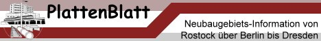](http://www.plattenblatt.wg.am)

Als Altprohlis wurde früher der historische Dorfplatz von Prohlis bezeichnet, um den sich die Gehöfte des Ortes gruppierten. Nach der Eingemeindung erfolgte die offizielle Umbenennung in Altprohlis, die 1924 erstmals nachweisbar ist. Im Zuge der Errichtung des Neubaugebietes Prohlis fielen mit Ausnahme eines Dreiseithofes sämtliche Gebäude dem Abriss zum Opfer. In diesem Zusammenhang wurde auch der Platz Altprohlis überbaut. Seine Lage war ungefähr an der Kreuzung Gamigstraße / Georg-Palitzsch-Straße. Im letzten erhaltenen Gutshof befindet sich heute das [Heimat- und Palitzschmuseum](../../../sudost/prohlis/).

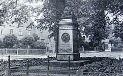

**_Foto:_** _Der Dorfplatz Altprohlis mit dem Palitzsch-Denkmal in den 1930er Jahren_

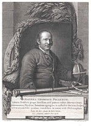Nr. 11: Der heute nicht mehr erhaltene Gutshof gehörte im Mittelalter zu den Besitzungen des Dresdner Maternihospitals, das das Gehöft gemeinsam mit dem benachbarten Haus- und Gartengrundstück Nr. 10 erworben hatte. Im 18. Jahrhundert gehörte der Hof der ursprünglich aus Coschütz stammenden Familie Palitzsch. Am 11. Juni 1723 wurde hier der bekannte Bauernastronom Johann Georg Palitzsch geboren. Nach dem frühen Tod seines Vaters übernahm zunächst seine Mutter gemeinsam mit ihrem neuen Ehepartner die Verwaltung, bevor 1744 ihr Sohn die Wirtschaft übernahm. Das 1 1/2 Hufen-Gut bestand zu diesem Zeitpunkt aus Wohnhaus, Stall, Scheune, mehreren Nebengebäuden und Ackerflächen.

Palitzsch befasste sich neben seiner bäuerlichen Arbeit mit Naturwissenschaften und Astronomie und wurde für seine Forschungen viel geehrt. Seine umfangreiche Sammlung, bestehend aus astronomischen Geräten, Mineralien, ausgestopften Tieren, exotischen Hölzern, völkerkundlichen Gegenstände und einer großen Bibliothek war in mehreren Räumen im Seitenflügel des Bauernhofes untergebracht. Kurfürst Friedrich August III. ließ ihn von allen Frondiensten befreien und besuchte ihn am 5. 8. 1779 auf seinem Prohliser Gut. Am 21. Februar 1788 verstarb Palitzsch in seinem Haus, sein Nachlass ging bei Plünderungen 1813 verloren.

_**Bild:** Stich von Christian Gottfried Schulze (1782) nach einem Anton Graff-Gemälde von 1777 / Wikipedia._

Die Straße Am Anger geht auf einen Verbindungsweg zwischen dem früheren Dorfkern und der Tornaer Straße zurück. Ende des 19. Jahrhunderts entstand hier die bis 1924 betriebene [Ziegelei Kunath](../../../sudost/prohlis/strassen_prohlis/ziegelei_kunath/), deren Areal heute als Naturpark Prohlis unter Schutz steht.
Seit 1928 ist die Straße im Adressbuch verzeichnet.  Im Zuge der Neubebauung nach 1979 wurde sie ausgebaut und mit 16-geschossigen Wohnhochhäusern bebaut.

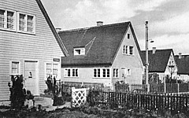Südlich der Straße entstand zwischen 1926 und 1930 eine Holzhaussiedlung zu beiden
Seiten des neu angelegten Torweges. Die Straßen wurden nach Vogelarten benannt und mit Typenhäusern der Firmen Höntsch & Co. Niedersedlitz und der Deutschen Werkstätten
Hellerau bebaut. Die Entwürfe für die aus fünfzig Doppelhäusern bestehende Siedlung _(Foto)_ stammten von Stadtbaurat Paul Wolf. Bevorzugt wurden diese Gebäude an
kinderreiche Familien verkauft. 1945 fiel die Siedlung mit Ausnahme eines einzigen Hauses den Bomben zum Opfer. Ab 1950 wurden die zerstörten Gebäude durch massive
Eigenheime ersetzt. Das letzte erhaltene Holzhaus am Zeisigweg wurde nach 1990 denkmalgerecht saniert.

Die Berzdorfer Straße entstand in den 1980er Jahren im nördlichen Teil des Neubaugebietes Prohlis. Ihren Namen erhielt sie nach
dem Dorf Berzdorf auf dem Eigen bei Görlitz. Der Ort, der bereits 1963 als Ortsteil zur Gemeinde Schönau-Berzdorf kam, fiel 1969 dem Braunkohleabbau zum Opfer. An seiner Stelle befindet sich heute der Berzdorfer See.

Die Boxberger Straße wurde im Zuge des Aufbaus des Neubaugebietes Prohlis angelegt und zunächst Wilhelm-Koenen-Straße genannt. Der Politiker Wilhelm Koenen (1886-1963) gehörte zunächst der USPD, später der KPD an und war nach 1945 am Aufbau des politischen Lebens in der DDR beteiligt. Ab 1946 saß er für die SED im sächsischen Landtag, ab 1949 auch in der Volkskammer. Am 25. Februar 1993 erfolgte die Umbenennung der Straße nach dem Ort Boxberg bei Weißwasser. Zeitgleich erhielt der angrenzende Wilhelm-Koenen-Platz den Namen Albert-Wolf-Platz.

Der Dohnaer Platz entstand als nördlicher Abschluss eines Wohngebiets an der Tornaer Straße, welches zwischen 1926 und 1930
überwiegend mit Holzhäusern bebaut wurde. Die Gebäude um den Dohnaer Platz, der 1930 erstmals im Adressbuch geführt wird,
wurden jedoch 1929 in massiver Bauweise errichtet. Die Namensgebung erfolgte in Anlehnung an die südlich des Platzes verlaufende Dohnaer Straße nach der Kleinstadt Dohna bei Pirna.

Der 1927 nach einer Vogelart benannte Drosselweg liegt in einem kleinen Wohngebiet, welches zwischen 1926 und 1930 angelegt
wurde. Ursprünglich gab es hier vorwiegend Holzhäuser der Niedersedlitzer Firma Höntsch & Co. und der Deutschen Werkstätten
Hellerau. Mit Ausnahme eines Doppelhauses am Zeisigweg fielen alle Gebäude dem Luftangriff zum Opfer. Auf den Fundamenten entstanden ab 1950 neue Wohnhäuser, nun jedoch in Massivbauweise.

Die Elsterwerdaer Straße entstand Anfang der 1980er Jahre im Zusammenhang mit dem Prohliser Neubaugebiet und erhielt ihren Namen nach der brandenburgischen Kleinstadt Elsterwerda. Im Zusammenhang mit der städtebaulichen Neuordnung des Areals wurde der zehngeschossige Plattenbau Elsterwerdaer Straße 1-7 2005 zugunsten einer Grünfläche abgerissen. Ein am Giebel befindliches Wandbild “Mutter und Kind” des Dresdner Künstlers Siegfried Schade konnte geborgen und für eine Wiederverwendung an anderer Stelle eingelagert werden. Das Kunstwerk entstand zwischen 1975 und 1979 aus 30 einzelnen Platten und stellt ein bedeutendes Zeugnis der architekturbezogenen Kunst der DDR dar.

Der nach einer Vogelart benannte Finkenweg befindet sich in einem Wohngebiet, welches zwischen 1926 und 1930 entstand. Die
Siedlung, zu der auch einige benachbarte Straßen gehören, war ursprünglich mit Holzhäusern der Firma [Höntzsch & Co.](../../../ost/niedersedlitz/strassen_niedersedlitz/) und der [Deutschen Werkstätten](../../../nord/hellerau/deutsche_werkstatten/) Hellerau bebaut. Sämtliche Gebäude fielen, mit Ausnahme eines Doppelhauses am Zeisigweg, 1945 dem
Luftangriff zum Opfer. Nach 1950 entstanden auf den Grundmauern neue Einfamilienhäuser in massiver Bauweise.

Die Finsterwalder  Straße entstand um 1980 im östlichen Teil des Neubaugebietes Prohlis und wurde, ebenso wie die meisten
Nachbarstraße nach einer Stadt in Brandenburg benannt. Finsterwalde liegt im Süden des Bundeslandes und ist auch als “Sängerstadt” bekannt.

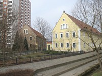Die Gamigstraße verband ursprünglich den Prohliser Dorfkern mit den südlich des Ortes gelegenen Lehmgruben bei Torna. Im 19. Jahrhundert siedelten sich hier mehrere Ziegeleien an, die heute jedoch nicht mehr existieren. An der Gamigstraße bestand bis zum Abriss 1979 auch die alte Dorfschmiede, die 1710 erstmals erwähnt wurde. Seit 1832 befand sich diese im Besitz der Familie Enke, die ihr Unternehmen 1978 nach Großluga verlegte. Ihren Namen erhielt die Straße 1926 nach einer Geländeerhebung bei [Torna](../../../sudost/torna/). Zuvor wurde sie kurzzeitig Dorfstraße genannt.

Durch den Bau des Neubaugebietes veränderte die Gamigstraße teilweise ihren Verlauf und wurde bis zur Mügelner Straße verlängert. Die vorhandenen Gebäude mussten mit wenigen Ausnahmen der Neubebauung weichen. Zu beiden Seiten der Gamigstraße befinden sich Parkanlagen, die auf den früheren Schlosspark bzw. eine renaturierte Kiesgrube zurückgehen. Vor den Wohnhochhäusern Gamigstraße 20 und 22 ist eine “Windskulptur” der Künstlerin Leoni Wirth zu sehen. Die aus Stahl und farbigen Glasornamenten bestehende Plastik dreht sich bei Wind in die entsprechende Richtung, befindet sich derzeit jedoch leider in reparaturbedürftigem Zustand. Eine Restaurierung ist geplant.

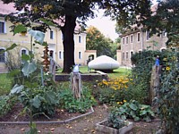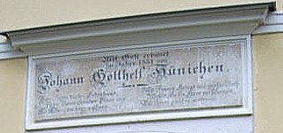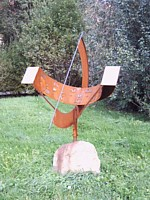

**_Fotos:_** _Impressionen um den Palitzschhof - Schrifttafel über dem Eingang und Sonnenuhr zu Ehren von Palitzsch_

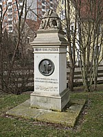Palitzsch-Denkmal:
An der Gamigstraße steht seit 1877 ein Denkmal für den Bauernastronomen Johann Georg Palitzsch, der 1723 auf dem väterlichen Gut in Prohlis geboren wurde und 1758 den Halleyschen
Kometen wiederentdeckte. Das Monument zeigt einen Himmelsglobus nebst Fernrohr, Zirkel und Winkelmesser und wurde von den Bildhauern Knieling und Biltz geschaffen. 1938 und 1988 erfolgten
Erneuerungen des Denkmals, welches einst den Mittelpunkt des verschwundenen Dorfplatzes Altprohlis bildete. 2006 wurde es auf die Fläche unmittelbar vor dem Palitzschhof versetzt.

Eine weitere
Erinnerungsstätte für Johann Georg Palitzsch entstand 2006 auf Initiative der Palitzsch-Gesellschaft. Die vom Künstler Manfred Eisen-Graf gestaltete Sonnenuhr in Form einer
Kartoffel befindet sich an der Ecke Gamigstraße / Prohliser Straße und erinnert daran, dass Palitzsch den Kartoffelanbau im Dresdner Raum einführte.

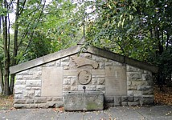Palitzschbrunnen:
Der Brunnen wurde vermutlich Anfang des 18. Jahrhunderts gegraben und gehörte zum früheren Palitzschgut in Altprohlis. Aus Anlass des 200. Geburtstages von Johann
Georg Palitzsch wurde die Anlage 1923 zu einem Denkmalbrunnen umgestaltet. Der Brunnen hat die Form eines Hausgiebels und zeigt ein Porträtmedaillon des Bauernastronomen, darüber
einen Kometen sowie zu beiden Seiten zwei Schrifttafeln. 1976 musste der stark verfallene Brunnen abgebaut werden und wurde 1980/81 restauriert. Seitdem befindet er sich auf dem Schulhof der 121./122. Oberschule. _( **Foto:**_
_Paulae / Wikipedia)_

Die Georg-Palitzsch-Straße erinnert an den bekanntesten Prohliser Einwohner, den Bauernastronomen Johann Georg Palitzsch (1723-1788). Palitzsch besaß ein Gut im Dorf, welches später als Beigut zum Schloss gehörte und 1978 abgerissen wurde. Am 25. Dezember 1758 entdeckte er den Halleyschen Kometen wieder und wurde für seine wissenschaftliche Leistung vielfach geehrt. Weniger bekannt sind Palitzschs Verdienste auf dem Gebiet der Botanik (Anbau der ersten Kartoffeln im Dresdner Raum) und derPhysik (Installation des ersten Dresdner Blitzableiters auf dem Schlossturm). Zu den Gästen des Astronomen auf seinem Prohliser Gut gehörten u.a. Kurfürst Friedrich August III., Prinz Heinrich von Preußen und Prinz Leopold von Braunschweig.

In ihren Grundzügen geht die Georg-Palitzsch-Straße auf einen alten Verbindungsweg zwischen dem Dorfkern und dem benachbarten Niedersedlitz zurück. Nach dessen Ausbau wurde dieser Weg als Niedersedlitzer Straße bezeichnet. Mit der Eingemeindung von Prohlis nach Dresden wechselte die Namensgebung 1925 in Georg-Palitzsch-Straße. Beim Bau des Neubaugebietes Prohlis änderte sich der Straßenverlauf durch Überbauung. Der Name wurde daraufhin auf die heute noch bestehende neu angelegte Straße im Süden des Neubauviertels übertragen.

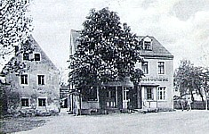Schloßschänke: Die Schloßschänke entstand im 19. Jahrhundert am alten Dorfplatz und war
mit angeschlossener Fleischerei, Gästegarten und Tanzsaal beliebte Einkehrstätte der Einwohner und Gäste des Ortes. Ein weiterer Gasthof befand sich an der [Dohnaer Straße](../../../sudost/strehlen/strassen_strehlen/dohnaer_strasse/) gegenüber der Gamigstraße. Während diese, nach ihren Besitzern auch Wolfscher Gasthof
genannte Einkehrstätte 1945 den Bomben zum Opfer fiel, blieb die Schloßschänke noch bis in die 1960er Jahre geöffnet. Zuletzt befand sich hier eine Polsterwerkstatt, bevor das Gebäude mit dem Dorfkern 1979 abgerissen wurde.

Der Goldammerweg verbindet den Prohliser Meisenweg mit der bereits auf Reicker Flur gelegenen Hülßestraße. Ursprünglich war der 1937 erstmals im Adressbuch genannte Weg eine kurze Sackgasse, wurde später jedoch verlängert. Wie auch bei anderen Straßennamen in diesem Wohngebiet erfolgte die Namensgebung nach einer Vogelart.

Die Gubener Straße befindet sich im nordwestlichen Teil des Neubaugebietes Prohlis, das um 1980 entstand. Guben liegt in der Niederlausitz im Osten von Brandenburg an der Grenze zu Polen.

Die Hauboldstraße bildet die südliche Verlängerung der Gamigstraße und entstand erst nach 1990 im Zuge der Bebauung dieses Gewerbegebietes. Mit der Namensgebung wird an den Mathematiker und Geographen Georg Gottlieb Haubold (1714-1772) erinnert. Zwischen 1751 und 1772 war er Oberinspektor des Mathematisch-Physikalischen Salons.

Die Herzberger Straße wurde im Zuge des Neubauviertels um 1980 in der Nähe des Jacob-Winter-Platzes angelegt. Wie auch viele benachbarte Straßen erhielt sie ihren Namen nach einem Ort in der Lausitz, der Stadt Herzberg in Südbrandenburg.

Der Jacob-Winter-Platz wurde Ende der 1970er Jahre angelegt und erhielt zunächst den Namen des früheren SPD-Politikers Otto Grotewohl (1894-1964). Grotewohl übernahm nach der Vereinigung der Arbeiterparteien zur SED 1946 gemeinsam mit Wilhelm Pieck den Vorsitz der Einheitspartei. Am Otto-Grotewohl-Platz war ursprünglich das Stadtteilzentrum für Prohlis mit Läden, Gaststätten und Verwaltungseinrichtungen geplant, welches jedoch bis 1989 nicht realisiert wurde. Lediglich ein Industriewaren-Kaufhaus öffnete unter dem Namen “Magnet Prohlis” am 1. Juli 1987 seine Türen. Erst am 25. Oktober 2001 konnte hier das neue Prohlis-Zentrum als künftiges Ortsteilzentrum übergeben werden.

Seit dem 25. Februar 1993 trägt der Otto-Grotewohl-Platz den Namen Jacob Winters. Jacob Winter (1857-1940) war ab 1886 dritter Oberrabbiner der jüdischen Gemeinde in Dresden und wurde 1912 zum Professor der Literaturwissenschaften ernannt. Er verstarb 1940 in Berlin und wurde auf dem Neuen Jüdischen Friedhof in der Johannstadt beigesetzt.

Die Köhlerstraße wurde nach 1990 im Zusammenhang mit der Erschließung von Gewerbeflächen an der Dohnaer Straße angelegt
und nach Johann Gottfried Köhler (1745-1801) benannt. Köhler war zwischen 1785 und 1801 Oberinspektor des Mathematisch-Physikalischen Salons und der Kunstkammer.

Der Lange Weg verbindet die Dohnaer Straße und die Mügelner Straße und bildet gleichzeitig die östliche Grenze von Prohlis. Da
diese Straße beim Bau des Neubaugebietes als Hauptverkehrsverbindung geplant war, wurden hier keine Wohngebäude errichtet.
1998 entstand am Langen Weg das erste Smart-Center Sachsens mit seinem charakteristischen “Schaufensterturm” zur Präsentation der Fahrzeuge.

Die Prohliser Allee entstand im Zusammenhang mit dem Bau des Neubaugebietes und bildet dessen Hauptachse. In den Erdgeschosszonen der Wohnhäuser wurden Läden und Versorgungseinrichtungen für die Bewohner des Stadtteils eingerichtet. Zu diesen gehörte u.a. das heute als Stadtteilzentrum genutzte "Magnet"-Kaufhaus (eröffnet 1987), die Wohngebietsgaststätte "Stern" (1977), das Café "Spree" (1978) und das Eiscafé "Espresso" (1981). Außerdem gab es an der Prohliser Allee ein Ambulatorium und ein Altersheim. Gleichzeitig wurde eine neue Straßenbahntrasse angelegt. Zur künstlerischen Auflockerung der meist zehngeschossigen Wohnblocks dienten Keramikwandbilder an den Giebelflächen, welche von den Künstlern Klaus Dennhardt (Nähe Gaststätte “Stern”), Hernando Leon (Herzberger-/Gamigstraße) und Siegfried Schade (Ecke Elsterwerdaer Straße) gestaltet wurden. Leider gingen die beiden letzteren bei Abbrüchen und Sanierungen nach 1990 verloren.

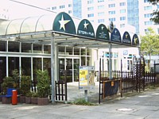Wohngebietsgaststätte “Stern”: Das Lokal entstand 1977 im Zusammenhang mit dem Bau des Neubaugebietes und diente neben der gastronomischen Versorgung des Stadtteils zugleich auch als Wohngebietstreff. Regelmäßig fanden hier Vorträge, Tanz- und andere Veranstaltungen sowie Familienfeiern statt. Nach 1990 wurde die Gaststätte geschlossen und das Haus umgebaut. Heute befinden sich hier u.a. eine Spielothek und eine Bankfiliale. Teile des Gebäudes werden auch wieder gastronomisch genutzt. Im April 2007 erhielt die Gaststätte ihren ursprünglichen Namen “Stern”, mit dem an den Prohliser Bauernastronomen Johann Georg Palitzsch erinnert werden soll, zurück. Vor dem Haus steht die 1973 von Walter Howard geschaffene Bronzeplastik “Sternengucker”, welche Palitzsch und ein Kind beim Betrachten des Sternenhimmels zeigt.

Die Trattendorfer Straße wurde als eine der ersten neuen Straßen des Neubaugebietes Prohlis angelegt. Am 26. Februar 1976 erfolgte hier die Grundsteinlegung für den neuen Stadtteil. In der Folge entstanden an der Straße sechsgeschossige Plattenbauten sowie ein Schulhaus vom Typ "Dresden Atium", welches bis 1991 von der 120. POS "Wilhelm Koenen", heute von der 120. Grundschule "Am Geberbach" genutzt wird. Der Straßenname erinnert an den kleinen Ort Trattendorf im südlichen Brandenburg, heute ein Stadtteil von Spremberg.

[Prohlis auf OpenStreetMap](https://www.openstreetmap.org/search?query=Dresden+Prohlis)

* * *

 \[ [Home](../../../index.html)\] \[ [Nord](../../../nord/)\] \[ [Nordwest](../../../nordwest/)\] \[ [Neustadt](../../../neustadt/)\] \[ [Nordost](../../../nordost/)\] \[ [West](../../../west/)\] \[ [Zentrum](../../../zentrum/)\] \[ [Südwest](../../../sudwest/)\] \[ [Süd](../../../sud/)\] \[ [Südost](../../../sudost/)\] \[ [Ost](../../../ost/)\] \[ [Register](../../../Register/register.html)\] \[ [Kontakt](../../../Kontakt/kontakt.html)\] \[ [Impressum](../../../impressum/)\]
