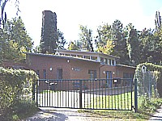

* * *

* * *

* * *

Die Ziegelei Kunath wurde um 1870 von Friedrich Kunath gegründet und nahm ursprünglich das gesamte Areal bis zur [Dohnaer Straße](../../../../sudost/strehlen/strassen_strehlen/dohnaer_strasse/) ein. Nach bescheidenen Anfängen entstand 1873 ein moderner Vierkammer-Brennofen, der vor allem zur Produktion hochwertiger Dachziegel genutzt wurde. 1887 stellte Kunath die Produktion von Hand- auf Dampfbetrieb um und erweiterte zehn Jahre seine Ziegelei um einen weiteren Brennofen. Später übernahmen die Söhne Ernst Richard und Karl Hugo Kunath den Betrieb, der bis Ende 1924 in der Ziegelherstellung tätig war. Anschließend wurde durch die Dresdner Baufirma K. F. Bretschneider in den Lehmgruben noch Kies abgebaut. Bei den Abbauarbeiten entdeckte man im Herbst 1929 ein gut erhaltenes Mammutskelett. Bereits 1924 hatten die Besitzer auf dem ehemaligen Ziegelofen einen kleinen Natur- und Blumengarten geschaffen, der als Prohliser Naturpark öffentlich zugänglich war.

Die nach der endgültigen Stillegung der Grube 1953 nicht mehr benötigten Flächen
erhielten im Anschluss ebenfalls eine parkartige Gestaltung, wobei sowohl ein als Restloch verbliebener Teich als auch Reste der Ziegeleigebäude mit einbezogen
wurden. Die geplante Verfüllung der Lehmgrube in den 1960er Jahren wurde durch die Unterschutzstellung des Parks als Natur- und Vogelschutzgebiet verhindert. Seit
2006 befindet sich hier eine Außenstelle des Umweltzentrums Dresden. Regelmäßig finden Veranstaltungen zu ökologischen Themen statt. Der frühere Brennofen dient als
Ausstellungsraum. Das Restloch der früheren Lehmgrube steht als Naturdenkmal unter Schutz und ist Brutplatz von über 40 Vogelarten. Auch verschiedene Eidechsen und
Kleinsäuger wie Kaninchen und Füchse sind hier heimisch. Seit 2012 werden die drei bestehenden Naturschutzgebiete in Prohlis und Torna unter dem Namen „Ziegeleigruben in Prohlis und Torna“ zusammengefasst und bilden ein
zusammenhängendes Naturreservat.

* * *

 \[ [Nord](../../../../nord/)\] \[ [Nordwest](../../../../nordwest/)\] \[ [Neustadt](../../../../neustadt/)\] \[ [Nordost](../../../../nordost/)\] \[ [West](../../../../west/)\] \[ [Zentrum](../../../../zentrum/)\] \[ [Südwest](../../../../sudwest/)\]
 \[ [Süd](../../../../sud/)\] \[ [Südost](../../../../sudost/)\] \[ [Ost](../../../../ost/)\] \[ [Register](../../../../Register/register.html)\] \[ [Kontakt](../../../../Kontakt/kontakt.html)\] \[ [Impressum](../../../../impressum/)\]
