* * *

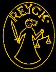

**Gemeindesiegel von Reick**

* * *

**Schulen in Reick**

[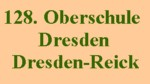](http://www.dd.shuttle.de/128ms/)

[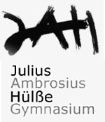](http://www.huelsse-gym.de)

* * *

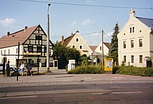Das Rundplatzdorf Reick wurde Mitte des 11. Jahrhunderts durch slawische Siedler
angelegt und 1288 erstmals urkundlich erwähnt, als das Meißner Lorenzhospital hier Zinsrechte erwarb. Der Ortsname, ursprünglich Rykh, ist vom altsorbischen Wort ryk
= Graben abgeleitet. Zu Reick gehörten auch die Fluren des wüst gewordenen Dorfes Lippen. 1318 erwarben die Mönche des Klosters Altzella den Ort für ihren Klosterhof
in Leubnitz, der seinen Besitz 1396 durch Ankauf des einstigen Vorwerks der Familie Ziegler noch erweitern konnte. Bis zur Säkularisierung unterstand Reick nun dem
Hofmeister zu Leubnitz und kam dann gemeinsam mit dem Leubnitzer Amt 1550 an den Rat der Stadt Dresden. Historisch verbürgt ist, dass sich die Reicker Bauern 1682 gemeinsam mit ihren Nachbarn
in Strehlen und Prohlis gegen die Amtsherrschaft auflehnten und ihre Ackertage verweigerten.

Mehrfach wurde das Dorf von Katastrophen heimgesucht, die großes Leid für die Bevölkerung verursachten. So kam
es 1677 zu einem schweren Hochwasser, 1632 und 1714 zu Pestepedemien und 1790 zu einem Dorfbrand, an den noch eine Gedenktafel in [Altreick](../../sudost/reick/strassen_reick/) erinnert. 1807 fielen mehrere Gehöfte der Tat eines Brandstifters zum Opfer, der dafür später in Lockwitz hingerichtet wurde. 1813 wurden erneut Teile des Ortes im Zusammenhang mit der Schlacht
bei Dresden in Mitleidenschaft gezogen.

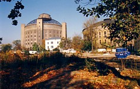
Durch den Bau der Bahnlinie Dresden - Pirna wandelte sich Reick vom Bauerndorf zum Wohn- und Industrievorort Dresdens. 1848 erhielt der Ort erstmals eine
Bahnstation, die jedoch 1857 wieder eingezogen wurde. Erst 1906/07 konnte der neue Bahnhof Reick eröffnet werden, welcher heute als S-Bahn-Haltepunkt genutzt
wird. Neben einigen Industriebetrieben, die sich vorrangig entlang der Bahnstrecke niederließen, erwarb die Stadt Dresden 1872 12 Hektar Land in Reick, auf dem zwischen 1878-1881 das [Gaswerk](../../sudost/reick/gaswerk_reick/) entstand. Der 1909 gebaute Gasometer des Betriebes, von Erlwein entworfen, ist bis heute Wahrzeichen des Stadtteils geblieben _(Foto)_. Im gleichen Jahr wurde in dessen Nachbarschaft eine bis 1939 existierende Radrennbahn angelegt.

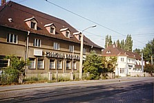 Zu den bedeutenden Unternehmen, die sich bis 1900 in Reick angesiedelten, gehörten auch die Kamerafabrik Emil Wünsche (später PENTACON), die [Lackfabrik Süring](../../sudost/strehlen/strassen_strehlen/dohnaer_strasse/), die Werkzeugmaschinenfabrik John & Eichler sowie die Zieh- und Stanzwerke Reick Schmalzeders Erben (nach 1945 VEB Stanzila) an der Mügelner Straße _(Foto)_. Hier war 1913 auch ein bis heute genutzter Straßenbahnhof errichtet worden. Ein weiterer Fabrikbezirk entwickelte sich um die Lohrmannstraße mit Unternehmen der Holz- und metallverarbeitenden Industrie. Der stark gewachsene Vorort wurde am 1. Januar 1913 nach Dresden eingemeindet.

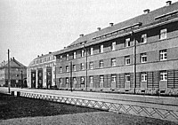Zwischen 1919 und 1933 errichtete die Heimstätten-Genossenschaft Reick im Stadtteil ausgedehnte Wohnviertel zwischen dem alten Dorfkern und der Dohnaer
Straße. Der am 31. Mai 1919 gegründeten gemeinnützigen Genossenschaft gehörten zu Beginn vor allem Dresdner Straßenbahner an, die so in der Nähe ihres
Arbeitsplatzes preiswerten Wohnraum erhalten konnten. 1920 erwarb die Genossenschaft eine ehemalige Ziegelei an der Tornaer Straße und begann mit dem Bau der Siedlungsanlage _(Foto: Tornaer Str. 14-30)._
Der Bebauungsplan wurde durch den Architekten Bruno Just erarbeitet. Zu den ersten Gebäuden gehörte ein Versuchsbau aus Lehm und Abbruchmaterial, ein Verfahren, welches sich jedoch nicht bewährte. An diesem Haus
erinnert eine Gedenktafel an das Bauvorhaben.

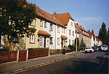Die weiteren Gebäude, meist Reihen- und Doppelhäuser, entstanden nach einem
einheitlichem Konzept und den Entwürfen verschiedener Architekten und stellen ein bedeutendes Zeugnis des gemeinnützigen Wohnungsbaus der Jahre vor dem Zweiten Weltkrieg dar _(Foto: Morgenleite)_
. Inflationsbedingt verzögerte sich der Bauablauf, so dass die letzten der 634 Wohnungen erst 1932 übergeben werden konnten. Einige Ergänzungen folgten dann noch bis zum Ausbruch des Zweiten
Weltkriegs. 1945 wurden Teile der Siedlung, aber auch einige Gebäude im alten Dorfkern durch Bomben zerstört. Der Wiederaufbau erfolgte bis 1969. 1984
schloss sich die Heimstätten-Genossenschaft Reick mit der AWG “Glückauf Süd” zusammen, die die meisten Gebäude
in den vergangenen Jahren saniert hat. Weitere Neubauviertel in Plattenbauweise wurden ab 1980 zwischen Reick und Prohlis und ab 1984 an der Reicker Straße errichtet.

Heute ist Reick vor allem Wohnvorort mit starkem gewerblichen Anteil. 1997 entstand an der Lohrmannstraße auf dem Gelände des früheren VEB Elektromat ein neuer Gewerbepark, wofür vier nach Professoren der TU benannte
neue Straßen angelegt wurden. 2006 wurde an der Mügelner Straße mit dem Neubau des Straßenbahnhofes begonnen, welcher inzwischen als einer von drei modernen Betriebshöfen der DVB sowohl als Abstell- und
Wartungshalle dient und zugleich die Weichenbauwerkstatt aufnimmt.

Schulen in Reick:

Volksschule:
Ursprünglich besuchten die Reicker Kinder die Kirchschule von Leubnitz. Die erste eigene Schule entstand 1889/90 an der Reicker Straße 89. 1909 wurde das Gebäude aufgestockt und erweitert und erhielt in diesem
Zusammenhang auch eine Turnhalle. Mit der Eingemeindung Reicks erfolgte die Eingliederung in das Dresdner Schulnetz und die Benennung als 45. Volksschule. Nach dem Umzug in das heutige Hülße-Gymnasiums wurde das
Schulgebäude überflüssig und deshalb 1930 geschlossen.

Nach 1945 diente das frühere Schulhaus u. a. als Kinderheim, Polizeirevier und Beratungsstelle. 1980 öffnete hier das
“Haus der Pioniere”, während die frühere Turnhalle bereits ab 1946 als Kino und Theaterbühne genutzt wurde. Das
von W. Felden gegründete “Kleine Theater Reick” gehörte zu den ersten Spielstätten der Nachkriegszeit und war
zeitweise Interimsspielstätte des Operettentheaters, wurde jedoch seit den 1950er Jahren vorrangig als Filmtheater
genutzt. 1983 bezog bis 1990 die Experimentalbühne “SCHICHTheater” die Räume. Nach der Wende übernahm die neu gegründete Nickelodeon Kino GmbH das Haus und betrieb hier noch bis Juni 1992 ein Kino mit ca. 300 Plätzen.
Danach befand sich in diesem Nebengebäude bis zur Schließung im Jahr 2000 das soziokulturelle Zentrum “Brennhaus”. Im Oktober 2001 wurde die frühere Turnhalle mit dem Kinosaal abgerissen, während das Hauptgebäude
noch bis 2006 als Jugendhaus “Mareike” genutzt wurde.

Seit April 2008 hat im früheren Schulhaus die Dresdner Niederlassung der Heilsarmee ihr Domizil. Die 1865 vom
methodistischen Pfarrer William Booth in London gegründete Religionsgemeinschaft ist in Dresden seit 1904 aktiv und
widmet sich vor allem der Betreuung sozial benachteiligter Menschen. Für diese stehen hier u.a. eine Kleiderkammer, eine Bibliothek und ein Verpflegungsstützpunkt zur Verfügung.

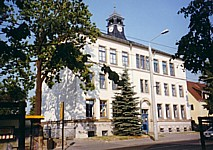

**_Foto:_** _Das alte Schulhaus an der Reicker Straße - heute Sitz der Heilsarmee_

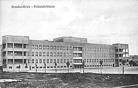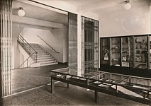Hülße-Gymnasium: Das Gebäude an der Hülßestraße 2 _(Fotos SLUB / Fotothek)_ wurde 1927-29 nach Entwürfen von Stadtbaurat Paul Wolf erbaut und gehörte damals zu den modernsten Schulbauten Europas. Der im Bauhausstil errichtete Gebäudekomplex besaß neben 32 Klassenräumen und Fachkabinetten zwei übereinander liegende Turnhallen, einen Kinosaal, Speiseräume, ein Brausebad im Keller sowie sechs Freiluft-Klassenzimmer für den Unterricht in den Sommermonaten. Am 19. Oktober 1929 erfolgte die feierliche Eröffnung dieser Schule als "Palitzsch-Schule" (45. Volksschule), benannt nach dem Bauernastronomen und Naturwissenschaftler Johann Georg Palitzsch. Der Neubau bot Platz für ca. 670 Schüler aus Reick und dem benachbarten Prohlis. Am 5. Februar 1945 wurde das Schulhaus in ein Lazarett umgewandelt und wenige Tage später, am 13./14. Februar 1945, beim Luftangriff schwer beschädigt. Aula und Turnhallen brannten völlig aus; weitere Räume und das Freigelände wurden erheblich in Mitleidenschaft gezogen.

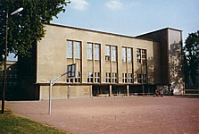Nach Beseitigung der Schäden wurde das Haus ab Juni 1945 wieder als 45. Volksschule, ab 1948 auch von einer Erweiterten Oberschule genutzt. 1952 erhielt diese Volksschule den Namen des tschechischen Arbeiterführers “Klement Gottwald” verliehen. Im Zuge der Umstrukturierung des DDR-Schulsystems war hier ab 1961 die zehnklassige 45. Polytechnische Oberschule untergebracht. Im Kellergeschoss befanden sich Lehrkabinette für den obligatorischen "Unterrichtstag in der Produktion", die auch von Schülern weiterer Schulen des Stadtbezirks Dresden-Süd genutzt wurden. Das Obergeschoss nutzte 1967-1988 die Erweiterte Oberschule “Bertolt Brecht”. 1985 entstanden zudem Spezialklassen für den erweiterten Russischunterricht.

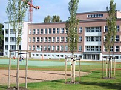Seit 1992 ist hier das Julius-Ambrosius-Hülße-Gymnasium untergebracht. An der Fassade des 2003/05 sanierten und unter Denkmalschutz stehenden Baus erinnert neben einer Sonnenuhr ein Bild Johann Georg Palitzschs an den gelehrten Bauern des Nachbardorfes Prohlis. 2009 entstand auf dem Grundstück eine moderne Dreifeld-Sporthalle. Nach deren Fewrtigstellung konnten die vorhandenen übereinander liegenden Sporthallen im Seitenflügel zur Mensa und weiteren Unterrichtsräumen umfunktioniert werden.

Radrennbahn:

Die Radrennbahn Reick wurde im Jahr 1909 vom “Verein für Radwettfahrten” nordwestlich des Dorfkerns in unmittelbarer Nachbarschaft des Gaswerkes angelegt. Zuvor besaß der Verein bereits eine kleinere Rennbahn an der Pfotenhauer-/Neubertstraße in der Johannstadt. Diese existierte zwischen 1901 und 1909 und wird heute als [Karl-Stein-Stadion](../../zentrum/johannstadt/strassen_johannstadt/pfotenhauerstrasse/) für Sportveranstaltungen genutzt.

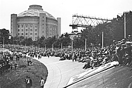Dank der Unterstützung finanzkräftiger Sponsoren wie dem Odol-Fabrikanten Lingner, dem Direktor der Dresdner Filiale der Deutschen Bank Hermann und der Bankiersfamilie Arnhold entstand in Reick eine der damals modernsten Radrennbahnen Deutschlands. Die offizielle Einweihung erfolgte am 13. März 1910. Noch im gleichen Jahr wurde hier die Europameisterschaft im Radrennen ausgetragen. Die Bahn war jedoch nicht nur Schauplatz für große Sportveranstaltungen, sondern wurde auch für Kundgebungen genutzt. Bei einer der größten sprach am 19. Juli 1932 der KPD-Vorsitzende Ernst Thälmann vor 80.000 Dresdner Arbeitern _(Foto: SLUB/Fotothek)_.

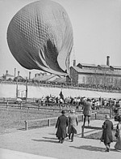Für Aufsehen hatte bereits am 27. März 1910 der Ballonaufstieg der Schwestern Große aus Meißen gesorgt, die mit ihrem Ballon von Reick aus bis in die Karpaten reisten. Die Ballonfahrt erfolgte im Rahmen eines “Flugtages” mit 26 Teilnehmern und unter Anwesenheit des sächsischen Königs sowie des Kriegsministers von Hausen. Ein weiterer “Nationaler Ballonwettbewerb” fand am Ostersonntag 1911 statt. 12 Mannschaften traten dabei zu einer Ziel- und Weitfahrt an. Während des Wettstreits ereignete sich ein tragisches Unglück, bei dem ein Ballon außer Kontrolle geriet und nach Kollission mit dem Kohlenvorratsbunker der Gasanstalt abstürzte. Der Ballonführer, ein Offizier aus Halle, kam beim Absturz ums Leben, seine vier Mitfahrer wurden schwer verletzt. _(Foto: Kurt Otto Burghardt (1914)- SLUB/Fotothek)_

Trotz der optimalen Bedingungen geriet der Verein bereits wenige Jahre nach Eröffnung der Radrennbahn in finanzielle Schwierigkeiten. Um diese auszugleichen erfolgte 1913 eine Erweiterung der Nutzung für Fußball, Polo und Leichtathletik. Da jedoch trotz aller Bemühungen auch später nicht an die Erfolge der Anfangsjahre angeknüpft werden konnte, wurde die Radrennbahn Mitte der 1930er Jahre aufgegeben und 1939 offiziell geschlossen.

[_Weiterführende Literatur und Quellen_](../../impressum/quellenverzeichnis/)

 \[ [Home](../../index.html)\] \[ [Nord](../../nord/)\] \[ [Nordwest](../../nordwest/)\] \[ [Neustadt](../../neustadt/)\] \[ [Nordost](../../nordost/)\] \[ [West](../../west/)\] \[ [Zentrum](../../zentrum/)\] \[ [Südwest](../../sudwest/)\] \[ [Süd](../../sud/)\]
\[ [Südost](../../sudost/)\] \[ [Ost](../../ost/)\] \[ [Register](../../Register/register.html)\] \[ [Kontakt](../../Kontakt/kontakt.html)\] \[ [Impressum](../../impressum/)\]
