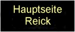
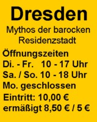
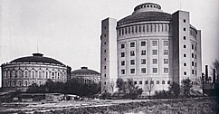
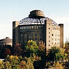
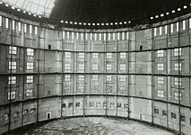
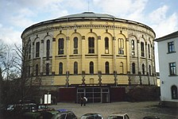
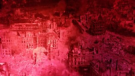
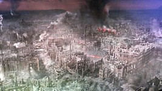

* * *

* * *

* * *

Im Jahr 1872 erwarb die Stadt Dresden 12 Hektar Ackerland auf Reicker Flur, um hier ein Gaswerk zur zentralen Versorgung der Stadt anzulegen. Zwischen 1878 und 1881 wurde dieses Werk erbaut, welches ab 1923 die alleinige Versorgung Dresdens mit Stadtgas übernahm. Einige bestehende kleinere Gaswerke in den mittlerweile eingemeindeten Vororten wurden daraufhin stillgelegt. Zunächst entstanden in Reick zwei Gasbehälter mit einem Fassungsvermögen von je 30.000 m³. 1908/09 folgte der von Hans Erlwein entworfene große Gasometer, der bis heute zu den Wahrzeichen des Stadtteils gehört. Mit einem Durchmesser von 62 Metern und einem Fassungsvermögen von 115.000 m³ war er einer der größten Stahlbetonbauten seiner Zeit. Ein vierter Scheibengasbehälter wurde in den 1920er Jahren erbaut.

**_Foto:_** _Das Reicker Gaswerk in den Dreißiger Jahren_

Auch nach Beseitigung der Kriegsschäden von 1945 blieb das Gaswerk in Betrieb und wurde 1959 um einen weiteren Gasbehälter erweitert. Das Reicker Werk trug seit 1957 den Namen “Joliot Curie” nach dem bekannten französischen Physiker. Neben den Gasbehältern besaß das Unternehmen auch alle notwendigen Einrichtungen zur mechanischen und chemischen Aufbereitung der Kohle, zur Reinigung und Erzeugung von Steinkohlen- und Wassergas sowie zur Verarbeitung der bei der Stadtgaserzeugung anfallenden Nebenprodukte. Im Jahr 1958 wurde das Gaswerk an das DDR-Ferngasnetz des Kraftwerkes Schwarze Pumpe bei Hoyerswerda angeschlossen, so dass bei Bedarf von dort zusätzliche Mengen bezogen werden konnten.

Im Zusammenhang mit dem weiteren Ausbau des Ferngasnetzes wurde der Betrieb in Reick 1973 eingestellt. Gleichzeitig entstand an der Gasanstaltstraße ein modernes Fernheizwerk zur Versorgung der südöstlichen Dresdner Stadtteile. Der Schornstein des Werkes maß 220 Meter und war bis zu seinem Abbruch 2017 höchster in Dresden. Die überflüssigen Anlagen des Gaswerkes konnten nun schrittweise beseitigt werden. Auf den Fundamenten eines ehemaligen Gasometers entstand eine Sporthalle für die Angehörigen des Energiekombinates Dresden. Ein weiterer kleinerer Gasometer von 1879 diente viele Jahre als Flüssigkeitstank für Enteisungslauge des Straßenwinterdienstes. Mit Umstellung der Gasversorgung in Dresden von Stadt- auf Erdgas konnte 1992 der letzte als Reserve verbliebene Gasbehälter aufgegeben und gesprengt werden. Das Foto (links) zeigt einen Blick ins Innere des großen Gasometers im Jahr 1985 (Bild Hans Reinecke - SLUB/Fotothek).

Noch erhalten ist der 68 Meter hohe Erlwein-Gasometer von 1908. Trotz vielfältiger Umbaupläne für das denkmalgeschützte Gebäude konnte bislang keine Nutzung gefunden werden. Nach dem Pläne für einen Zirkus, einen Sportpalast oder für eine Bibliothek gescheitert waren, begann im Februar 1998 der Umbau des Gebäudes zum Musicaltheater. Finanzielle Schwierigkeiten des Investors führten jedoch bereits nach wenigen Monaten zum Baustopp und schließlich zur Aufgabe dieses Vorhabens.

Panometer

Im benachbarten kleinen Gasometer _(Foto)_, 1879/80 von Stadtbaurat Theodor Friedrich errichtet, ist seit Dezember 2006 ein historisches Panorama zu sehen, welches einen Blick auf Dresden vom Turm der Hofkirche um 1756 zeigt. Schöpfer ist der aus dem Iran stammende Künster Yadegar Asisi, der ein ähnliches Projekt bereits in Leipzig erfolgreich umsetzte. Das 360°-Bild ist insgesamt 105 Meter lang und 30 Meter hoch und wurde mit Hilfe einer speziellen fotografisch genauen Drucktechnik hergestellt. Beim Blick von der Aussichtsterrasse erlebt der Besucher die Barockstadt zur Tages- und Nachtzeit, wobei die Schau durch Musik- und Toneffekte bereichert wird. Ergänzend gibt es eine Ausstellung zum Thema “Dresden in der Barockzeit”, einen Dokumentationsfilm über die Anfertigung des Panoramas sowie ein kleines Café.

Im Dezember 2011 wurde dieses Panoramabild entfernt und durch ein ebenfalls von Asisi geschaffenes Panorama vom alten Rom im Jahr 312 ersetzt. Das Bild zeigte das antike Rom zum Zeitpunkt des Einzugs Kaiser Konstantins nach seiner siegreichen Schlacht und damit den historischen Wendepunkt von der Antike zum christlichen Abendland. Im Dezember 2012 kehrte das überarbeitete Panoramabild “Dresden - Mythos der barocken Residenzstadt” nach Reick zurück. Im Februar 2015 wurde erstmals alternativ ein Bild der zerstörten Stadt nach dem Luftangriff am 13./14. Februar 1945 gezeigt. Der Betrachter steht dabei auf dem Rathausturm und schaut über die teilweise noch brennende Innenstadt. Begleitet wird die Schau durch eine umfassende Dokumentation und historische Einordnung der Ereignisse. Künftig plant Yadegar Asisi eine weitere Darstellung Dresdens um 1900. Geplant ist, diese drei Panoramen künftig abwechselnd im alten Gasometer zu zeigen.

**_Bilder:_** _Blick über das zerstörte Dresden 1945 im Panometer Reick_

* * *

 \[ [Home](../../../index.html)\] \[ [Nord](../../../nord/)\] \[ [Nordwest](../../../nordwest/)\] \[ [Neustadt](../../../neustadt/)\] \[ [Nordost](../../../nordost/)\] \[ [West](../../../west/)\] \[ [Zentrum](../../../zentrum/)\] \[ [Südwest](../../../sudwest/)\] \[ [Süd](../../../sud/)\] \[ [Südost](../../../sudost/)\] \[ [Ost](../../../ost/)\] \[ [Register](../../../Register/register.html)\] \[ [Kontakt](../../../Kontakt/kontakt.html)\] \[ [Impressum](../../../impressum/)\]
