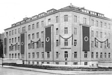
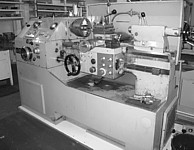

* * *

* * *

Vorläufer des VEB Mikromat waren die beiden Dresdner Werkzeugmaschinenhersteller Hille und Großmann. 1869 hatte Moritz Hille in der Südvorstadt eine Werkstatt für mathematisch-physikalische Instrumente und Apparate gegründet, die sich ab 1885 vorrangig der Herstellung von
Gasmotoren widmete. Später gehörten auch Kraftfahrzeuge und Werkzeugmaschinen zum Produktionsprogramm. Bereits vor dem Ersten Weltkrieg hatte sich die Firma mit einigen anderen Dresdner Betrieben vereinigt
und firmierte ab 1918 als [Hille-Werke AG](../../../sud/plauen/strassen_plauen/chemnitzer_strasse/). Da das Betriebsgelände an der
Chemnitzer Straße jedoch zu klein geworden war, verlegte man 1929 den Firmensitz nach Dresden-Reick.

Unweit der Hille-Werke hatte bis zur Zerstörung 1945 die [Firma Großmann](../../../sud/plauen/strassen_plauen/chemnitzer_strasse/) ihren Sitz _(Foto: Gebäude an der Chemnitzer Straße um 1938)_
. Das 1863 von Heinrich Großmann gegründete Unternehmen stellte vorrangig Nähmaschinen, Bohr- und Fräsmaschinen sowie entsprechendes Zubehör her. Während des Zweiten Weltkriegs
waren beide Firmen in die Rüstungsindustrie eingebunden und beschäftigten zahlreiche, meist französische, Zwangsarbeiter.

1946 fielen beide Betriebe unter die Bestimmungen des Volksentscheids und wurden
enteignet. Zusammen mit einigen anderen metallverarbeitenden Firmen schloss man sich zum VVB Werkzeugmaschinen und Werkzeuge (WMW) zusammen. 1962 erfolgte die Fusion des VEB Feinst-Maschinenwerk und des [VEB Schleifmaschinen](../../../sudost/reick/strassen_reick/) (ehem. Elbe-Werke AG) zum VEB Mikromat. In den 1970er Jahren kamen weitere Betriebe hinzu, so dass Mikromat zu einem der bedeutendsten Dresdner
Großbetriebe mit bis zu 3000 Angestellten wurde. Organisatorisch gehörte die Firma zum Werkzeugmaschinenkombinat “Fritz Heckert” und verkaufte seine Erzeugnisse
unter dem Markennamen WMW in zahlreiche Länder. Hauptsächlich wurden Koordinaten-Bohrmaschinen, Gewinde- und Flachschleifmaschinen sowie optische Profilschleifmaschinen produziert.

Anfang der 1970er Jahre entstand für das Unternehmen an der Mügelner Straße 36 ein moderner Neubau. Das viergeschossige Gebäude mit seinen 40 bzw. 66 Meter langen Fassaden wurde zwischen 1970 bis 1973 nach Plänen
der Architekten Willi Fieting, Hans-Jürgen Kätzig und Karl-Heinz Perschel errichtet und gehört zu den wichtigsten
Beispielen der DDR-Industriearchitektur in Dresden. Der kubische Baukörper wurde in Stahlbeton- Skelettbauweise
erbaut und erhielt eine vorgehängte Aluminiumfassade mit farbigen Thermoscheiben und emailliertem Sicherheitsglas. Hier waren bis 1989 die Büros und Konstruktionsräume der Firma untergebracht.

1990 wurde das Werkzeugmaschinenkombinat aufgelöst und der VEB Mikromat von der Treuhand übernommen. Fortan firmierte der Betrieb als Mikromat Werkzeugmaschinen GmbH und wurde zum 1. Januar 1992 privatisiert. Mit
der Übernahme durch frühere Betriebsangehörige erfolgte die Aufteilung in die Reicker Werkzeugmaschinen GmbH
und die Mikromat Werkzeugmaschinenfabrik GmbH. Heute werden hier hochmoderne Präzisionsmaschinen für den Weltmarkt hergestellt. Außerdem betätigt sich die seit 2005 unter dem Namen Mikromat GmbH tätige Firma als
Zulieferer für andere Werkzeugmaschinenhersteller. Heute hat der Betrieb ca. 160 Mitarbeiter. Das zuletzt bis 2009 als Bildungszentrum genutzte frühere Bürogebäude steht jedoch leer.

* * *

 \[ [Home](../../../index.html)\] \[ [Nord](../../../nord/)\] \[ [Nordwest](../../../nordwest/)\] \[ [Neustadt](../../../neustadt/)\] \[ [Nordost](../../../nordost/)\] \[ [West](../../../west/)\] \[ [Zentrum](../../../zentrum/)\] \[ [Südwest](../../../sudwest/)\] \[ [Süd](../../../sud/)\] \[ [Südost](../../../sudost/)\] \[ [Ost](../../../ost/)\] \[ [Register](../../../Register/register.html)\] \[ [Kontakt](../../../Kontakt/kontakt.html)\] \[ [Impressum](../../../impressum/)\]
