## Altreick

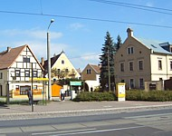In Altreick sind noch Teile des früheren Dorfkerns zu sehen, der bis 1945 zu den am besten erhaltenen in Dresden gehörte. Von 1897 bis 1913 wurde er offiziell Dorfplatz, danach Altreick genannt. Die meisten Gebäude entstanden nach dem letzten großen Dorfbrand 1807 bzw. nach 1813, als zahlreiche Gehöfte durch französische Soldaten zerstört wurden. Einige Häuser des Dorfes, welches sich auch an der Mügelner und der Reicker Straße entlang zog, fielen den Bomben des Zweiten Weltkrieges zum Opfer. Darunter befand sich der frühere Dorfgasthof mit seinem Ballsaal (Nr. 1) sowie das Kino "Reicker Lichtspiele" (Nr. 2). Weitere Gehöfte mussten 1976 dem Bau des nahegelegenen Neubaugebietes Prohlis weichen.

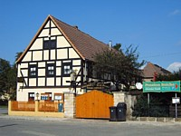Von den verbliebenen und in den letzten Jahren zum Teil sanierten Gebäuden stehen die Gehöfte Altreick Nr. 21 (erbaut 1774) sowie Mügelner Straße 3, 5 und 7 unter Denkmalschutz. Am Wohnhaus Altreick Nr. 7 erinnert eine Gedenktafel an den Dorfbrand von 1790, während im Giebel von Nr. 21 noch einige Kanonenkugeln von 1813 eingemauert sind. Heute befindet sich in diesem Haus eine Pension _(Foto)_. Der stark verfallene Dreiseithof Mügelner Straße 7 wurde 2009 rekonstruiert und zu einer Wohnanlage ausgebaut. 2010 folgte das ebenfalls unter Denkmalschutz stehende Gehöft Nr. 17.

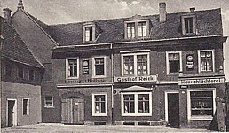Gasthof Reick (Nr. 1): Der im 19. Jahrhundert entstandene Dorfgasthof befand sich bis zur Zerstörung 1945 im Gehöft Altreick Nr. 1. Besitzer war um 1900 der Gastwirt Wilhelm Thomas, in den 1930er Jahren Fritz Paschke. Neben den Gasträumen besaß das Lokal auch einen Gesellschaftssaal und einen Gästegarten. Nach 1945 wurde die Ruine beseitigt. Heute befindet sich auf dem Grundstück eine Grünfläche.

Nr. 2: Auch der auf der gegenüberliegenden Straßenseite gelegene große Vierseithof Altreick 2 fiel 1945 den Bomben zum Opfer. Hier befand sich neben verschiedenen Läden das "Reicker Lichtspielhaus", auch "Reicker Lichtspiele" genannt. Inhaberin war Anfang der 1930er Jahre Dora Böse, ab 1936 Kurt Pillack. Als Ersatz für das zerstörte Kino wurde bereits 1946 in der Schulturnhalle der Reicker Volksschule ein neues Kino eingerichtet. Das zugleich als Domizil der privaten Bühne "Kleines Theater Reick" genutzte Gebäude mit ca. 300 Plätzen wurde zuletzt von der Nickelodeon Kino GmbH betrieben

## Am Lehmhaus

Der Straßenname Am Lehmhaus erinnert an die 1920 erfolgte Grundsteinlegung für die Siedlung der [Heimstätten- Genossenschaft Reick](../../../sudost/reick/). Zu den ersten Häusern gehörte ein aus Lehm und Abbruchmaterial entstandener Versuchsbau, der die
Erwartungen jedoch nicht erfüllen konnte. Die übrigen Gebäude wurden bis 1932 in klassischer Bauweise errichtet und gehören zu den wichtigen Zeugnissen des sozialen Wohnungsbaus in Dresden.

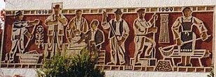

**_Foto:_** _Der Bilderfries am Lehmhaus wurde 1969 aus Anlass des 50. Jubiläums der Reicker Heimstättengenossenschaft an der Giebelwand des ersten Gebäudes der Siedlung angebracht._

## Besselplatz

Der Besselplatz wurde in den Zwanziger Jahren im Zusammenhang mit dem Bau der Reicker Siedlung angelegt und als großzügige Grünanlage gestaltet. Der Name erinnert an den Mathematiker und Astronom Friedrich Wilhelm Bessel (1784-1846), der u. a. die exakte Figur und Größe der Erde bestimmte und als erster die Existenz von Doppelsternen nachwies. Die Gebäude rund um den Platz wurden von den Architekten Just und Haferkamp 1929 für die Heimstätten-Genossenschaft Reick entworfen. Nach Beseitigung einiger Kriegsschäden erfolgte zwischen 1964 und 1969 der Wiederaufbau. Heute gehören die Bauten zur WG Glückauf Süd e. G. und wurden 1993/94 saniert.

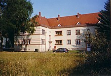

**_Foto:_** _Wohnhaus der Reicker Siedlung am Besselplatz_

## [Dohnaer Straße](../../../sudost/strehlen/strassen_strehlen/dohnaer_strasse/)

## Enno-Heidebroek-Straße

Die im Gewerbegebiet Reick an der Lohrmannstraße gelegene Enno-Heidebroek-Straße wurde 1997 auf dem Gelände des
früheren VEB Elektromat angelegt. Ihren Namen verdankt sie dem Maschinenbauingenieur Enno Heidebroek (1876–1955),
der viele Jahre als Professor und ab 1945 als erster Rektor der Nachkriegszeit an der Technischen Hochschule tätig war.

## Friederike-Serre-Weg

Der Friederike-Serre-Weg wurde 2011 im Zusammenhang mit der Erschließung eines neuen Wohngebietes am ehemaligen
Gaswerk Reick angelegt. Mit der Namensgebung wird an Friederike Amalie Serre (1800-1872) erinnert, welche im 19. Jahrhundert gemeinsam mit ihrem Mann Johann Friedrich Anton Serre einen Künstlerkreis auf dem heimischen Rittergut
Maxen versammelte. Außerdem engagierte sie sich als Mäzenin und unterstützte Waisenhäuser, den Tierschutzverein und die Schillerstiftung.

## Gasanstaltstraße

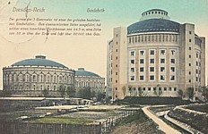Die Gasanstaltstraße entstand im Zusammenhang mit dem Bau des am 1. März 1881 eröffneten [Gaswerkes Reick](../../../sudost/reick/gaswerk_reick/). Ursprünglich war sie Teil des alten Gruna – Reicker Kommunikationsweges, der in der Nähe der Brücke am [Landgraben](../../../ost/striesen/landgraben/) in die Bodenbacher Straße mündete. Beim Bau des Reicker Gaswerkes musste dieser Weg teilweise aufgegeben bzw. neu trassiert werden. In Dokumenten aus dieser Zeit wird er als Reicker Weg bzw. Grunaer Weg bezeichnet. Der Name Gasanstaltsstraße ist erstmals im Adressbuch von 1906 nachweisbar.

Bis zu seiner Stilllegung 1973 sicherte das Gaswerk die Versorgung der Stadt Dresden. Später entstand an seiner Stelle ein modernes Fernheizwerk. Von den ehemaligen Bauten sind noch zwei historische Gasometer erhalten geblieben. Der größere wurde 1908 von Hans Erlwein errichtet, steht jedoch heute nach gescheiterten Umbauplänen in ruinösem Zustand leer. Im kleineren Gasometer befindet sich seit Dezember 2006 das “Panometer”, ein über 100 Meter großes Rundpanorama-Bild, welches die Dresdner Innenstadt im Jahr 1756 darstellt. 2011/12 wurde dieses vorübergehend durch ein Panoramabild vom alten Rom zur Zeit Kaiser Konstantins ersetzt. 2014 war erstmals eine Darstellung Dresdens nach dem Bombenangriff vom 13. Februar 1945 zu sehen, welche künftig in regelmäßigem Wechsel mit dem historischen Dresden präsentiert wird.

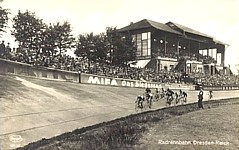1909 wurde an der Gasanstaltstraße die bis 1939 genutzte [Radrennbahn](../../../sudost/reick/) angelegt. Betreiber war der “Verein für Radwettfahrten”, der hier regelmäßige Wettkämpfe und 1910 sogar die Europameisterschaft im Rennradfahren austrug. Außerdem diente das Areal mehrfach für Ballonwettbewerbe. Neben Sportwettkämpfen fanden jedoch auch politische Kundgebungen statt. U.a. sprach 1932 Ernst Thälmann auf einer Wahlkampfveranstaltung vor tausenden Dresdner Arbeitern. Nach Schließung der Sportstätte entstand auf dem Areal eine Kleingartenanlage. Künftig ist hier jedoch eine kleine Wohnanlage mit Einfamilien- und Doppelhäusern geplant.

Da das Areal an der Gasanstaltstraße zwischen Gaswerk und der auf Seidnitzer Flur gelegenen [Pferderennbahn](../../../ost/seidnitz/pferderennbahn/) zunächst von Bebauung verschont blieb, gab es hier Platz für temporäre Nutzungen. So richtete man während des Ersten Weltkrieges die Sanierungsanstalt Dresden-Reick ein. Der aus mehreren Gebäuden und Baracken bestehende Komplex diente der Versorgung von militärischen Einheiten, die hier entlaust, gebadet und desinfiziert wurden. Zudem wurde militärische Ausrüstung repariert und ergänzt sowie die für Pferdetransporte genutzten Güterwagen gereinigt. Die Kapazität der Sanierungsanstalt betrug ca. 800 bis 1000 Personen pro Tag, bevor diese vom nahen Bahnhof Reick wieder an die Front geschickt wurden.
1916 besuchte der sächsische König Friedrich August III. die Anstalt sowie das zugehörige Pferdebad.

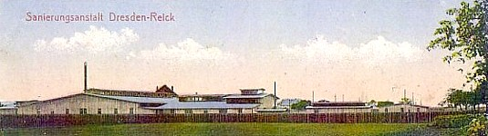

**_Foto:_** _Blick über die Sanierungsanstalt Reick 1916_

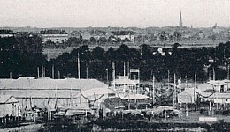1925 fand in Reick die Große Landwirtschaftliche Landesausstellung des Landeskulturrates Sachsen statt, der in diesem Zusammenhang zur Landwirtschaftskammer umgewandelt wurde. Die vom 4. bis zum 8. September 1925 durchgeführte Messe war eine Leistungsschau der sächsischen Landwirtschaft und angrenzender Bereiche. Eröffnet wurde sie am 4. September mit einem Festumzug, an dem auch Schüler vieler Dresdner Schulen teilnahmen. Präsentiert wurden in mehreren Themenkomplexen moderne Anbaumethoden sowie Spitzenprodukte der Acker- und Viehwirtschaft, u.a. Saatgut, Mittel zur Unkrautbekämpfung, 120 Pferde der beiden in Sachsen bestehenden Zuchtrichtungen und Rinder. Die Forstwirtschaft war durch eine forstwissenschaftliche Sonderausstellung der Tharandter Forstakademie vertreten. Außerdem gab es eine Schau "Landfrauenarbeit - Berufsarbeit" mit Ausstellung von Bauernmöbeln, Haushaltgeräten und typischen ländlichen Gerätschaften. Besonders gute Erzeugnisse wurden zum Abschluss der Ausstellung mit Ehrenpreisen und Medaillen bedacht.

## Georg-Mehrtens-Straße

Die Georg-Mehrtens-Straße wurde 1997 im Gewerbegebiet Lohrmannstraße angelegt und nach dem Ingenieur Georg Christoph Mehrtens (1843-1917) benannt. Mehrtens war ab 1897 Professor für Eiserne Brücken an der Technischen
Hochschule und befasste sich mit der Konstruktion moderner Straßen- und Eisenbahnbrücken. 1901 bis 1902 hatte er auch das Amt des Rektors der Hochschule inne.

## Gudehusstraße

Die Gudehusstraße erinnert an den Opernsänger Heinrich Wilhelm Gudehus (1842-1909), der ab 1880 an der Semperoper engagiert war und als Heldentenor in Wagner-Stücken bekannt wurde. Gudehus lebte trotz verschiedener Auslandsauftritte bis zu seinem Tod in Johannstadt und liegt auf dem Alten Annenfriedhof begraben. Die Gebäude der Gudehusstraße entstanden Ende der 1920er Jahre. 1930 ist sie erstmals im Dresdner Adressbuch zu finden.

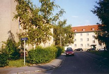

**_Foto:_** _Wohnhäuser an der Gudehusstraße_

## Herschelstraße

Die Herschelstraße entstand 1926 im Zusammenhang mit dem Bau der Siedlung der Heimstätten-Genossenschaft Dresden-Reick und wurde nach dem Astronomen Friedrich Wilhelm Herschel (1738-1822) benannt. Als königlicher Hofastronom in England entdeckte Herschel 1781 den Planeten Uranus. In Briefkontakt stand er u.a. mit dem Prohliser Bauernastronomen Johann Georg Palitzsch. Allerdings blieb sie nur ein kurzer Straßenstumpf und war als Seitenstraße der Prohliser Straße südlich des Ortskerns Altreick nur mit einem Gebäude bebaut (heute Prohliser Straße 1a). Im Zusammenhang mit der Errichtung der Plattenbauten der Lübbenauer Straße wurde sie Mitte der 1970er Jahre eingezogen.

Nach 1990 entstand auf Freiflächen an der Keplerstraße / Dohnaer Straße eine neue Wohnsiedlung. Die dafür angelegte neue Erschließungsstraße erhielt in Anlehnung an die verschwundene Straße wieder den Namen Herschelstraße.

## Hülßestraße

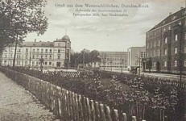Die ab 1900 benannte frühere Lindenstraße erhielt nach der Eingemeindung von Reick 1914 den Namen Hülßestraße. Julius Ambrosius Hülße (1812-1876) kam 1850 als Professor für mechanische Technologie und Volkswirtschaft an die Polytechnische Schule in Dresden und war viele Jahre deren Leiter. Er befasste sich vor allem mit der Technik der Textilverarbeitung und mit den Grundlagen des Eichwesens. Seinen Namen trägt seit 1990 auch das hier befindliche [Julius-Ambrosius-Hülße-Gymnasium](../../../sudost/reick/). Das Gebäude selbst entstand bereits 1928/29 und gehörte damals zu den modernsten Schulbauten Europas.

Weitere Baudenkmale der Hülßestraße sind die Wohnhäuser Nr. 2 - 12 sowie das frühere Postamt A 36 an der Ecke zur Prohliser Straße (Nr. 24). Die Wohnzeile entstand nach dem Ersten Weltkrieg für die Heimstättengenossenschaft Dresden-Reick e. G., die im Erdgeschss des Hauses Hülßestraße 4 zudem ihre Geschäftsstelle hatte. Die historische Aufnahme _(links)_ zeigt einen Blick von der Reicker Straße in die Hülßestraße, das Schulgebäude ist im Hintergrund rechts zu sehen.

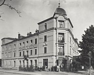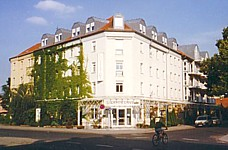Hotel “Coventry”: Gegenüber der Schule befand sich viele Jahre die beliebte Reicker Wohngebietsgaststätte “Coventry”, benannt nach der Dresdner Partnerstadt in Großbritannien. Bereits vor dem Ersten Weltkrieg gab es in dem mehrfach umgebauten Haus (Nr. 1) eine Gaststätte mit Namen "Wettinschlößchen" (Foto links - SLUB/Fotothek). 1993 wurde dieses Gebäude in ein Hotel umgewandelt. Im Erdgeschoss entstand die auch als Kleinkunstbühne dienende Gaststätte “Brimborium”, in der regelmäßig Kabarettisten und Künstler des Operettentheaters auftraten. 1998 musste die Betreibergesellschaft Insolvenz anmelden. 2006 übernahm die österreichische Hotelkette “Belmondo” das Haus _(Foto rechts)_. Heute gehört es zur Hotelgruppe “Azimut”.

## Keplerstraße

Die Gebäude an der Keplerstraße entstanden Anfang der Zwanziger Jahre durch die Heimstätten-Genossenschaft Reick.
Ihren Namen erhielt die Straße nach dem Astronomen Johannes Kepler (1571-1630), der die Keplerschen Gesetze des Planetenumlaufs um die Sonne entdeckte. Zu den markantesten Bauten gehört das Eckhaus Kepler-/Reicker Straße mit
seinem runden Ladenvorbau, der viele Jahrzehnte eine Fleischerei beherbergte.1997 wurden im Anschluss an die vorhandene Bebauung fünf neue Wohnkomplexe errichtet.

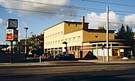

**_Foto:_** _Kreuzung Keplerstraße/ Reicker Straße mit der “runden Ecke”_

## Kurt-Beyer-Straße

Die Kurt-Beyer-Straße wurde 1997 im neuen Reicker Gewerbepark an der Lohrmannstraße angelegt und erhielt ihren Namen nach dem Bauingenieur Kurt Beyer (1881-1952). Beyer befasste sich mit der Konstruktion moderner
Stahlbetonbauten und war ab 1919 an der Technischen Hochschule tätig. Maßgeblich beteiligt war er am Bau des [Pumpspeicherwerkes](../../../west/niederwartha/pumpspeicherwerk/) Niederwartha, der [Kaditzer Elbbrücke](../../../nordwest/kaditz/strassen_kaditz/flugelwegbrucke/) sowie am Wiederaufbau Dresdner Brücken nach 1945.

## Lohrmannstraße

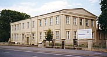Die heutige Lohrmannstraße geht auf einen alten Verbindungsweg zwischen Reick und Gruna
zurück, der noch um die Jahrhundertwende als Grunaer Weg bezeichnet wurde. Nach 1913 wurde der nördliche Teil Gasanstaltstraße, der südliche Abschnitt Lohrmannstraße genannt.
Der Name erinnert an den Geodäten und Astronomen Wilhelm Gotthelf Lohrmann (1796-1840), der an der großen Landvermessungsaktion 1825/30 beteiligt war. Zugleich
leitete Lohrmann ab 1827 den Mathematisch-Physikalischen Salon, ab 1835 die Technische Bildungsanstalt.

Die Lohrmannstraße entwickelte sich nach dem Ersten Weltkrieg zum bevorzugten Gewerbestandort für zahlreiche
Unternehmen. Zu den ältesten Betrieben gehörte die frühere Reicker Brauerei, die in den Dreißiger Jahren geschlossen wurde. Ab 1964 hat hier auch der zuvor in Laubegast beheimatete Schmierstoffhersteller [Elaskon](../../../sudost/reick/elaskon/) sein Domizil.  Nach 1990 entstand ein Gewerbepark, dessen Straßen nach bedeutenden Technikern und Wissenschaftlern der TH benannt wurden.

## Marie-Wittich-Straße

Die Marie-Wittich-Straße erinnert an die Opernsängerin Marie Wittich (1862-1931), die ab 1884 zum Ensemble der
Dresdner Oper gehörte. Berühmt wurde sie in der Rolle der “Salomé” bei der Uraufführung der gleichnamigen Oper in Dresden 1905.

## Mügelner Straße

Die nach dem heutigen Heidenauer Ortsteil Mügeln benannte Mügelner Straße entstand ursprünglich als Straße W und verbindet den alten Dorfkern von Reick mit den Nachbarorten Dobritz und Niedersedlitz. In Altreick haben sich noch einige Gehöfte aus der dörflichen Vergangenheit des Ortes erhalten, welche unter Denkmalschutz stehen (Nr. 3, 5 und 7). Hauptsächlich siedelten sich hier jedoch verschiedene Industriebetriebe an. Bedeutendstes Unternehmen war die Firma Hille (nach 1945 [VEB Mikromat](../../../sudost/reick/mikromat/)). Außerdem befindet sich an der Mügelner Straße der 1913 eröffnete Straßenbahnhof Reick mit der Weichenbauwerkstatt der Dresdner Verkehrsbetriebe.

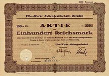Elbe-Werke AG (Nr. 20): Das Unternehmen wurde 1914 von Hermann Haelbig als "Elbe-Werke Hermann Haelbig" gegründet und widmete sich zunächst der Herstellung von Metallpressen, Schleif- und Fräsmaschinen, Sägen, Pumpen und anderen metallverarbeitenden Maschinen. 1918 erfolgte die Umwandlung in eine Kommanditgesellschaft, zwei Jahre später in eine Aktiengesellschaft. 1922 erwarb die Firma die Dresdner Zählmaschinenfabrik Wilhelm Wagner, 1926 die Weißeritzwerk AG in Dippoldiswalde. Ein wesentlicher Zukauf gelang zudem 1931 mit dem Erwerb der Flachschleifmaschinenfabrikation der Berliner Samsonwerk GmbH.

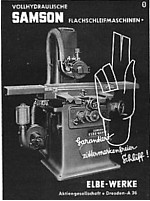Ab 1935 spezialisierte sich das Unternehmen auf Präzisionswerkzeuge sowie vollhydraulische Schleif- und Ziehmaschinen. Am 14. Mai 1938 wurde die Firma in die Elbe-Werke AG umgewandelt und erweitert und modernisiert. Zu diesem Zeitpunkt arbeiteten hier ca. 300 Angestellte. Nach dem Krieg fiel der Betrieb unter die Demontagebestimmungen und wurde 1946 enteignet. Zunächst als VEB Elbewerk Dresden, ab 1953 als VEB Schleifmaschinen Dresden produzierte man hier bis nach 1990 verschiedene Werkzeugmaschinen. Ab 1959 gehörte der Betrieb zum [VEB Mikromat](../../../sudost/reick/mikromat/) und wurde 1992 privatisiert. 2007 wurde das Betriebsgelände verkauft und ist heute Sitz mehrerer Gewerbebetriebe. Das unter Denkmalschutz stehende Bürogebäude aus den 1930er Jahren wurde als typisches Beispiel für die Bautradition dieser Zeit 2008 saniert.

Firma Emil Wünsche: Das Unternehmen ging auf den Kaufmann Emil Wünsche zurück, welcher ab 1887 auf der Moritzstraße 20 ein Geschäft für Kameras und Photopapier besaß. 1895 übernahm er die Firma seines Lieferanten Paul Förster auf der Josephinenstraße 1. Zunächst führte Wünsche den kleinen Handwerksbetrieb zur Herstellung von Fotoapparaten fort, entschied sich jedoch schon im Folgejahr zur Expansion. Dafür erwarb er ein Grundstück an der Mügelner Straße in Reick. 1898 wurde der Betrieb zur Emil Wünsche Aktiengesellschaft für photographische Industrieumgewandelt und beschäftigte nun 350 Mitarbeitern.

Obwohl die Produkte durchaus einen guten Ruf besaßen, geriet das junge Unternehmen in finanzielle Schwierigkeiten. 1902 beging Emil Wünsche Selbstmord. Der Betrieb wurde von seinen Erben unter der Leitung von Louis Lang fortgeführt und schloss sich 1909 mit der Striesener [Kamerafabrik Hüttig AG](../../../ost/striesen/strassen_striesen/schandauer_strasse/) und weiteren deutschen Herstellern zur ICA A.G. zusammen. 1926 kam diese zum Zeiss Ikon Konzern. Nach 1945 wurde die Produktion in Reick als Betriebsteil von [Pentacon](../../../ost/striesen/strassen_striesen/schandauer_strasse/ernemann-werke/) fortgesetzt und 1990 eingestellt.

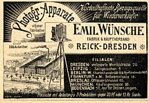

**_Bild:_** _Werbung der Firma Emil Wünsche_

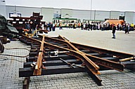
Straßenbahnhof Reick: Der Betriebshof Reick entstand 1913 durch Umbau einer hölzernen Lagerhalle und konnte bereits im Folgejahr eingeweiht werden. Zuvor war das Gelände von
einer Gärtnerei und einem Fuhrunternehmen genutzt worden. 1920 erfolgte eine erste Erweiterung der Wagenhalle, um mehr Fahrzeuge abstellen zu können. Fünf Jahre später
kamen weitere Abstellgleise im Freigelände hinzu. Zwischen 1929 und 1934 richtete die Dresdner Straßenbahn AG in Reick ihren Werkplatz für den Bau von Weichen und spezieller Gleiskonstruktionen ein _(Foto)_.

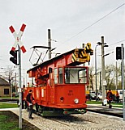Der Betriebshof überstand den Zweiten Weltkrieg ohne größere Schäden und wurde 1955/56
nochmals modernisiert und um ein Kulturheim der DVB erweitert. Mit Inbetriebnahme der neuen Straßenbahntrasse nach Prohlis gewann er noch mehr an Bedeutung. Bauliche Mängel und die
Konzentration der Fahrzeuge auf wenige große Betriebshöfe führten zur Entscheidung, die hölzerne Wagenhalle 2007 abzureißen und den Straßenbahnhof komplett umzugestalten. Im September 2007 wurde der neue
Betriebshof  mit Abstellhalle, Service- und Waschhalle sowie einer Montagehalle für den Gleisbau wieder eröffnet. Dabei wurde auch die Einfahrt von der
Mügelner zur Niedersedlitzer Straße verlegt. Am ehemaligen Eingang steht ein historischer Straßenbahn-Krantriebwagen von 1925 _(Foto)_.

## Otto-Mohr-Straße

Die Otto-Mohr-Straße entstand zur Erschließung des Gewerbegebietes zwischen Lohrmannstraße und Seidnitzer Weg. Der
Name erinnert an den Hochschulprofessor Otto Mohr, der zwischen 1873 und 1900 Professor für Technische Mechanik, Festigkeitslehre und Graphische Statik an der Technischen Hochschule in Dresden war. Mohr befasste sich vor allem mit
Problemen des Eisenbahn- und Wasserbaus.

## Perronstraße

Die Perronstraße wurde 1930 im Zusammenhang mit der Reicker Siedlung angelegt. Ihren Namen erhielt sie nach dem Opernsänger Carl Perron (1858-1928), der viele Jahre an der Dresdner Staatsoper tätig war. Am 13. Februar 1946 wurde hier der symbolische Grundstein für eine kleine Reihenhaussiedlung mit acht Doppelhäusern gelegt. Die Wohnanlage war erste Neubausiedlung in Dresden nach dem Zweiten Weltkrieg und wurde nach ihrer Fertigstellung 1948 von Familien von Opfern des Faschismus bezogen.

## Scheidemantelstraße

Die in den Zwanziger Jahren angelegte Scheidemantelstraße erhielt ihren Namen nach dem Opernsänger Karl Scheidemantel
(1859-1923), der zwischen 1886 und 1911 als Bariton dem Ensemble der Dresdner Oper angehörte. Nach zeitweiser Abwesenheit wurde Scheidemantel 1920 für zwei Jahre zum Operndirektor in Dresden gewählt.

## Schroeterstraße

Die im “Astronomenviertel” um die Keplerstraße gelegene Schroeterstraße verdankt ihren Namen dem Astronomen Johann
Hieronymus Schroeter (1745-1816) der sich mit dem Bau neuer astronomischer Fernrohre befasste und vor allem durch seine Arbeiten zur Monderkundung bekannt wurde.

## Schuchstraße

Die Schuchstraße erinnert an den bedeutenden Dirigenten Ernst Edler von Schuch (1846-1914), der 1872 als Musikdirektor
an die Dresdner Oper verpflichtet wurde. Über vierzig Jahre prägte Schuch das Dresdner Musikleben und führte die Oper zu
ihrem internationalen Ruf als wichtige Uraufführungsstätte für Strauss-Werke. Seine Tochter Liesel wurde als Sopranistin bekannt und erhielt kurz vor ihrem Tod 1990 die Ehrenbürgerschaft der Stadt.

## Seebachstraße

Die Seebachstraße wurde nach dem früheren Hoftheaterintendanten Nikolaus von Seebach (1854-1930) benannt, der 1894 zum Generaldirektor der Hofoper und des Hoftheaters ernannt wurde. Seebach blieb als einziger höfischer Intendant auch nach der Revolution 1918 im Amt und schied erst nach seinem 25-jährigen Dienstjubliäum 1919 auf eigenen Wunsch aus.

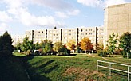

**_Foto:_** _Blick von der Seebachstraße zum Neubaugebiet Reicker Straße (Otto-Dix-Ring)_

__

Die Tornaer Straße geht auf einen alten Verbindungsweg zwischen Reick und Torna zurück und erhielt ihren Namen beim
Ausbau zur Fahrstraße nach dem Ersten Weltkrieg. Noch bis Ende der Zwanziger Jahre befand sich an der Kreuzung mit der
Dohnaer Straße eine Ziegelei. 1919 begann die Heimstättengenossenschaft Dresden-Reick in diesem Gebiet mit dem Bau
einer Genossenschaftssiedlung. Die Gebäude an der Tornaer Straße wurden dabei von den Architekten Schilling & Gräbner,
Rudolf Bitzan und Otto Wulle entworfen und bis 1930 fertiggestellt. Weitere Neubauten folgten auf den verbliebenen Flächen nach 1990.

## Wieckestraße

Die Wieckestraße erhielt ihren Namen nach dem Schauspieler Paul Wiecke (1862-1944), der ab 1895 viele Jahre am
Dresdner Schauspielhaus engagiert war. Als dessen Direktor zwischen 1920 und 1928 setzte sich Wiecke für die Aufführung
moderner Stücke expressionistischer Autoren ein und wurde 1928 zum Ehrenmitglied des Theaters ernannt. Später wirkte er
als Leiter eines privaten Komödientheaters auf der Reitbahnstraße und verstarb 1944 in Blankenburg/Harz. Seine Urne wurde 1951 nach Dresden überführt und auf dem Tolkewitzer Friedhof beigesetzt.

[Reick auf OpenStreetMap](https://www.openstreetmap.org/search?query=Dresden+Reick)

* * *

 \[ [Home](../../../index.html)\] \[ [Nord](../../../nord/)\] \[ [Nordwest](../../../nordwest/)\] \[ [Neustadt](../../../neustadt/)\] \[ [Nordost](../../../nordost/)\] \[ [West](../../../west/)\] \[ [Zentrum](../../../zentrum/)\] \[ [Südwest](../../../sudwest/)\] \[ [Süd](../../../sud/)\] \[ [Südost](../../../sudost/)\] \[ [Ost](../../../ost/)\] \[ [Register](../../../Register/register.html)\] \[ [Kontakt](../../../Kontakt/kontakt.html)\] \[ [Impressum](../../../impressum/)\]
