* * *

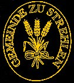

**Gemeindesiegel von Strehlen**

* * *

* * *

**Bildungseinrichtungen**

**in Strehlen**

[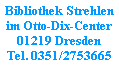](http://www.bibo-dresden.de)

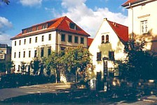Strehlen entstand im 11. Jahrhundert als slawisches Bauerndorf am Kaitzbach und wurde 1288 erstmals als Strowelin erwähnt. Der Name bedeutet Ort des Strovela und weist auf den Sippenältesten der Siedlung hin. Die Strehlener Flur erstreckte sich ursprünglich von der Bürgerwiese bis zum Koitzschgraben bei Reick und bestand aus zwei Teilen. Der am Frankenberg gelegene Teil (zwischen Lockwitzer und Teplitzer Straße) wurde als Vorwerksflur bezeichnet und gehörte zu einem Herrengut. Die bäuerlichen Felder lagen “vor” und “hinter dem Steine”, d. h. in der Nähe des Großen Gartens und an der heutigen Reicker Straße. Mit über 385 Hektar Land und 250 Einwohnern (1553) war Strehlen eines der größten Dörfer des Dresdner Umlandes.

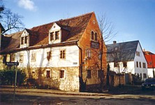1288 erhielt der Meißner Lorenzaltar Zinsrechte in Strehlen, bevor 1296 das Kloster Altzella von Markgraf Friedrich einen Großteil des Dorfes erwarb und es dem Leubnitzer Klosterhof unterstellte. 1312 konnte mit dem Erwerb der Hälfte des Vorwerks dieser Besitz noch vergrößert werden. Bis zur Reformation lenkten die Hofmeister von Leubnitz aus die Geschicke Strehlens. 1550 wurde das Dorf gemeinsam mit Leubnitz und weiteren Orten der Lehnshoheit des Dresdner Rates unterstellt. Kirchlich gehörte Strehlen zur Frauenkirche. 1676 mussten fast 60 Hektar Land für die Anlage des [Großen Gartens](../../zentrum/grosser_garten/) an Kurfürst Johann Georg II. abgetreten werden. Zu den größten Problemen der örtlichen Bevölkerung gehörten die häufigen Überschwemmungen des Kaitzbaches, welcher die Fluren bis zur Stadtgrenze unter Wasser setzte. Bereits 1410 war bei Strehlen ein kleines Stauwehr angelegt worden, von welchem Wasserröhren bis zur Innenstadt führten. 1547 ist eine Mühle urkundlich erwähnt.

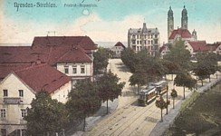

**_Foto:_** _Dorfplatz Altstrehlen (Friedrich-August-Platz) um 1900_

Schwer getroffen wurde der Ort während der Beschießung Dresdens im Jahr 1760. Große Teile des Dorfkerns fielen dem Bombardement preußischer Artillerie zum Opfer. Auch 1813 gab es Schäden im Ort, den sich Napoleon wegen seiner strategischen Lage als Beobachtungsposten ausgewählt hatte. Noch lange wurde diese Anhöhe an der heutigen Elsa-Brändström-Straße als Napoleonhügel bezeichnet. 1855 wurde Strehlen erneut bei einem großen Dorfbrand zerstört. Im Anschluss entstanden die Güter neu und erhielten dabei ihr heutiges Aussehen. Zum Aufschwung trug auch die am 1. August 1848 eröffnete und über Strehlener Flur führende Bahnlinie nach Böhmen bei, für die an der Oskarstraße ein Haltepunkt entstand.

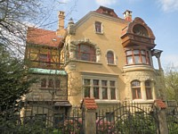In der zweiten Hälfte des 19. Jahrhunderts entwickelte sich Strehlen vom Bauerndorf zum bevorzugten Wohnort der Dresdner Oberschicht. Nach dem 1870 erfolgten Erlass strenger Baubestimmungen, die eine Ansiedlung gewerblicher Unternehmen weitgehend verhinderten, enstanden bis 1900 zahlreiche Villen an der Tiergarten- und Wiener Straße **_(Foto:_** _Tiergartenstraße 52)_. Als neues Geschäftszentrum entwickelte sich ab 1870 der Wasaplatz. Sogar der sächsische König Albert ließ sich Ende des 19. Jahrhunderts eine [Villa](../../sudost/strehlen/konigliche_villa/) in Strehlen errichten. Zuvor befand sich auf diesem Gelände das Rote Haus, Sitz des Strehlener Revierförsters. Seit 1882 besaß Strehlen Straßenbahnverbindung nach Dresden, die 1900 auf elektrischen Betrieb umgestellt und später bis Leubnitz verlängert wurde. Am 1. Januar 1892 kam der aufstrebende Villenvorort nach mehrjährigen Verhandlungen zu Dresden.

Nach der Eingemeindung ließ die Stadt für die verbliebenen Freiflächen einen neuen Bebauungsplan aufstellen. Dafür wurde der bisher offen fließende [Kaitzbach](../../sud/kaitz/kaitzbachtal/) zum Teil kanalisiert und der Ortskern durch ein Rückhaltebecken vor
Überschwemmungen geschützt. Bedeutendstes Bauvorhaben war die 1903-05 entstandene [Christuskirche](../../sudost/strehlen/christuskirche/) mit ihrer
markanten Doppelturmfront, die am höchsten Punkt der Ortsflur errichtet wurde. Um die Kirche sind noch einige
historische Gehöfte von Altstrehlen erhalten geblieben, die heute meist gewerblich genutzt werden. In den Zwanziger
Jahren folgten Wohnblocks und Kleinhausviertel an der Teplitzer und Lockwitzer Straße und deren Seitenstraßen.
Bauherr waren verschiedene Siedlergemeinschaften und Genossenschaften. 1945 fielen einige Gebäude dem Luftangriff auf Dresden zum Opfer, vor allem im Bereich der Eisenbahnstrecke.

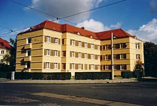

**_Foto:_** _Die in den 1920er Jahren entstandene Wohnanlage Dohnaer-/ Hugo-Bürkner-Straße_

Trotz der dichten Besiedlung Strehlens blieben auch nach dem Zweiten Weltkrieg einige Flächen unbebaut. Nach Schließung der Bombenlücken wurde 1958 an der Grenze zu Gruna ein Gewerbegebiet angelegt, in dem sich u.a. das
Institut für Reinststoffe und der VEB Hochvakuum niederließen. Auf ehemaligem Gärtnereigelände entstand ab 1986 das Wohngebiet Reicker Straße mit dem erst 2001 eröffneten Otto-Dix-Center. Eine [katholische Kirche](../../sudost/strehlen/st_-petrus-kirche/) gibt es seit
1962 an der Dohnaer Straße. Heute ist Strehlen vor allem Wohnvorort und Sitz zahlreicher Unternehmen, die die alten Villen in den letzten Jahren weitgehend sanierten.

Schulen in Strehlen:

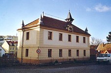Dorfschule:
Ursprünglich gehörte Strehlen kirchlich und damit auch schulisch zur Frauen- bzw. zur Kreuzkirche im nahegelegenen Dresden. Erst um 1800 wurden die Kinder des Dorfes in der angemieteten Schulstube eines
Bauerngutes unterrichtet, da der Ort kein eigenes Schulhaus besaß. Auch seine Bezahlung musste der Lehrer selbst organisieren und erhielt von jedem Schüler
wöchentlich sechs Pfennige Schulgeld. Nachdem das bislang genutzte Gebäude den Kampfhandlungen von 1813 zum Opfer gefallen war, wechselte auch die Schulstube ihren Standort. Der Unterricht wurde nun von einem ehemaligen
Soldaten gehalten, bevor nach dessen Tod 1827 erstmals ein ausgebildeter Lehrer für die Strehlener Kinder angestellt werden konnte. In diesem Zusammenhang forderte die Schulbehörde die
Gemeinde auf, endlich ein richtiges Schulgebäude im Ort zu errichten.

Ein solches entstand 1828 an der Dohnaer Straße 16 und wurde am 28. April des Folgejahres eingeweiht. Zuvor hatte
die für schulische Belange zuständige Superintendentur in Dresden mit den Strehlener Gemeindevertretern einen entsprechenden Vertrag geschlossen. Die Pläne für das noch erhaltene Gebäude _(Foto)_
stammten vom renommierten Architekten und Oberlandbaumeister Thormeyer. Neben den Kindern des Dorfes Strehlen besuchten auch
Zschertnitzer Schüler diese Schule. Die Bauausführung übernahm der Zimmermeister Johann Gottlieb Tharandt aus Lockwitz. Im Erdgeschoss befand sich der einzige Klassenraum, im Obergeschoss die Wohnung des Lehrers. 1858
erhielt die Schule noch einen Anbau mit zwei weiteren Schulräumen. Nach 1945 bezog die DDR-Jugendorganisation FDJ das Haus und nutzte es als Klubhaus. Heute wird es gewerblich genutzt und steht unter Denkmalschutz.

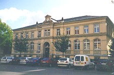23\. und 47. Volksschule: Nach dem das bisherige Schulhaus im Dorfkern nicht mehr den Anforderungen genügte, errichtete die Gemeinde Strehlen 1874 einen Neubau an der Mockritzer Straße 19 _(Foto)_. Nach der Eingemeindung Strehlens bezog diesen die 23. Volksschule. 1939 entstand ein Erweiterungsbau an der Lockwitzer Straße (47. Volksschule). Im Keller dieses Gebäudes wurde am 14. Februar 1945 eine Notaufnahme für Verletzte des Luftangriffes eingerichtet, in der u. a. der Arzt Dr. Rainer Fetscher tätig war. Die zur Schule gehörende Turnhalle war durch die Bomben zerstört worden. Wenige Tage später bezog eine Dienststelle der Stadtverwaltung die Schulgebäude, welche mit der Betreuung der Ausgebombten und der Organsation der Lebensmittelversorgung befasst war. Seit 2001 erinnert ein Mahndepot vor dem Schulhaus an diese Geschichte.

Nach dem Zweiten Weltkrieg wurden beide Gebäude bis 1990 als 47. bzw. 23. POS genutzt. 1952 begann der Wiederaufbau der Turnhalle. 1954 folgte der Neubau eines weiteren Nebengebäudes an der Teplitzer Straße mit vier zusätzlichen Klassenräumen. Die feierliche Einweihung fand am 8. Oktober 1954 statt. 1991 wurde die bisherigen POS zur 23. Mittel- und 47. Grundschule umgewandelt. Heute haben hier die 47. Grundschule und die private Janusz- Korczak-Schule, eine heilpädagogische Bildungsstätte für Kinder mit sozial-emotionalen Problemen, ihr Domizil. Janusz Korczak war ein polnischer Arzt und Pädagoge, der 1942 die ihm anvertrauten ca. 200 jüdischen Waisenkinder ins Vernichtungslager Treblinka begleitete und dort ebenfalls den Tod fand. Im Hof der Schule erinnert eine am 10. November 1883 gepflanzte “Luthereiche” an den 400. Geburtstag des Reformators. Seit 1938 steht sie als Naturdenkmal unter Schutz. 2017/18 entstand zudem an der Mockritzer Straße eine neue Turnhalle.

128\. Grundschule: Das Schulhaus am Rudolf-Bergander-Ring, ein Plattenbau vom Typ "Dresden", entstand Anfang der 1980er Jahre im Zuge des Neubaugebietes Reicker Straße. Bis 1990 wurde es als zehnklassige Polytechnische Oberschule (128. POS), danach als Grundschule genutzt. 2016 erhielt die Schule zu Ehren der sächsischen Königin Carola, die sich als Gründerin des Albertvereins für die Belange der Krankenpflege einsetzte, den Namen "Carola von Wasa".

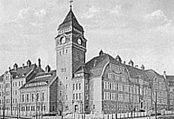Pädagogisches Institut:
Das Gebäude an der Teplitzer Straße und am Weberplatz entstand zwischen 1906 und 1910 als Nachfolgeeinrichtung des [Friedrichstädter Lehrerseminars](../../zentrum/friedrichstadt/lehrerbildungsseminar/) und erhielt zunächst den Namen König-Friedrich-August- Lehrerseminar. Der am 6. April 1910 feierlich eingeweihte moderne Neubau _(Foto)_ beherbergte neben dem eigentlichen Lehrgebäude auch eine Übungsschule und einen Seitenflügel mit Aula. Blickfang des Komplexes bildete der markante Uhrturm unmittelbar neben dem Haupteingang.

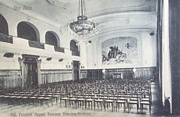Nach Auflösung aller sächsischen Lehrerseminare war hier ab 1923 das Pädagogische Institut der Technischen Hochschule untergebracht. Erstmals in Sachsen erhielten Lehrer nun eine Hochschulausbildung, wodurch die bisherige Praxis des Lehrerseminars überwunden wurde. Gründer und erster Direktor der Einrichtung war Richard Seyfert. Zu den bekanntesten Absolventen gehörte der spätere Schriftsteller Erich Kästner. Auf Weisung des sächsischen Gauleiters Martin Mutschmann wurde das Pädagogische Institut am 5. August 1936 von der Technischen Hochschule getrennt und in eine eigenständige Hochschule für Lehrerbildung umgewandelt. Im Vorfeld hatte es heftige Diskussionen innerhalb der NS-Führung gegeben, ob eine akademische Ausbildung auch weiterhin die Voraussetzung für den Lehrerberuf sein sollte. Zur Gewinnung von Studenten wurden diesen ab 1937 die
Studiengebühren erlassen und weitere Vergünstigungen wie vergünstigte Wohnungen gewährt. Bis 1941 gab es an der Hochschule fünf Abteilungen, u.a. für landwirtschaftliche Haushaltungskunde, technische Fächer und Gartenbau. 1942 erfolgte eine erneute Umstrukturierung innerhalb der sächsischen Lehrerbildung, wonach in Dresden ausschließlich Lehrerinnen ausgebildet wurden.

1945 wurde der Gebäudekomplex mit seinem Uhrturm schwer beschädigt, konnte jedoch zwischen 1949 und 1954 in leicht veränderter Form wiederhergestellt werden. Zeitweise nutzten die Sektion Berufspädagogik der TU und die Arbeiter-Bauern-Fakultät die Räumlichkeiten. Seit 1993 befinden sich hier die Hörsäle und Seminarräume der Fakultät Erziehungswissenschaften der Technischen Universität. In unmittelbarer Nachbarschaft entstanden 1972 die fünf Studentenwohnheime der Wundtstraße. Vor dem Gebäude stehen 1955 die Plastiken „Arbeiterstudent“ (von Wilhelm Landgraf) und „Bauernstudentin“ (von Gerhard Markwald).

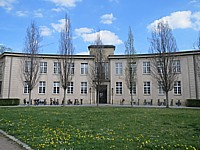Palucca-Schule: Die 1925 von Gret Palucca gegründete Privatschule für
künstlerischen Tanz erhielt nach dem Zweiten Weltkrieg am Basteiplatz ein neues Unterrichtsgebäude. Nachdem die Einrichtung 1939 von den Nazis zwangsweise
geschlossen wurde, konnte die bekannte Tanzpädagogin hier an ihre bisherige Tätigkeit anknüpfen und junge Leute im Ausdruckstanz unterrichten. Bis ins hohe
Alter leitete Gret Palucca ihre Schule, die auch heute noch Ballett-Tänzer in verschiedenen Stilrichtungen ausbildet.

Am 1. April 1949 wurde die Palucca-Schule zur Staatlichen Fachschule für
Künstlerischen Tanz erhoben und hat seit 1993 den Status einer Hochschule. Das Hauptgebäude am Basteiplatz 4 _(Foto)_
mit fünf Balettsälen entstand 1954 und wurde mehrfach erweitert. Die an der Fassade angebrachte Figur einer Tänzerin stammt von Rudolph Löhner. Außerdem gehören die Villen Tiergartenstraße 78 und 80 zur Schule. Vor dem
Gebäude fand 1965 die Bronzeplastik “Tänzerin” von Johannes Friedrich Rogge Aufstellung. Ein moderner Ergänzungsbau wurde ab 2004 nach einem Entwurf des Büros Storch, Ehlers & Partner errichtet und 2007 seiner
Bestimmung übergeben.

[_Weiterführende Literatur und Quellen_](../../impressum/quellenverzeichnis/)

 \[ [Home](../../index.html)\] \[ [Nord](../../nord/)\] \[ [Nordwest](../../nordwest/)\] \[ [Neustadt](../../neustadt/)\] \[ [Nordost](../../nordost/)\] \[ [West](../../west/)\] \[ [Zentrum](../../zentrum/)\] \[ [Südwest](../../sudwest/)\] \[ [Süd](../../sud/)\]
 \[ [Südost](../../sudost/)\] \[ [Ost](../../ost/)\] \[ [Register](../../Register/register.html)\] \[ [Kontakt](../../Kontakt/kontakt.html)\] \[ [Impressum](../../impressum/)\]
