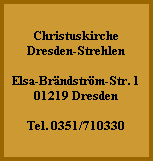
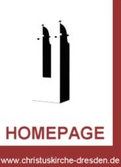
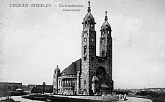
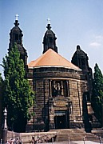
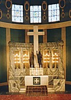
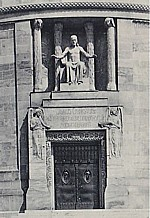

* * *

* * *

* * *

* * *

* * *

* * *

Die Strehlener Christuskirche entstand zwischen 1902 und 1905 auf einer Erhebung oberhalb
des Dorfkernes. Zuvor wurde dieser Hügel auch als Steinbruch genutzt. Den hier gewonnenem Plänerkalkstein brannte man dabei in einem Kalkofen auf dem Gelände der heutigen
Kleingartensparte. Nach ihrer Lage östlich bzw. westlich dieser Erhebung trugen die Felder der Strehlener Bauern einst die Namen “vor” und “hinter dem Steine”. Bis zur Einweihung der
Kirche fanden die Gottesdienste der seit 1893 selbstständigen Kirchgemeinde in der Turnhalle der 23. Bezirksschule auf der Lockwitzer Straße statt. Zuvor gehörte Strehlen kirchlich zur Kreuzkirche.

Der zu den bedeutendsten Schöpfungen des Jugendstils in Sachsen zählende Kirchenbau entstand in dreijähriger Bauzeit nach Plänen des Architektenbüros Schilling & Gräbner und wurde am 19. November 1905 geweiht. Erst kurz zuvor hatten die Kirchenbehörden die Vorschrift aufgehoben, Kirchenneubauten nur in historischen Stilen zu errichten, so dass die Architekten einen größeren Gestaltungsspielraum erhielten. Die Strehlener Kirche war somit erster moderner Kirchenbau Sachsens nach Überwindung des Historismus. Die Innenraumgestaltung übernahmen die Monumentalmaler Karl Groß und Otto Gußmann, der für die Deckenmalereien und die Glasfenster verantwortlich zeichnete. Leider sind von den Fenstern nur noch die Entwurfszeichnungen erhalten geblieben. Die Orgel mit pneumatischer Traktur und spätromantischem Klangbild stammte aus der Werkstatt Jehmlich. Das Gehäuse schufen die Architekten Rudolf Schilling & Julius Graebner. 1917 mussten die aus Zinn bestehenden Prospektpfeifen für Rüstungszwecke abgegeben werden. Sie wurden 1919 durch Zinkpfeifen ersetzt.

1945 wurde die Christuskirche durch Brandbomben und eine Luftmine schwer beschädigt und konnte erst im Oktober 1951 wieder eingeweiht werden. Trotz der Schäden fanden bereits zuvor gelegentliche Konzerte in dem Gebäude statt. Für die meisten Veranstaltungen der Gemeinde wird heute jedoch das 1937 entstandene Kirchgemeindehaus gegenüber der Christuskirche genutzt. 1955 erhielt die Kirche drei ihrer ursprünglich fünf Glocken zurück. Eine Restaurierung der Jehmlich-Orgel erfolgte 1984/88, eine komplette Sanierung des gesamten Gebäudes in den Jahren nach 1990. Zuvor war bereits das Innere von Helmar Helas in Anlehnung an das ursprüngliche Aussehen wiederhergestellt worden. 2013/15 erhielt die Orgel im Rahmen einer umfassenden Erneuerung ihr ursprüngliches Klangbild zurück und ist heute mit 64 Registern und drei Manualen eine der größten romantischen Orgeln im Dresdner Raum. Der monumentale Bau mit seinen beiden 66 Meter hohen Türmen ist bis heute ein Wahrzeichen der Gegend und weithin sichtbar.

Am und im Gebäude befinden sich verschiedene künstlerische Darstellungen, die von bekannten Künstlern geschaffen wurden. Die monumentale Christusfigur über dem Haupteingang _(Foto rechts)_ stammt, ebenso wie die beiden Engel und die Reliefs “Der Sämann” und “Der gute Hirte”, von Peter Pöppelmann. Bemerkenswert ist auch der Altar aus griechischem Marmor _(Foto links)_. Die beiden Bronzefiguren Paulus und Johannes wurden, wie auch die Figur des “Ecce Homo” in der Brauthalle, von August Hudler angefertigt. Karl Groß schuf den 1945 leider beschädigten Taufstein aus Zöblitzer Serpentin, während die Bronzereliefs an der Kanzel von Arnold Kramer gestaltet wurden. Diese zeigen die Porträts zeitgenössischer Künstlerkollegen. Neben dem Altarraum sind zwei Majolika-Reliefs im Jugendstil, geschaffen von Richard König, zu sehen.

* * *

 \[ [Home](../../../index.html)\] \[ [Nord](../../../nord/)\] \[ [Nordwest](../../../nordwest/)\] \[ [Neustadt](../../../neustadt/)\] \[ [Nordost](../../../nordost/)\] \[ [West](../../../west/)\] \[ [Zentrum](../../../zentrum/)\] \[ [Südwest](../../../sudwest/)\] \[ [Süd](../../../sud/)\] \[ [Südost](../../../sudost/)\] \[ [Ost](../../../ost/)\] \[ [Register](../../../Register/register.html)\] \[ [Kontakt](../../../Kontakt/kontakt.html)\] \[ [Impressum](../../../impressum/)\]
