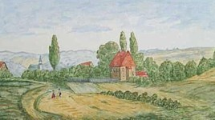
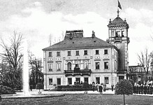
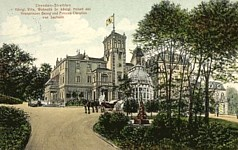
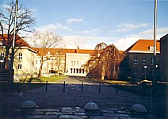

* * *

* * *

* * *

* * *

* * *

* * *

 Die Königliche Villa in Strehlen entstand im 19. Jahrhundert auf dem Gelände des früheren “Roten Hauses”, welches bis zur Neuordnung der königlichen Jagdbezirke 1850 Forsthaus und Sitz des Hegereiters war. Diesem Beamten oblag die Verwaltung und Betreuung des “Rothhäuser Reviers”, das einen Großteil des Dresdner Südraums einnahm. Gleichzeitig besaß der Hegereiter das Schankrecht und betrieb hier eine kleine Gastwirtschaft. Während der Schlacht bei Dresden im August 1813 hatte das Anwesen wegen seiner Lage strategische Bedeutung und wurde bei Kampfhandlungen schwer beschädigt. Nach Auflösung des Forstreviers verkaufte der Staat das Gebäude an einen Privatmann, der die Schankwirtschaft noch einige Jahre weiterführte _(Gemälde von 1867)_.

1860 übernahm Kronprinz Albert das Grundstück und ließ das Hegereiterhaus zu einem Gartenschlösschen umbauen. 1883 konnten die Arbeiten an der neuen “Königlichen Villa” _(Fotos)_ abgeschlossen werden. Die umliegenden Gartenanlagen wurden vom Hofgärtner Wilhelm Poscharsky parkähnlich gestaltet. Vor allem in den Frühjahrs- und Herbstmonaten hielt sich die königliche Familie gern in Strehlen auf.

Neben dem Hauptgebäude erwarben die Wettiner auch die benachbarte Villa Trautmann, welche nun als Kavaliershaus diente. Um die Strehlener Besitzungen schnell erreichen zu können, ließ Albert 1897 einen privaten Eisenbahnhaltepunkt an der Bahnstrecke nach Prag einrichten, der bis heute erhalten ist. Der von Hofbaurat Gustav Frölich im Neobarockstil entworfene Pavillon diente auch als Empfangsgebäude für prominente Gäste der Villa, zu denen u. a. Kaiser Wilhelm II. gehörte. Nach dem Tod König Alberts 1902 übernahm seine Witwe Carola die Strehlener Villa und bewohnte das Haus bis zu ihrem Tod 1907. Danach nutzte Kronprinz Georg das Grundstück als Wohnsitz

Auch nach der Novemberrevolution blieb die Königliche Villa im Besitz der Wettiner, wurde jedoch zum Wohnhaus umgebaut und vorrangig an frühere Hofbedienstete vermietet. Da die finanziellen Mittel für die Erhaltung des Parks nicht mehr ausreichten, versuchten die Wettiner, das Grundstück 1928 an die Stadt Dresden zu verkaufen, allerdings ohne Erfolg. Pläne für eine auf dem Areal geplante Villenkolonie scheiterten ebenfalls.

Erst in den Dreißiger Jahren übernahm der Staat das Gelände für die Neubebauung mit militärischen Einrichtungen. 1939/40 entstand im früheren Park der Gebäudekomplex des Luftgaukommandos _(Foto)_, dessen Angehörige aktiv an den Vorbereitungen des Zweiten Weltkrieges beteiligt war. Architekt des Neubaus war Wilhelm Kreis. An die Zweckbestimmung des Gebäudes erinnert ein von Karl Albiker geschaffenes Ikarus-Relief über dem Haupteingang. Bereits 1936 war die frühere Residenzstraße nach einem 1936 bei einem Flugzeugabsturz bei Klotzsche tödlich verunglückten General in General-Wever-Straße umbenannt worden.

1945 wurde die frühere Königliche Villa durch Sprengbomben getroffen und völlig zerstört. Die beim Luftangriff weitgehend unbeschädigten übrigen Gebäude nutzte zwischen 1945 und 1952 die Sächsische Landesregierung. 1959 übernahm die NVA das Gelände und richtete hier die Militärakademie “Friedrich Engels” ein. Für Ausbildungs- und Verwaltungszwecke der Einrichtung wurden zahlreiche Neubauten errichtet und die mittlerweile in August-Bebel-Straße umbenannte Straße teilweise in das Areal einbezogen. Noch 1988 begann man mit dem Bau eines modernen Gefechtsstandes, der jedoch bis zur Wende nicht mehr fertiggestellt werden konnte.

Seit 1990 werden die Gebäude durch die Technische Universität und zum kleineren Teil durch die Bundeswehr genutzt. An die Geschichte des Grundstücks erinnern der in den letzten Jahren sanierte frühere Haltepunkt und das ehemalige Offizierscasino, welches heute als Veranstaltungsort “Tusculum” durch das Studentenwerk betrieben wird.
