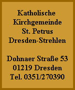
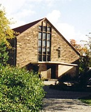
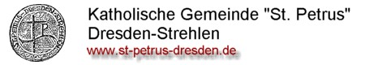

* * *

Die heutige St.-Petrus-Gemeinde Strehlen entstand 1923 als katholische Pfarrei und hatte
ihren Sitz zunächst in einer Villa auf der Gustav-Adolf- Straße 3. Ende der Zwanziger Jahre wurden die Gemeinderäume zur Tiergartenstraße 6 verlegt, wo eine kleine Kapelle eingerichtet
wurde. Diese Villa fiel 1945 den Bomben zum Opfer.

Als Provisorium wurde für die Strehlener Katholiken 1947 eine kleine Interimskirche auf der
Franz-Liszt-Straße geschaffen. 1962 entstand nach Entwürfen von Egon Körner ein modernes Gemeindezentrum unmittelbar neben dem Olympia-Kino an der Dohnaer Straße. Das
schlichte Haus besitzt keinen Turm und wird für Gottesdienste und kirchliche Veranstaltungen genutzt.  Im Inneren befindet sich an der Altarrückwand ein Sandsteinrelief von Max Lachnit,
welches die Verklärung Christi auf dem Berg Tabor darstellt..

In den 1990er Jahren wurde die St.-Petrus- Kapelle zu einem internationalen christlichen Begegnungszentrum erweitert.
Die feierliche Einweihung des neuen Gemeindehauses erfolgte am 23. Februar 1992. Hier sind u.a. ein Festsaal,
Gruppenräume für die kirchliche Arbeit und Büros untergebracht. Architekt des Gebäudes war Gunther Just. Seit 2013
weist am Eingang  ein vier Meter hohes Bronzekreuz auf die Kirche hin. Schöpfer war der Metallgestalter Wolfram Ehnert.

* * *

 \[ [Home](../../../index.html)\] \[ [Nord](../../../nord/)\] \[ [Nordwest](../../../nordwest/)\] \[ [Neustadt](../../../neustadt/)\] \[ [Nordost](../../../nordost/)\] \[ [West](../../../west/)\] \[ [Zentrum](../../../zentrum/)\] \[ [Südwest](../../../sudwest/)\] \[ [Süd](../../../sud/)\] \[ [Südost](../../../sudost/)\] \[ [Ost](../../../ost/)\] \[ [Register](../../../Register/register.html)\] \[ [Kontakt](../../../Kontakt/kontakt.html)\] \[ [Impressum](../../../impressum/)\]
