

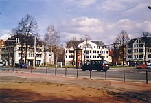Der kleine Platz An der Pikardie, am Schnittpunkt der Hauptallee des Großen Gartens mit der Karcherallee gelegen, erhielt seinen Namen 1907 nach dem Schneidermeister Carl Pickard, der einst hier ein Grundstück besaß. Ende des 19. Jahrhunderts entstanden Villen, die jedoch 1945 zum Teil zerstört wurden. Die Baulücken wurden 1992/93 mit modernen Bürohäusern nach Entwürfen von Claus Peter Krieger geschlossen _(Foto)_. Hier hat u.a. der Arzneimittel-Hersteller Asta Medica seinen Stammsitz.

Picardie: Vor dem Zweiten Weltkrieg existierte im Großen Garten auch ein Ausflugslokal “Picardie”. Die Gastwirtschaft ging auf ein 1716 errichtetes Torwärterhaus zurück, nach dem man die hier gelegenen Grunaer Fluren dem Großen Garten zugeschlagen hatte. Im Nebenerwerb durften die Torwärter Bier und Milch ausschenken und einfache Speisen anbieten. 1832 wurde das Torwärterhaus abgetragen. An seiner Stelle ließ der Dresdner Schneidermeister Carl Pickard ein größeres Restaurationsgebäude bauen. Fortan fanden hier Konzerte, Tanz- und Varieteveranstaltungen statt. Nach dem Besitzer setzte sich im Volksmund der Name "Picardie" durch. Die Gastwirtschaft blieb bis Mitte der 1930er Jahre geöffnet. Danach bezog ein Institut für landwirtschaftlichen Unterricht das Haus. Zudem gab es hier im Zweiten Weltkrieg ein Lazarett. Das landhausartige Gebäude an der Karcherallee ist noch erhalten und befindet sich im Besitz der Technischen Universität.

Die heutige Barlachstraße entstand Ende des 19. Jahrhunderts im Zusammenhang mit dem Ausbau des Strehlener Villenviertels um den Wasaplatz. Ursprünglich ab 1878 nach dem Maler Julius Schnorr von Carolsfeld Schnorrstraße benannt, wechselte sie mit der Eingemeindung Strehlens 1893 erstmals ihren Namen. Bis 1945 wurde sie nun nach dem bekannten preußischen Generalfeldmarschall Gebhard Leberecht Blücher Blücherstraße genannt. 1946 erhielt sie den Namen des Bildhauers und Dichters Ernst Barlach (1870-1938), der vor allem durch seine vom Expressionismus beeinflussten Skulpturen bekannt wurde. Die Villen der Barlachstraße, in der Zeit zwischen 1900 und 1920 entstanden, dienen heute meist gewerblichen Zwecken bzw. als Ärztehäuser.

Sowohl Basteistraße als auch der benachbarte Basteiplatz erhielten ihre Namen 1912 bzw. 1925 nach dem bekannten Felsplateau in der Sächsischen Schweiz. 1953/55 entstanden am Basteiplatz neue Gebäude für die Palucca-Schule für künstlerischen Tanz. Bemerkenswert ist auch die Villa Basteistraße 26, die 1910 vom Architektenbüro Schilling & Gräbner errichtet wurde und Auftakt für weitere Wohnbauten in diesem Teil Strehlens wurde.

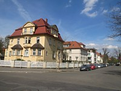

**_Foto:_** _Blick in die Basteistraße (Ecke Tiergartenstraße)_

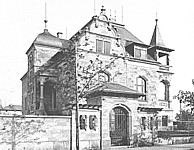Die Beethovenstraße wurde 1891 im westlichen Teil von Strehlen angelegt. Wie auch die benachbarten Straßen erhielt sie ihren Namen nach einem deutschen Komponisten. Ludwig van Beethoven lebte von 1770 bis 1827 und gehört zu den bedeutendsten Musikern der deutschen Musikgeschichte. Das Straßenbild prägten vor 1945 Villen und Landhäuser aus der Zeit um 1900. So entstand die Villa Beethovenstraße 5 _(Foto)_ 1894 nach Entwürfen des Baumeisters Carl Friedrich Kraft (1851-1912). Im Nachbarhaus Nr. 7 war vor dem Ersten Weltkrieg "Jorns Schule für Damen" untergebracht. Sämtliche Gebäude der Straße fielen 1945 dem Luftangriff zum Opfer und wurden in den 1960er Jahren durch mehrgeschossige Wohnblocks ersetzt.

Die Bernhard-Kretschmar-Straße wurde Ende der 1980er Jahre beim Bau des Neubaugebietes Reicker Straße angelegt und nach dem Dresdner Maler Bernhard Kretzschmar (1889-1972) benannt. Kretzschmar gehörte ab 1927 der Künstlergruppe “Dresdner Sezession” an und war ab 1946 Professor an der Hochschule für Bildende Künste. Ursprünglich standen hier mehrgeschossige Plattenbaublocks, die im Zuge des Rückbauprogramms für dieses Wohnviertel 2003 abgerissen wurden.

Die Buchnerstraße im Wohnviertel an der Teplitzer Straße verdankt ihren Namen dem Dresdner Festungsbaumeister Paul Buchner (1531-1607). Buchner war ab 1559 Handwerker im Dienste Kurfürst Augusts und wurde 1576 zum Oberzeugmeister ernannt. Maßgeblich war er am Ausbau der Stadtbefestigung, am Bau des Zeughauses (Albertinum) und am Umbau des Residenzschlosses unter Kurfürst Christian I. beteiligt. Die Straße erhielt ihren Namen 1938 im Zuge des Ausbaus einer Reihenhaussiedlung oberhalb der Teplitzer Straße.

Die Herkunft des Namens dieser Straße im Osten Strehlens ist unklar, vermutlich wurde sie nach einer Privatperson benannt. Ursprünglich trug sie ab 1881 den Namen Concordienstraße, wurde nach der Eingemeindung Strehlens jedoch 1893 in Cäcilienstraße umbenannt. Die Heilige Cäcilia gilt als Schutzpatronin der Musik, speziell der Kirchenmusik. Das Straßenbild prägen bis heute villenartige Mehrfamilienhäuser aus dem ersten Drittel des 20. Jahrhunderts. Architektonisch interessant ist die 1925 von Paul Marcus errichtete Villa Böhme (Nr. 5). Bauherr war der Kaufmann Eugen Richard Böhme, der an der Waisenhausstraße 38/40 ein Modewarenkaufhaus besaß. In der gegenüber liegenden Villa Nr. 6 wohnte einige Jahre die Malerin, Grafikerin und Objektkünstlerin Angela Hampel. Zu ihren Schöpfungen gehören u.a. die beiden Figuren "Undine kommt" und "Undine geht" am Johannstädter Elbufer und der [Pieschener Molenbrücke](../../../nordwest/pieschen/).

Die Straßenbahn nach Reick fährt hingegen erst seit 1947 durch diese Straße, nachdem die ursprüngliche Streckenführung über Hugo-Bürkner, Dohnaer und Dorotheenstraße aufgegeben wurde. Einige Baulücken wurden nach 1990 durch Neubauten geschlossen.

Die Cauerstraße entstand 1938 im Zusammenhang mit der Anlage einer Kleinhaussiedlung zwischen Strehlen und Zschertnitz. Ihren Namen erhielt sie nach dem Bildhauer Emil Cauer dem Älteren (1800-1867) , der einer Dresdner Bildhauer- und Malerfamilie entstammte und 1867 in Bad Kreuznach verstarb. Von 1829 und 1832 war er auch Konservator der Antikensammlung in Dresden.

Die Conrad-Felixmüller entstand Mitte der 1980er Jahre im Neubaugebiet Reicker Straße. Ihren Namen erhielt sie nach dem expressionistischen Dresdner Maler und Grafiker Conrad Felixmüller (1897-1977).

Auch die in unmittelbarer Nachbarschaft gelegene Curt-Querner-Straße erinnert an einen Maler. Curt Querner (1904-1976) verbrachte einen Großteil seines Lebens in Börnchen bei Kreischa und war nach seinem Studium an der Dresdner Kunstakademie freischaffend tätig. Künstlerisch gilt er als Vertreter des Realismus und der Neuen Sachlichkeit.

Die Defreggerstraße wurde 1923 angelegt und verbindet die Lockwitzer mit der Teplitzer Straße. Wenig später entstanden hier einige Reihenhäuser der Heimstättengesellschaft Sachsen, welche bevorzugt an Angestellte der Deutschen Post vermietet wurden. Ihren Namen erhielt die Straße nach dem Maler Franz von Defregger (1835-1921), der Ende des 19. Jahrhunderts zur den bekanntesten Vertretern der Münchner Kunstszene gehörte. Defregger schuf vor allem Historienbilder und Szenen aus dem Volksleben seiner Tiroler Heimat.

Die 1935 angelegte Donndorfstraße erinnert an den Bildhauer Adolf von Donndorf (1835-1916), der als Rietschel-Schüler u.a. das Lutherdenkmal vor der Frauenkirche schuf. 1864 wurde er zum Ehrenmitglied der Dresdner Kunstakademie ernannt und verbrachte seine letzten Lebensjahre in Stuttgart.

Das zuvor als Lehmgrube einer Zschertnitzer Ziegelei genutzte Gelände wurde bis zum Zweiten Weltkrieg mit Ein- und Zweifamilienhäusern bebaut. Nach 1945 hatten hier die Malerinnen Lea Grundig (Nr. 35) und Eva Schulze-Knabe (Nr. 43) ihre Ateliers. Auf der Donndorfstraße 41 lebte nach ihrer Rückkehr nach Dresden 1949 die Schriftstellerin Auguste Wieghardt-Lazar. Bekannt wurde sie durch ihr Kinderbuch "Sally Bleistift in Amerika". Lazar, Witwe eines Mathematikprofessors, hatte sich in den 1930er Jahren im Widerstand gegen das NS-Regime engagiert und musste 1938 nach Großbritannien emigrieren. Ihre letzten Lebensjahre verbrachte sie in Dölzschen (Am Tälchen 10).

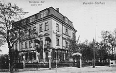Die Dorotheenstraße und die von ihr abgehende Hermannstraße wurden 1880/81 nach den Hauptfiguren aus Goethes Versepos "Hermann und Dorothea" benannt. Das Straßenbild prägen bis heute Villen und Mehrfamilienhäuser aus der Zeit vom Ende des 19. Jahrhunderts. Im Eckhaus zur Dohnaer Straße (Dorotheenstraße 2) befand sich ab ca. 1895 das beliebte Lokal "Dorotheenhof" (Foto). Die Gaststätte im Erdgeschoss des Wohnhauses wurde viele Jahrzehnte von der Familie Piersig betrieben und profitierte von ihrer günstigen Lage an der damaligen Gleisschleife der Straßenbahn. Um 1980 schloss der "Dorotheenhof" seine Pforten.

Zu den früheren Bewohnern der Straße gehörten u.a. die Maler Carl Bantzer (Nr. 12) und Otto Hildebrandt (Nr. 15). Im Wohnhaus Dorotheenstraße 20 lebte 1915 die Familie von Max Immelmann (1890-1916), der als "Adler von Lille" einer der bekanntesten Jagdflieger des Ersten Weltkrieges war und am 18. Juni 1916 bei einem Absturz ums Leben kam. Sein Grab befindet sich im Urnenhain Tolkewitz. Auch der ehemalige Kreuzschüler und später weltbekannte Sänger und Dirigent Peter Schreier wohnte einige Jahre auf der Dorotheenstraße.

Der Edmund-Moeller-Weg wurde 1980 im Zuge des Ausbaus des Neubaugebietes Reicker Straße angelegt und nach dem Bildhauer Edmund Moeller (1885–1958) benannt. Moeller schuf u.a. einige Plastiken am Neustädter Brückenkopf der [Albertbrücke](../../../zentrum/johannstadt/albertbrucke/) sowie Relieftafeln für die Grunaer [Thomaskirche](../../../ost/gruna/thomaskirche/) und besaß ein Atelierhaus auf der [Gostritzer Straße](../../../sudost/leubnitz-neuostra/page14822/gostritzer_strasse/) 10 in Leubnitz-Neuostra. Im Garten des noch heute von bildenden Künstlern genutzten Gebäudes sind ebenfalls einige seiner Werke zu sehen. Die Plattenbauten am Edmund-Moeller-Weg wurden 2003 abgerissen.

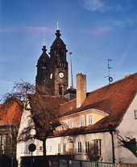Die heutige Elsa-Brändström-Straße trug einst den Namen Auf dem Berge, da sich hier die mit 127 Metern höchste Erhebung der Dorfflur befand. Hier stand bis 1892 ein Kalkofen zur Gewinnung von Baustoffen. Im Zuge des Ausbaus dieses Weges zur Fahrstraße erhielt er 1882 zunächst nach seiner Lage den Namen Oststraße. Ab 1892 wurde die Oststraße nach dem nahen Dorf Niedersedlitz Sedlitzer Straße genannt. Der jetzige Name erinnert an die schwedische Krankenpflegerin Elsa Brändström (1888-1948), die als “Engel von Sibirien” an der Rettung hunderter Kriegsgefangener im Ersten Weltkrieg beteiligt war. Die verdienstvolle Aktivistin des Deutschen Roten Kreuzes war bis zu ihrer Emigration in die USA 1933 auch in Sachsen aktiv, wo sie sich der Betreuung kriegsbeschädigter Soldaten widmete. Das Foto zeigt einen Blick aus der Elsa-Brändström-Straße zur Strehlener Kirche, im Vordergrund das Gemeindehaus.

Bemerkenswert ist die 1869 erbaute Villa auf dem Eckgrundstück zur Rayskistraße (Nr. 13). Das Gebäude entstand im Stil der Neorenaissance und liegt inmitten einer ausgedehnten parkartigen Gartenanlage. Erster Besitzer war der Dresdner Unternehmer Ernst Ludwig Aulhorn, Inhaber der Löbtauer Schokoladenfabrik [Petzold & Aulhorn](../../../sud/plauen/strassen_plauen/petzold___aulhorn/). Während seiner Amtszeit von 1904 bis 1914 wohnte hier der Dresdner Stadtbaurat Hans Erlwein. Nach 1945 wurde die Villa zunächst von der Roten Armee beschlagnahmt und als Wohnhaus sowjetischer Offiziere genutzt. 1946-48 lebte der sächsische Landesvorsitzende der neu gegründeten Liberal-Demokratischen Partei (LDPD) Prof. Hermann Kastner im Haus. Kastner hatte zeitweise auch das Amt des sächsischen Justizministers inne und war stellvertretender DDR-Ministerpräsident. Ab 1952 befand sich hier bis zur Schließung 1995 ein Kindergarten. 2011 begann die Sanierung der Villa und ihrer Nebengebäude. Außerdem sollen auf dem Areal zwei Mehrfamilienhäuser entstehen.

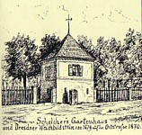Auf dem Grundstück Elsa-Brändström-Straße 16 ist noch ein historischer Weichbildstein erhalten geblieben, wie er früher zur Begrenzung des städtischen Weichbildes verwendet wurde. Der Stein trägt die Nr. 34 und die Jahreszahl 1729 und befindet sich als einer der wenigen seiner Art noch am ursprünglichen Standort. Ein weiterer Stein dieser Art mit der Nr. 35 ist am anderen Ende des “Schindergässchens” erhalten geblieben, welches die Elsa-Brändström-Straße mit der Dohnaer Straße verbindet _(Zeichnung mit Gartenpavillon aus der Zeitschrift “Bergblumen” von 1892)_. Der aus dem Jahr 1543 stammende Stein wurde in den 1990er Jahren restauriert und ergänzt. Auf dem benachbarten “Napoleonhügel” weilte 1813 Napoleon, um seine Truppen während der Schlacht bei Dresden zu beobachten. An seinen Aufenthalt in Strehlen erinnert seit
2013 eine Tafel an der Grundstücksmauer Elsa-Brändström-Straße 18.

Die Eugen-Bracht-Straße entstand in den 1930er Jahren im Zusammenhang mit dem Bau einer kleinen Wohnanlage an der Reicker Straße. Benannt wurde sie nach dem Kunstmaler und Akademieprofessor Eugen Felix Prosper Bracht (1842-1921). Bracht war an der Berliner und ab 1884 an der Dresdner Kunstakademie tätig und schuf vor allem Landschaftsdarstellungen und historische Monumentalgemälde.

Die Pläne für die hier errichteten Mehrfamilienhäuser stammen von Lothar Schie, der auch in Leubnitz-Neuostra und Torna als Architekt tätig war. In einem dieser Gebäude wohnte nach dem Zweiten Weltkrieg der Schauspieler, Regisseur und Direktor des Centraltheaters Georg Wörtge. Bereits 1921 hatten Strehlener Einwohner in diesem Gebiet Obstbäume gepflanzt und Kleingärten angelegt. Offiziell wurde der Verein "Dresden-Strehlen Freudenberg" am 1. April 1921 gegründet und zählt heute 96 Gärten.

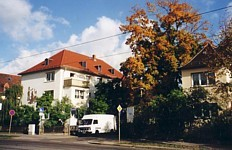

**_Foto:_** _Wohnhäuser an der Eugen-Bracht-Straße_

Die Eugen-Hoffmann-Straße wurde 1986 als Erschließungsstraße im Wohngebiet Reicker Straße angelegt und nach dem Maler, Graphiker und Bildhauer Eugen Hoffmann (1892–1955) benannt. Hoffmann wirkte viele Jahre als Professor an der Dresdner Kunstakademie. Im Zuge des Stadtumbaus nach der Wende wurden die hier befindlichen Wohnblocks Nr. 1 bis 23 abgerissen und die Straße daraufhin zurückgebaut. 2005 erfolgte die offizielle Aufhebung der Namensgebung und die Umwandlung des Areals zur Grünanlage.

Die Eva-Schulze-Knabe-Straße entstand im Zusammenhang mit dem Bau des Neubaugebietes Reick und verläuft parallel zum Koitzschgraben, der historischen Flurgrenze zwischen Reick und Strehlen. Ihren Namen erhielt sie nach der Malerin und Grafikerin Eva-Schulze-Knabe (1907-1976), die gemeinsam mit ihrem Mann Fritz Schulze in den Zwanziger Jahren der proletarischen Künstlergruppe “ASSO” angehörte. Während ihr Mann 1942 von den Nationalsozialisten hingerichtet wurde, überlebte Eva Schulze-Knabe die NS-Diktatur und war nach 1945 als Professorin an der Dresdner Kunstakademie tätig. An das Ehepaar erinnert seit 1954 ein Gedenkstein an ihrem ehemaligen Atelier am [Hohen Stein](../../../sud/plauen/hoher_stein/) in Plauen.

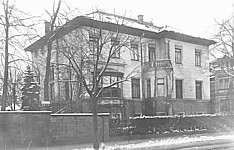Die Franz-Liszt-Straße hieß ab 1881 bis Mitte der 1930er Jahre Palaisstraße, da sie unmittelbar auf das Palais im Großen Garten zuführt. Hier befand sich auch die 1945 zerstörte [Königliche Villa](../../../sudost/strehlen/konigliche_villa/) auf dem späteren Gelände der Militärakademie. Aus Anlass des 50. Todestages von Franz Liszt wurde die Palaisstraße 1936 in Franz-Liszt-Straße umbenannt und damit die Tradition fortgesetzt, Nebenstraßen der Tiergartenstraße nach bekannten Komponisten zu benennen (Mozartstraße, Richard-Wagner-Straße, Beethovenstraße). Franz Liszt (1811-1886) gilt als einer der bedeutendsten Komponisten des 19. Jahrhunderts. und schuf vor allem Klaviermusik und Sinfonien.

Bis zur Gegenwart blieben an der Franz-Liszt-Straße einige historische Villenbauten erhalten, die heute unter Denkmalschutz stehen. Als Kulturdenkmale sind die Villen Nr. 5, 13, 16, 17 und 19 in die Denkmalliste eingetragen. Letztgenannte entstand 1899 für den Amtsgerichtsdirektor Eduard Ginsberg, der für seinen Wohnsitz das bekannte Architekturbüro Schilling & Gräbner verpflichtete. Auch die übrigen Häuser wurden nach 1870 für wohlhabende Dresdner Familien gebaut. Einige wurden 1945 zerstört, darunter die Villa Nr. 6 _(Foto)_. Hier wohnte der frühere Verleger und Chefredakteur der "Dresdner Neuesten Nachrichten" Julius Wollf, der 1933 wegen seiner jüdischen Herkunft aus seinem Verlag gedrängt wurde. 1942 nahm sich Wollf wegen zunehmender Diskriminierung durch die Nazis zusammen mit seiner Frau Johanna in seinem Haus das Leben. An das Paar erinnert seit 2016 ein Stolperstein vor dem Grundstück.

Das ebenfalls nicht mehr vorhandene Haus Nr. 7 war einst Wohnhaus von Nikolaus Graf von Seebach (1854-1930), Intendant des Dresdner Hoftheaters und Förderers moderner Bühnenkunst. Erhalten blieb hingegen die Nr. 13. Hier lebte ab 1927 der Schauspieler Paul Hoffmann (1902-1990), der bis 1946 dem Ensemble des Dresdner Staatsschauspiels angehörte. Später war er künstlerischer Leiter des Württembergischen Staatstheaters und von 1968 bis 1971 Direktor des Burgtheaters in Wien.

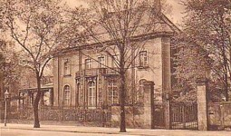Die Gerhard-Hauptmann-Straße entstand im 19. Jahrhundert als Verbindung zwischen Strehlen und dem Stadtzentrum und wurde ursprünglich ab 1875 Residenzstraße genannt. Nach dem Ersten Weltkrieg erhielt sie den Namen des deutschen Dichters Gerhard Hauptmann (1862-1946), der regelmäßig in Dresden zu Gast war und in der nahen Lößnitz auch seine erste Frau Marie Thienemann kennengelernt hatte. Mit der Namensgebung wurde mit ausdrücklicher Genehmigung der
Stadtverordneten ausnahmsweise vom Grundsatz abgewichen, Straßen nur nach bereits verstorbenen Personen zu benennen.

Im Zusammenhang mit dem Bau des Luftgaukommandos der Wehrmacht auf dem Areal der früheren Königlichen Villa erfolgte 1934 die Umbenennung des östlichen Straßenabschnitt zwischen Strehlener Platz und Wasaplatz in General- Wever-Straße (heute [August-Bebel-Straße](../../../sudost/strehlen/strassen_strehlen/august-bebel-strasse/)). Das verbliebene Reststück behielt seinen Namen und war bis 1945 von Villenbauten geprägt _( **Foto:** Gerhard-Hauptmann-Straße 4)_. Heute befinden sich hier neben Resten der historischen Bebauung am Richard-Strauss-Platz u.a. eine Großtankstelle und ein 1960 errichtetes Bürohochhaus.

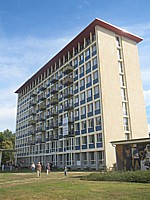Bürohochhaus (Nr. 1): Das neungeschossige Gebäude entstand 1958/60 nach Plänen von Alfred Gottfried und Georg Wolf und ist wegen seiner markanten Fassade auch als “Blaues Haus” bekannt. Bis 1989 wurde es vom Zentralen Forschungsinstitut für Arbeitsökonomie und Arbeitsschutz genutzt. Der Stahlbetonbau besitzt eine Rasterfassade, dessen einzelne Felder mit blauen Kacheln aus Meißner Keramik verkleidet sind. Im Inneren befanden sich ursprünglich Büros für ca. 400 Angestellte. Ein Festsaal und Räume für ein Rechenzentrum wurden später hinzugefügt. Als Beispiel der architektonischen Moderne in der DDR steht das Gebäude unter Denkmalschutz. Nach 1990 nutzte bis 1999 die Bundesanstalt für Arbeitsschutz das Haus. 2012 begann der Umbau zum Appartementwohnhaus mit insgesamt 64 Wohnungen.

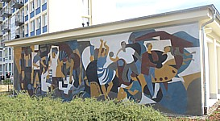Am Verbindungsbau zum angrenzenden Speise- und Festsaal befindet sich seit 1967 ein Wandbild von Dietmar Gubsch. Gubsch schuf dieses Bild als Kunststudent und wurde bei der Gestaltung von den Professoren Lohmar und Hesse der Hochschule für bildende Künste fachlich unterstützt. Bei der Umsetzung kam eine besondere Sgraffitto-Technik zum Einsatz, bei der verschiedene Schichten farbigen Kalkputzes aufgetragen und anschließend teilweise wieder abgekratzt wurden, wodurch das Werk eine Reliefstruktur und Plastizität bekam. Im Zuge der Sanierung des Gebäudes restaurierte Dietmar Gubsch sein Wandbild 2013.

Nr. 3: Der moderne Gebäudekomplex entstand 2008/09 als Seniorenresidenz “Domizil am Zoo” und beherbergt mehrere Appartements für betreutes Wohnen sowie ein Pflegeheim mit ca. 140 Plätzen. Die aus drei Einzelgebäuden bestehende Anlage erhielt außerdem Räume für eine Arztpraxis, eine Cafeteria, Friseursalon und einen Kiosk. Zuvor waren einige Nebengebäude des ehemaligen Forschungsinstitutes für Arbeit abgerissen worden.

Die 1928 angelegte und durch die GAGFAH mit Wohnhäusern bebaute Geystraße im Süden von Strehlen verdankt ihren Namen dem Maler Leonhard Gey (1838-1894). Gey besuchte ab 1856 die Dresdner Kunstakademie und gehört zu den bedeutendsten Historienmalern des 19. Jahrhunderts. 1884 wurde er zum Professor ernannt und übernahm vier Jahre später die Leitung des Naturzeichen- und Aktsaales der Oberklasse. Zahlreiche seiner Werke finden sich im Kupferstichkabinett.

1972/74 entstand auf Freiflächen an der Geystraße an der Flurgrenze zu Zschertnitz das Seniorenheim “Olga Körner”, welches in den letzten Jahren modernisiert und durch einen modernen Neubau ersetzt wurde. An Stelle der abgerissenen Plattenbauten aus DDR-Zeiten sollen künftig Einfamilienhäuser gebaut werden. Weitere Einfamilien- und Reihenhäuser im oberen Teil der Straße stammen von 1984/86 und aus den 1990er Jahren.

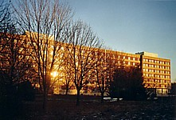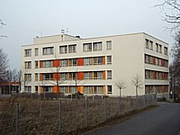

**_Fotos:_** _Seniorenheim “Olga Körner” vor dem Abriss 2005 (links) und Neubau (rechts)_

Die Gotthardt-Kuehl-Straße wurde im Zusammenhang mit dem Bau von Siedlungshäusern im Bereich Lockwitzer/Teplitzer Straße Ende der 1920er Jahre angelegt. Ihren Namen erhielt sie nach dem Maler Gotthardt Kuehl (1850-1915), der bis zu seinem Tod als Professor an der Dresdner Kunstakademie wirkte und zahlreiche Darstellungen seiner Heimatstadt schuf. Sein Atelier hatte Kuehl zeitweise in der Villa Wasa am Wasaplatz. Die Gebäude entstanden zwischen 1920 und 1926 im Auftrag der Heimstättengesellschaft Sachsen GmbH und wurden vom Büro Klette & Böttcher entworfen. Auf der gegenüber liegenden Seite befand sich der erste Fußballplatz des Sportvereins VfL Reichsbahn, Vorläufer des heutigen ESV Dresden. Seit 2005/06 dient die Fläche als Rückhaltebecken des Kaitzbachs.

Zu den früheren Bewohnern der Straße gehörte der Maler und Grafiker Hans Peter Möller-Uetersen (1892-1977) (Nr. 8). Möller-Uetersen schuf vor allem Entwürfe für Wandbilder und übernahm die Neugestaltung der Wandflächen im ehemaligen Verwaltungsgebäude der Landesbauernschaft Sachsen an der Ammonstraße. Nach 1945 bezog die Reichsbahndirektion Dresden den Bau und ließ die als unpassend erachteten Wandbilder der NS-Zeit durch Wandfresken mit Motiven zum Verkehr ersetzen. Auch die heute nicht mehr vorhandenen Darstellungen sächsischer Städte in der Mittelhalle des Hauptbahnhofs stammten von Möller-Uetersen.

Der Grunaer Weg führt als Verlängerung der Zwinglistraße bis zur Bahnlinie und von dort parallel zum Bahndamm bis zur Tiergartenstraße. In seinem Verlauf geht er auf einen alten Verbindungsweg zwischen Strehlen und Gruna zurück. Dieser hatte seinen Beginn ursprünglich in der Nähe der Christuskirche, folgte der heutigen Reicker Straße und zweigte dann in Richtung Gruna ab. 1892 erhielt er offiziell seinen heutigen Namen. Neben Kleingärten und einigen Wohnhäusern liegt am Grunaer Weg auch das zentrale Depot der Busse der Dresdner Verkehrsbetriebe mit Wartungs- und Abstellhallen.

Zur guten Clara: Die Gartenwirtschaft am Grunaer Weg 18 entstand 1919 und wurde von einer Obst- und Gemüsehändlerin betrieben, die zuvor einen Verkaufsstand am Terrassenufer besaß. Als "Gute Clara" bot sie in dem kleinen Lokal Butterbrote, Käse, Bier und Branntwein an. Die Bauten bestanden zunächst nur aus zwei ausrangierten Eisenbahnwagen, in denen sie auch lebte. Ein ausrangierter Straßenbahnwagen diente als Musikpavillon und Kinderspielplatz. Später folgte noch eine schlichte Gaststube. Nach Claras Tod 1935 übernahmen neue Betreiber die beliebte Schankwirtschaft, die noch bis ca. 1975 existierte.

Die Gußmannstraße erinnert an den Maler Otto Gußmann (1869-1926), der um 1900 als bedeutendster Vertreter der Monumentalmalerei in Dresden galt. Gußmann schuf u. a. die Innenausstattung des Neuen Rathauses und des Italienischen Dörfchens sowie die Glasfenster der Christuskirche in Strehlen. Erstmals ist die Straße im Adressbuch von 1929 erwähnt. In den Dreißiger Jahren entstand zwischen Gey- und Gußmannstraße eine Wohnsiedlung der GAGFAH. Die letzten Wohnungen wurden kurz nach Kriegsbeginn 1940 übergeben.

An ihrem Ende trifft die [Gustav-Adolf-Straße](../../../sudost/strehlen/strassen_strehlen/gustav-adolf-strasse/) auf den gleichnamigen Platz, in den auch die Oskarstraße, die Julius-Otto-Straße und der Kaitzbachweg einmünden. In der Mitte stand seit 1998 eine Stahl-Acryl-Plastik der Dresdner Künstlerin Kerstin Franke-Gneuß, die den Verlauf des unter dem Platz hindurchfließenden Kaitzbaches symbolisieren soll. Das Kunstwerk “Innere Mitte” ist Teil des Wasser-Kunst-Projektes “Mnemosyne”, welches die oft wenig beachteten Stadtgewässer wieder erlebbar machen will. Im Zuge des Ausbaus der Oskarstraße zur Straßenbahntrasse wurde die Plastik 2017 entfernt und nach Altstrehlen versetzt. Begrenzt wird der Gustav-Adolf-Platz von einigen repräsentativen Villen, der Bahnstrecke nach Pirna sowie einer Kleingartenanlage.

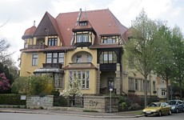

**_Foto:_** _Doppelvilla am Gustav-Adolf-Platz / Julius-Otto-Straße 10_

Der Hagedornplatz entstand Mitte der Dreißiger Jahre in der Nähe der Einmündung Eugen-Bracht-/ Reicker Straße und wurde 1938 benannt. Neben einem Wohnblock aus dieser Zeit entstanden hier die Kleingartensparte “Sommerlaune” sowie die Tennisplätze des Eisenbahner-Sportvereins. Seinen Namen verdankt der Platz dem Kunstsammler und Schriftsteller Christian Ludwig von Hagedorn (1712-1780). Hagedorn gilt als einer der wichtigsten Kunsthistoriker des 18. Jahrhunderts und war ab 1764 Generaldirektor der Dresdner Kunstakademie sowie Leiter der kurfürstlichen Sammlungen.

Die im Neubaugebiet Reicker Straße gelegene Hans-Jüchser-Straße erhielt ihren Namen nach dem Maler und Grafiker Hans Jüchser (1894-1977). Jüchser gehörte zeitweise der revolutionären Künstlervereinigung „ASSO“ und der Neuen Dresdner Sezession an und wurde während der NS-Zeit als „entartet“ verfolgt. Sein Grab befindet sich auf dem Loschwitzer Friedhof. Die 1980 entstandene Bebauung mit mehrgeschossigen Plattenbauten wurde 2003 komplett zurückgebaut.

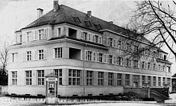Die Heinrich-Zille-Straße wurde 1875 angelegt und zunächst Sedanstraße genannt. Mit dieser Namensgebung sollte an die siegreiche Schlacht von Sedan während des Deutsch-Französischen Krieges 1870/71 erinnert werden. Da es jedoch in der Südvorstadt bereits eine gleichnamige Straße gab (heute Hochschulstraße), war nach der Eingemeindung Strehlens 1893 eine Umbenennung notwendig. Dabei entschied man sich für den Namen Waterloostraße, benannt nach der Schlacht bei Waterloo am 18. Juni 1815. 1946 beschloss die Stadt Dresden, Straßennamen mit militärischem Bezug zu tilgen und benannte die Waterloostraße nach dem Maler und Zeichner Heinrich Zille (1858-1929) in Heinrich-Zille-Straße um.

Neben einigen älteren Villenbauten aus der Zeit um 1900 befand sich hier von 1930 bis 2010 das Postamt Dresden A 20 _(Foto)_, welches zuvor auf der Mockritzer Straße untergebracht war. Das von Paul Löffler entworfene Gebäude (Nr. 16) entstand im Auftrag der Heimstättengesellschaft Sachsen GmbH, die in dieser Zeit einige Wohnhäuser in diesem Viertel errichten lassen hatte. Das Postamt wurde beim Bombenangriff 1945 schwer beschädigt, konnte jedoch schon bald wieder aufgebaut werden. Im Keller des Hauses Heinrich-Zille-Straße 6 bestand zwischen 1996/98 das erste arabische Restaurant Dresdens “Sindbad”.

Der in den 1980er Jahren im Neubaugebiet am Otto-Dix-Ring angelegte Heinz-Lohmar-Weg wurde nach dem deutschen Maler und Grafiker Heinz Lohmar (1900-1976) benannt. Wegen seiner Mitgliedschaft in der KPD und der „Roten Hilfe“ musste er 1933 zunächst in die Schweiz, später nach Frankreich emigrieren. Ab 1949 arbeitete Heinz Lohmar als Lehrer bzw. Professor an der Dresdner Hochschule für Bildende Künste.

Die kurze Herderstraße wurde Ende des 19. Jahrhunderts im Villenviertel zwischen Wiener und Tiergartenstraße angelegt. Mit der 1903 erfolgten Namensgebung wird an den deutschen Philosophen, Theologen und Schriftsteller Johann Gottfried Herder (1744-1803) erinnert. Die Wohngebäude Herderstraße 1 und 3 stehen unter Denkmalschutz.

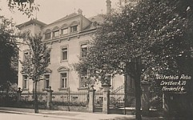

**_Foto:_** _Das Töchterheim Rehm auf der Herderstraße 4_

Der Name Hermannstraße wie auch die Bezeichnung der benachbarten Dorotheenstraße gehen auf Goethes Versepos “Hermann und Dorothea” zurück. Beide Straßen wurden Ende der 1880er Jahre im Zusammenhang mit der Bebauung dieses Teils von Strehlen angelegt und waren einst auch Endpunkt der Straßenbahnlinie.

Vor dem Ersten Weltkrieg lebte der Maler Carl Bantzer (1857-1941) in diesem Viertel. Bantzer gehörte als Gründungsmitglied des “Goppelner Kreises” zu den Wegbereitern der modernen Freilichtmalerei. Er bezog 1899 eine Wohnung auf der Hermannstraße 2 und lebte zwischen 1901 und 1904 im Nachbarhaus Nr. 4. 1906 verzog er in die benachbarte Dorotheenstraße 12. Neben gemeinsamen Ausflügen zu Naturstudien im Dresdner Südraum trafen sich die Künstlerfreunde oft in “Schützes Restaurant” in Strehlen.

Die kurze Hildebrandstraße zwischen August-Bebel- und Teplitzer Straße verdankt ihren Namen dem Bildhauer Adolf von Hildebrand (1847-1921), der vor allem Werke im Stil der griechischen Antike schuf. Bis 1946 wurde sie nach dem preußischen General und Militärtheoretiker Karl von Clausewitz (1780-1831) Clausewitzstraße genannt. Um 1960 entstanden hier einige Gebäude für die Militärakademie mit Offizierswohnungen.

Älteren Datums ist die um 1860 errichtete Villa Nr. 1. Das ursprünglich der Residenzstraße (August-Bebel-Straße) zugeordnete Haus entstand nach Plänen von Gustav Hanefeld für den Maurermeister Friedrich Rudolph Tharandt. Gemeinsam mit seinem Bruder Johann Traugott besaß er ein Bauunternehmen und baute mehrere Villen in Strehlen.

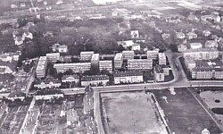Die Hugo-Bürkner-Straße wurde Mitte der 1920er Jahre angelegt, als hier eine Wohnsiedlung der Heimstätten-Gesellschaft Sachsen errichtet wurde. In diesem Zusammenhang entstand auch die als “Hugo-Bürkner-Park” bezeichnete Grünanlage zwischen Teplitzer und Lockwitzer Straße, die zugleich als Rückhaltebecken für den [Kaitzbach](../../../sud/kaitz/kaitzbachtal/) dient. Teile dieser Anlage wurden vor dem Zweiten Weltkrieg als Sportplatz genutzt _(im Bild unten)_. Ihren Namen erhielt die Straße 1929 nach dem Maler Hugo Bürkner (1818-1897), der von 1840 bis 1897 als Lehrer für Holzschneidekunst an der Dresdner Kunstakademie wirkte. Bis 2005 stand in den Parkanlagen eine von Ernst Hermann Grämer geschaffene Skulptur "Mutter mit Kind". 2013 wurde sie an den [Hepkeplatz](../../../ost/striesen/strassen_striesen/) versetzt.

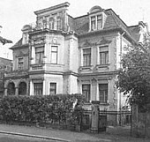Die Julius-Otto-Straße wurde um 1890 angelegt und in den Folgejahren mit repräsentativen Villen bebaut. Die Gebäude weisen verschiedene Stilformen auf und sind typisches Beispiel einer Strehlener Vorstadtstraße der Gründerzeit Bemerkenswert sind u. a. die Häuser Nr. 3 (1887), 4 (1893) und 5 (1898 - _Foto_) im französischen Renaissancestil sowie die beiden vom Architekten Martin für sich selbst erbauten Landhäuser Nr. 13 und 15. Wie fast alle Gebäude stehen auch diese beiden Villen im altdeutschen Stil unter Denkmalschutz. Für den Bau kamen teilweise renommierte Dresdner Architekten zum Einsatz. So entwarf Max Hübner, Inhaber des Büros Hübner & Baron bzw. Hübner & Frieße, die Häuser Julius-Otto-Straße 3 und 9. Die Entwürfe für Nr. 12 stammen vom Architektenbüro Rumpel & Sommerschuh. Zu den einstigen Bewohnern der Straße gehörten der Grafiker Heinrich Molge (Nr. 3) und der letzte Rektor der Hochschule für Verkehrswesen Manfred Zschweigert (Nr. 6).

Ihren 1888 vergebenen Namen verdankt die Julius-Otto-Straße dem langjährigten Dresdner Kreuzkantor Ernst Julius Otto (1804-1877), der mit seinen Kompositionen das Dresdner Musikleben des 19. Jahrhunderts wesentlich mitbestimmte. Ein 1886 vor der Kreuzschule enthülltes Denkmal wurde 1942 für Rüstungszwecke eingeschmolzen und 2010 durch eine Kopie an der Kreuzkirche ersetzt. In Strehlen besaß der Musiker einst eine Sommerwohnung.

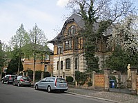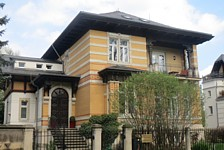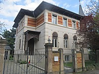

**_Fotos:_** _Villen in der Julius-Otto-Straße, in der Mitte Nr. 11, rechts Nr. 15_

Die 1938 angelegte Kerstingstraße erhielt ihren Namen nach dem Maler Georg Friedrich Kersting (1785-1847), der zum
Romantikerkreis um Kügelgen und Körner gehörte und eng mit Caspar David Friedrich befreundet war. Zeitweise arbeitete er
auch als Lehrer und Malervorsteher der Meißner Porzellanmanufaktur. Bis zum Beginn des Zweiten Weltkrieges entstand an der Kerstingstraße eine kleine Reihenhaussiedlung.

Die Knöffelstraße erinnert an den Architekten Johann Christoph Knöffel (1686-1752), welcher als Schüler Pöppelmanns
1708 in den Staatsdienst trat und ab 1728 Oberlandbaumeister war. 1750 trat er die Nachfolge seines Ausbilders als
Generalakzisebaudirektor an. Von Knöffel stammen u.a. die Pläne für das Kurländer Palais sowie für die 1945 zerstörte Ritterakademie und das Alte Rathaus. Außerdem wirkte er beim Bau des Brühlschen Palais und der Umgestaltung des
Marcolinipalais in der Friedrichstadt mit. Die Wohnhäuser an der Knöffelstraße entstanden Ende der Dreißiger Jahre.

Die Kreischaer Straße verbindet den Wasaplatz mit dem alten Strehlener Dorfkern und wurde nach dem kleinen Ort Kreischa
im Lockwitztal benannt. Trotz baulicher Veränderungen seit Ende des 19. Jahrhunderts und einiger Abbrüche in jüngerer
Vergangenheit sind hier noch Teile der früheren dörflichen Bebauung Strehlens erhalten geblieben. Bemerkenswert ist der
Vierseithof  Kreischaer Straße 34, dessen Geschichte sich bis 1697 zurückverfolgen lässt. Im 18. Jahrhundert befand er sich
im Besitz der Familie Palitzsch. Später dienten die Gebäude u.a. als Tankstelle, Autowerkstatt und Stellmacherei. 1991 begann eine umfassende Sanierung des Hofes, welcher heute als Wohnanlage dient.

Die heutige Kurt-Frölich-Straße in Strehlen entstand Ende des 19. Jahrhunderts, ist jedoch erstmals im Adressbuch von 1911 verzeichnet. Zunächst wurde sie Krusestraße genannt. Namensgeber war vermutlich, in Bezug auf die benachbarte Waterloostraße (heute Heinrich-Zille-Straße), der deutsche General August Heinrich Ernst von Kruse (1779-1848), der während der Schlacht bei Waterloo zum Stab Wellingtons gehörte. Neben seiner militärischen Laufbahn engagierte er sich auch für moderne Lamndwirtschaftsmethoden und setzte sich für den Tierschutz ein.

Auch nach 1945 behielt die Krusestraße zunächst ihren Namen. Auf Beschluss der Stadtbezirksversammlung Dresden-Süd erfolgte schließlich am 14. März 1963 die Umbenennung in Kurt-Frölich-Straße. Kurt Frölich (1893-1941), der zuletzt in Leubnitz wohnte, war gemeinsam mit seiner Frau Elsa im Widerstand gegen die Nationalsozialisten aktiv und wurde in der Nazizeit mehrfach inhaftiert. 1941 starb er an den erlittenen Misshandlungen, sein Grab befindet sich im Ehrenhain des Heidefriedhofes.

Die Lannerstraße in Nachbarschaft des Wasaplatzes wurde um 1880 angelegt und nach dem österreichischen Komponisten
Joseph Lanner (1801-1843) benannt. Lanner schuf vor allem zahlreiche Wiener Walzer. Gemeinsam mit dem Wasaplatz und der Kreischaer Straße bildet die Lannerstraße seitdem das neue Geschäftszentrum Strehlens mit mehrgeschossigen
Wohngebäuden und Läden im Erdgeschoss.

Die bereits Ende des 19. Jahrhunderts mit mehrgeschossigen Wohnhäusern bebaute Lenbachstraße erhielt ihren Namen nach
dem Porträtmaler Franz von Lenbach (1836-1904), der zu den bedeutendsten Künstlern seiner Zeit gehörte und in München
lebte. Ende der Zwanziger Jahre errichtete die Eisenbahner-Baugenossenschaft zwischen Lenbach- und Teplitzer Straße eine kleine Wohnanlage.

Die Lockwitzer Straße wurde Ende des 19. Jahrhunderts im Zusammenhang mit dem Bau neuer Wohn- und Geschäftshäuser am Rande des Strehlener Dorfkerns angelegt. Nach Verlegung der Straßenbahnlinie aus der Kreischaer in die Lockwitzer Straße entwickelte sich diese zur wichtigsten Strehlener Geschäftsstraße. 1925/26 entstanden nach Plänen des Architekten Walter Seidler zwischen Lockwitzer und Dohnaer Straße einige Wohnhäuser für den 1868 gegründeten “Allgemeinen Mietbewohnerverein in Dresden” (Nr. 31-67). Wenig später folgten die Wohnblocks der Heimstättengesellschaft Sachsen. Einige Baulücken in der Nähe des Wasaplatzes und südlich des Dorfkerns wurden nach 1990 durch moderne Geschäftshäuser ersetzt.

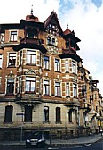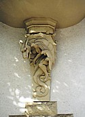

**_Fotos:_** _Interessante architektonische Details prägen die Gründerzeitbebauung der Lockwitzer Straße_

Nr. 14: In diesem Gründerzeithaus lebte von 1940 bis 1944 der österreichische Schauspieler Carl Günther. Er war ab 1940 am Dresdner Staatsschauspiel engagiert und arbeitete zudem als Filmschauspieler (u.a. "Herr Sanders lebt gefährlich"). Nach Schließung aller Theater 1944 verzog er in seine Heimatstadt Wien.

Nr. 18: Das 1902/03 errichtete dreigeschossige Mietshaus gehört zu den architektonisch bedeutendsten Häusern der Straße. Es entstand nach Plänen des Dresdner Baumeisters Carl Krebs und wurde am 31. März 1903 offiziell übergeben. Am Eckerker befindet sich eine Drachenplastik ( _Foto oben rechts_). Ein ähnliches Fabelwesen (Vogel Greif) ist an der Fassade des Wohnhauses Nr. 26 zu sehen.

Die Mary-Krebs-Straße am Rande des alten Dorfkerns verdankt ihren Namen der Dresdner Klaviervirtuosin Mary Krebs-
Brenning (1851-1900). Die zu den bekanntesten Pianistinnen ihrer Zeit gehörende Künstlerin bewohnte ab 1887 bis zu ihrem
Tod gemeinsam mit ihrem Mann Theodor Brenning das Wohnhaus Nr. 1. Brenning war Königlicher Stallmeister und Besitzer
eines Rennstalls, dessen Stallanlagen und ein Brunnen im Hof noch erhalten sind. Das unter Denkmalschutz stehende Gebäude
wurde 1999 saniert. Im Dezember 2002 eröffnete im Keller des Hauses das private Kabaretttheater “Zur Raspel” (bis 2012).
Das Doppelhaus Mary-Krebs- Straße 2/4 entstand 1910 als Auftakt einer geplanten, jedoch nie realisierten großstädtischen Bebauung des Dorfplatzes. Erst 2014 wurde das angrenzende Grundstück mit zwei Mehrfamilienhäusern bebaut.

Die Mockritzer Straße wurde Ende des 19. Jahrhunderts angelegt. Neben dem 1874 erbauten neuen Strehlener Schulhaus (heute 47. Grundschule) entstanden repräsentative Wohn- und Geschäftshäuser. Im Wohnhaus Nr. 6, 1904 von Paul Marcus errichtet, lebte zeitweise die bekannte Dresdner Opernsängerin und Dresdner Ehrenbürgerin Liesel von Schuch. Die verbliebenen Baulücken wurden nach dem Ersten Weltkrieg mit einer Wohnanlage der Eisenbahner- Baugenossenschaft Dresden geschlossen. 2017/18 folgte an der Ecke Dohnaer Straße der Neubau einer modernen Schulsporthalle.

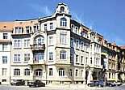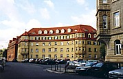

**_Fotos:_** _Mietshaus Mockritzer Straße 6 und Wohnhaus der Eisenbahner-WG_

Die Mozartstraße entstand Mitte des 19. Jahrhunderts im Villenviertel an der Tiergartenstraße und erhielt ihren Namen nach
dem Komponisten Wolfgang Amadeus Mozart (1756-1791). Mozart weilte 1785 und 1789 auch für einige Tage in Dresden und gab hier Konzerte. Die Gebäude der Mozartstraße wurden 1945 zum Großteil zerstört, die Straße selbst durch den Bau
des Zooparkplatzes unterbrochen.

Die Oskarstraße entstand Ende des 19. Jahrhunderts und wurde 1888 nach dem Strehlener Gutsbesitzer und Gemeindevorstand Oskar Jähnichen (1833-1893) benannt. Jähnichen hatte dieses Amt von 1863 bis zur Eingemeindung des Ortes nach Dresden inne. Unklar ist, warum und ab wann diese Namensgebung auf den schwedischen König Oskar II. (1829-1907) zurückgeführt wird. Der Grund lag vermutlich in den ebenfalls nach schwedischen Persönlichkeiten benannten benachbarten Straßen (Gustav-Adolf-Straße, Wasaplatz).

Das Straßenbild prägen vor allem Villen und Landhäuser, die überwiegend unter Denkmalschutz stehen. Bemerkenswert ist davon u.a. die Villa Nr. 6, errichtet von Albin Weißbach. Bis Ende der 1940er Jahre befand sich hier der Firmensitz der Firma Kinotechnik Dr. Walter Meinel, später VEB Kinotechnik Dresden. Außerdem befindet sich an der Oskarstraße der Haltepunkt Strehlen. Im Empfangsgebäude, welches heute als Restaurant genutzt wird, wohnte viele Jahre der Präsident der Reichsbahndirektion Dresden Hermann Demmler. Das Haus wurde vor einigen Jahren saniert. Davor entstand 2017-2019 eine moderne Bus- und Straßenbahnhaltestelle, nachdem die Bahntrasse von der Wasastraße in die Oskarstraße verlegt worden war. Die Einweihung der Strecke fand am 5. Juli 2019 statt.

Die als Seitenstraße der Rayskistraße erst nach 1990 angelegte Oskar-Kokoschka-Straße erinnert an den österreichischen Maler und Dramatiker Oskar Kokoschka (1886-1980), der 1916 als Patient des Lahmann-Sanatoriums nach Dresden kam und hier bis 1923 lebte. Kokoschka bemühte sich als jüngster Professor an der Kunstakademie um eine Erneuerung des Kunstbetriebes in Dresden und schuf auch einige Darstellungen der Stadt.

Der Otto-Dix-Ring wurde 1980 als ringförmige Erschließungsstraße für das Neubauviertel südlich der Reicker Straße angelegt. Zuvor wurden die Flächen als Feld bzw. von Strehlener Gärtnereibetrieben genutzt. Ihren Namen erhielt die Straße nach dem Maler, Grafiker und Professor an der Dresdner Kunstakademie Otto Dix (1891-1969).

Die Rayskistraße wurde Mitte der 20er Jahre auf Strehlener Flur angelegt und anschließend mit Kleinhäusern bebaut.
Gleichzeitig waren hier einige Wohngebäude im Bauhausstil entstanden. Ihren Namen erhielt sie 1931 nach dem Maler
Ferdinand von Rayski (1806-1890). Rayski studierte an der Kunstakademie in Dresden und schuf vor allem Porträtgemälde, von denen sich viele in der Gemäldegalerie Neue Meister befinden. Sein Grab liegt auf dem Trinitatisfriedhof.

Die Flächen an der Reicker Straße wurden ursprünglich als Felder “hinter dem Steine” bezeichnet, da sie sich hinter der markanten Erhebung des heutigen “Kirchberges” befanden. Ende des 19. Jahrhunderts siedelten sich hier mehrere Gärtnereien an. Außerdem gab es zwischen 1889 und 1920 in diesem Gebiet die Strehlener Ziegelei, welche sich im Besitz der Firma Miersch, Conrad & Söhne Naumann befand. Im Anschluss an die bereits um 1930 entstandene Bebauung wurde ab 1984 auf ehemaligem Gartenland ein Neubaugebiet mit ca. 3350 Wohnungen errichtet. 2001 folgte das moderne Einkaufszentrum ODC (“Otto-Dix-Center”). Im Wohnhaus Reicker Straße 33 lebte viele Jahre der Kunstschriftsteller, -kritiker und Kurator Will Grohmann (1887-1968). Grohmann verfasste mehrere kunsthistorische Schriften aund war nach 1945 kurzzeitig Rektor der [Kunstgewerbeschule](../../../zentrum/johannstadt/strassen_johannstadt/kunstgewerbeschule/).

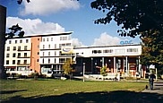

_Foto: Blick von der Reicker Straße zum Otto-Dix-Center_

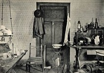Gärtnerei Simmgen: Die Gärtnerei wurde 1892 von Ernst Theodor Simmgen im östlichen Teil von Strehlen gegründet und befand sich bis 1953 in Familienbesitz. Ernst Theodor Simmgen war als Stadtrat und Ökonomierat ein geachteter Bürger und erwarb sich durch seine Rosenzucht hohe Anerkennung. In den Zwanziger Jahren übernahm Sohn Rudolf den Betrieb auf der Reicker Strasse 44 gegenüber dem Hagedornplatz. Er setzte den Anbau von Rosenstöcken fort und konnte die Gärtnerei weiter ausbauen. Für seiner züchterischen Erfolge wurde er als “Rosenkönig von Dresden” geehrt und konnte seine Pflanzen überregional, z. T. auch im Ausland verkaufen. Das Bild zeigt den Wohnraum eines Gärtnergehilfen in einer Strehlener Gärtnerei vor dem Ersten Weltkrieg _(Werbekarte des Allgemeinen Deutschen Gärtner-Vereins)_.

Nach 1945 musste Rudolf Simmgen sein Unternehmen teilweise zur Obst- und Gemüsegärtnerei umwandeln und war einige Zeit auch Pächter eines Gutes in Goppeln. 1953 verließ die Familie Simmgen wegen zunehmender Repressalien Dresden und ließ sich später in Philadelphia nieder, wo sie bis ins hohe Alter ein Blumengeschäft betrieben. Die Strehlener Rosenfelder übernahm die volkseigene Gärtnerei “Floradres”, welche hier noch bis nach 1990 Zierpflanzen anbaute. Heute befinden sich auf dem Gelände Wohnblocks des Neubaugebietes Reicker Straße. Erhalten blieb das frühere Wohnhaus der Familie.

Gärtnerei Rülcker:
Die zu den ältesten noch bestehenden Gärtnereien Dresdens gehörende Firma Gartenbau Rülcker wurde 1864 vom Kunstgärtner Carl Julius Rülcker gegründet. Rülcker übernahm zunächst auf Pachtbasis eine Gärtnerei an der
Zinzendorfstraße und siedelte 1872 auf die Strehlener Felder an der heutigen Reicker Straße über. Dem erst 24-jährigen
gelang es innerhalb weniger Jahre, sein Unternehmen erfolgreich auszubauen. Mehrfach beteiligte er sich an Gartenbau-
Ausstellungen und bekam 1878 von König Albert den Titel “Königlicher Hoflieferant” verliehen. 1889 erwarb Rülcker weitere Flächen. Charakteristisch war in den Anfangsjahren der Anbau und die Veredlung von Treibflieder.

Auch nach 1945 blieb die Firma in Familienbesitz, musste sich jedoch in der Nachkriegszeit verstärkt dem Anbau von
Gemüse widmen. 1961 wurde sie in die GPG “Floradres” eingegliedert, 1991 wieder eigenständig. Das bis heute an der
Reicker Straße 43 ansässige Familienunternehmen zieht und verkauft vor allem Zier- und Balkonpflanzen und besitzt außerdem zwei Verkaufsfilialen in Dresden.

Sportplatz Reicker Straße: Die Sportstätte entstand 1927/28 als Trainings- und Wettkampfplatz für den “Verein für
Leibesübungen Reichsbahn Dresden” und wurde am 9. September 1928 feierlich eingeweiht. Für die Sportler standen ein
Fuß- und Handballplatz, eine 400-m-Aschenbahn und Sprunggruben zur Verfügung. Später kam noch ein Schießstand hinzu.
Der in den letzten Wochen des Zweiten Weltkrieges als Standort einer Flakbatterie missbrauchte Platz musste erst in der
Nachkriegszeit wiederhergestellt werden, bevor 1948 die neu gegründete BSG Reichsbahn (ab 1950 BSG Lokomotive) das
Gelände übernehmen konnte. Seit den 50er Jahren diente der Platz bis 1999 als Domizil der vereinseigenen Hockeysektion,
die hier 1958 und 1959 sogar Länderspiele veranstaltete. Da die vorhandenen Anlagen nicht mehr den Anforderungen genügten, verlegten die Hockeysportler 2000 ihr Traningsgelände in die Friedrichstadt. Ein Brand des Vereinsheims im
Februar 2004 besiegelte schließlich die Geschichte der Sportstätte, deren Reste heute fast völlig verschwunden sind.

Der Richard-Strauss-Platz an der Kreuzung zwischen Gerhard-Hauptmann- und Wiener Straße entstand Ende des 19.
Jahrhunderts und wurde bis zum Ersten Weltkrieg Residenzplatz genannt. Mitte der Zwanziger Jahre erfolgte die Umbenennung nach dem bekannten Komponisten und Dirigenten Richard Strauss (1864-1949). Strauss wirkte häufig in
Dresden als Gastdirigent und ließ hier zahlreiche seiner Opern uraufführen. Zu seinen bedeutenden Kompositionen gehören u.a. die Opern “Salome” (1905), “Elektra” (1909) und “Der Rosenkavalier” (1911). Um den Platz standen bis zur Zerstörung 1945 mehrere Villen, von denen lediglich zwei bis zur Gegenwart überdauerten. Beide werden heute gewerblich bzw. als Gaststätte genutzt.

Die bereits vor dem Ersten Weltkrieg angelegte und mit Mietshäusern bebaute Robert-Koch-Straße erhielt ihren Namen in
Erinnerung an den Arzt und Bakteriologen Robert Koch (1843-1910), der 1882 das Tuberkelbazillus und ein Jahr später den Choleraerreger entdeckte und maßgeblich an der Entwicklung der modernen Bakteriologie beteiligt war.

Der Rudolf-Bergander-Ring wurde 1980 im Zusammenhang mit dem Neubaugebiet Reicker Straße angelegt. In der Folgezeit entstanden hier mehrgeschossige Plattenbauten, eine Schule (128. POS) sowie ein Kindergarten. Benannt wurde die Straße nach dem Dresdner Maler Rudolf Bergander (1909-1970). Bergander gehörte in den Zwanziger Jahren der Künstlergruppe “ASSO” und ab 1947 der Gruppe “Das Ufer an” Zwischen 1952 und und 1958 sowie 1964/65 war er Rektor der Hochschule für Bildende Künste.

Im Zuge des Rückbauprogramms für nicht mehr benötigten Wohnraum wurden die Blöcke am Rudolf-Bergander-Ring mit ca. 700 Wohnungen 2010/11 abgerissen und die Fläche im Anschluss begrünt. Erhalten blieben hingegen die Kindertagesstätte “Spielkiste e.V.” sowie das heute als 128. Oberschule genutzte Schulhaus. Eine weitere Kita mit 117 Plätzen entstand 2013. Städtische Planungen sehen in den kommenden Jahren den Bau eines Technologieparkes mit verschiedenen wissenschaftlichen Instituten vor.

Die Schurichtstraße wurde in den Dreißiger Jahren als durchgehend geplante Wohnstraße zwischen Strehlen und Zschertnitz
angelegt. Da infolge des Zweiten Weltkriegs diese Pläne nicht vollständig realisiert wurden, blieb die zunächst Rungestraße
genannte Straße zweigeteilt, was immer wieder zu Verwechslungen führte. 1993 erhielt der auf Strehlener Flur gelegene
Straßenteil den Namen Schurichtstraße nach dem Architekten und Zeichner Christian Friedrich Schuricht (1753-1832), der u. a. die Erweiterungsbauten des Pillnitzer Schlosses schuf.

Die Teplitzer Straße verbindet den Strehlener Platz mit der Dohnaer Straße und gehört als Teil der Bundesstraße B 172 zu den am stärksten frequentierten Verkehrswegen der Stadt. Um dieser Bedeutung gerecht zu werden, ist sie vollständig
vierspurig mit getrennten Richtungsfahrbahnen ausgebaut. Ihren Namen erhielt sie nach der nordböhmischen Stadt Teplitz (Teplice).

Während der westliche Teil bis zur Caspar-David-Friedrich-Straße kaum bebaut ist und im wesentlichen von Grundstücken der Technischen Universität bzw. dem 1932 eröffneten Sportplatz des früheren Vereins ["Dresdensia"](../../../Zentrum/Pirnaische_Vorstadt/Rudolf-Harbig-Stadion/Rudolf-Harbig-Stadion.html) eingenommen wird, befinden sich im Ostteil mehrere Wohnanlagen. Bemerkenswert ist die 1926/28 von der Heimstättengesellschaft Sachsen errichtete Siedlung Teplitzer Straße 80-96/ Corinthstraße 1-5. Die nach einem einheitlichen Konzept von Paul Löffler im expressionistischen Stil gestalteten Häuser befanden sich seit 1959 im Besitz der Deutschen Post und wurden bevorzugt an deren Angestellte vermietet. Im Jahr 2000 wurde die seit 1991 unter Denkmalschutz stehende “Postsiedlung” verkauft und 2006/07 saniert.

Unweit davon wurden 1955/56 die ersten Wohnhäuser der damaligen AWG Dresden-Süd (heute Wohnungsgenossenschaft “Glückauf” Süd) bezogen. Auf ehemaligem Acker- und Gartenland entstanden unter Mithilfe der späteren Bewohner viergeschossige Häuser mit insgesamt 48 Wohnungen (Teplitzer Str. 42-52). Am 29. Oktober 1956 konnten die ersten Mieter einziehen. Wegen der bevorzugten Vergabe an junge Familien mit Kinderwunsch wurden diese Häuser im Volksmund auch “Storchenhäuser” genannt. Im Haus Nr. 41c lebte viele Jahre die international bekannte Soloharfenistin der Staatskapelle Jutta Zoff.

Dresdensia SV: Der Fußballverein entstand 1910 als Ausgründung aus dem bereits 1898 gegründeten ATV Dresden und spielte zunächst unter dem Namen FC Dresdensia Dresden, später als Dresdensia SV. Neben dem Dresdner SC und dem Sportverein Guts Muts war er dritter größerer Dresdner Fußballverein. Die Spiele wurden überwiegend auf einem Sportplatz an der Johann-Georgen-Allee (Lingnerallee), gelegentlich aber auch in der größeren [Illgen-Kampfbahn](../../../Zentrum/Pirnaische_Vorstadt/Rudolf-Harbig-Stadion/Rudolf-Harbig-Stadion.html) ausgetragen. Bekanntester Spieler war bis zu seinem Wechsel zum DSC der spätere Bundestrainer Helmut Schön.

Im Zusammenhang mit der II. Deutschen Hygieneausstellung 1930/31 musste der Verein sein Gelände aufgeben und zog 1932 auf einen neuen Sportplatz an der Teplitzer Straße um. Der Platz lag zwischen Zelleschem Weg und Teplitzer Straße und blieb bis 1945 Heimstatt der "Dresdensia". Größter sportlicher Erfolg war 1935 der Gewinn der ostsächsischen Meisterschaft und die damit verbundene Qualifikation für die sächsische Gauliga, in der man jedoch nur ein Jahr verblieb. 1945 wurde der Sportverein wie alle anderen Vereine aufgelöst und auch nicht wieder neu gegründet. Auf dem früheren Sportplatz entstanden in den 1950er Jahren die Studentenwohnheime Zellescher Weg. Reste der einstigen Anlage sind noch am Rand des Grundstücks erkennbar. Ein neuer Sportplatz entstand wenig später auf der gegenüberliegenden Seite der Teplitzer Straße für die Militärakademie der NVA.

Die Thormeyerstraße im Wohngebiet zwischen Strehlen und Zschertnitz entstand in den Dreißiger Jahren und wurde nach dem
Architekten Gottlob Friedrich Thormeyer (1775-1842) benannt. Thormeyer entwarf u. a. die Freitreppe zur Brühlschen Terrasse und das Moreaudenkmal in Räcknitz.

Die nach 1990 im Zusammenhang mit einem Wohnpark an der Reicker Straße angelegte Vogelsteinstraße verdankt ihren
Namen dem Maler und Zeichner Carl Christian Vogel von Vogelstein (1788-1868), der als Nachfolger Kügelgens Professor
an der Dresdner Kunstakademie wurde. Vogelstein schuf einige Gemälde zur Ausgestaltung des Pillnitzer Schlosses und wohnte viele Jahre in “Helbigs Etablissement”, Vorgängerbau des “Italienischen Dörfchens”.

Die kurze Voßstraße, eine Querstraße der Wiener Straße, erhielt ihren Namen nach dem deutschen Dichter Johann Heinrich
Voß (1751-1826), der als Vertreter der Aufklärung verschiedene gesellschaftskritische Werke schrieb.

Die Walter-Arnold-Straße entstand nach 1980 im Zusammenhang mit dem Bau des Neubauviertels an der Reicker Straße.
Ihren Namen verdankt sie dem Bildhauer Walter Arnold (1909-1979), der ab 1949 als Professor für Plastik an der Hochschule für Bildende Künste tätig war. Zwischen 1959 und 1964 leitete er als Präsident den Verband Bildender Künstler
in der DDR.

Die um 1880 angelegte Wasastraße erhielt ihren Namen nach dem schwedischen Königsgeschlecht Wasa. Mit der Namensgebung sollte die Gemahlin König Alberts, Carola von Wasa-Holstein-Gottor (1833-1907) geehrt werden, die diesem Geschlecht entstammte. 1853 hatte sie den sächsischen Thronfolger geheiratet. Zu DDR-Zeiten wurde die Wasastraße nach einem Politiker Johannes-Dieckmann-Straße genannt. Johannes Dieckmann (1893-1969) gehörte zu den Mitbegründern der LDPD (Liberaldemokratische Partei Deutschlands) und war zwischen 1949 und 1969 Präsident der Volkskammer und ab 1960 zugleich stellvertretender Vorsitzender des Staatsrates der DDR. Für seine Verdienste erhielt er 1963 die Ehrenbürgerwürde der Stadt Dresden. Im Oktober 1991 bekam die Wasastraße ihren früheren Namen zurück. Bis heute sind hier zahlreiche Villen und Landhäuser verschiedener Stilrichtungen erhalten, die nach erfolgter Sanierung meist gewerblichen Zwecken dienen.

Ab 18. Dezember 1896 verkehrten über die Wasastraße die Straßenbahnen der "Dresdner Straßenbahn", vorerst bis zum Endpunkt Strehlen an der Dohnaer Straße. Noch vor dem Ersten Weltkrieg wurde die Strecke bis nach Leubnitz verlängert. Die Streckenführung über die Wasastraße wurde erst 2019 aufgegeben und durch eine Neubaustrecke über Tiergarten- und Oskarstraße ersetzt. Die letzten Bahnen fuhren am 13. Januar 2019.

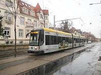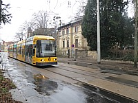

**_Fotos:_** _Der letzte Tag der Straßenbahn auf der Wasastraße (13. Januar 2019)_

Nr. 1: Die schloßartige Villa entstand 1885 für einen Rechtsanwalt und befand sich später im Besitz dessen Sohnes, eines Möbelfabrikanten. 1945 wurde das Haus beim Luftangriff schwer beschädigt, konnte jedoch 1947 in leicht veränderter Form wieder aufgebaut werden. Das zu DDR-Zeiten als Mietshaus genutzte Gebäude erlitt im Jahr 2000 bei einem Brand erneut größere Schäden. 2009 erfolgte eine denkmalgerechte Wiederherstellung und Sanierung der Villa durch einen privaten Investor.

Nr. 16: Die im Landhausstil erbaute Villa war bis 1990 Sitz der Landeskirchlichen Kreditgenossenschaft (LKG). Die im Besitz der evangelischen Kirche befindliche Bank entstand 1925 als erstes derartiges Kreditinstitut in Deutschland und hatte ihr Domizil zunächst im Alten Rathaus am Altmarkt. In den 1930er Jahren bezog die Bank neue Geschäftsräume auf der Ringstraße 62, 1937 das Eckhaus Moritzstraße 19. Nach Zerstörung des Gebäudes befand sich ihr Sitz zunächst im Pfarramt von Leubnitz , bevor im Dezember 1945 das Pfarrhaus der Strehlener Kirche auf der Wasastraße 16 bezogen werden konnte.

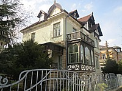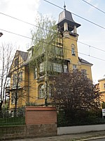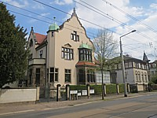

**_Fotos:_** _Villen an der Wasastraße: links die 1902 von Otto Foerster erbaute Villa Wasastraße 10,_

_in der Mitte Nr. 2b, rechts Nr. 11_

Der Weberplatz entstand als Vorplatz des 1910 erbauten [Friedrich-August-Seminars](../../../sudost/strehlen/) und erhielt seinen Namen nach dem
bekannten Komponisten Carl Maria von Weber (1786-1826), der viele Jahre als Hofkapellmeister in Dresden wirkte.
Gleichzeitig entstanden die Diesterwegstraße und die Wigardstraße, die heute nicht mehr vorhanden sind und nach 1945 mit
Ergänzungsbauten der Technischen Universität überbaut wurden. Sowohl der Pädagoge Adolph Diesterweg (1790-1866) als auch der Stenograph Franz Wigard (1807-1885) waren an den bürgerlichen Reformen des 19. Jahrhunderts beteiligt und
sollten mit dieser Namensgebung in Nachbarschaft der ersten modernen Lehrerbildungsstätte in Sachsen geehrt werden.

Die Wundtstraße erhielt ihren Namen nach dem Philosophen und Psychologen Wilhelm Wundt (1832-1920), der als Begründer der modernen experimentellen Psychologie gilt. 1969/73 entstanden an der Wundtstraße sechs 15-geschossige Studentenwohnheime für die Technische Universität. Diese wurden in den vergangenen Jahren saniert und mit neuen Außenfassaden versehen.

Zur künstlerischen Gestaltung des Neubaukomplexes wurde 1974 im hofartigen Innenbereich zwischen den Wohnheimen die Plastik “Ballspieler” des Bildhauers Wilhelm Landgraf aufgestellt. Ein weiteres Kunstwerk „Zwiesprache“ stammt von Theo Balden. Seit 2010 steht zwischen den Häusern außerdem die Stahlplastik “Durch die Wand”. Das Kunstwerk wurde von Frank Findeisen geschaffen und besteht aus verschiedenen Stahlschrott-Teilen.

[Strehlen auf OpenStreetMap](https://www.openstreetmap.org/search?query=Dresden+Strehlen)

* * *

 \[ [Home](../../../index.html)\] \[ [Nord](../../../nord/)\] \[ [Nordwest](../../../nordwest/)\] \[ [Neustadt](../../../neustadt/)\] \[ [Nordost](../../../nordost/)\] \[ [West](../../../west/)\] \[ [Zentrum](../../../zentrum/)\] \[ [Südwest](../../../sudwest/)\] \[ [Süd](../../../sud/)\] \[ [Südost](../../../sudost/)\] \[ [Ost](../../../ost/)\] \[ [Register](../../../Register/register.html)\] \[ [Kontakt](../../../Kontakt/kontakt.html)\] \[ [Impressum](../../../impressum/)\]
