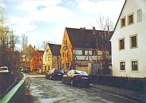
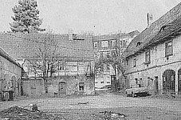
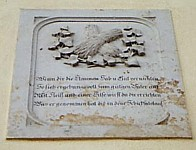
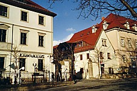
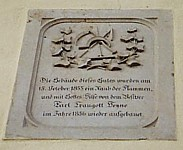
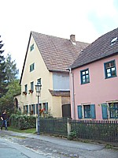
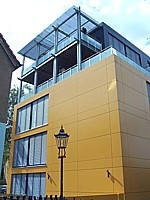

* * *

* * *

Der Dorfplatz Altstrehlen, der sich zu beiden Seiten des Kaitzbaches erstreckt,
gehört zu den größten Dorfplätzen im Stadtgebiet. Ursprünglich gehörten auch Teile der Kreischaer Straße und der [Dohnaer Straße](../../../../sudost/strehlen/strassen_strehlen/dohnaer_strasse/) dazu. Ihr heutiges Aussehen
erhielten die Gebäude nach dem letzten großen Dorfbrand im Jahr 1855. Weitere Häuser entstanden um 1900, als sich Strehlen vom Bauerndorf zum Wohnvorort entwickelte. Oberhalb des Platzes steht seit 1905 die Strehlener [Christuskirche](../../../../sudost/strehlen/christuskirche/).

Ab 1860 trug die Platzanlage den Namen Albertplatz, womit der sächsische
Kronprinz Albert geehrt werden sollte. Albert verbrachte  zu dieser Zeit regelmäßig die Sommermonate in seiner [Strehlener Villa](../../../../sudost/strehlen/konigliche_villa/). Mit der Eingemeindung Strehlens 1892 wechselte die
Bezeichnung in Friedrich-August-Platz. Auch nach Abdankung des Königs behielt der Platz zunächst seinen Namen. Erst 1946 erfolgte die Umbenennung in Altstrehlen.

Trotz verschiedener Umbauten nach 1900 und Gebäudeabrissen in den 1980er Jahren und nach 1990 sind noch einige
historische Gehöfte erhalten geblieben. Bemerkenswert sind u. a. die Bauernhöfe Altstrehlen Nr. 10 und 13. In der
Toreinfahrt vom Gut Nr. 10 erinnert eine eingemauerte Kanonenkugel an die Zerstörung des Dorfes  im Jahr 1813.
Sämtliche Gebäude werden heute nicht mehr landwirtschaftlich genutzt, sondern dienen Wohn- und Gewerbezwecken.

Nr. 1: Der historische Vierseithof an der Ecke Kreischaer Straße / Altstrehlen bildete bis zu seinem Abriss den Auftakt zum historischen Strehlener Dorfkern.
Zu DDR-Zeiten wurden die ehemaligen Wohn- und Wirtschaftsgebäude u.a. als Altstoffhandel und von der Schuhmacher-PGH “Hans Sachs” genutzt. Trotz Denkmalschutzes wurden die Gebäude 1996 wegen ihres schlechten
Bauzustandes abgerissen. Eine hier geplante Wohnanlage in Anlehnung an die einstige Gestaltung kam bislang nicht zustande.

Nr. 3: Im 1856 nach einem Brand wiederaufgebauten Gehöft Altstrehlen Nr. 3 _(Foto unten)_
befindet sich seit der Rekonstruktion 1997 ein kleines Einkaufszentrum. An der Scheune informieren Schrifttafeln über die Geschichte des Anwesens:

**_Linke Schrifttafel (mit Darstellung eines Ährenbündels):_**

_Wenn dir die Flammen Hab und Gut vernichten,_

_so sieh ergebungsvoll zum güt´gen Vater auf._

_Mit Fleiß und seiner Hilfe wirst du dir errichten,_

_was er genommen hat dir in dem Schicksalslauf._

_**Rechte Schrifttafel (mit Darstellung verschiedener landwirtschaftlicher Geräte:)**_

_Die Gebäude dieses Gutes wurden am_

_18\. Oktober 1855 ein Raub der Flammen_

_und mit Gottes Hilfe von dem Besitzer_

_Karl Traugott Heyne_

_im Jahre 1856 wieder aufgebaut._

Nr. 4: An Stelle des wegen Baufälligkeit abgerissenen Gebäudes Altstrehlen Nr. 4 entstand 2008 im Anschluss an die
bestehende Gründerzeitbebauung ein modernes mehrgeschossiges Wohn- und Geschäftshaus. Das von Architekt und
Bauherr Konrad Lentschig gestaltete Gebäude erregte wegen seiner Fassadengestaltung Aufsehen und wird von einigen Anwohnern als “unpassend” kritisiert, setzt jedoch einen modernen farblichen Akzent im Dorfkern.

**_Fotos:_** _Dorfkern Altstrehlen - das rechte Bild zeigt den Neubau Altstrehlen Nr. 4_

* * *

 \[ [Home](../../../../index.html)\] \[ [Nord](../../../../nord/)\] \[ [Nordwest](../../../../nordwest/)\] \[ [Neustadt](../../../../neustadt/)\] \[ [Nordost](../../../../nordost/)\] \[ [West](../../../../west/)\] \[ [Zentrum](../../../../zentrum/)\] \[ [Südwest](../../../../sudwest/)\] \[ [Süd](../../../../sud/)\] \[ [Südost](../../../../sudost/)\] \[ [Ost](../../../../ost/)\] \[ [Register](../../../../Register/register.html)\] \[ [Kontakt](../../../../Kontakt/kontakt.html)\] \[ [Impressum](../../../../impressum/)\]
