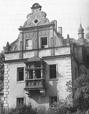
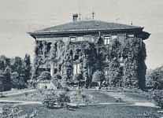
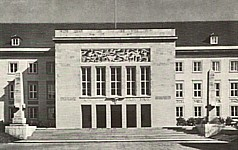
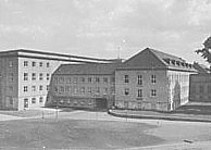
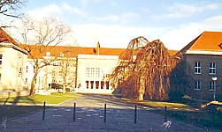
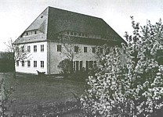

* * *

* * *

Die August-Bebel-Straße wurde im Zusammenhang mit dem Ausbau des Villenviertels Strehlen als Residenzstraße angelegt. Auf einem angrenzenden Gartengrundstück entstand 1860 die [Königliche Villa](../../../../sudost/strehlen/konigliche_villa/), Landsitz der Wettiner in Strehlen. Nach dem Ersten Weltkrieg wurde die Residenzstraße in Gerhard-Hauptmann-Straße umbenannt. Mit der Namensgebung sollte ausdrücklich der eng mit Dresden verbundene Schriftsteller geehrt werden, weshalb auch das Prinzip durchbrochen wurde, Straßen nur nach bereits verstorbenen Persönlichkeiten zu benennen.

In den Dreißiger Jahren entstand im früheren Park der Königlichen Villa der Militärkomplex des Luftgaukommandos der Wehrmacht. In diesem Zusammenhang erhielt der Straßenabschnitt zwischen Strehlener Platz und Wasaplatz den Namen General-Wever-Straße. Walther Wever war erster Stabschef der deutschen Luftwaffe und kam am 3. Juni 1936 bei einem Flugzeugabsturz in der Nähe von Klotzsche ums Leben. 1945 fielen mehrere Villen, vor allem im westlichen Bereich den Bomben zum Opfer. In einem dieser Gebäude (Residenzstraße Nr. 3b) hatte vor dem Ersten Weltkrieg der frühere sächsische Kriegsminister Max von Hausen (1846-1922) seinen Wohnsitz. Heute befindet sich auf dem Grundstück an der Gerhard-Hauptmann-Straße ein Seniorenheim.

 Im westlichen Abschnitt der August-Bebel-Straße sind bis heute einige Villen aus dem 19. und vom Beginn des 20. Jahrhunderts erhalten geblieben. Die Bauten entstanden ab 1850 für wohlhabende Dresdner Unternehmer und Künstler. Bemerkenswert sind die Häuser Nr. 27 und Nr. 30, die im Neorenaissancestil bzw. im klassizistischen Stil gestaltet wurden. Das frühere Wohnhaus des Kunstmalers Wilhelm Claudius (Nr. 10, ehem. Residenzstraße 20), 1888 erbaut und 1910 um einen Atelierflügel erweitert, fiel 1985 dem Abriss zum Opfer _(Foto)_. Jüngeren Datums sind die erst nach 1900 errichteten Villen Nr. 23, Nr. 48 und Nr. 50, welche bereits modernere Bauformen und Jugendstildekor aufweisen. Heute werden einige dieser Gebäude gewerblich genutzt.

In der DDR-Zeit wurde die 1946 in August-Bebel-Straße umbenannte General-Wever-Straße unterbrochen und zum Teil in das Gelände der Militärakademie einbezogen. Lediglich der Abschnitt zwischen Franz-Liszt-Straße und Wasaplatz blieb öffentlich zugänglich. Erst 1990 konnten die meisten Gebäude einer zivilen Nutzung zugeführt und die Straße wieder freigegeben werden. Im ehemaligen Offizierscasino entstand 1996 die vom Studentenwerk betriebene Gaststätte “Tusculum” (Nr. 5), welche seit 2012 als Studentenclub “Wu 5” (ehemals Wundtstraße 5) genutzt wird. Weitere Gebäude nutzt die Fakultät Erziehungswissenschaften der Technischen Universität. Hier befindet sich auch das kleine „Kino im Kasten“ (Nr. 20). Der Straßenname erinnert an den bekannten deutschen Arbeiterführer August Bebel (1840-1913), der zwischen 1884 und 1890 in Dresden-Plauen wohnte.

Einzelne Gebäude:

Nr. 7 (ehem. Residenzstraße 13): Die etwas von der Straße in Richtung Bahnlinie zurückgesetzt stehende Villa wurde um 1894 von Oswald Haehnel für Bruno Klette errichtet. Das in historisierenden Formen gestaltete Gebäude mit repräsentativer Fassadengestaltung steht unter Denkmalschutz _(Foto)_

Nr. 12 (ehem. Residenzstraße 22): Das Gebäude entstand 1894 für Ernst O. Simonson und überstand als eine der wenigen Villen des westlichen Straßenteils alle Wirren der Zeit. Nach 1945 wurde das "Villa Tusculum" genannt Haus umgebaut und erweitert und bis zur Auflösung der Einrichtung als Offizierskasino der Militärakademie genutzt. Heute befindet sich hier ein Studentenclub.

Luftgaukommando (Nr. 19): Zu den architektonisch auffälligsten Gebäuden der August-Bebel-Straße gehört der Komplex des früheren Luftgaukommandos (Nr. 19). Die Gebäude wurden zwischen 1936 und 1938 nach Plänen von Wilhelm Kreis errichtet und nehmen einen Großteil der früheren Gartenanlage der Königlichen Villa ein. Im Mittelpunkt befindet sich ein Ehrenhof, an dessen Stirnseite das dreigeschossige Hauptgebäude mit Mittelrisalit steht. Diesen Mitteltrakt ziert das Relief “Fliegender Genius” von Karl Albiker. Darstellungen des Ikarus, des Gottes Vulkan und mehrere Kriegerfiguren weisen auf die militärische Funktion des Gebäudes hin. An das Haupthaus schließen sich zwei zweigeschossige Seitenflügel an. Teile des plastischen Schmucks, vor allem solche mit NS-Bezug, wurden nach 1945 entfernt. Erhalten blieben die Reliefköpfe Otto Lilienthals und des Fliegergenerals Ernst Udet. Abgeschlossen wird der Hof durch zwei kleine Wachgebäude und ein schmiedeeisernes Tor.

Nach der Fertigstellung hatte hier das Luftgaukommando IV seinen Sitz, welches für die Koordination aller Groß- und Jagdverbände der Luftwaffe im Großraum Sachsen zuständig war. Außerdem oblag der Behörde die Organisation der Luftabwehr sowie des zivilen Luftschutzes. 1945 wurden die Bauten nur leicht beschädigt und dienten zunächst bis 1952 als Sitz der sächsischen Landesregierung.Danach übernahm die Kasernierte Volkspolizei das Areal. Seit 1959 gehörte das ehemalige Luftgaukommando zur Militärakademie der Nationalen Volksarmee der DDR.

Militärakademie “Friedrich Engels”: Die Militärakademie wurde am 5. Januar 1959 in Dresden gegründet und war höchste militärische Bildungsstätte der DDR. Genutzt wurden die Gebäude des früheren Luftgaukommandos _(Foto)_ sowie einige in den 1960er und 70er Jahren auf dem Areal errichtete Neubauten. Die nach dem Arbeiterführer Friedrich Engels benannte Hochschule unterstand unmittelbar dem Minister für Nationale Verteidigung und war trotz ihrer wissenschaftlichen Aufgaben ein Teil der NVA. Neben Führungskräften für die Nationale Volksarmee wurden hier auch Offiziere aus befreundeten Staaten zu Diplom-Militärwissenschaftlern bzw. Diplom-Ingenieuren ausgebildet. Mit dem Beitritt der DDR zur Bundesrepublik wurde die Akademie aufgelöst und die Gebäude an die Technische Universität Dresden übergeben. Die Bauten des Luftgaukommandos übernahm die Bundeswehr.

Heute werden die meisten Gebäude des Areals von den geisteswissenschaftlichen Fakultäten der TU genutzt. Der Ende der 1970er Jahre erbaute Hörsaalkomplex beherbergt seit seiner Sanierung 2013/14 zwei moderne Hörsäle sowie Seminarräume. Im großen Saal finden seit 1993 regelmäßig Filmvorführungen des “Kino im Kasten” (KiK) statt. Das
sogenannte “Blaue Haus”, ein sechsstöckiger Plattenbau, diente nach Auflösung der Militärakademie zeitweise als Bekleidungsstelle der sächsischen Polizei. Künftig sollen auch hier Räume der TU untergebracht werden, ebenso wie in den früheren Fahrzeughallen. Dort sind Labors sowie ein Prüfstand des Institutes für Automobiltechnik vorgesehen.

Nr. 38 (ehem. Residenzstraße 46): In dieser heute unter Denkmalschutz stehenden Villa lebte ab 1896 der impressionistische Maler Carl Bantzer (1857-1941), der mehrere Jahre der Künstlerkolonie Goppeln angehörte. Bantzer stammte aus Hessen, wo er 1884/85 gemeinsam mit dem Dresdner Maler Wilhelm Claudius zusammenarbeitete Dessen heute nicht mehr vorhandenes Atelierhaus befand sich auf der Residenzstraße 20. Ab 1896 war Carl Bantzer Professor der Dresdner Kunstakademie.

Nr. 46 (ehem. Residenzstraße 50): Die um 1890 erbaute Villa befand sich einst im Besitz des Bankiers und Konsuls Eugen Gutmann (1840-1925), einem der Gründer der Dresdner Bank. Ursprünglich war das Grundstück von einer großzügigen Parkanlage umgeben. 1936 entstand im hinteren Teil nach Plänen des Architekten Wilhelm Jost das Kameradschaftshaus des Nationalsozialistischen Studentenbundes. Das im Stil eines größeren Einfamilienhauses gestaltete Gebäude _(Foto)_ beherbergte im Inneren Wohnräume für Mitglieder der "Kameradschaft Stammhaus" sowie Schulungs- und Versammlungsräume des NSB sowie des NS-Dozentenbundes. Im Erdgeschoss gab es einen großen Gemeinschaftsraum mit vorgelagerter Terrasse zum Garten. Das Gebäude überstand den Luftangriff ohne größere Schäden und wurde erst nach 1990 zugunsten moderner Einfamilienhäuser abgerissen.

* * *

 \[ [Home](../../../../index.html)\] \[ [Nord](../../../../nord/)\] \[ [Nordwest](../../../../nordwest/)\] \[ [Neustadt](../../../../neustadt/)\] \[ [Nordost](../../../../nordost/)\] \[ [West](../../../../west/)\] \[ [Zentrum](../../../../zentrum/)\] \[ [Südwest](../../../../sudwest/)\] \[ [Süd](../../../../sud/)\] \[ [Südost](../../../../sudost/)\] \[ [Ost](../../../../ost/)\] \[ [Register](../../../../Register/register.html)\] \[ [Kontakt](../../../../Kontakt/kontakt.html)\] \[ [Impressum](../../../../impressum/)\]
