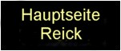
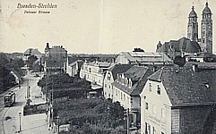
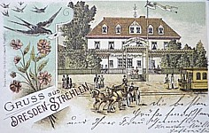
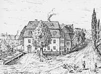
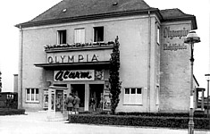
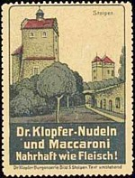
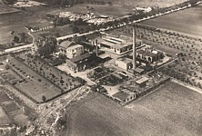
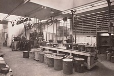
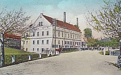
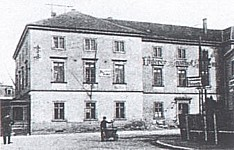

* * *

* * *

Die Dohnaer Straße ist Teil einer alten Verbindungsstraße zwischen Dresden und der einst wichtigen Burg Dohna. Ihren Ausgangspunkt hat sie im Dorfkern von Strehlen, wo noch einige historische Bauerngüter erhalten geblieben sind. Hier verlief einst auch die Weichbildgrenze Dresdens, die mit entsprechenden Weichbildsteinen gekennzeichnet wurde. Ein solcher hat sich noch in Altstrehlen erhalten.

Nach Zerstörung der um 1000 entstandenen Burg Dohna im Zuge der Dohnaischen Fehde 1402 verlor der Verkehrsweg schlagartig seine Bedeutung, da Markgraf Wilhelm die wichtige Moltabrücke bei Großluga zerstören ließ und somit die Verbindung nach Dohna unterbrach. Erst nach Ende der Kampfhandlungen konnte diese Straße wieder durchgängig befahren werden. Im 18. Jahrhundert wurde sie als [Alte Teplitzer Poststraße](../../../../sudost/strehlen/strassen_strehlen/dohnaer_strasse/alte_teplitzer_poststrasse/) ausgebaut und diente nun dem Fernverkehr nach Böhmen. Mit Entstehung neuer Verkehrswege im Elbtal verlagerte sich der Verkehr immer mehr auf diese günstigeren Verbindungen, wodurch die alte Straße zum unbedeutenden Ortsverbindungsweg herabsank.

Erst im 19. Jahrhundert griff man auf den ursprünglichen Verlauf zurück. Die alte Dohnaische Straße wurde zur Chaussee ausgebaut und gehört heute als Bundesstraße 172 zu den am stärksten befahrenenen Ausfallstraßen Dresdens. Bis zur Stadtgrenze folgte diese Straße weitgehend dem ursprünglichen Verlauf. Der Straßenteil zwischen Luga und Dohna existiert heute nur noch als Feldweg. 1899 entstand an der Ehrlichtmühle in Heidenau die neue Müglitzbrücke, in den 20er Jahren der Neubauabschnitt bis Pirna.

Strehlen:

Die Dohnaer Straße beginnt im alten Dorfkern von Strehlen, wo noch einige frühere Bauerngüter erhalten sind. Einige dieser Gebäude, u. a. die Nr. 1 und Nr. 27 sind als Baudenkmale in den Denkmallisten verzeichnet. Bedeutendstes historisches Gebäude ist das 1829 von Thormeyer errichtete alte Strehlener [Schulhaus](../../../../sudost/strehlen/) (Nr. 16), welches seit 1977 ebenfalls unter Denkmalschutz steht und heute gewerblich genutzt wird. Ende des 19. Jahrhunderts entstanden weitere Wohn- und Geschäftshäuser, darunter der einstige Gasthof [“Zur goldenen Krone”](../../../../sudost/strehlen/strassen_strehlen/dohnaer_strasse/goldene_krone/) (Nr. 7-9) und das Restaurant "Rathsgarten" (Nr. 13 - _Bild_). Hinzu kamen nach 1870 einige Villen, später auch mehrgeschossige Mietshäuser. Seit 1881 trägt die Dohnaer Straße offiziell ihren Namen. 1962 wurde auf dem Grundstück Nr. 53 ein Gemeindehaus für die katholische
[St.-Petrus-Gemeinde](../../../../sudost/strehlen/st_-petrus-kirche/) eingeweiht.

Strehlener Mühle: Die Mühle am Kaitzbach entstand Mitte des 16. Jahrhunderts als Wassermühle _(Zeichnung)_ und wurde 1870 zur modernen Dampfmühle umgebaut. Am 9. August 1883 besiegelte ein Brand das Schicksal des Unternehmens. Nach Abbruch der Ruinen entstand an gleicher Stelle zehn Jahre später das Mietshaus Dohnaer Straße 18. Bauherr war der Bäckermeister Louis Haase, dessen Nachkommen bis heute im Haus ihre Bäckerei betreiben (seit 1971 Bäckerei Morenz). 1993 entstand nebenan das kleine “Café Lui”.

Olympia-Kino: Das kleine Kino an der Ecke Dohnaer/Teplitzer Straße wurde im März 1938 eröffnet. Architekt des Gebäudes war Paul Müller, der das Haus in modernen und sachlichen Formen gestaltete. Im Inneren befand sich hinter dem Foyer mit der Kinokasse der Zuschauerraum mit ca. 500 Plätzen. Außerdem gab es im Obergeschoss ein Wohnung. Die Namensgebung erfolgte vermutlich in Anlehnung an ein bereits vor dem Ersten Weltkrieg gegründetes Filmtheater am Altmarkt. Auch nach 1945 wurde im “Olympia-Kino” der Spielbetrieb fortgesetzt. 1995 schloss das Kino aus wirtschaftlichen Gründen und wurde in der Folgezeit zur Kfz-Werkstatt umgebaut _(Foto: Stadtwiki Dresden)._

Wohnsiedlung Dohnaer/Rayskistraße: Die nach einem einheitlichem Konzept entworfene Wohnsiedlung entstand zwischen 1930 und 1934 im Auftrag des Baumeisters Hanns Vasak und wurde in Anlehnung an die Formensprache des Bauhauses modern gestaltet. Bereits zuvor hatte die Heimstättengesellschaft Sachsen (HGS) zwischen Dohnaer und Lockwitzer Straße einige Wohnblocks errichten lassen. Die Gebäude beherbergten vorrangig Kleinwohnungen mit Bädern und WC´s. Wegen des Verdachts der Beamtenbestechung und manipulierter Bürgschaften wurden Vasak und der Geschäftsführer der HGS 1934 verhaftet. Die folgenden Zivilgerichtsprozesse zwischen Banken und der am Bau beteiligten Reichspost führten zu einem jahrelangen Rechtsstreit, der erst 1959 mit der Auflösung der Heimstättengesellschaft und der Übernahme der Häuser durch die Deutsche Post endete. Nach 1990 wurde die Siedlung saniert.

Leubnitz-Neuostra:

Mit Erreichen der Ortsgrenze zwischen Strehlen und Leubnitz trifft die Dohnaer Straße auf die Bundesstraße B 172, die
ihrem weiteren Verlauf bis zur Dresdner Stadtgrenze folgt. Ursprünglich lagen hier mehrere Ziegeleien, welche heute alle
nicht mehr existieren und deren Grundstücke jetzt gewerblich genutzt werden. 1928 entstanden auf Leubnitzer Flur die auch
“Sommersiedlung” genannten Mietshäuser an der Spitzwegstraße. Die übrigen Freiflächen wurden nach 1980 mit einer Plattenbausiedlung bebaut. Beim Bau konnten Reste einer steinzeitlichen Siedlung freigelegt werden.

Zum Knipser (Nr. 81): In diesem Gebäude befand sich bis 1990 die filmtechnische Anstalt der Familie Schumann.
Ursprünglich war das Unternehmen 1926 vom deutsch-russischen Mechaniker Wladimir Schmidt in der Johannstadt
gegründet worden. Hier fertigte man verschiedene Kameras und Filmprojektoren für das In- und Ausland. Nach Zerstörung
der Geschäftsräume auf der Pfotenhauerstraße verlegte Schmidt zusammen mit seinem Mitarbeiter Erich Schumann den
Betrieb nach Leubnitz, wo man mit ausgelagerten Maschinen einen Neuanfang wagte. In den 1960er Jahren übernahm
Schumann die Firma allein und widmete sich fortan vor allem der Produktion von Kurzfilmen für wissenschaftliche Institute und Unternehmen sowie der Erstellung und Vervielfältigung von Diaserien.

Mit dem Wegfall der Auftraggeber nach der Wende entschloss sich die Familie, in den Geschäftsräumen ein Fotostudio
sowie ein kleines Café einzurichten. Unter dem Namen “Zum Knipser” existiert das Lokal bis heute. In den Räumen ist zudem eine
Ausstellung historischer Kameras und Kinomaschinen zu sehen, ebenso Teile der Ausstattung des 1995 geschlossenen Olympia-Kinos.

Firma Dr. Klopfer:
Die Nahrungsmittelfabrik an der Dohnaer Straße 103 wurde 1900 von Dr. Volkmar Klopfer gegründet und produzierte in einem speziellen Verfahren Lezithin. Das für die
gesunde Ernährung wichtige Pflanzeneiweiß wurde dabei mit Hilfe einer von Klopfer entwickelten Zentrifuge aus Weizenmehl gewonnen und zur Weiterverarbeitung zu Vollkornbrot und
Kräftigungsmitteln verkauft. Der international renommierte Lebensmittelfachmann erhielt 1911 auf der I. Internationalen Hygiene-Ausstellung für sein Verfahren den “Großen Preis”.

Bis zum Ersten Weltkrieg wuchs die Belegschaft des Werkes auf zeitweise über 300 Angestellte an. Bedingt durch die Kriegsfolgen und die Inflation geriet der Nahrungsmittelhersteller jedoch in
wirtschaftliche Schwierigkeiten und wurde 1924 in eine Aktiengesellschaft umgewandelt. Dr. Klopfer fungierte zunächst noch als deren Direktor, schied jedoch wenig später aus seinem Betrieb aus und gründete das [Chemische Werk Dr. Klopfer GmbH](../../../../sudost/leubnitz-neuostra/page14822/altleubnitz/) in Altleubnitz. 1932 wurde die Dr. Klopfer AG geschlossen und das Grundstück verkauft.

Nach 1945 befand sich hier der VEB Weizenin, welcher u.a. Speisewürze, Glutal, Brühpulver und Rohstoffe für die
Backwarenindustrie herstellte. Nach der Wende übernahm die Düsseldorfer Handelsgesellschaft Zamek den Betrieb. Die
Fabrikgebäude weisen zum Teil Jugendstil-Dekorationen auf und stehen unter Denkmalschutz. 1997/98 wurde die Anlage saniert und wird heute von einem Sportcenter und einem Autohaus genutzt.

Reick:

Lackfabrik Wilhelm Süring KG (Nr. 111): Das Unternehmen wurde 1841 gegründet und später gemeinsam von Carl Wilhelm Süring (1851-1915) und Alfred Bruno Angermann als Lackfabrik Süring & Angermann betrieben. Die Firma besaß ein großes Fabrikgrundstück am südlichen Rand von Reick unmittelbar an der Dohnaer Straße. Nach dem Ausscheiden Angermanns übernahm Wilhelm Süring die alleinige Geschäftsführung, sein Sohn Friedrich Wilhelm Süring (1883-1962) wurde technischer Leiter. Die Produktionspalette umfasste verschiedene Lacke und Farben, Tränk- und Isolierlack für elektrische Bauteile sowie Spritzlack für die Fahrzeugindustrie, aber auch Bohnerwachs, welches unter dem Markennamen "Wichsmädel" vertrieben wurde.

**_Fotos:_** _Luftbild der Lackfabrik Süring um ca. 1930 und ein Blick in die Produktionsräume (SLUB / Fotothek)_

Nach dem Tod des Vaters ging die Betriebsleitung 1915 an Friedrich Wilhelm Süring über, der den Betrieb nach dem Ersten Weltkrieg nochmals erweiterte. Zwischen 1919 und 1923 entstanden nach Plänen des Architekten Gustav Lüdecke
neue Fabrikgebäude und Wohnhäuser für die Angestellten des Betriebes. Auch nach 1945 blieb das Unternehmen zunächst in Familienbesitz und firmierte als Wilhelm Süring KG bis zur zwangsweisen Verstaatlichung 1972. Danach wurde es als VEB Lackfabrik Dresden ein Betriebsteil des Kombinates [Elaskon](../../../../sudost/reick/elaskon/). Heute nutzen verschiedene Gewerbeunternehmen das Areal. An die einstigen Besitzer erinnert noch die erhaltene Familiengrabstätte auf dem Äußerer Matthäusfriedhof.

Prohlis:

Zwischen dem Dorfkern von Prohlis und der Dohnaer Straße entstanden Ende des 19. Jahrhunderts auf Leubnitzer, Prohliser und Tornaer Flur mehrere Ziegeleien. Auf eine solche geht auch der Naturpark an der Gamigstraße zurück, der mit seinem Teich nach Einstellung des Betriebes angelegt wurde. Bis 1923 betrieben hier die Gebrüder Kunath eine Lehmgrube zur Rohstoffgewinnung ihrer Ziegelei (Dohnaer Straße 121). Ein weiteres Restloch der 1906 stillgelegten Ziegelei Pahlisch & Vogel wurde nach dem Abriss der Gebäude 1933 zum [Freibad Prohlis](../../../../sudost/prohlis/) umgewandelt (Nr. 135). Gegenüber stand bis zur Zerstörung 1945 der Prohliser Gasthof (Nr. 182 - _Bild_). Hier fand am 31. Mai 1921 die letzte Gemeinderatssitzung vor der Eingemeindung statt.

**_Ziegeleien an der Dohnaer Straße_**

**_Standort_**

Ziegelwerk Mey & Sohn (F. Herrmann und Johannes Mey)

Dohnaer Str. 60

Ziegelwerk Hering (Herings Erben)

Dohnaer Str. 64

[**Ziegelwerke Reinhold Prenzel**](../../../../sudost/torna/ziegeleien_torna/)(VEB Ziegelwerk Torna)

Alttorna 5

[**Ziegelwerke Schmidt & Co.**](../../../../sudost/torna/ziegeleien_torna/)

Alttorna 7

Dampfziegelwerk Pahlisch & Bergmann

Tornaer Str. 28

[**Ziegelwerke Friedrich Kunath**](../../../../sudost/prohlis/strassen_prohlis/ziegelei_kunath/)

Dohnaer Str. 121

Ziegelwerke F. Paul Gottschalch (später Pahlisch & Vogel)

Dohnaer Str. 135

Dampfziegelei Thieme & Söhne

Dohnaer Str. 158

Dampfziegelei Müller & Bergmann

Dohnaer Str. 176

Dampfziegelei Robert Kunath (Kunath & Müller)

Dohnaer Str. 176-180

Ziegelwerke Kurt Herrnsdorf

Dohnaer Str. 194

Dampfziegelwerke Hans Leonhardt

Dohnaer Str. 236

[**Ziegelei Heyde & Waschneck**](../../../../sudost/kleinluga/ziegelei_waschneck/)

Dohnaer Str. 340

Lockwitz/Nickern:

Der durch die Fluren von Lockwitz und Nickern führende Straßenabschnitt wird von verschiedenen gewerblichen Einrichtungen geprägt, die meist nach 1990 auf früherem Ziegeleigelände entstanden. Neben zahlreichen Autohäusern wurde 1995 gegenüber der Gleisschleife Prohlis das Einkaufszentrum “Kaufpark Nickern” errichtet. In der 1994 an der Ecke Fritz-Meinhard-Straße eröffneten Mercedes-Niederlassung erinnert das Café Caracciola an den berühmten Rennfahrer Rudolf Caracciola, der seine Karriere in den Zwanziger Jahren als Autoverkäufer in Dresden begann. Seit dem Ende des 19. Jahrhunderts gab es auch in Lockwitz mehrere Lehm- und Kiesgruben sowie [Ziegeleien](../../../../sudost/lockwitz/strassen_lockwitz/ziegelwerk_lockwitz/). Beim Aufschluss dieser Gruben wurden 1873 und 1875 Stoß- und Backenzähne von Mammuts gefunden.

Unterer Gasthof Lockwitz: Der Gasthof entstand als zweiter des Ortes Mitte des 16. Jahrhunderts an der Dohnaer Straße/ Ecke Lockwitztalstraße und wurde 1577 erstmals urkundlich genannt. Zur besseren Unterscheidung vom älteren Oberen Gasthof erhielt das ursprünglich als Niederschänke bezeichnete Lokal den Namen Unterer Gasthof Lockwitz. Ein beim Abriß des Gebäudes 1878 entdeckter Tursturz im Keller weist auf ein Baujahr 1609 hin (andere Quellen nennen 1694 als Entstehungsjahr des Gebäudes). Eigentümer war damals Michael Bähr, der von der Rittergutsherrschaft die Erlaubnis zum Bierschank erhalten hatte.

Mehrfach wechselten später die Besitzer der Schänke. Ab 1811 gehörte sie der Familie Pomßel, die den Restaurationsbetrieb 1862 in den neu erbauten Niederen Gasthof verlegte und dafür einen Neubau mit zwei Sälen errichten ließ. Die alte Niederschänke wurden 1878 zugunsten eines Wohnhauses mit Fleischerei abgerissen. 1891/95 wurde der Gasthof von Otto Kreyßig um einen Saalanbau und eine Veranda erweitert. Während der Obere Gasthof heute nicht mehr existiert, blieb der Untere Gasthof auch nach 1945 beliebte Einkehrstätte und war wegen seiner häufigen Tanzveranstaltungen stadtbekannt. Nach 1990 befand sich in den Räumen ein Jugendclub (UGL) sowie ein China-Restaurant. Heute haben hier verschiedene Unternehmen ihr Domizil. Im 2008 sanierten Ballsaal finden regelmäßig Veranstaltungen statt, außerdem können die Räume für private Feiern gemietet werden.

Großluga

Nach Verlassen der Lockwitzer Flur erreicht die Dohnaer Straße Großluga, letzter Stadtteil auf Dresdner Stadtgebiet. Bis zur Eingemeindung Großlugas nach Niedersedlitz 1922 wurde sie hier als Dorfstraße, teilweise auch als Großluga - Lockwitzer Communicationsweg bzw. Großluga - Gommerner Weg bezeichnet. Gommern gehört heute zur Stadt Heidenau. Um 1907 sind auch die Namen Lockwitzer Straße bzw. Gommernsche Straße nachweisbar. Da es in Niedersedlitz bereits eine Lockwitzer Straße gab, erfolgte 1922 die Umbenennung des in Richtung Dresden führenden Teilabschnitts in Dresdner Straße. Mit der Eingemeindung von Niedersedlitz nach Dresden wurden sowohl Lockwitzer als auch Gommerner Straße 1953 bzw. 1956 der Dohnaer Straße zugeordnet. Die Wohnhäuser in diesem Abschnitt erntstanden meist Ende des 19. Jahrhunderts als freistehende Mietshäuser für die Arbeiter der örtlichen Ziegeleien und Industriebetriebe. Hier befindet sich auch das frühere Rathaus mit einer Wetterfahne von 1898. Unter Denkmalschutz steht auch das landhausartige Herrenhaus des früheren Gutshofes Dohnaer Straße 362.

Nr. 405: Das ehemalige Bauerngut gehört zum alten Dorfkern von Großluga und entstand in heutiger Form in der Mitte des 19. Jahrhunderts. An der Scheune des Hofes erinnert eine Gedenktafel an das Jahr 1866, "als der Krieg über Sachsen und seine Nachbarländer die Geisel schwang", im Mai "ein großer Teil der Feld- und Baumfrüchte durch Frost vernichtet wurde" und dass im gleichen Jahr die Scheune und die Hälfte des Wohnhauses "durch ruchlose Hand in Asche gelegt wurde". Im Folgejahr wurde ein Seitengebäude Opfer eines Brandstifters. Auch während der Napoleonischen Kriege litten die Bewohner des Ortes unter den Kriegsfolgen. 1813 gab es im Dorf 13 Tote sowie große Verluste an Vieh, meist durch Seuchen.

Nr. 409: Das einstöckige Gebäude, vorletztes Haus vor der Stadtgrenze zu Dohna, war einst das Großlugaer [Schulhaus](../../../../sudost/grossluga/). Es entstand 1841 als gemeinsame Schule für die Kinder von Groß- und Kleinluga, Gommern, Wölkau und Meuscha. Zuvor waren die Schüler in verschiedenen Häusern von Gommern und Kleinluga unterrichtet worden. Mit Fertigstellung des neuen Schulgebäudes an der Kleinlugaer Straße wurde die alte Schule 1899 zum Wohnhaus.

* * *

 \[ [Home](../../../../index.html)\] \[ [Nord](../../../../nord/)\] \[ [Nordwest](../../../../nordwest/)\] \[ [Neustadt](../../../../neustadt/)\] \[ [Nordost](../../../../nordost/)\] \[ [West](../../../../west/)\] \[ [Zentrum](../../../../zentrum/)\] \[ [Südwest](../../../../sudwest/)\] \[ [Süd](../../../../sud/)\] \[ [Südost](../../../../sudost/)\] \[ [Ost](../../../../ost/)\] \[ [Register](../../../../Register/register.html)\] \[ [Kontakt](../../../../Kontakt/kontakt.html)\] \[ [Impressum](../../../../impressum/)\]
