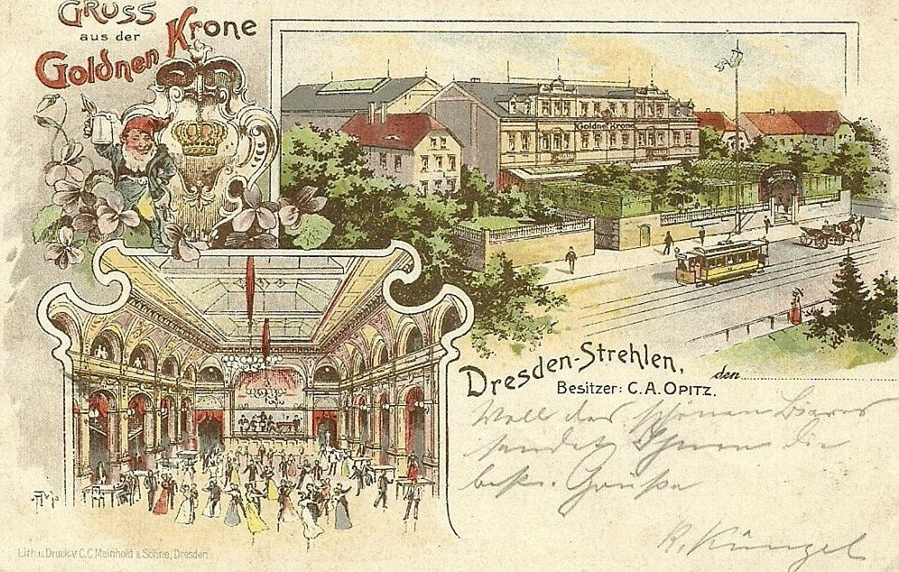
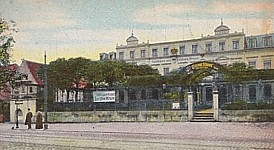
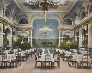

* * *

 Das einstige Strehlener Ballhaus “Zur Goldenen Krone” entstand 1877 auf Initiative des Gastwirts Ernst Neumann nach Plänen des Baumeisters Otto Walter. Für den Bau mussten zwei Bauernhäuser abgebrochen werden. Ab 1882 endete unmittelbar vor dem Lokal die Pferdebahn, was diesem zusätzliche Gästeströme bescherte. Wegen des großen Zuspruchs ließ der neue Besitzer Heinrich Hebenstreit sein Restaurant 1888 und 1891 erweitern und in diesem Zusammenhang auch einen Ballsaal anbauen. Für den Um- und Ausbau wurde der in Strehlen ansässige Architekt Max Georg Poscharsky gewonnen, der ein repräsentatives Wirtshaus mit mehreren Gasträumen und Vereinszimmern schuf. Am 30. Oktober 1889 wurde der Neubau mit einer Versammlung des Gebirgsvereins für die Sächsische Schweiz - Sektion Strehlen und einer anschließenden “Festkneipe” eingeweiht. 1891 erfolgte unter Mitwirkung des Architekten Ernst Sommerschuh nochmals eine Erweiterung.

**_Foto:_** _Das Ballhaus “Goldene Krone” auf einer historischen Ansichtskarte_

Zu den Besuchern der “Goldenen Krone” gehörten nicht nur die Strehlener Einwohner, sondern auch zahlreiche Ausflügler aus dem gesamten Stadtgebiet. Beliebt waren regelmäßige Konzerte und Tanzveranstaltungen sowie die angeschlossene Asphalt-Kegelbahn. Nach dem Verkauf des Lokals 1894 an Carl Adolf Opitz wechselten mehrfach die Besitzer des Hauses. Letzter Pächter war der Gastronom Curt Müller, welcher durch die wirtschaftliche Lage nach dem Ersten Weltkrieg jedoch in Schwierigkeiten geriet. Aus diesem Grund wurde der Gasthof 1923 geschlossen und seit 1931 als [Fabrik für elektrotechnische Geräte](../../../../../neustadt/leipziger_vorstadt/grossenhainer_strasse/) genutzt.

Das private Unternehmen befand sich im Besitz von Alfred Luscher, welcher hier verschiedene Bauteile für Akkumulatoren und elektrische Apparate herstellte. Ab 1948 wurde der Betrieb bis 1976 als VEB Sächsische Akkumulatorenwerke weitergeführt. Zuletzt dienten Gasthaus und Ballsaal noch als Lagerräume. Erst während des 1998/99 erfolgten Abrisses wurden Teile der ursprünglichen Innenraumgestaltung entdeckt und geborgen. An gleicher Stelle befindet sich heute eine kleine Wohnanlage.

* * *

 \[ [Home](../../../../../index.html)\] \[ [Nord](../../../../../nord/)\] \[ [Nordwest](../../../../../nordwest/)\] \[ [Neustadt](../../../../../neustadt/)\]
 \[ [Nordost](../../../../../nordost/)\] \[ [West](../../../../../west/)\] \[ [Zentrum](../../../../../zentrum/)\] \[ [Südwest](../../../../../sudwest/)\]
 \[ [Süd](../../../../../sud/)\] \[ [Südost](../../../../../sudost/)\] \[ [Ost](../../../../../ost/)\] \[ [Register](../../../../../Register/register.html)\] \[ [Kontakt](../../../../../Kontakt/kontakt.html)\] \[ [Impressum](../../../../../impressum/)\]
