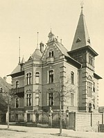
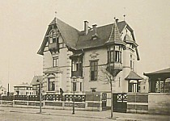

Die Gustav-Adolf-Straße wurde im Zusammenhang mit dem Ausbau des Villenviertels rund um den Wasaplatz angelegt und weist noch heute einige interessante Gebäude aus der Zeit um 1900 auf. Die Namensgebung nach dem schwedischen König Gustav Adolf II. Wasa (1594-1632) erfolgte 1888 als Referenz an Carola von Wasa, Gemahlin des sächsischen Königs Albert, die aus dieser Familie stammte. Gustav Adolf nahm als Feldherr am Dreißigjährigen Krieg teil und fiel 1632 bei Lützen.

Das Straßenbild prägen bis zur Gegenwart vor allem Villen und Landhäuser, die zwischen 1888 und 1900 für wohlhabende Dresdner Bürger entstanden. Strehlen war zu dieser Zeit, nicht zuletzt wegen der Nähe zum königlichen Großen Garten und zur [Königlichen Villa](../../../../sudost/strehlen/konigliche_villa/) zum bevorzugten Wohnort des Dresdner Großbürgertums geworden. Die meisten Bauten der Gustav-Adolf-Straße überstanden den Luftangriff 1945 ohne größere Schäden und sind heute denkmalgerecht saniert. Die historische Aufnahme (links) zeigt die Villa Nr. 8. Heute hat hier die 2009 als erste studentische Damenverbindung Dresdens gegründete Akademische Damenverbindung Regina Maria-Josepha ihren Sitz.

Einzelne Gebäude:

Nr. 2: Die Villa an der Einmündung in die August-Bebel-Straße entstand 1892 und ist entsprechend als Eckhaus architektonisch ausgeprägt. Entworfen wurde sie vom Architektenbüro Rose & Oberle. Max Rose (1862-1922) gestaltete mehrere Villenbauten in Dresden, ab 1900 als Teilhaber des Büros Rose & Röhle.

Nr. 6: 1893 entstand nach Plänen des Architekten Max Hübner, der auch das Nachbarhaus Nr. 4 entwarf, die Villa Gustav-Adolf-Straße 6. Gestaltet wurde sie im Landhausstil mit Elementen der Neorenaissance. Bauherr und erster Besitzer war der englische Geistliche Charles Alfred Moore. Dieser lebte hier gemeinsam mit seiner Frau. 1913 erwarb der Fabrikant Paul Jahn das Gebäude und ließ es umbauen und modernisieren. U. a. erhielt die Villa einen Anbau im Eingangsbereich, eine freistehende Garage sowie eine moderne Heizungsanlage. Nach 1945 erfolgte eine Aufteilung des Hauses in mehrere Mietwohnungen. 2003 wurde es denkmalgerecht saniert und bekam auch im Inneren zahlreiche Details aus der Entstehungszeit zurück.

Nr. 8: Das Haus Gustav-Adolf-Straße 8 wurde 1890/91 vom Architekten Hans Viktor Weiner entworfen und ist wie die meisten Nachbarhäuser im Stil der deutschen Renaissance gestaltet. Auch im Inneren blieben viele Elemente der Entstehungszeit erhalten, u.a. eine bemalte Stuckdecke im ersten Obergeschoss. Seit 2009 hat hier die erste Akademische Damenverbindung Dresdens "Regina Maria-Josepha" ihren Sitz. Die ausschließlich Frauen offenstehende Studentenverbindung erhielt ihren Namen nach Erzherzogin Maria Josepha von Österreich (1699-1757), die 1719 den Sohn August des Starken, Friedrich August II. geheiratet hatte.

Nr. 9: Im gegenüberliegenden Haus Nr. 9 lebte von 1910 bis 1934 das Ehepaar Wilhelm und Hermine Herzing. Hermine "Minni" Herzing (1883-1968) arbeitete als Malerin und Illustratorin und gestaltete u.a. mehrere Gedichtbände von Joseph von Eichendorff und Eduard Mörike. Bekannt wurde sie auch als Porzellanmalerin und Schöpferin von zahlreichen Alpen- und Blumenbildern.

Nr. 11: Hier verbrachte der Maler und Zeichenlehrer David Simonson (1831-1896) seine letzten Lebensjahre. Er war ein Schüler von Eduard Bendemann und gründete die private Akademie für Zeichnen, Malen und Modellieren. Ab 1865 gehörte er der Dresdner Montagsgesellschaft und war auch Mitglied der Dresdner Kunstgenossenschaft. Auch sein Sohn Ernst Oskar Simonson-Castelli (1864-1926) wurde als Maler bekannt und wohnte viele Jahre ganz in der Nähe (August-Bebel-Straße 12).

Nr. 12: Den Abschluss der rechtsseitigen Bebauung der Straße zum Gustav-Adolf-Platz bildet die 1892 errichtete Villa Gustav-Adolf-Straße 12. Architekt war Eduard Martin, ein Schüler von Hermann Nicolai. Martin zeichnete für mehrere Strehlener Villen verantwortlich, so auch für die Häuser Julius-Otto- Straße 13 und 15.

Nr. 13: Zu den bemerkenswertesten Häusern des Viertels gehört die 1903 von Otto Foerster für den Kaufmann Carl Heinoldt und den Fabrikdirektor Emil Schiff errichtete Doppelvilla Gustav-Adolf-Straße 13. Das Haus wurde unter Verwendung von Jugendstilelementen im Landhausstil gestaltet und bildet zusammen mit der Villa Julius-Otto-Straße 10 eine bauliche Einheit. Beide Häuser schließen den Gustav-Adolf-Platz in westliche Richtung ab. Viele Jahre lebte hier der Physiker Georg Berndt (1880-1972) , der von 1924 bis zu seiner Emeritierung 1955 als Professor für Messtechnik an der Technischen Hochschule beschäftigt war. Nach ihm ist der Berndt-Bau der TU benannt, sein Grab befindet sich auf dem Trinitatisfriedhof.

* * *

 \[ [Home](../../../../index.html)\] \[ [Nord](../../../../nord/)\] \[ [Nordwest](../../../../nordwest/)\] \[ [Neustadt](../../../../neustadt/)\] \[ [Nordost](../../../../nordost/)\] \[ [West](../../../../west/)\] \[ [Zentrum](../../../../zentrum/)\] \[ [Südwest](../../../../sudwest/)\] \[ [Süd](../../../../sud/)\] \[ [Südost](../../../../sudost/)\] \[ [Ost](../../../../ost/)\] \[ [Register](../../../../Register/register.html)\] \[ [Kontakt](../../../../Kontakt/kontakt.html)\] \[ [Impressum](../../../../impressum/)\]
