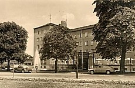
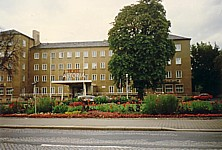

* * *

* * *

Der Strehlener Platz wurde Ende des 19. Jahrhunderts angelegt und gärtnerisch gestaltet. Zuvor befand sich hier eine Steuereinnahmestelle mit Akzisehaus, welches 1930 dem Neubau des Hotels “Astoria” weichen musste. 1933 erfolgte die Umbenennung in Horst-Wessel-Platz nach dem nationalsozialistischen “Märtyrer” Horst Wessel, der 1930 in Berlin von Kommunisten erschossen worden war.1945 wurde diese Namensgebung wieder aufgehoben und der Platz fortan bis 1990 Ernst-Thälmann-Platz genannt. In den Grünanlagen an der Teplitzer Straße fand 1986 aus Anlass des 100. Geburtstages des Arbeiterführers ein Thälmann-Denkmal Aufstellung. Schöpfer war der Bildhauer Johannes Peschel. Das bis heute erhaltene Denkmal zeigt eine Büste Thälmanns vor acht Betonsäulen. 1990 erhielt der Strehlener Platz seinen ursprünglichen Namen zurück.

Hotel “Astoria”:

Das im modernen Stil gestaltete Gebäude am Strehlener Platz entstand nach einem Entwurf von Stadtbaurat Paul Wolf als ”Haus der Jugend” und wurde am
24\. März 1931 eröffnet. Getrennt in einen Knaben- und einen Mädchentrakt bot das Haus über 460 Betten, mehrere Speise-, Vortrags- und Aufenthaltsräume und galt als eine der modernsten Jugendherbergen
Deutschlands. Nach dem Machtantritt der Nazis musste diese Einrichtung geschlossen werden. Zunächst wurde das Haus nun als Führerschule der Hitlerjugend, während des Zweiten Weltkrieges als Hilfskrankenhaus genutzt.
1945 brannte es teilweise aus, blieb jedoch in seiner Grundstruktur erhalten.

Nach Beseitigung der Kriegsschäden konnte hier am 11. August 1950 das erste Dresdner Großhotel nach dem Zweiten
Weltkrieg eingeweiht werden. Beim Wiederaufbau orientierte man sich am bereits zur Bauzeit verwendeten Stil. Die
Innenausstattung übernahm der Architekt Hans Hartl, der wegen seiner formalistisch-modernen Gestaltung scharf kritisiert wurde. 1956 erfolgte eine teilweise Modernisierung im Zusammenhang mit dem Dresdner Stadtjubiläum.
Während der Feierlichkeiten besuchten u. a. Otto Grotewohl, Kulturminister Alexander Abusch, der frühere sowjetische Stadtkommandant Oberst Bortnikow, der jemenitische Kronprinz Emir Seif el-Islam al-Badr und
Nordkoreas Staatschef Kim Ir-Sen das Hotel. Auch Staatspräsident Wilhelm Pieck und SED-Chef Walter Ulbricht trugen sich ins Gästebuch des Hauses ein.

Anfang der 1960er Jahre diente das Hotel zeitweise als Gästehaus des Rates des
Bezirkes Dresden. 1965 wurde es zum Interhotel erweitert und erhielt in diesem Zusammenhang den Namen “Astoria”. Das Haus besaß 114 Betten, eine Bar
und ein Tanzcafé. Außerdem gab es neben einer auch von den Dresdnern gern besuchten Gaststätte einen “Intershop”, in dem gegen Devisen westliche Waren
erworben werden konnten. Zu den berühmten Gästen des ”Astoria” gehörten  u. a. Erich Kästner, Karl Böhm, Rudolf Mauersberger und Täve Schur. Ab 1985
gehörte es als Betriebsteil zum neu eröffneten Luxushotel “Bellevue” am Neustädter Elbufer. 1988 enstand in den Räumen des früheren Tanzcafés das Restaurant “Rendezvous”.

Trotz einiger Renovierungsarbeiten kurz nach der Wende und guter Auslastung wurden das Hotel “Astoria” und die angeschlossene Gaststätte 1992 geschlossen und im Oktober 1997 für einen geplanten, aber nie realisierten
Hotelneubau abgerissen. An gleicher Stelle entstand 2006 ein Lebensmittelmarkt.

Ingenieurschule für Eisenbahnwesen:

Nachdem bereits 1951 in Dresden eine Ingenieurschule für Eisenbahnwesen gegründet worden war, welche ihren Sitz
zunächst an der Dornblüthstraße 6 hatte, entstand wenig später ein Neubau am Strehlener Platz und der Strehlener Straße. 1955 konnte
das Haus bezogen werden. Ausgebildet wurden hier Führungskräfte für den mittleren Dienst der Deutschen Reichsbahn. Für diese gab es die Abteilungen Maschinentechnik, Eisenbahnstrecken-, Brücken und
Hochbau, Sicherungs- und Fernmeldetechnik, Starkstromtechnik sowie Ökonomie des Eisenbahnwesens. Zum Leiter wurde der Reichsbahnhauptrat Koepp ernannt. Neben Mitarbeitern der Deutschen Reichsbahn wurden später auch
Absolventen des militärischen Transportwesens sowie verschiedener Großbetriebe mit eigenen Anschlussbahnen
ausgebildet. In den 1970er Jahre wurde die Schule in Ingenieursschule für Verkehrstechnik umbenannt und 1988 an die [Hochschule für Verkehrswesen](../../../../zentrum/sudvorstadt/strassen_sudvorstadt/friedrich-list-platz/hochschule_fur_verkehrswesen/) angeschlossen, 1991 jedoch aufgelöst. Heute nutzen u.a. die Berufsschule für Elektro-
und Informationstechnik und die Fachschule für Technik dire Gebäude.

* * *

 \[ [Home](../../../../index.html)\] \[ [Nord](../../../../nord/)\] \[ [Nordwest](../../../../nordwest/)\] \[ [Neustadt](../../../../neustadt/)\] \[ [Nordost](../../../../nordost/)\] \[ [West](../../../../west/)\] \[ [Zentrum](../../../../zentrum/)\] \[ [Südwest](../../../../sudwest/)\] \[ [Süd](../../../../sud/)\] \[ [Südost](../../../../sudost/)\] \[ [Ost](../../../../ost/)\] \[ [Register](../../../../Register/register.html)\] \[ [Kontakt](../../../../Kontakt/kontakt.html)\] \[ [Impressum](../../../../impressum/)\]
