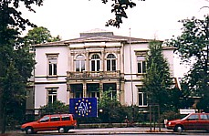
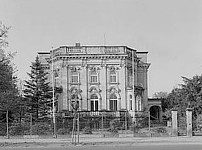
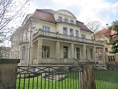
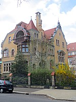
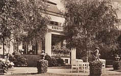
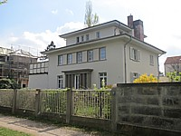
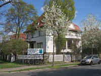
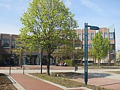

Die Tiergartenstraße entstand Mitte des 19. Jahrhunderts und erhielt ihren Namen nach dem hier 1861 eröffneten Zoologischen Garten. Die Grundstücke an der Südseite des Großen Gartens wurden mit
repräsentativen Villen bebaut, die die Straße zum Wohnsitz einiger der reichsten Dresdner Familien machten. Gleichzeitig stellte diese Straße eine Verbindung zwischen dem “Englischen Viertel” der Seevorstadt und den
Villenvierteln Strehlens her. Ab 1882 verkehrte die Pferdebahnlinie Neumarkt - Zoologischer Garten bis zur Tiergartenstraße. Am Endpunkt dieser Strecke (Querallee) befand sich damals der Eingang zum Zoologischen Garten,
welcher jedoch 1891 an die heutige Stelle verlegt wurde. Eines der früheren Kassenhäuschen ist noch erhalten und diente ab 1919 als Straßenbahnwartehalle. Leider fielen Teile der Fassade, darunter ein Löwenkopfrelief
über der Tür, späteren Umbauten zum Opfer. Nach 1945 diente diese Wartehalle zeitweise als Notquartier einer ausgebombten Familie.

1945 fielen zahlreiche Villen an der Tiergartenstraße den Bomben zum Opfer, vor
allem im westlichen Bereich. An Stelle der zerstörten Gebäude entstanden in den 1960er Jahren Neubauten sowie eine Schule. 1988 wurde auf einem früheren Villengrundstück das moderne [Gemeindezentrum](../../../../sudost/strehlen/strassen_strehlen/tiergartenstrasse/mormonentempel/) der Dresdner Mormonen eingeweiht.

Einzelne Gebäude:

Villa Salzburg (Nr. 8): Die Villa im Renaissancestil wurde 1874 vermutlich von Karl Eberhard für den Textilgroßhändler Adolph Salzburg errichtet. Die Gestaltung erfolgte im seinerzeit im Villenbau typischen Sti1 der Semper-Nicolai-Schule. 1909/10 ließen die Schwiegereltern von Adolph Salzburgs ältestem Sohn, Carl und Felicia Glückmann, das Haus umbauen, das sie nach dem Tod Salzburgs kurz zuvor erworben hatten. Aus dieser Zeit stammt auch die noch gut erhaltene Innenausstattung. Die von den Nazis 1940 enteignete Villa diente danach bis zum Ende des Zweiten Weltkriegs dem Deutschen Roten Kreuz, später der TU Dresden, verschiedenen medizinischen Einrichtungen und von 1970 bis 1990 der Zivilverteidigung.

Das einzige erhaltene Gebäude des 1945 zerstörten "Englischen Viertels" war von 1992 bis 2005 Sitz eines Weiterbildungszentrums für Denkmalpflege. Eine umfassende Rekonstruktion erfolgte 2000/01 durch das Dresdner Architektenbüro Sabine Wenzel. Ab 2010 befand sich in der Villa bis zur Schließung 2016 eine exklusive Möbelhandlung.

Nr. 10: Die 1945 zerstörte Villa war vor dem Zweiten Weltkrieg Wohnsitz der Familie Kreutzkamm, Besitzer der bekannten Konditorei am Altmarkt. An ihrer Stelle befindet sich heute der Parkplatz des Zoologischen Gartens.

21\. Mittelschule:
Das Schulhaus vom DDR-Typ “Dresden” entstand Anfang der 1970er Jahre an der Tiergartenstraße 18 und wurde wegen seiner Nähe zum Zoo umgangssprachlich als “Zooschule” bezeichnet. Offiziell hieß diese Schule
21\. POS “Anton Saefkow”. Mit der Namensgebung sollte der kommunistische Widerstandskämpfer Anton Saefkow (1903-1944) geehrt werden, der wegen seiner Untergrundarbeit und dem Aufruf zur Sabotage in Rüstungsbetrieben
1944 zum Tode verurteilt wurde. Ab 1986 befand sich im Erdgeschoss des Schulgebäudes das Dresdner Schulmuseum.
2003 schloss die 1991 in die 21. Mittelschule umgewandelte Bildungseinrichtung ihre Pforten. Seit 2005 nutzt die Freie BIP Kreativsschule das Gebäude als Grundschule.

Brunnen “Mutter und Kind”:
An der Ecke Tiergartenstraße/ Beethovenstraße befindet sich ein kleiner Brunnen “Mutter mit Kind”, welcher 1963 von Vinzenz Wanitschke geschaffen wurde. Die bronzene Brunnenplastik entstand im Rahmen
eines Wettbewerbes und wurde 2003/04 saniert. In diesem Zusammenhang erfolgte zugleich eine Neugestaltung des Brunnenbeckens und die Hinzufügung einer Granitkugel, welche sich auf dem Wasserpolster bewegt.

Nr. 32: Das Gebäude befand sich in den Zwanziger Jahren im Besitz des jüdischen Bankiers Heinrich Arnhold. Gemeinsam mit seiner kunstsinnigen Frau Lisa trat Arnhold nicht nur als Stifter verschiedener sozialer Einrichtungen in Erscheinung, sondern trug auch eine große Kunstsammlung zusammen. Zu dieser Sammlung gehörten Gemälde und Grafiken von Künstlern wie Max Liebermann, Lovis Corinth, Otto Nolde und Käthe Kollwitz, aber auch wertvolle Porzellane und Plastiken. Nach dem Tod Heinrich Arnholds 1935 und unter dem Eindruck der zunehmenden Repressalien gegen jüdische Bürger verlegte seine Witwe ihren Wohnsitz 1937 in die Schweiz und lebte nach 1945 in der USA, wo sie 1972 verstarb.

An Stelle der 1945 zerstörten Villa wurde in den 1960er Jahren ein Wohnblock errichtet (Nr. 26a - 28b). 2009 ließ die Bürgerstiftung vor dem Haus ein Denkmal für die Bankiersfamilie aufstellen. Das von der Künstlerin Erika Lust gestaltete Mahnmal besteht aus einer Sandstein-Bodenplatte, einer Stele und einer gläsernen Gedenkplatte mit einem Foto des vernichteten Gebäudes.

Nr. 32 (neu): Das an Stelle eines zerstörten Vorgängerbaus an der Ecke Tiergarten-/Franz-Liszt-Straße errichtete Gebäude entstand im Auftrag der WG Johannstadt und wurde 2016 fertiggestellt. Vor dem Haus befindet sich ein Brunnen "Mädchen mit Blatt II" der Künstlerin Malgorzata Chodakowska.

Nr. 36: Die Villa an der Einmündung zur Herderstraße wurde 1903 errichtet. In diesem Haus wohnten viele Jahre die Inhaber des bekanntesten Dresdner Kaufhauses Renner am Altmarkt.

Nr. 38: Architekt und Bauherr der 1898 errichteten Villa war Ernst C. Fleischer, der als Lehrer für Elemente der architektonischen Formenlehre und des architektonischen Zeichnens an der Baugewerkeschule tätig war. Sein Büro befand sich 1892 auf der Marschallstraße 39, ab 1904 auf der Reitbahnstraße. Die Fassade im Neobarockstil wurde teilweise nach dem architektonischen Vorbild der Hofkirche gestaltet. Nach dem Ersten Weltkrieg wohnte hier Bergdirektor Willy Emanuel Eydam, Generaldirektor eines Kohlebergwerks in Eibiswald (Steiermark). Eydam übte zudem mehrere Nebentätigkeiten aus und war u.a. Vorsteher des Dresdner Freimaurer-Instituts in Striesen und Vorsitzender der Ortsgruppe Dresden des Schutzbundes für Deutschböhmen und die Sudetenländer.

Später gehörte die Villa der Gebrüder Bühler GmbH, einer in Freital ansässigen Mühlenbauanstalt & Maschinenfabrik (später VEB Fördertechnik Freital). Diese verkaufte Haus um 1940 an den Staat. Zuletzt befand sich hier bis 1945 das Heeres-Bauamt der Wehrmacht. Die Villa überstand als eines der wenigen Gebäude die Zerstörungen 1945. Zwischen 2003 und 2008 wohnte hier der Wettiner Prinz Alexander von Sachsen, der zeitweise im Auftrag der sächsischen Landesregierung tätig war.

Nr. 40/42: Auf diesem Grundstück an der Ecke zur Oskarstraße stand bis zur Zerstörung 1945 die frühere Villa des Kommerzienrates Paul Leonhardt. Leonhardt war zugleich Generalkonsul von Bolivien, wobei sich der Sitz des Konsulates auf der nahegelegenen Beuststraße befand. Während des Zweiten Weltkriegs waren im Haus Teile des Dresdner Stadtarchivs ausgelagert, die bei der Vernichtung der Villa verloren gingen. Nach Abriss der Ruine Anfang der 1950er Jahre errichtete die Technische Universität hier einige Baracken. Im März 1987 begann auf dem Areal der Bau des [Gemeindezentrums](../../../../sudost/strehlen/strassen_strehlen/tiergartenstrasse/mormonentempel/) der Kirche Jesu Christi der Heiligen der letzten Tage. Erhalten blieb die unter Denkmalschutz stehende Grundstücksumfassung zwischen Tiergarten-, Oskar- und Wiener Straße.

Nr. 48: Das nach seinem Bauherren Villa Mund genannte Haus entstand 1906 im Jugendstil mit klassizistischen Elementen. Die Planung oblag dem renommierten Architekturbüro Lossow & Viehweger, welches mehrere Villenbauten in Strehlen entwarf. Noch im selben Jahr trennte sich William Lossow von seinem Büropartner und arbeitete fortan zusammen mit seinem Schwiegersohn Max Hans Kühne (Lossow & Kühne).

Nr. 50: Das Büro Lossow & Kühne entwarf wenige Jahre später die zwischen 1910 und 1911 entstandene Villa Gerstle-Salzburg. Bauherrin war die aus Augsburg stammende Anna Gerstle, die die Verantwortung für den Bau ihrem Schwiegersohn Dr. Friedrich Salzburg übertrug. Salzburg war beruflich als Rechtsanwalt tätig und ein Sohn von Adolph Salzburg, Besitzer der Villa Tiergartenstraße 8. Gemeinsam mit Annas Sohn Hans Gerstle und dessen Familie lebte auch Friedrich Salzburg nach der Fertigstellung in diesem Haus. 1937 zwang die zunehmende Verfolgung der Juden beide Familien zur Emigration.

Nr. 52: Die Villa _(Foto links)_ wurde 1901 von William Lossow als eigenes Wohnhaus errichtet. Lossow war Teilhaber des bekannten Architekturbüros Lossow & Viehweger und um 1900 einer der meistbeschäftigten Dresdner Architekten. Zahlreiche Entwürfe für Villen der Tiergartenstraße stammen von seiner Hand. Später kam die Lossow-Villa in den Besitz der Siemens AG für Glasindustrie und wurde nach 1945 von der Tanzschule Römer genutzt.

Nr. 54: Auch dieses Haus wurde vom Büro Lossow & Kühne geplant. Die Villa entstand 1911 für den Bankier Adolf Paderstein.

Nr. 64: Dieses Gebäude _(Foto rechts)_ entstand um 1900 als Wohnhaus für den jüdischen Bankier und Unternehmer Victor von Klemperer Edler von Klemenau (1876-1943). Klemperer übernahm 1914 die Nachfolge seines Vaters als Direktor der Dresdner Bank und war zugleich bedeutender Kunstkenner und -sammler. Zu seinem Freundeskreis gehörten Fritz Busch, Richard Tauber, Maria Cebotari und Oskar Kokoschka. Villa und Kunstsammlung wurden 1938 von den Nazis beschlagnahmt und die jüdische Familie in die Emigration getrieben. Bis 1945 nutzte die Reichsfinanzverwaltung das Haus, welches beim Luftangriff zerstört wurde. Dabei ging auch ein Großteil der Sammlung verloren. Einige Reste wurden 1991 an die Erben zurückgegeben. Auf dem Grundstück wurde in der Nachkriegszeit ein neues Wohnhaus errichtet.

Nr. 72: Diese beim Luftangriff 1945 zerstörte Villa war Wohnsitz des letzten amtierenden Dresdner Oberbürgermeisters vor dem Ende des Zweiten Weltkriegs. Dr. Rudolf Kluge gehörte ab 1930 als Stadtverordneter der NSDAP dem Stadtrat an und übernahm 1934 das Amt des Zweiten Bürgermeisters. Zwischen 1937 und 1940 und ab Februar 1945 leitete er die städtische Verwaltung bis zum 7. Mai 1945.

Bischof-Wienken-Haus (Nr. 74): Die in den Zwanziger Jahren im Bauhausstil errichtete Villa befindet sich im Besitz der katholischen Kirche und wird als Bischof-Wienken-Haus bezeichnet. Heinrich Wienken war zwischen 1951 und 1957 Bischof des Bistums Meißen und ließ im Haus ein kirchliches Schulungszentrum einrichten. Nach 1990 wurde das Gebäude renoviert und beherbergt seit November 2006 eine Niederlassung der Missionsschwestern vom heiligen Petrus Claver. Der Orden ist vor allem in der Kinder- und Jugendarbeit tätig. Sein Patron Petrus Claver (1581-1651), dem auch die im Haus befindliche Kapelle geweiht ist, widmete sich der Seelsorge der nach Südamerika verschleppten afrikanischen Sklaven und wurde dafür 1888 heilig gesprochen.

Nr. 81: Die Villa entstand 1914 für den Textilhändler Benedix Jordan und zeigt noch Anklänge an den späten Jugendstil _(Foto rechts)_. Jordan war Inhaber des Herrenbekleidungsgeschäftes G. Tuchler Nachf. an der König-Johann-Straße. Auch dieses Haus wurde 1938 als jüdisches Eigentum konfisziert und war bis 1945 Sitz des rumänischen Konsulats. Heute dient die Villa als Bürohaus.

Nr. 82: Die bis 2007 vom Heinrich-Schütz-Konservatorium genutzte Villa ist heute Sitz und Begegnungsstätte des jüdisch-orthodoxen Religionsvereins Chabad Lubawitsch. Zuvor hatte dieser sein Domizil auf der Merseburger Straße 1.

Nr. 94:
Der moderne Gebäudekomplex wurde 1993/95 für die Dresdner Kfz-Innung errichtet. Ursprünglich wurde das Areal vom VEB Kraftverkehr genutzt. Die neuen
Häuser beherbergen Werkstätten und Unterrichtsräume für die Berufsausbindung, Wohnungen für auswärtige Schulungsteilnehmer, eine Mensa sowie eine öffentliche
Gaststätte. Zum Eröffnungszeitpunkt 1996 war das Zentrum größtes Berufs- und Technologiezentrum des Kfz-Gewerbes in Deutschland.

* * *

 \[ [Home](../../../../index.html)\] \[ [Nord](../../../../nord/)\] \[ [Nordwest](../../../../nordwest/)\] \[ [Neustadt](../../../../neustadt/)\] \[ [Nordost](../../../../nordost/)\] \[ [West](../../../../west/)\] \[ [Zentrum](../../../../zentrum/)\] \[ [Südwest](../../../../sudwest/)\] \[ [Süd](../../../../sud/)\] \[ [Südost](../../../../sudost/)\] \[ [Ost](../../../../ost/)\] \[ [Register](../../../../Register/register.html)\] \[ [Kontakt](../../../../Kontakt/kontakt.html)\] \[ [Impressum](../../../../impressum/)\]
