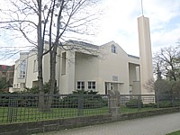
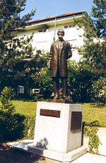

* * *

* * *

* * *

* * *

* * *

* * *

Die Dresdner Mormonengemeinde wurde am 21. Oktober 1855 von Franklin Richards gegründet. Kurz zuvor hatte sich der aus Meißen stammende Lehrer Karl Gottfried Mäser gemeinsam mit seiner Familie  in der
Nähe der Marienbrücke in der Elbe taufen lassen. Mäser musste wegen seines Glaubenswechsels 1857 seinen Beruf aufgeben und wanderte nach Amerika aus, wo er zu den einflussreichsten Mitgliedern der Mormonengemeinschaft
wurde und bis heute verehrt wird. Sitz der Religionsgemeinschaft ist Salt Lake City im US-Bundesstaat Utah. In Dresden war den Mormonen die öffentliche Religionsausübung erst ab 1918 gestattet. Dafür nutzte man bis 1945
Gemeinderäume auf der Zirkusstraße und der Königsbrücker Straße 62. Nach Zerstörung bzw. Aufgabe dieser Gebäude diente das ehemalige Offizierskasino auf der Stauffenbergallee 12 zeitweise als Domizil der Kirche.

1987/88 entstand auf dem Grundstück der 1945 zerstörten Villa des Kommerzienrates Paul Leonhardt an der [Tiergartenstraße 42](../../../../../sudost/strehlen/strassen_strehlen/tiergartenstrasse/) ein neues
Gemeindezentrum für die Dresdner Mormonengemeinde _(Foto)_. Der am 26. Oktober 1988 geweihte moderne Zweckbau wurde von der Bauakademie der DDR unter Leitung von Dieter Hantzsche entworfen und erhielt eine Kapelle,
Veranstaltungsräume, Büros sowie eine Bibliothek. Das Gebäude war zugleich Sitz der Religionsgemeinschaft, die sich selbst als Kirche Jesu Christi der Heiligen der
letzten Tage bezeichnet, in der DDR. 1985 war bereits in Freiberg ein Tempel der  Mormonengemeinschaft geweiht worden. Mit dem für DDR-Verhältnisse
ungewöhnlichen Bauvorhaben wollte die Staatsführung ihre Toleranz in Glaubensfragen unter Beweis stellen und gleichzeitig die Beziehungen zur USA verbessern.. Die Mormonen gehören zu den einflussreichsten Kirchen in der
USA. Das Dresdner Gemeindezentrum wird bis heute von der Kirche genutzt und bietet deren Mitgliedern neben Gottesdiensten auch verschiedene kulturelle Veranstaltungen wie Theater- und Musikabende an.

Mäser-Denkmal:

Die drei Meter hohe Bronzestatue wurde von den Nachkommen Mäsers in der USA gestiftet und als Geschenk an dessen Geburtsstadt Meißen übergeben. Der Einspruch von Kirchenvertretern und Pädagogen, die Mäsers Bedeutung für die Pädagogik bezweifeln, verhinderte jedoch die Aufstellung des Denkmals. Schließlich entschied sich die Gemeinde für das Gelände des Gemeindezentrums in Dresden als künftigen Standort. Im Juli 2001 konnte das Denkmal an der Tiergartenstraße eingeweiht werden. Die Statue wurde von Ortho Fairbanks geschaffen und stellt eine Kopie des Denkmals vor der von Mäser gegründeten Universität von Provo/Utah dar.

* * *

 \[ [Home](../../../../../index.html)\] \[ [Nord](../../../../../nord/)\] \[ [Nordwest](../../../../../nordwest/)\] \[ [Neustadt](../../../../../neustadt/)\]
 \[ [Nordost](../../../../../nordost/)\] \[ [West](../../../../../west/)\] \[ [Zentrum](../../../../../zentrum/)\] \[ [Südwest](../../../../../sudwest/)\]
 \[ [Süd](../../../../../sud/)\] \[ [Südost](../../../../../sudost/)\] \[ [Ost](../../../../../ost/)\] \[ [Register](../../../../../Register/register.html)\] \[ [Kontakt](../../../../../Kontakt/kontakt.html)\] \[ [Impressum](../../../../../impressum/)\]
