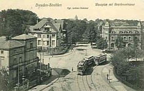
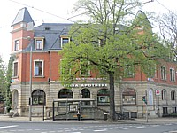
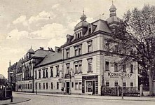
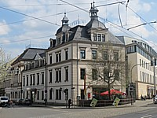
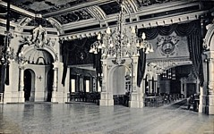
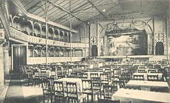
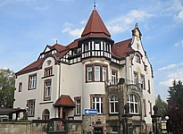

Der Wasaplatz wurde um 1880 angelegt und entwickelte sich in der Folgezeit zum neuen Strehlener Ortszentrum mit Gasthof, Geschäften und Wohnhäusern. Neben dem Hotel “Königshof” und einigen Villen entstand um 1880 das Geschäftshaus mit der Wasa-Apotheke. Seinen Namen erhielt dieser Platz wie auch die benachbarte Wasastraße nach dem polnisch-schwedischen Königsgeschlecht Wasa. Die Gemahlin König Alberts, Carola von Wasa-Holstein-Gottor (1833-1907) entstammte dieser Familie und sollte mit der Namensgebung geehrt werden. 1853 hatte sie den sächsischen Thronfolger geheiratet. Heute ist der Wasaplatz wichtiger Verkehrsknotenpunkt und zugleich Einkaufszentrum für die Umgebung. Nach 1990 entstand unmittelbar neben dem "Königshof" ein modernes Wohn- und Geschäftshaus an der Lockwitzer Straße.

**_Fotos:_** _Der Wasaplatz auf einer historischen Ansicht um 1900 (links) und 2014 (rechts)_

Einzelne Gebäude:

Strehlener Hof:  Der Strehlener Hof entstand unter dem Namen “Königshof” 1888/89 als Großgaststätte am Wasaplatz _(Fotos)_. Zuvor befand sich hier der Gasthof Palitzsch, der dem prunkvollen Neorenaissancebau weichen musste. Der angeschlossene Saal war bereits vor dem Zweiten Weltkrieg Schauplatz von Konzerten, Tanzveranstaltungen und Theateraufführungen und genoss weit über die Ortsgrenzen hinaus einen guten Ruf.
In einem hölzernen Anbau an der Lockwitzer Straße, im Volksmund "Holzoper" genannt, befand sich viele Jahre ein Varieté. Aus Luftschutzgründen wurde dieses Gebäude während des Zweiten Weltkriegs abgebrochen. Lediglich die ehemalige Eingangshalle diente noch viele Jahre als Feinkostladen "Menü". Die restliche Fläche wurde nach 1945 bis zum Neubau des Wohn- und Geschäftshauses Lockwitzer Straße 1-3 u.a. als Lagerplatz eines Kohlenhandels genutzt und war Standort für mehrere kleinere Läden.

Im erhaltenen Ballsaal fanden in der Nachkriegszeit Theater- und Varietéaufführungen statt, die zum Wiederaufleben des Kulturlebens in der zerstörten Stadt beitrugen. Nach Schaffung neuer Spielstätten diente der Saal nur noch als Lagerraum. Lediglich die Gaststätte, nach 1945 in “Strehlener Hof“ umbenannt, blieb noch bis 1992 geöffnet. Nach erfolgter Privatisierung des Gaststättenkomplexes wurden die Gebäude mit Ausnahme des Kopfbaus und der Straßenfront zur Kreischaer Straße abgerissen. Dabei wurden Malereien und Ausstattungsreste des Saales geborgen und für eine Wiederverwendung aufgearbeitet. 1995/97 erfolgte der Wiederaufbau des Strehlener Hofs unter seinem alten Namen “Königshof” als Hotel-  und Gaststättenkomplex. In diesem Zusammenhang erfolgte die Erweiterung um einen Büro- und Geschäftshausflügel zur Lockwitzer Straße. Prunkstück ist der im Stil der Jahrhundertwende wiederhergestellte historische Ballsaal, der für verschiedene Veranstaltungen genutzt wird. Bis 2011 gehörte das Hotel zur Sheraton-Gruppe (Four Points) und wird heute als “Dormero-Hotel” von der Hotelgruppe Gold-Inn geführt.

**_Fotos:_** _Historische Bilder aus dem Königshof - links der Ballsaal,_

_rechts ein Blick in den heute nicht mehr vorhandenen Theatersaal._

Villa Wasa: Der schlossartige Bau im Jugendstil entstand 1903 für den Glasfabrikanten Gustav Kühnel und gehört zu den repräsentativsten Villenbauten in Strehlen. Zeitweise hatte der Maler Gotthard Kuehl hier sein Atelier. Nach 1945 diente die Villa viele Jahre als Klubhaus “August Bebel” und war Veranstaltungsort für Konzerte, Lesungen usw. 1991/93 hatte hier das Dresdner Kulturamt seinen Sitz.

Nach kompletter Sanierung des Gebäudes wird die Villa seit 1994 teilweise als Restaurant genutzt. Die Innenraumgestaltung übernahm unter Einbeziehung der vorhandenen Jugendstilornamente der im Haus wohnende Künstler R. Kleemann. Im Souterrain befindet sich der “Wasakeller”, im Obergeschoss die Gaststätte “Homage” im Stil der Jahrhundertwende. Weitere Räume werden zu Wohnzwecken bzw. als Büro genutzt.

König-Albert-Eiche: Der seit 1999 unter Naturschutz stehende Baum in der kleinen Grünanlage inmitten des Platzes wurde am 24. April 1898 zu Ehren des 25-jährigen Thronjubiläums des sächsischen Königs Albert gepflanzt. Initiatoren waren die Kirchgemeinde der Strehlener Christuskirche sowie verschiedene Vereine des Ortsteils. Eine geplante Gedenktafel wurde nicht realisiert.

* * *

 \[ [Home](../../../../index.html)\] \[ [Nord](../../../../nord/)\] \[ [Nordwest](../../../../nordwest/)\] \[ [Neustadt](../../../../neustadt/)\] \[ [Nordost](../../../../nordost/)\] \[ [West](../../../../west/)\] \[ [Zentrum](../../../../zentrum/)\] \[ [Südwest](../../../../sudwest/)\] \[ [Süd](../../../../sud/)\] \[ [Südost](../../../../sudost/)\] \[ [Ost](../../../../ost/)\] \[ [Register](../../../../Register/register.html)\] \[ [Kontakt](../../../../Kontakt/kontakt.html)\] \[ [Impressum](../../../../impressum/)\]
