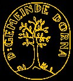

* * *

**Gemeindesiegel von Torna**

* * *

Der kleine Bauernweiler Torna wurde 1347 erstmals urkundlich erwähnt. Der Ortsname ist vom altsorbischen Torn = Dornenstrauch abgeleitet und wurde ursprünglich Tornaw geschrieben. Das Dorf mit seinen
wenigen Gehöften unterstand bis zur Reformation dem Klosterhof Leubnitz. Neben Frondiensten und Abgaben waren die Tornaer Bauern auch zum “Besthaupt” verpflichtet, was bedeutete, das beim Tod eines Bauern dessen bestes
Pferd, beim Tod der Bäuerin die beste Kuh an die Grundherrschaft abgegeben werden musste.

1547 lagen alle sieben Hufen des Ortes wüst und wurden auch zwanzig Jahre später noch vom benachbarten Prohlis aus
bewirtschaftet. Die Gründe hierfür sind nicht bekannt. Später wurde der Ort wieder besiedelt, erlitt jedoch durch die Ereignisse des Dreißigjährigen Krieges erneut einen schweren Rückschlag, so dass 1642 nur noch zwei
Bauernfamilien im Dorf lebten. Betroffen war Torna auch von der Schlacht bei Dresden 1813, als mehrere Gebäude niederbrannten. Im Jahr 1867 zählte der Ort 57 Einwohner. Teile des früheren Dorfkerns sind noch an
der Straße Alttorna und der Tornaer Straße erhalten geblieben. Hier befindet sich seit 1998 auch das rustikale Lokal “Zum Stein” (Tornaer Straße 86).

Im 19. Jahrhundert entstanden auf Tornaer Flur mehrere [Ziegeleien](../../sudost/torna/ziegeleien_torna/), die die Landwirtschaft immer mehr zurückdrängten. Neue Wohngebiete mit Eigenheimen wurden in den Zwanziger
Jahren am Dorngraben und an der Kauschaer Straße errichtet. Bis heute beliebt ist die Einkehrstätte [“Goldener Stiefel”](../../sudost/torna/goldener_stiefel/), die aus einer Schuhmacherei
hervorging. Nachdem ein geplanter Zusammenschluss mit Leubnitz-Neuostra nicht zustande gekommen war, wurde Torna am 1. Juni 1921 nach Dresden eingemeindet.

Gamig:

Der
Gamighübel, zwischen Torna, Leubnitz-Neuostra und Kauscha gelegen ist mit 187 Meter über NN höchste Erhebung der Umgebung und letzter Überrest einer Granitklippe im kreidezeitlichen Meer. Der Sage nach wurde
dieser Berg einst von einem Zwergenvolk bewohnt, die im Inneren des Felsens nach Gold und Edelsteinen gruben. Das Klopfen der Hämmer war bei günstiger Windrichtung bis nach Leubnitz zu hören. Erst der Bau der Kirche und
das regelmäßige Glockenleuten vertrieb die Zwerge vom Gamig. Im Gerichtsbuch von Kauscha und Gaustritz taucht der Name erstmals im Jahr 1592 auf und ist vom slawischen “kamjen” (= Stein) abgeleitet. Noch bis ins 19.
Jahrhundert sah man im Gamig eine frühgeschichtliche Opferstätte, was sich jedoch nicht archäologisch belegen lässt.

Im 19. Jahrhundert entstanden einige Steinbrüche, die von den Bauern der umliegenden
Dörfer Kauscha, Torna und Leubnitz betrieben wurden. Der hier gewonnene Granit fand hauptsächlich im Straßen- und Wegebau Verwendung. Bei den Arbeiten fanden sich verschiedene Fossilien kreidezeitlicher Meeresbewohner,
die u. a. vom Geologen Geinitz beschrieben wurden und sich heute im Staatlichen Museum für Mineralogie und Geologie befinden. Heute ist der Hügel Flächennaturdenkmal. An brütenden Vogelarten konnten u.a. die Nachtigall,
der Kuckuck und die Goldammer beobachtet werden.

[_Weiterführende Literatur und Quellen_](../../impressum/quellenverzeichnis/)

 \[ [Home](../../index.html)\] \[ [Nord](../../nord/)\] \[ [Nordwest](../../nordwest/)\] \[ [Neustadt](../../neustadt/)\] \[ [Nordost](../../nordost/)\] \[ [West](../../west/)\] \[ [Zentrum](../../zentrum/)\] \[ [Südwest](../../sudwest/)\] \[ [Süd](../../sud/)\]
 \[ [Südost](../../sudost/)\] \[ [Ost](../../ost/)\] \[ [Register](../../Register/register.html)\] \[ [Kontakt](../../Kontakt/kontakt.html)\] \[ [Impressum](../../impressum/)\]
