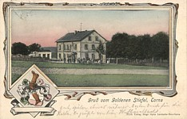

* * *

* * *

* * *

* * *

* * *

* * *

Die historische Gaststätte “Goldener Stiefel” wurde 1815 im Gehöft Torna Nr. 5 eröffnet und zunächst nur im Nebenerwerb betrieben. 1826 übernahm der Schuhmacher Johann Andreas Kotte das Lokal und erhielt
für dieses im August 1848 das “Große Schankrecht”. Ihren Namen verdankt die Gastwirtschaft einer Anekdote aus den Gründerjahren. Stammgäste sollen dem Wirt zu seinem Geburtstag einen von ihm selbst gefertigten Stiefel,
bemalt mit Goldfarbe, und ein dazu passendes Schild mit der Inschrift “Zum Goldenen Stiefel” geschenkt haben, welches am Haus angebracht wurde. Der Name ging fortan auf das Lokal über, welches sich nicht zuletzt wegen
der herrlichen Fernsicht zur beliebten Ausflugsgaststätte entwickelte.

Nach dem Tod “Vater Kottes” übernahm 1863 dessen Schwiegersohn Ernst Wilhelm Schmidt die Schankwirtschaft und ließ 1876/77 das heutige Gebäude
oberhalb des ursprünglichen Standortes am Pfaffenberg errichten. Zwei Jahre später kaufte der aus der Oberlausitz stammende Ernst Wilhelm Klimpel die Gaststätte. Um 1900 war der ”Goldene Stiefel” Stammlokal des
“Gebirgsvereins Sächsische Schweiz”, der sich sehr um die touristische Erschließung dieser Region verdient gemacht hat. Obwohl die Fernsicht durch die Bebauung des Umfeldes in den Zwanziger Jahren stark eingeschränkt
wurde, blieb die Gaststätte auch weiterhin ein beliebtes Ziel der Dresdner.

**_Foto:_** _Der “Goldene Stiefel” auf einer historischen Ansichtskarte_

Nach dem Zweiten Weltkrieg wurde das Lokal zeitweise verpachtet und ab 1972 von der HO bewirtschaftet. Erst 1988 kam der “Goldene Stiefel” wieder in Privatbesitz. Neben den Gasträumen, die auch für Tanzveranstaltungen
genutzt werden, entstand während der Sanierung 1992 der „Stiefelkeller“ mit Bar und Gesellschaftsraum. Nach einem
weiteren Umbau 2009 stehen heute 150 Plätze im Gastraum, 150 im Biergarten sowie ca. 50 Terrassenplätze zur Verfügung. Hinzu kommen einige Hotelzimmer.

* * *

 \[ [Home](../../../index.html)\] \[ [Nord](../../../nord/)\] \[ [Nordwest](../../../nordwest/)\] \[ [Neustadt](../../../neustadt/)\] \[ [Nordost](../../../nordost/)\] \[ [West](../../../west/)\] \[ [Zentrum](../../../zentrum/)\] \[ [Südwest](../../../sudwest/)\] \[ [Süd](../../../sud/)\] \[ [Südost](../../../sudost/)\] \[ [Ost](../../../ost/)\] \[ [Register](../../../Register/register.html)\] \[ [Kontakt](../../../Kontakt/kontakt.html)\] \[ [Impressum](../../../impressum/)\]
