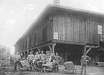

* * *

Ziegelei Prenzel:

Die Ziegelei Prenzel war älteste von einst drei Ziegeleien auf Tornaer Flur und wurde 1897 von Rudolph Krackow gegründet. Krackow übte zu diesem Zeitpunkt das Amt
des Gemeindevorstands aus und beschäftigte in seinem Unternehmen zunächst 50 Mitarbeiter. Hergestellt wurden in dem noch großteils in Handarbeit arbeitenden Betrieb vor allem Mauerziegel für die wachsende Großstadt.

1903 erwarb der zuvor als Maurerpolier tätige Reinhold Prenzel bei einer Versteigerung die Krackowsche Ziegelei. Schrittweise erweiterte er das
Unternehmen, ohne jedoch die grundsätzliche Technologie zu verändern. Die Ziegel wurden in Handarbeit aus dem in der zugehörigen Lehmgrube geförderten Material geformt. Zum Transport dienten ein
Eimerkettenbagger mit anschließender Grubenbahn sowie mehrere Förderbänder. Die von Frauen auf Trockenhorden
gestapelten Rohziegel wurden dann in den Brennofen geschoben und nach ihrer Fertigstellung per Pferdewagen, später
per Lastwagen zum Bestimmungsort transportiert. Die Kapazität der Ziegelei lag bei ca. 40.000 Ziegeln am Tag.

Nach dem Tod Reinhold Prenzels übernahm 1933 dessen Sohn Martin die Leitung des Familienbetriebes. Da Martin
Prenzel nicht aus dem Zweiten Weltkrieg zurückkehrte, musste die Ziegelei nach Kriegsende von seiner Frau Marianne
weitergeführt werden. Zunächst noch gut ausgelastet, machte sich später die veraltete Technik des Werkes bemerkbar.
1972 musste die Familie eine halbstaatliche Beteiligung aufnehmen und wurde 1976 schließlich enteignet. Das Tornaer
Werk gehörte fortan zum VEB Vereinigte Ziegelwerke Dresden. Unter dessen Regie wurden Ringofen und Trockenhallen durch ein modernes Ziegelwerk ersetzt. 1982
kam der Betrieb zum Kombinat VEB Sächsische Ziegelwerke mit Sitz in Langburkersdorf. Im Zuge der staatlich geforderten Konsumgüterproduktion wurde ab 1983 neben Mauerziegeln auch Haushaltkeramik hergestellt.

1990 erhielt die Familie Prenzel ihr Eigentum zurück und verkaufte die Ziegelei an die Firma Moll. Da das Werk trotz
Modernisierung nicht mehr konkurrenzfähig war, entschlossen sich die neuen Eigentümer zur Stilllegung und zum Abriss
der Gebäude 1993. Heute befinden sich auf dem Areal verschiedene Kleinbetriebe sowie eine Niederlassung des Paketdienstleisters DHL.

Ziegelei Schmidt & Co.:

Die Ziegelei wurde 1897 auf dem an die bereits existierende Ziegelei Prenzel angrenzenden Grundstück gegründet und
befand sich zunächst im Besitz von Karl Ralf Schneider. 1901 erwarb Adolf Schmidt, welcher bereits im nahe gelegenen
Nickern eine Ziegelei besaß, gemeinsam mit seinem Geschäftspartner Sarfert den Betrieb. Die moderne Dampfziegelei
beschäftigte ca. 50 Angestellte, unter ihnen auch zahlreiche Saisonarbeiter. Geleitet wurde das Unternehmen vom
Ziegelmeister Robert Oswald. Für den Ziegeleibetrieb entstanden zahlreiche Gebäude. Als Werkshaus diente das Gebäude Alttorna Nr. 7.

Nach dem Tod Sarferts verkaufte Adolf Schmidt seine Ziegelei 1919 an Gustav Werner, wobei der Name Schmidt &
Co. jedoch beibehalten wurde. Die Produktion umfasste bis zum Beginn des zweiten Weltkrieges neben Mauerziegeln
auch Dachsteine, wurde jedoch 1939 eingestellt. Das Gelände diente fortan als Abstellplatz für Fahrzeuge der Nickerner Luftabwehrkaserne und Unterkunft für Fremdarbeiter.

1946 nahm die Ziegelei Schmidt & Co. ihren Betrieb wieder auf, stellte jedoch bis 1950 lediglich Naßpreßsteine her. Erst
1950 konnte wieder regulär mit der Brennziegelherstellung begonnen werden. Der Familienbetrieb wurde Mitte der 50er
Jahre in Volkseigentum überführt und kam zum VEB (K) Ziegelwerke Dresden. Aufgrund der technisch veralteten
Anlagen und Erschöpfung der Lehmvorkommen stellte man die Produktion um 1970 ein und nutzte das Gelände als Sitz
der Abteilung Hauptmechanik des Dresdner Baukombinates. Nicht mehr benötigte Anlagen wie der Ringofen und der
Schornstein wichen dem Neubau von Betriebshallen; weitere Gebäude wurden umgebaut. Heute befindet sich auf dem Grundstück ein kleiner Gewerbepark mit mehreren Firmen, meist aus der Bau- und Recycling-Branche.

* * *

 \[ [Home](../../../index.html)\] \[ [Nord](../../../nord/)\] \[ [Nordwest](../../../nordwest/)\] \[ [Neustadt](../../../neustadt/)\] \[ [Nordost](../../../nordost/)\] \[ [West](../../../west/)\] \[ [Zentrum](../../../zentrum/)\] \[ [Südwest](../../../sudwest/)\] \[ [Süd](../../../sud/)\] \[ [Südost](../../../sudost/)\] \[ [Ost](../../../ost/)\] \[ [Register](../../../Register/register.html)\] \[ [Kontakt](../../../Kontakt/kontakt.html)\] \[ [Impressum](../../../impressum/)\]
