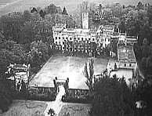
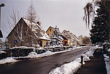
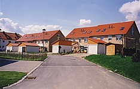
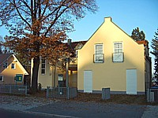
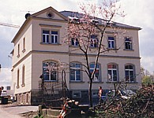



Altfranken wurde als “Aldin Vrankin” erstmals in einer Urkunde vom 26. Mai 1311 urkundlich erwähnt. Der vermutlich von fränkischen Siedlern gegründete Ort war eine Stiftspräbende des Domstifts Meißen und
besaß Anteile an den Dörfern Kaditz, Dölzschen, Naußlitz und Pesterwitz. Der Name wird von eingewanderten fränkischen Bauern abgeleitet, die als “Aldionen” (= Dienstleute, Fröner) zu bestimmten Dienstpflichten gegenüber
ihrem Herren verpflichtet waren und im Gegenzug ihre persönliche Freiheit erhielten. Möglicherweise wurde in die Bildung des Straßenangerdorfes ein bereits vorhandener slawischer Rundling einbezogen.

 Altfranken gehörte als Domherrengut bis zur Reformation dem Hochstift
Meißen, musste jedoch auch an das Amt Dresden Zinsen entrichten. In den Hussitenkriegen wurde das Dorf wahrscheinlich zerstört, schnell jedoch wieder
aufgebaut. 1517 übertrug Bischof Johann IV. den Ort der Vikarie St. Annen in Meißen. Erst mit der Reformation und der Bildung des Prokuraturamtes Meißen 1581 endete
die kirchliche Herrschaft in Altfranken. 1616 wurde Michael Gerlach, Prokuraturverwalter des Amtes, als Lehnsherr von Pesterwitz und Altfranken genannt. Einige Jahre später kam das Rittergut in
bürgerlichen Besitz. Seit 1655 gehörte das Dorf  zum Amt Dresden.

Im Jahr 1787 wurde der bisher zum Pesterwitzer Rittergut gehörende Ort zum selbstständigen neuschriftsässigen
Rittergut erklärt, dessen Besitzer jedoch nur eingeschränkte Rechte hatten und nicht zu den Sitzungen des Landtags
erscheinen durften. 1813 stürmten französische Soldaten den Ort und richteten erheblich Schäden an, bevor sie am 26. Oktober zum Abzug gezwungen wurden. Dorf und Rittergut wechselten nun häufig ihren Besitzer. Neben der
Landwirtschaft war vor allem der Obstanbau von Bedeutung. Außerdem gab es eine Schäferei. An der Kesselsdorfer Straße bestand zeitweise eine Ziegelei.

1850 erwarb Heinrich Wilhelm Graf von Luckner das Altfrankener Rittergut. Dieser ließ das [Schloss](../../sudwest/altfranken/schloss_altfranken) (Foto) errichten und mit einem reizvollen Landschaftspark umgeben.
1865 ging das Anwesen in den Besitz seines Sohnes Felix über, der wegen seiner Eskapaden als “der tolle Graf” bekannt wurde, sich jedoch sehr für die Entwicklung
des Ortes engagierte. Zweiter bedeutender Sohn Altfrankens ist Heinrich Klemm (1819-1886), der seine ersten Lebensjahre im Dorf verbrachte und später als Gründer der Europäischen Modenakademie bekannt wurde. Seine
wertvolle Privatbibliothek bildete den Grundstock der Deutschen Buch- und Schriftensammlung, die heute zur Deutschen Bücherei in Leipzig gehört. Klemm gilt
als einer der bedeutendsten Bibliothekare überhaupt und finanzierte auch den Aufbau einer Volksbibliothek in seinem Heimatort.

1909 plante die Stadt Dresden zwischen Altfranken und Gorbitz die Anlage eines großen Volksparks, der analog zum Albertpark am Weißen Hirsch den
Namen Königin-Carola-Park erhalten sollte. Obwohl die Pläne für das über 510.000 m² große Gelände bereits fertig gestellt waren, verhinderte der Erste Weltkrieg
deren Umsetzung. In den Jahren nach 1918 zog in das Schloss ein Wohnstift für ältere Damen ein. Auf Betreiben der Nationalsozialisten wurde der neogotische Bau 1939 als “undeutsch” abgerissen. Die geplante Führerschule
der Hitlerjugend konnte jedoch nicht mehr realisiert werden. Nach dem Luftangriff auf Dresden kamen in den hier errichteten Notunterkünften hunderte
Ausgebombte unter, was zu einem deutlichen Zuwachs der Einwohnerzahl Altfrankens führte.

Das frühere Rittergut wurde 1946 enteignet und dem VEG Pesterwitz angeschlossen, welches die Stallungen als Schweinezuchtanlage nutzte. Den
verwilderten Park ließ die Gemeinde in den 1960er Jahren wieder herstellen. 1973 entstand hier ein moderner [Campingplatz](../../sudwest/altfranken/schloss_altfranken) für Besucher Dresdens. Da die kleine Gemeinde mit der Erhaltung der örtlichen Infrastruktur völlig überfordert war, wurde bereits um 1970 der Anschluss an Dresden erwogen, der jedoch
ebenso wie die geplante Eingemeindung nach Gompitz nicht zustande kam. Nach 1990 entstanden zwischen altem Dorfkern und Kesselsdorfer Straße neue Wohnsiedlungen _(Foto)_ sowie ein großer Gewerbepark mit mehreren
Einkaufsmärkten. Als erster Ort des Dresdner Umlandes kam Altfranken am 1. Januar 1997 als Stadtteil zu Dresden.
Zu den jüngsten Bauvorhaben gehörte der Bau der Autobahn A 17, für die unterhalb des Schlossparkes ein Tunnel entstand. Außerdem entstanden mehrere neue Wohnviertel, die zu einem starken Anwachsen der Einwohnerzahl
führten.

## Gemeindeverwaltung

1967 wurde auf einem Grundstück gegenüber der Einmündung der Dorfstraße in die Otto-Harzer-Straße ein Gebäude für die Freiwillige Feuerwehr des Ortes errichtet.
Zugleich diente das Haus als Versammlungsort und Domizil der Gemeindebibliothek. Für die Gemeindeverwaltung entstand nach 1990 auf dem Nachbargrundstück ein moderner Neubau _(Foto)_
. Das Feuerwehrhaus diente zuletzt noch als Gaststätte “Zur Feuerwehr” und wurde dann zugunsten eines Einfamilienhauses abgerissen.

### Schulen in Altfranken

Das Schulhaus entstand 1888 aus Mitteln der Heinrich-Klemm-Stiftung. Klemm, der
als Waisenkind selbst auf Kosten der Gemeinde erzogen worden war, finanzierte die Einrichtung aus Dankbarkeit gegenüber seinem Heimatort und stiftete auch eine
Gemeindebibliothek für Altfranken. Die feierliche Einweihung der Schule fand am 19. September 1888 statt. Zu den Traditionen gehörte später ein alljährliches Schulfest
mit Festumzug am Geburtstag Klemms, bei denen neben Kaffee und Kuchen auch kleine Gaben an die Kinder des Ortes verteilt wurden. Das Schulhaus wird heute
nicht mehr genutzt und dient seit seiner Renovierung 1998 als Wohnhaus.

[_Weiterführende Literatur und Quellen_](../../impressum/quellenverzeichnis/)

 \[ [Home](../../index.html)\] \[ [Nord](../../nord/)\] \[ [Nordwest](../../nordwest/)\] \[ [Neustadt](../../neustadt/)\] \[ [Nordost](../../nordost/)\] \[ [West](../../west/)\] \[ [Zentrum](../../zentrum/)\] \[ [Südwest](../../sudwest/sudwest.html)\] \[ [Süd](../../sud/)\]
 \[ [Südost](../../sudost/)\] \[ [Ost](../../ost/)\] \[ [Register](../../register/)\] \[ [Kontakt](../../kontakt/)\] \[ [Impressum](../../impressum/)\]
