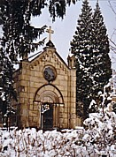
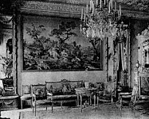
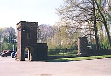
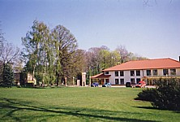

Das Altfrankener Schloss entstand um 1850 für Graf Johann Heinrich Wilhelm von Luckner,
der 1847 die Gutsherrschaft Altfranken erworben hatte. Der im neogotischen Tudorstil gestaltete Bau wurde vom Besitzer unter Mitwirkung des Architekten Karl Alexander von
Heideloff zum Teil selbst entworfen. Die Bauleitung oblag dem Tischlermeister Timme. Gleichzeitig wurde auch der ca. 4,2 Hektar große Schlosspark mit einer 700 Meter langen
Zufahrtsallee angelegt. Neben der im englischen Stil gestalteten Parkanlage gehörte auch ein geometrisch angelegter Schlossgarten und ein zur Versorgung dienender Obst- und
Gemüsegarten zum Grundstück. Am 12. September 1852 konnte der Bau mit Weihe der privaten Schlosskapelle abgeschlossen werden. Sieben Jahre später entstand auf dem Friedhof
im Nachbarort Pesterwitz noch ein Familienmausoleum der Luckners _(Foto)_.

Graf Wilhelm Heinrich von Luckner geriet schon bald nach Fertigstellung des Schlosses in persönliche Schwierigkeiten. Am 19. Januar 1865 erschoss er sich,
vermutlich in geistiger Umnachtung, im Schloss, welches nun in den Besitz seines Sohnes Nikolaus Felix überging. Dieser ließ den Bau 1874 nach Plänen von
Hofbaurat Bernhard Krüger erweitern und im Stil eines gotischen Kastells mit Zinnenmauern, Toranlage und Wachtürmen umgestalten. Der Speisesaal im Inneren
wurde von Erwin Oehme mit Szenen aus dem Ritterleben und der Geschichte der Heiligen Elisabeth ausgestaltet _(Foto)_ Auch die anderen Räume erhielten eine
prunkvolle Ausstattung mit wertvollen Gemälden, Emaillearbeiten und anderen Kunstwerken. Zu diesen Schätzen gehörte auch der Marschallstab Nicolaus von Luckners, der als Mitglied der
französchen Revolutionsarmee 1794 wegen angeblichen Verrats hingerichtet wurde. Ihm zu Ehren entstand die
“Marseillaise”, die bis heute französische Nationalhymne ist. Sein Nachfahre auf Altfranken, Graf Felix von Luckner,
galt Ende des 19. Jahrhunderts als eine Ausnahmeerscheinung der Dresdner Gesellschaft und sorgte durch zahlreiche Eskapaden und seine Hochzeit mit der Solotänzerin der Hofoper Mathilde Zink für Aufsehen.





Nach seinem Tod 1902 übernahm seine Witwe das Anwesen und richtete hier ein Stift für adlige Damen ein, welches bis zu ihrem Tod 1934 bestand. Da ihr Sohn kein Interesse am
Altfrankener Besitz zeigte und weit entfernt in Baden-Baden wohnte, verfiel das Schloss jedoch immer mehr. Der schlechte Bauzustand wurde 1939 von den Nazis zum Anlass
genommen, das Gebäude von den Luckner-Erben zu erwerben und abzureißen. Schloss Altfranken wurde wegen seiner architektonischen Gestaltung im englischen Tudorstil als
“undeutscher Bau” und “Beispiel schlechtester Art neugotischer Bemühungen” bezeichnet und Ende 1939 abgetragen. Auch ein Einspruch des Landesdenkmalpflegers Walter
Bachmann konnte den Abbruch nicht verhindern. An Stelle des Schlosses sollte eine Führerschule der Hitlerjugend entstehen, mit deren Bau jedoch kriegsbedingt nicht mehr
begonnen wurde. Dem Abriss entgingen lediglich die Kellerräume des Gebäudes und Teile der Toranlage des Schlosshofes mit zwei Löwenplastiken _(Foto rechts)_ und einigen Türmen.
Die wertvolle Kassettendecke des Festsaales kam nach Dresden-Wilschdorf und wurde dort 1942 im [Gasthof](../../../nord/wilschdorf/) eingebaut.

1945 entstand auf dem Schlossgelände ein Barackenlager für Ausgebombte und
Flüchtlinge aus den Ostgebieten. Nach Kriegsende waren hier zeitweise auch Angehörige der Dresdner NSDAP-Führungsschicht interniert. Zur Brennholzgewinnung wurden Bäume im Schlosspark abgesägt und der Park
dadurch schwer in Mitleidenschaft gezogen. Auch die ehemalige Umfassungsmauer fiel der Gewinnung von Baumaterial zum Opfer. Nach Räumung des Lagers im Jahr 1952 übernahm die Gemeinde Altfranken den Park
und begann 1959 mit der Umgestaltung zum Volkspark. Im Winter gab es hier u.a. eine Eisbahn, in den Sommermonaten fand ab 1960 Freilichtkino statt.

1972 beschlossen die zuständigen Organe die
Umwandlung des Areals zum Campingplatz. Dadurch sollte der nach Einführung des visafreien Grenzverkehrs nach Polen und der CSSR stark angewachsene Tourismus gefördert und
zugleich der Mangel an geeigneten Unterkünften für Dresden-Besucher gemindert werden. 1973 begann der Bau von
Bungalows, Finnhütten und sanitären Einrichtungen. 1976 folgte eine kleine Verkaufsstelle mit Gaststätte. Schrittweise
wurde auch mit der Wiederherstellung des Landschaftsparkes begonnen. Infolge der fehlenden Baukapazitäten konnten
weitere Pläne wie der Bau eines Schwimmbades und einer Kegelbahn nicht umgesetzt werden. Als internationaler Campingplatz vor den Toren Dresdens wurde Altfranken von zahlreichen Gästen aus dem In- und Ausland besucht.

1991 übergab der Landkreis Dresden den Platz an die Firma KIM Park Hotel, die hier auf dem Gelände des früheren Schlosses ein modernes Motel mit öffentlicher Gaststätte errichtete. Die verbliebenen Reste des
Schlosses, darunter Teile der früheren Toranlage mit zwei Rundtürmen und eine von einer Löwenplastik bekrönten Säule, wurden dabei saniert und in die Anlage einbezogen _(Fotos oben)_
. Das Hotel übernahm auch die Bewirtschaftung des inzwischen geschlossenen Campingplatzes. Leider wurde der Park durch den Bau der Autobahn A 17 weiter beeinträchtigt, ist inzwischen jedoch wieder hergestellt.



Seit Oktober 2004 stand vor dem Hotel die ursprünglich für die Dresdner Frauenkirche neu
gegossene Taufglocke “Josua”. Die wegen ihrer Tonqualität nicht für das Kirchengeläut verwendbare Glocke des ersten Gusses wurde vom Hotelbesitzer des KIM-Hotels
erworben und in einem eigens errichteten Glockenstuhl aufgehängt, durfte jedoch auf Grund eines Rechtsstreites mit dem Künstler nicht mehr öffentlich gezeigt werden. 2008 wurde sie
deshalb durch einen Neuguss ersetzt, welcher auf den strittigen Glockenzierrat verzichtete. Heute wird sie u.a. bei Hochzeiten im Schlossrestaurant geläutet.

* * *

 \[ [Home](../../../index.html)\] \[ [Nord](../../../nord/)\] \[ [Nordwest](../../../nordwest/)\] \[ [Neustadt](../../../neustadt/)\] \[ [Nordost](../../../nordost/)\] \[ [West](../../../west/)\] \[ [Zentrum](../../../zentrum/)\] \[ [Südwest](../../../sudwest/)\] \[ [Süd](../../../sud/)\] \[ [Südost](../../../sudost/)\] \[ [Ost](../../../ost/)\] \[ [Register](../../../register/)\] \[ [Kontakt](../../../kontakt/)\] \[ [Impressum](../../../impressum/)\]
