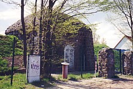
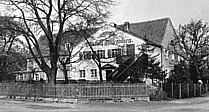
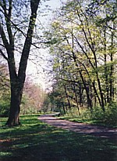
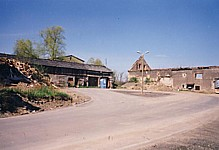
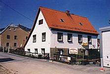

Die Altfrankener Dorfstraße ist die Hauptstraße des Ortes und verbindet diesen mit der Landstraße nach Wurgwitz und
Gompitz. Bis 1997 wurde sie nur Dorfstraße genannt, danach jedoch, um Verwechslungen mit gleichnamigen Straßen zu vermeiden, um den Zusatz ergänzt. Anschließend an die bereits vorhandenen Wohngebäude aus der dörflichen
Vergangenheit des Ortes entstanden hier ab 2004 zahlreiche Einfamilienhäuser. Bemerkenswert ist ein aus Granitsteinen gemauerte Hochbehälter des Wasserwerkes im westlichen Teil der Straße.

**_Fotos:_** _Wohnhäuser an der Altfrankener Dorfstraße (links) - Wasserhochbehälter (rechts)_

Gasthof Altfranken:
Der aus der alten Dorfschänke hervorgegangene Gasthof an der Dorfstraße 7 war bereits vor 1945 beliebte Einkehrstätte für Wanderer und Spaziergänger aus dem nahen Dresden. Zuletzt wurde er als Konsum-Gaststätte
betrieben. 1973 schloss das Lokal wegen Baufälligkeit seine Pforten. Da alle Versuche zu einer Wiedereröffnung scheiterten, wurde das Gebäude 1993 abgerissen.

**_Foto:_** _Der Gasthof Altfranken um 1930_

Der Altfrankener Schmiedeweg verläuft im alten Dorfkern Altfrankens. Der Name erinnert an die einst hier befindliche
Dorfschmiede. Bis zur Eingemeindung des Ortes wurde er Schmiedeweg genannt. In aktuellen Stadtplänen ist er nicht mehr benannt.

Die Straße Am Lucknerpark dient der Erschließung einer kleinen Wohnsiedlung im nördlichen
Teil Altfrankens. Eine gleichnamige Straße gab es in unmittelbarer Nähe auch auf Gorbitzer Flur. Diese wurde jedoch bereits 1950 in Am Altfrankener Park umbenannt.

Hier befindet sich der nördliche Zugang zum Altfrankener Schlosspark. Der Park wurde ab 1850 für den Besitzer des [Schlosses Altfranken](../../../sudwest/altfranken/Schloss_Altfranken/schloss_altfranken.html) Johann Heinrich Wilhelm von Luckner als
englischer Landschaftspark angelegt. Leider ging die ursprüngliche Struktur nach 1945 durch den Bau eines Campingplatzes, nach 1990 durch den Autobahnbau teilweise verloren. In
jüngster Zeit begann jedoch die Wiederherstellung der historischen Anlage.

Die Straße Am Rittergut wurde erst nach 2000 auf dem Areal des früheren Rittergutes angelegt. 1787 wurde ein zuvor zu
Pesterwitz gehörender Gutshof zum selbständigen Rittergut erhoben, welches sich ab 1850 im Besitz der Familie von Luckner befand. Nach 1945 nutzte das Volksgut Pesterwitz die Gebäude, welche 2000 abgerissen wurden. In der Folge
entstand hier eine kleine Wohnsiedlung.

**_Fotos:_** _Die Gebäude des ehemaligen Volksgutes kurz vor dem Abriss 1999_

__

Der
1998 im Zusammenhang mit einer Neubausiedlung südlich des Ortskerns angelegte Halankweg erhielt seinen Namen nach Arthur Curt Halank (1865-1926). Halank war erster Lehrer der Altfrankener Schule.

Die nach einem früheren Grundbesitzer Haufes Berg genannte Straße befindet sich im Ortskern Altfrankens und wurde 1998 zur Erschließung einer neuen Wohnsiedlung in
südlicher und westlicher Richtung verlängert. Im östlichen Abschnitt stehen noch einige Wohngebäude aus der dörflichen Vergangenheit des Ortes _(Foto)_.

Bis 1990 trug die Straße den Namen Oswald-Seidel-Weg. Diese Namensgebung war 1971 aus Anlass des 22. Jahrestages der Gründung der DDR “nach einem verdienstvollen Gebnossen” erfolgt. An der Ecke zur Altfrankener Dorfstraße erinnert
ein Gedenkstein an die Opfer des Ersten und Zweiten Weltkrieges.

Der Heinrich Klemm-Weg führt von der Altfrankener Dorfstraße zur ehemaligen Schule des Ortes, welche heute als Wohnhaus dient. Auch das gegenüberliegende und 2011 sanierte Wohnhaus Heinrich-Klemm-Weg 1 _(Foto)_
steht unter Denkmalschutz. Zwischen 1971 und 1990 wurde diese Straße Max-Körner-Weg genannt. Die Namensgebung war aus Anlass des 22. Gründungstages der DDR am 7. Oktober 1971 “nach einem verdienstvollen Genossen” erfolgt.

Der heutige Straßenname erinnert an den in Altfranken aufgewachsenen Verleger und Bibliothekar Heinrich Klemm (1819-1886)
. Der als Waisenkind von der Gemeinde erzogenen Junge war Mitbegründer der Europäischen Moden-Akademie in Dresden und durch seine wertvolle Privatbibliothek den Grundstock der Deutschen Bücherei in Leipzig legte. Auch für
seinen Heimatort stiftete er eine Volksbibliothek und half bei der Finanzierung des [Schulbaus](../../../sudwest/altfranken/altfranken.html).

Der Kastanienweg wurde 1998 im Zusammenhang mit dem Bau des Wohnparks “Altfrankener Höhe” angelegt. Auch
die Anliegerstraßen Lindenweg, Ulmenweg und Buchenhain erhielten die Namen heimischer Laubbäume.

Die Otto-Harzer-Straße verbindet Kesselsdorfer Straße und Ortszentrum und wurden in den 1960er und 70er Jahren mit Einfamilienhäusern bebaut. Mit der Namensgebung wird an den Kommunalpolitiker Paul Otto Harzer
(1894–1949) erinnert, der von 1927 bis 1933 als Bürgermeister die Geschicke des Ortes leitete.

Als Schulweg wird eine kleine in der Nähe des frühren Schulgebäudes entlang
führende Straße bezeichnet. Neben einigen älteren Wohnhäusern _(Foto)_ steht hier an der Ecke zum Heinrich-Klemm-Weg die 1888 erbaute Dorfschule, welche heute nur noch Wohnzwecken dient. Zuvor und nach Schließung der Schule
mussten die Kinder des Ortes die Schule im benachbarten Pesterwitz besuchen. Dies und die Tatsache, dass es in Dresden bereits eine gleichnamige Straße gab,
führte nach der Eingemeindung 1997 zur Umbenennung in Pesterwitzer Schulweg.

Die Rudolf-Walther-Straße wurde nach 1990 zur Erschließung des Altfrankener Gewerbegebietes angelegt. Zu den
größten Unternehmen, die sich hier ansiedelten, gehörte der Möbel-Markt “Möbel-Walther” (heute Möbel Kraft). Zu Ehren dessen Gründers Rudolf Walther (\* 1923) erhielt die neue Straße dessen Namen, wobei hier ausnahmsweise vom
Grundsatz abgewichen wurde, Straßen nur nach bereits Verstorbenen zu benennen. Rudolf Walther engagierte sich auch als Stifter und ist Träger
des Bundesverdienstkreuzes. 1999 wurden hier im Anschluss an die bestehende Bebauung noch 50 Reihenhäuser errichtet.

* * *

 \[ [Home](../../../index.html)\] \[ [Nord](../../../nord/)\] \[ [Nordwest](../../../nordwest/)\] \[ [Neustadt](../../../neustadt/)\] \[ [Nordost](../../../nordost/)\] \[ [West](../../../west/)\] \[ [Zentrum](../../../zentrum/)\] \[ [Südwest](../../../sudwest/)\] \[ [Süd](../../../Sud/sud.html)\] \[ [Südost](../../../Sudost/sudost.html)\] \[ [Ost](../../../Ost/ost.html)\] \[ [Register](../../../Register/register.html)\] \[ [Kontakt](../../../Kontakt/kontakt.html)\] \[ [Impressum](../../../Impressum/impressum.html)\]
