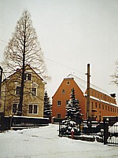
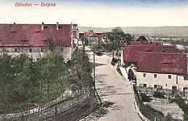
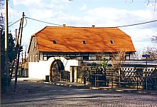
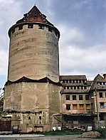
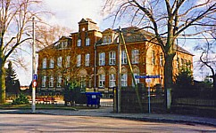
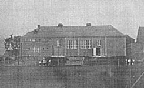
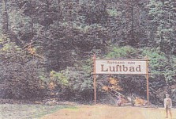
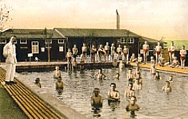



Die aus einem slawischen Rundplatzdorf hervorgegangene Siedlung oberhalb des
Plauenschen Grundes wurde 1144 erstmals als Deltsan in einer Urkunde Kaiser Konrad III. erwähnt, der den Ort in einem Rechtsstreit dem Meißner Domstift als Lehen zusprach. Der
Name ist vom altsorbischen Wort Delcane abgeleitet, was übersetzt “Berg- bzw. Burgbewohner” bedeutet. Diese Bezeichnung weist auf die geografische Lage über dem
Weißeritztal, möglicherweise auch auf die frühgeschichtliche Burganlage Thorun hin, die sich im nahen Pesterwitz befand und 1206 Gegenstand eines Streites zwischen dem Bischof von
Meißen und dem Burggrafen von Dohna war. Im Zusammenhang mit dem Schiedsspruch des Markgrafen wurde die Stadt Dresden erstmals urkundlich erwähnt. Der genaue
Standort dieser Burg war lange umstritten, wahrscheinlich befand sie sich auf dem nur wenige Kilometer von Dölzschen gelegenen Burgwartsberg. Noch älteren Datums sind
Besiedlungsspuren aus frühgeschichtlicher Zeit (ca. 3000 Jahre), wie sie bei Grabungen 1998/2001 auf der Dölzschener Höhe gemacht wurden.

Das Bauerndorf Dölzschen gehörte bis 1559 zu den Besitzungen des Meißner
Bischofs und wurde dann dem Prokuraturamt Meißen unterstellt. Die obere und niedere Gerichtsbarkeit lag beim Briesnitzer Amt bzw. der Stadt Dresden. Zu den späteren Grundherren gehörten ab 1651
der Besitzer des Pesterwitzer Rittergutes Reichbrod von Schrenkdorff und ab 1736 die in Roßthal ansässige Familie von Nimptsch, welche sich 1742 ein Lusthaus oberhalb des [Plauenschen Grundes](../../sud/plauen/plauenscher_grund/) errichten ließ. An seiner Stelle steht heute die [Begerburg](../../sudwest/dolzschen/begerburg/). Größtes Anwesen war ein 1657 erstmals erwähntes Freigut mit ca.
28 Hektar Grundfläche, welches noch bis zur Bodenreform existierte. Da der Ort nie eine eigene Kirche besaß, besuchten die Bewohner die Kirche im benachbarten Plauen, ab 1878 die Kirche von Pesterwitz.

Der Dorfkern entstand in seiner jetzigen Form nach den Zerstörungen 1813, die
lediglich ein Gehöft unbeschadet überstand _(Foto)_. Zuvor hatte es bereits im Dreißigjährigen Krieg und im Zweiten Schlesischen Krieg 1745 größere
Schäden im Dorf gegeben. Im Dezember 1745 plünderten preußische Soldaten neun Dölzschener Güter und brannten diese teilweise nieder. 1813 lieferten sich
Österreicher und Franzosen auf den Feldern zwischen Pesterwitz, Roßthal und Dölzschen schwere Gefechte und schossen dabei auch Dölzschen in Brand. Am
27\. August 1813 wurden die Truppen der Österreicher durch den französischen General Murat vernichtend geschlagen, über 13.000 Soldaten kamen in Gefangenschaft.

Neben dem Ackerbau war früher in Dölzschen der seit dem 16. Jahrhundert verbürgte
Obst- und Weinbau von Bedeutung. Durch den Aufschluss der Plänersteinbrüche im Plauenschen Grund verschwanden nach 1860 fast alle Weinterrassen in diesem Gebiet.
Neben dem alten Dorfkern und der im Weißeritztal gelegenen Siedlung Niederdölzschen entstanden ab 1900 weitere Wohngebiete zwischen Dölzschen und Plauen / Löbtau, die
heute als Hohendölzschen bezeichnet werden. Zu den Bewohnern der neuen Gebäude gehörten u. a. die Schriftstellerin Auguste Lazar und der Sprachwissenschaftler Victor
Klemperer. Im Weißeritztal waren bereits zu Beginn des 19. Jahrhunderts wichtige Großbetriebe entstanden, darunter das [Eisenhammerwerk](../../sud/plauen/plauenscher_grund/eisenhammerwerk/) Dölzschen und die aus der
früheren Neumühle hervorgegangenen König-Friedrich-August-Mühlenwerke AG _(Foto)_.

Bedingt durch den Zuzug begüterter Geschäftsleute, Fabrikanten und Beamter wuchsen auch die Steuereinnahmen des
Ortes an. Diese ermöglichten neben dem Ausbau des Straßennetzes die Förderung der Sport und Kultur. Auf Anregung des Dölzschener Bürgermeisters Alfred Darre entstanden 1928 ein Sportplatz sowie eine Turn- und
Festhalle für öffentliche Veranstaltungen, welche 1945 leider den Bomben zum Opfer fiel. Außerdem wurde das bereits bestehende Luftbad zum Schwimmbad ausgebaut und ein gemeindeeigener [Friedhof](../../sudwest/dolzschen/dolzschener_friedhof/) mit Kapelle angelegt. In
den Dreißiger Jahren folgte an der Flurgrenze zu Naußlitz eine Wohnsiedlung des Dresdner Spar- und Bauvereins.

1923 kam die Gemeinde [Roßthal](../../sudwest/rossthal/) mit ihrem Ortsteil [Neunimptsch](../../sudwest/rossthal/neunimptsch/) zu Dölzschen, welches seine Selbstständigkeit noch
bis nach dem Zweiten Weltkrieg bewahren konnte. Erst am 1. Juli 1945 wurde Dölzschen Stadtteil von Dresden. 1959 wurde der Ort durch Einrichtung einer Buslinie zum Dorfplatz an den öffentlichen Nahverkehr angeschlossen.
Außerdem schlossen sich die verbliebenen Bauern zu einer LPG zusammen. An der Wurgwitzer Straße entstand in den 1960er Jahren eine nach 1990 wieder geschlossene Schweinemastanlage.

Bis heute ist Dölzschen ein ruhiger Wohnvorort geblieben, in dem vor allem Einfamilienhäuser und Villen dominieren. Einige Ergänzungsbauten entstanden nach 1990 auf den noch vorhandenen Freiflächen zwischen Dorfkern und
Siedlung Hohendölzschen. Seit 2004 unterquert die Autobahn Dresden - Prag die Ortsflur und führt in der Nähe der Begerburg auf einer 30 Meter hohen Brücke über den Plauenschen Grund.

## Schulen in Dölzschen

Dorfschule: Ursprünglich besuchten die Kinder des Ortes die Plauener Kirchschule bzw. eine dörfliche “Reihenschule”,
bei der der Unterricht abwechselnd in den Bauernhöfen stattfand. Im Jahr 1816 gründeten Dölzschen, Roßthal und
Naußlitz einen gemeinsamen Schulverband, dessen erste Unterrichtsräume sich im Haus Pesterwitzer Straße (heute
Wurgwitzer Straße) 10 befanden. 1840 konnnte die Gemeinde ein eigenes Schulhaus einweihen (Pesterwitzer Straße 5).

Nachdem die Einwohnerzahl der Orte jedoch deutlich gestiegen war, genügte dieses nicht mehr den Anforderungen.
Deshalb musste bereits 1877 in Naußlitz eine Filialschule eingerichtet werden. Im Folgejahr trat der Pädagoge Robert
Weber seinen Dienst in Dölzschen an. Der reformwillige und engagierte Lehrer schuf nicht nur die Voraussetzungen für
einen modernen Unterrichtsbetrieb, sondern setzte sich auch für einen Schulneubau ein. Nach dessen Einweihung wurde die alte Dorfschule als Gemeindeamt, später als Wohnhaus genutzt und 1978 abgerissen.

81\. Grundschule: 1897 entstand am Rande des Dorfkerns die heutige Schule
und konnte ein Jahr später am 1. August 1898 feierlich eingeweiht wurde. Das großzügig geplante Gebäude erhielt eine mit Klinkern verkleidete Fassade, deren Mittelteil von einem Uhrtürmchen bekrönt wird _(Foto)._
Zunächst als Volksschule genutzt, wurde sie nach der Eingemeindung Dölzschens 1945 als 81. Volksschule in das Dresdner Schulnetz einbezogen. 1942 hatten die Behörden in einigen Räumen eine Polizeistation
sowie eine Dienststelle der NS-Wohlfahrt eingerichtet. Nach 1945 war hier eine sowjetische Polizeibehörde sowie ein Möbellager untergebracht, was den Schulbetrieb stark erschwerte.

Zu DDR-Zeiten trug die Schule ab 1977 nach einem Löbtauer Antifaschisten den Namen 81. POS “Willi Ermer”. Heute hat in dem Gebäude die 81. Grundschule ihr Domizil. 2009 erhielt sie den Namen des Schulrates Robert
Weber, der sich engagiert für den Bau des neuen Schulhauses eingesetzt hatte. Nach Robert Weber ist seit 1935 auch
die am Schulhaus vorbei führende Straße benannt. 2014 erfolgte eine umfassende Sanierung mit Neubau einer Turnhalle.

Turn- und Festhalle: Da weder die alte noch die neue Schule Räumlichkeiten für den Sportunterricht besaßen, fand dieser zunächst im Saal des Gasthofes
am Dorfplatz statt. 1927 errichtete die Gemeinde  neben der Schule eine moderne Turn- und Festhalle, welche sich äußerlich am Bauhausstil
orientierte und zugleich für kulturelle und gesellschaftliche Veranstaltungen genutzt wurde. Außerdem befanden sich im Gebäude Wannenbäder für die
Bevölkerung. Hier hatte auch der im gleichen Jahr gegründete “Freie Turn- und Sportverein” sein Domizil. Am 13. Februar 1945 wurde die Festhalle durch eine Luftmine getroffen und zerstört.

### Kleingartenverein “Dölzschener Höhe

http://www.kgv-doelzschen.de)

Obwohl die Geschichte des Naturheilvereins Dresden-Plauen (ab 1892 Naturheilverein Dresden-Löbtau) bis ins Jahr 1890 zurückreicht, entstanden die ersten Kleingärten erst 1913, als die Stadt Dresden Brachflächen oberhalb
des Ratssteinbruchs zum Anbau von Kartoffeln an Interessenten verpachtete. Zuvor hatte der Naturheilverein 1902 einen Vereinsgarten mit Spielplatz und
einem Vereinsheim angelegt, dem 1907 das “Luftbad Löbtau” folgte _(Foto)_. Erst nach dem Ersten Weltkrieg durften die Terrassenfelder in reguläre Kleingärten umgewandelt werden. 1920 erwarb der Verein ein größeres
Grundstück neben dem Luftbad, ein Jahr später auch das Areal des früheren Vereinsgartens des Naturheilvereins. 1923 entstand ein neues Vereinshaus an der Dölzschener Straße, welches jedoch 1945 zerstört wurde.

Nach der Zwangsauflösung des “Naturheilvereins Löbtau und Umgegend” 1946 war die Stadt Dresden Verpächter der Kleingärten auf der Dölzschener Höhe. Unter großen Mühen gelang es, die Anlage wieder instandzusetzen, ein
neues Gelände unmittelbar an der Hangkante zu erschließen und 1962 ein neues Vereinsheim zu errichten. Bis 1990 gehörten die Gärten zur Ortsuntergruppe “Dölzschener Höhe” des FDGB.

1990 entstand wieder ein rechtlich selbständiger Verein mit dem Namen “Dölzschener Höhe - Naturheilverein Dresden-Löbtau und Umgebung”. Der geplante Bau eines Sanatoriums und einiger Gästehäuser wurde nicht realisiert,
nicht zuletzt aus Sicherheitsgründen, da Teile der Anlage am Steinbruch wegen Absturzgefahr gesperrt werden
mussten. Seit 1999 bestehen in an dieser Stelle zwei Kleingartenvereine, die die obere und untere Anlage am Luftbad bewirtschaften.

### Kleingartenverein “Höhenluft”

http://www.hoehenluft.info

Die Geschichte des Kleingartenvereins begann im Frühjahr 1912, als der Stuhlbauer Arthur Beyer gemeinsam mit einigen Gleichgesinnten Grundstücke an der Grenzallee erwarb, um auf dem zuvor als Ackerland genutzten Terrain
Kleingärten anzulegen. Ziel war es, vor allem ärmeren Bevölkerungsschichten zu günstigen Pachtbedingungen den Anbau von Obst und Gemüse zu ermöglichen und so zur Linderung der sozialen Probleme beizutragen. Das Gelände
konnten die Kleingärtner vom Besitzer des Dölzschener Freigutes Hermann Pfeifer günstig erwerben.

Nachdem vor und während des Ersten Weltkrieges weitere Gärten hinzugekommen waren, konstituierte sich am 7.
November 1917 der Schrebergartenverein "Höhenluft". Zwei Jahre später trat der Verein dem Verband der Dresdner
Garten- und Schrebergartenvereine bei. Vergrößert wurde die Anlage 1938 durch die Vereinigung mit dem Verein “Gartenheim” an der Dölzschener Straße und weitere Landkäufe. Insbesondere in den Kriegs- und Nachkriegsjahren
bot der Kleingartenverein seinen Mitgliedern eine willkommene Möglichkeit, die Versorgung mit frischen Lebensmitteln zu verbessern. Heute gehören 195 Kleingärten zur Anlage “Höhenluft I”. Außerdem gibt es eine kleine
Gartengaststätte.

### Luftbad Dölzschen

Das Licht-
Luft- und Sonnenbad Dölzschen wurde auf Anregung des “Naturheilvereins Dresden-Löbtau und Umgegend” am Kirschberg angelegt und am Himmelfahrtstag (9. Mai) 1907 eingeweiht. Zunächst gab es hier nur
eine Liegewiese mit einem kleinen Badebassin. Das öffentliche Gartengelände sollte vor allem ärmeren Bevölkerungsschichten die Möglichkeit zur sportlichen Betätigung und Erholung an frischer Luft bieten. Bereits wenige
Jahre nach Eröffnung entschied sich der Verein, die Anlage  umzugestalten. Das erweiterte Bad wurde am 7. Mai 1911 offiziell eröffnet und besaß nun
zwei kleine Schwimmbecken, getrennt für Damen und Herren, sowie davon abgetrennte Sonnenbäder. Außerdem entstanden einige “Armengärten”, die heute von der Kleingartensparte “Dölzschener Höhe” genutzt werden. 1912 kam
ein Familienbad hinzu.

Nach dem Ersten Weltkrieg entstand aus dem bisherigen Licht- und Luftbad ein öffentliches Freibad mit einem deutlich
vergrößerten Wasserbecken und zwei kleinen Bassins sowie neuen Umkleideräumen und einer Kegelbahn. 1926 wurde der Eingang zur Mäserstraße (heute Luftbadstraße) verlegt. In den Dreißiger Jahren kamen moderne
Sanitäranlagen, eine Gastwirtschaft und mehrere Wochenendhäuschen hinzu. Seit 1986 ist dieses Bad neben dem Strandbad Wostra einziges Dresdner FKK-Bad mit Liegewiese und verschiedenen Sportanlagen.

### SG Dölzschen

Die Sportgemeinschaft Dölzschen wurde 1928 von Fußballern und Turnern des Ortes unter dem Namen “SG
Dölzschen 1928 e. V.” gegründet. Bereits fünf Jahre später musste der Verein wie alle Arbeitersportvereine auf Druck der Nationalsozialisten seine Arbeit einstellen
. 1945 erfolgte die Neugründung unter dem Namen “Vorwärts Dölzschen”. Im Zuge der Neuordnung des Sport- und Vereinswesen nach Gründung der DDR wurde die
Sportgemeinschaft als Betriebsmannschaft der Brauerei Felsenkeller angegliedert und trug fortan den Namen “Empor Felsenkeller”.

1992 endete diese Partnerschaft, so dass Empor Felsenkeller seitdem wieder eine selbständige Sportgemeinschaft ist,
welche zu ihrem ursprünglichen Namen SG Dölzschen 1928 e.V. zurückkehrte. Bis heute nutzt der Verein, der mit mehreren Fußballmannschaften am Spielbetrieb teilnimmt, sein Vereinsgelände mit Hartplatz und Sportheim Am
Dölzschgraben.

[_Weiterführende Literatur und Quellen_](../../impressum/quellenverzeichnis/)

 \[ [Home](../../index.html)\] \[ [Nord](../../nord/)\] \[ [Nordwest](../../nordwest/)\] \[ [Neustadt](../../neustadt/)\] \[ [Nordost](../../nordost/)\] \[ [West](../../west/)\] \[ [Zentrum](../../zentrum/)\] \[ [Südwest](../../sudwest/sudwest.html)\] \[ [Süd](../../sud/)\]
 \[ [Südost](../../sudost/)\] \[ [Ost](../../ost/)\] \[ [Register](../../register/)\] \[ [Kontakt](../../kontakt/)\] \[ [Impressum](../../impressum/)\]
