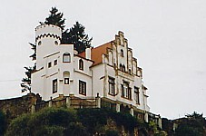
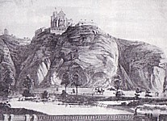
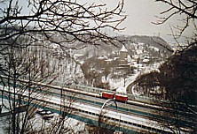

* * *

* * *

* * *

* * *

* * *

* * *

Auf einem steilen Felsvorsprung über dem Plauenschen Grund, der wegen
seiner Lage und Form ursprünglich “Kanapee” genannt wurde, ließ sich der Roßthaler Rittergutsbesitzer Carl Siegmund von Nimptsch Mitte des 18. Jahrhunderts das Lusthäuschen Carlsburg erbauen. Das hölzerne Bauwerk
wurde 1742  bei einem Unwetter zerstört. An seiner Stelle entstand nun ein Steinbau, der jedoch bereits drei Jahre später von Soldaten im Zusammenhang
mit der Schlacht bei Kesselsdorf vernichtet wurde. Auch der Nachfolgebau fiel 1759 kriegerischen Ereignissen zum Opfer. Daraufhin wurde ein kleiner Aussichtsplatz mit einem Rondell und Ruhebänken angelegt. Die nun
“Belvedere” genannte Plattform fiel im 19. Jahrhundert dem Steinbruchbetrieb zum Opfer.

1852 erwarb der Dölzschener Guts- und Steinbruchbesitzer Johann Gottlieb Beger dieses Grundstück und ließ sich vom Dresdner Architekten Theodor Lehnert eine
burgartige Villa im neogotischen Stil errichten. Nach seinem Besitzer Begerburg genannt, diente das Gebäude über dem Plauenschen Grund bis 1871 als Gastwirtschaft _(Zeichnung von 1856)_
. Für den Bau wurde überwiegend der anliegende Plänerstein genutzt. Auch das Innere orientierte sich am Aussehen einer Ritterburg, erzeugt durch den Einsatz von Holz und Holzimitaten. U.a. gab es einen
großen Saal, einen Kaffeesalon sowie mehrere Treppenaufgänge, die in die oberen Räume und zum Turm mit Aussichtsplattform führten. Nach dem Absturz eines
Gastes über die Klippen des Steinbruchs unterhalb des Hauses wurde die Schankkonzession jedoch wieder entzogen und die Begerburg in ein Wohnhaus umgewandelt. Bis  1934 blieb sie in Familienbesitz.

Wegen seines schlechten Bauzustandes war 1934 sogar ein Abriss des Gebäudes
geplant, der jedoch an den Protesten der Einwohner Dölzschens scheiterte. Stattdessen übernahm die Gemeinde das Areal und ließ die verfallene Villa
sanieren. Anschließend wurde sie bis 1945 zunächst von den Nationalsozialisten, danach zeitweise als FDJ-Heim “Grete Walther” genutzt. Später diente sie als
Domizil der Dölzschener Bücherei und als Lagerraum. 1979 erfolgte der Verkauf an einen privaten Besitzer, der die Begerburg 1985 umfassend renovieren ließ und als Pension einrichtete.

Unmittelbar am Haus führt ein Stufenweg hinab in den Plauenschen Grund. Die Hänge in diesem Bereich stehen als
Naturdenkmal unter Schutz und sind Reservat für einige seltene Tier- und Pflanzenarten. Zwischen 1999 und 2003
entstand  in direkter Nachbarschaft der historischen Villa eine Autobahnbrücke über das Weißeritztal. Zwei Jahre
zuvor hatte es an der auch als Kletterfelsen genutzten Klippe unterhalb der Burg einen spektakulären Felssturz gegeben. Zur Stabilisierung erfolgten deshalb 2000/01 umfangreiche Sicherungsmaßnahmen, um die Gefahr von
weiteren Gesteinsabbrüchen zu verringern.

**_Foto:_** _Blick von der Begerburg ins Weißeritztal - im Vordergrund die Autobahnbrücke_

* * *

 \[ [Home](../../../index.html)\] \[ [Nord](../../../nord/)\] \[ [Nordwest](../../../nordwest/)\] \[ [Neustadt](../../../neustadt/)\] \[ [Nordost](../../../nordost/)\] \[ [West](../../../west/)\] \[ [Zentrum](../../../zentrum/)\] \[ [Südwest](../../../sudwest/)\] \[ [Süd](../../../sud/)\] \[ [Südost](../../../sudost/)\] \[ [Ost](../../../ost/)\] \[ [Register](../../../Register/register.html)\] \[ [Kontakt](../../../Kontakt/kontakt.html)\] \[ [Impressum](../../../impressum/)\]
