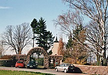
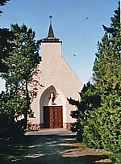

* * *

* * *

* * *

Der Dölzschener Friedhof entstand 1923 auf freiem Feld zwischen Dölzschen
und Roßthal. Da Dölzschen nie eine eigene Kirche besaß, unterstand der Ort im Mittelalter der Frauenkirche und ab 1578 der neu errichteten Annenkirche in der
Wilsdruffer Vorstadt. Das hatte zur Folge, dass die verstorbenen Einwohner auf dem weit entfernten Annenfriedhof beerdigt werden mussten. Erst im 18./19.
Jahrhundert konnten sich wohlhabendere Familien Kirchplätze im nahen Plauen kaufen. 1878 wechselte die Zugehörigkeit offiziell zu den Kirchen in Plauen bzw.
Pesterwitz, was auch die Nutzung der dortigen Friedhöfe zur Folge hatte.

Um künftig eine Beerdigung der Verstorbenen in unmittelbarer Nähe zu ermöglichen, erwarb die Gemeinde 1920 vom
Loschwitzer Zuckerfabrikanten Arno Reichelt ein ca. 8000 m² großes Gelände auf der Dölzschener Höhe, um einen
gemeindeeigenen Friedhof anzulegen. Das Areal wurde vom Chemnitzer Ingenieur Sievers und Gartengestalter Wilhelm
Otto Stein gestaltet und befindet sich seit seiner Eröffnung 1923 in kommunalem Besitz. Die unter Denkmalschutz stehende Toranlage _(Foto oben)_
schuf der Baumeister Schönberger aus heimischen Syenit. Am 28. Februar 1928 erließ die damals noch selbständige Ortsgemeinde ein Gesetz, welches die genauen Modalitäten der Beisetzungen auf diesem Friedhof regelte.

1927/28 wurde nach Plänen des Architekten Otto Reinhardt eine kleine Trauerhalle erbaut,
welche zugleich für kleinere Andachten und musikalische Veranstaltungen genutzt wird _(Foto rechts)_. Die Bauausführung des schlichten Gebäudes, welches auf jegliche religiöse Symbolik verzichtet, übernahm der Coschützer Baumeister Max Seiffert. Ihre Einweihung erfolgte am 9. September 1928. Mit der Eingemeindung des Ortes nach Dresden übernahm die Stadt 1945 auch den örtlichen Friedhof, der mit 0,8 Hektar Grundfläche kleinster kommunaler Friedhof Dresdens ist.

Zu den auf dem Dölzschener Friedhof beerdigten Personen gehört der bekannte jüdische
Sprach- und Literaturwissenschaftler Victor Klemperer (1881-1960), der bis zu seinem Tod 1960 in Dölzschen lebte. Außerdem fanden die TU-Professoren Karl Trinks (1891-1981) und Wolfgang Lange (1921-1977) sowie der Maler und Grafiker Erich Philipp (+ 1978) hier ihre letzte Ruhestätte. Seit 2000 steht das gesamte Areal unter Denkmalschutz. Im gleichen Jahr begann die Sanierung der Friedhofskapelle, welche 2006 abgeschlossen werden konnte. In diesem Zusammenhang erhielt das Gebäude eine neue Turmhaube sowie eine elektrische Orgel. Seit 2015 läutet im Turm eine neue Glocke, die urspünglich aus der Friedrichstädter [Matthäuskirche](../../../zentrum/friedrichstadt/strassen_friedrichstadt/friedrichstrasse/matthauskirche/) stammt. Viele Jahre hing sie dann im Glockenstuhl auf dem [Alten Matthäusfriedhof](../../../zentrum/friedrichstadt/strassen_friedrichstadt/friedrichstrasse/matthauskirche/matthausfriedhof/).

* * *

 \[ [Nord](../../../nord/)\] \[ [Nordwest](../../../nordwest/)\] \[ [Neustadt](../../../neustadt/)\] \[ [Nordost](../../../nordost/)\]
 \[ [West](../../../west/)\] \[ [Zentrum](../../../zentrum/)\] \[ [Südwest](../../../sudwest/)\] \[ [Süd](../../../sud/)\] \[ [Südost](../../../sudost/)\] \[ [Ost](../../../ost/)\] \[ [Register](../../../Register/register.html)\] \[ [Kontakt](../../../Kontakt/kontakt.html)\] \[ [Impressum](../../../impressum/)\]
