## Alfred-Darre-Weg

Der Alfred-Darre-Weg wurde 2000 im Zusammenhang mit dem Bau des Wohngebietes “Dölzschener Höhe” angelegt. Seinen
Namen erhielt er nach dem früheren Dölzschener Bürgermeister Alfred Darre (1890-1945), welcher maßgeblich am Ausbau der Gemeinde zum Dresdner Wohnvorort beteiligt war. Der SPD-Politiker initiierte u.a. den Ausbau des Wohnviertels
Hohendölzschen, die Anlage des Gemeindefriedhofes, des Sportplatzes sowie den Bau einer Turn- und Festhalle für den Ort.
1933 wurde er von den Nazis aus politischen Gründen aus dem Amt gedrängt und zeitweise inhaftiert. Sein Grab befand sich auf dem Dölzschener Friedhof , ist jedoch nicht mehr erhalten.

## Alfred-Schmieder-Straße

Die Alfred-Schmieder-Straße wurde 1936 angelegt und zunächst Zur Höhenluft genannt. Im Februar 1946 erfolgte die
Umbenennung nach dem Löbtauer SPD-Politiker Alfred Schmieder (1883-1943), der wegen seines Widerstands gegen das NS-Regime inhaftiert und im KZ Dachau ums Leben kam.

## Altdölzschen

Der frühere Dorfplatz wurde nach der Eingemeindung des Ortes 1953 in Altdölzschen umbenannt. Grund war die
Eingemeindung von Oberpoyritz, wo es ebenfalls einen Platz diesen Namens gab. Deutlich ist noch die Dorfform eines slawischen Rundweilers erkennbar. Um den Platz stehen die verbliebenen Bauerngüter des Ortes, welche ihr heutiges
Aussehen im 19. Jahrhundert erhielten. Bemerkenswert sind vor allem der Hof Altdölzschen Nr. 41 mit seiner Toranlage sowie
das Fachwerkhaus Nr. 37. Noch bis 1909 befand sich in der Mitte des Platzes der letzte von einst fünf künstlich angelegten
Zisternen, die früher zur Wasserversorgung der Gehöfte dienten. Heute stehen an dieser Stelle einige Ruhebänke und eine aus Anlass des 850. Ortsjubiläums gepflanzte Dorflinde.

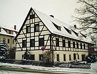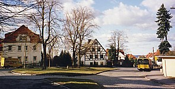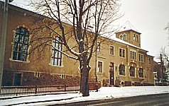

**_Fotos:_** _Dorfplatz Altdölzschen (Mitte und links) - Gasthof Dölzschen (rechts)_

Brauns Etablissement:
Der Gasthof am Rande des Dorfplatzes ging 1848 aus dem früheren Reiheschank hervor und wurde nach seinem Besitzer Oskar Braun “Brauns Etablissement” genannt. Dieser war zugleich Inhaber einer Mühle und Großbäckerei im [Plauenschen Grund](../../../sud/plauen/plauenscher_grund/) (später König- Friedrich-August-Mühlenwerke AG). 1862 erhielt das Gebäude einen
großen Saal sowie einen turmartigen Anbau, der zugleich als Aussichtsturm diente. Während des Zweiten Weltkrieges waren hier ukrainische Zwangsarbeiterinnen untergebracht. Der Gasthof mit seinem schönen Gästegarten blieb bis in die
Nachkriegszeit beliebtes Ausflugsziel, wurde dann jedoch geschlossen. Heute wird das Gebäude als Schulhort der 81.
Grundschule und Kindergarten genutzt. Im früheren Saal findet seit vielen Jahren der Sportunterricht der Schule statt.

## Am Dölzschgraben

Die Straße am Dölzschgraben wurde 1936 im Zusammenhang mit der Erweiterung des Dorfkerns angelegt. Der Name ist von einer Vertiefung abgeleitet, welche früher auch als Hohle bzw. Pflaumendelle bezeichnet wurde.

## Am Kirschberg

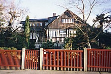Die Straße Am Kirschberg wurde 1930 durch Ausbau des alten
Stadtweges von Dölzschen nach Dresden angelegt und in den Dreißiger Jahren mit Einfamilienhäusern bebaut. Zuvor war dieser Teil der Dorfflur als Kirschgarten genutzt worden. Zu den
Bewohnern der neuen Häuser gehörte der Literatur- und Sprachwissenschaftler Victor Klemperer (1881-1960), der mit seiner Frau ab 1934 das Haus Am Kirschberg 19 bewohnte _(Foto)_
. Klemperer wurde wegen seiner jüdischen Herkunft 1933 von der Technischen Hochschule verbannt und musste 1940 in ein “Judenhaus” in Strehlen umziehen. Nur mit Glück überlebte er die Nazizeit und erhielt 1945 sein Haus zurück.
Bekannt wurde er vor allem durch seine Tagebücher und das Buch “L T I”, welches sich mit der Sprache des Dritten Reiches befasst. Klemperers Grab befindet sich auf dem [Dölzschener Friedhof](../../../sudwest/dolzschen/dolzschener_friedhof/). Seit 2014 erinnert
zudem vor dem haus eine Stele mit Informationstafeln an ihn. Im Haus Am Kirschberg 1 befand sich früher die beliebte Ausflugsgaststätte “Am Kirschberg”.

## Am Pfiff

Die frühere Dölzschener Saarstraße wurde 1946 in Am Pfiff umbenannt. Ebenso wie die Saarstraße hatten auch die benachbarten Straßen um 1935 ihre Namen nach Regionen im Grenzgebiet des Deutschen Reiches erhalten. Der inmitten der kleinen Siedlung gelegene Platz wurde in diesem Zusammenhang als Grenzlandplatz bezeichnet. Nach 1945 ersetzte man diese Bezeichnungen zum Teil durch neue Straßennamen. Der Name Grenzlandplatz, 1946 in Grüner Plan geändert, wurde 1950 aufgehoben.

Alte und neue straßennamen in hohendölzschen:  saarstraße - am pfiff eigenheimstraße - bernhard-wensch-straße bozener straße - grüne hoffnung grenzlandplatz - grüner plan marienburgstraße - ratsfeld zastrowstraße - rudi-lattner-straße memelstraße - südwesthang hultschiner straße - hultschiner straße

Während des Zweiten Weltkrieges befand sich Am Pfiff / Ecke Naußlitzer Straße ein Barackenlager für polnische
Zwangsarbeiterinnen. Eine weitere Baracke stand an der Grenzallee. Hier waren französische Zwangsarbeiter untergebracht,
welche in Dölzschen als Hilfskräfte in der Landwirtschaft eingesetzt waren. Nach 1990 entstanden in diesem Gebiet moderne Einfamilien- und Reihenhäuser.

## Am Tälchen

Die nach einem Flurnamen benannte Straße Am Tälchen entstand 1936. Ab 1959 wohnte im Haus Am Tälchen 10 die Kinderbuchautorin Auguste Lazar (1887-1970). Bekannt wurde sie vor allem durch ihr Buch “Sally Bleistift in Amerika”. Auguste Lazar hatte bereits in den 1920 Jahren zusammen mit ihrem Mann, einem TH-Professor, in Dresden gelebt, musste nach dem Machtantritt der Nazis als Jüdin emigrieren und kehrte 1949 zurück. Ihr Grab befindet sich auf dem Heidefriedhof.

## Bernhard-Wensch-Straße

Die Ende der Zwanziger Jahre angelegte Straße im Villenviertel Hohendölzschen erhielt ursprünglich wegen der hier
entstandenen Einfamilienhäuser den Namen Eigenheimstraße. Während der Nazizeit wurde sie nach dem 1934 verstorbenen
Reichspräsidenten als Hindenburgstraße bezeichnet. 1946 wurde diese Straße in Bernhard-Wensch-Straße umbenannt. Bernhard Wensch (1908-1942) war bis zu seiner Verhaftung 1941 als Jugendseelsorger des Bistums Meißen tätig und
engagierte sich im Widerstand gegen das Naziregime. Wensch verstarb 1942 im KZ Sachsenhausen und wurde in der Priestergruft des Alten Katholischen Friedhofs beigesetzt.

## Dölzschener Ring

Der Dölzschener Ring entstand erst im Jahr 2000 im Zusammenhang mit dem Bau des Wohnparkes “Dölzschener Höhe”. Bei
den Bauarbeiten wurden 1998 Reste einer frühgeschichtlichen Siedlung mit zahlreichen Gefäßscherben, Feuerstellen und Mahl- und Schleifsteinen entdeckt. Bis 2004
entstanden hier in mehreren Bauabschnitten über 50 Reihen- und Doppelhäuser.

## Firstenweg

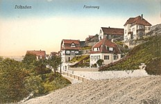Der Firstenweg führt am Rande (First) des Plauenschen Grundes entlang und entstand
vermutlich im 16. Jahrhundert als kurfürstlicher Jagdweg. Bis zum Ausbau der Straße durch den Plauenschen Grund war dieser Weg wichtige Verbindung zwischen Plauen
und den Dörfern oberhalb des Tales. Vor 1945 wurde er auch als Fürstenweg bezeichnet. Heute ist dieser Weg nur noch teilweise begehbar. Ein Teilstück wurde nach 1946 in Kohlgraben umbenannt.

## Friedhofsweg

Der Friedhofsweg verbindet Dölzschen mit dem benachbarten Roßthal und war, seit 1930 offiziell als Roßthaler Weg
bezeichnet, einst wichtige Verkehrsverbindung zwischen dem Sitz der Lehnsherrschaft und dem Bauerndorf Dölzschen. 1923 wurde hier der [Dölzschener Friedhof](../../../sudwest/dolzschen/dolzschener_friedhof/) angelegt und der Weg aus diesem Grund 1946 in Friedhofsweg umbenannt.

## Grenzallee

Die frühere Grenzstraße wurde zur Vermeidung von Verwechslungen mit einer gleichnamigen Straße in Naußlitz (heute Wendel-Hipler-Straße) 1945 in Grenzallee umbenannt. Zwischen 1933 und 1945 trug sie nach dem nationalsozialistischen Politiker Hermann Göring (1893-1946) den Namen Hermann-Göring-Straße. Die Straße bildet die Flurgrenze zwischen Dölzschen und Naußlitz bzw. Löbtau und ist seit 1910 Standort einer Villen- und Landhaussiedlung. Das Viertel zwischen Grenzallee und Hohendölzschener Straße wird heute auch Hohendölzschen genannt und war bis zum Beginn des Zweiten Weltkrieges weitgehend vollendet. Zu den zuletzt errichteten Gebäuden gehört die Mitte der Dreißiger Jahre entstandene Wohnsiedlung des Dresdner Spar- und Bauvereins im oberen Teil. Außerdem gab es hier die Gärtnerei Max Berthold, welche zeitweise auch eine Seidenraupenzucht beherbergte.

Im Haus Grenzallee 34 wohnte zeitweise der Direktor des Wissenschaftlich-Photographischen Instituts der Technischen Hochschule Hellmut Frieser (1901-1988). Zu den Bewohnern der Grenzallee (Nr. 35) gehörte ab 1937 auch der Arzt Eduard Grube (1896-1967). Grube war von 1924 bis 1933 Stadtarzt in Freital, wurde dann wegen seiner politischen Tätigkeit in der SPD beurlaubt und praktizierte als Arzt in Dresden-Löbtau. Im Mai 1945 wurde er zum ersten Stadtrat für Gesundheitswesen der Nachkriegszeit ernannt und war zwischen 1960 und 1966 Ärztlicher Direktor der [Medizinischen Akademie](../../../zentrum/johannstadt/universitatsklinikum/).

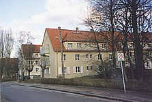

**_Foto:_** _Siedlung des Dresdner Spar- und Bauvereins an der Grenzallee / Hultschiner Straße._

Die kleine Verbindungsstraße Grüne Hoffnung entstand Mitte der 1930er Jahre und verbindet die Hultschiner Straße mit der Straße Südwesthang. Ebenso wie viele Nachbarstraßen wurde sie in Bezug auf das ehemalige Grenzgebiet des Deutschen Reiches Bozener Straße benannt. Bozen ist die Landeshauptstadt der heute zu Italien gehörenden Region Südtirol. Bereits 1945 wurde diese Bezeichnung aufgehoben und die Straße fortan in Bezug auf einen Flurnamen Grüne Hoffnung genannt. Die fehlende Bebauung war schließlich der Grund, die Namensgebung in den 1950er Jahren ganz aufzuheben. Im Zusammenhang mit dem Bau einiger Einfamilienhäuser erfolgte am 14. März 1996 die Wiederbenennung.

## Hohendölzschener Straße

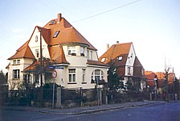Die Hohendölzschener Straße, die vom Dorfplatz bis zur Tharandter Straße führt, ist Teil eines alten Verbindungsweges zwischen Meißen und der Burg Dohna. Ursprünglich verlief dieser Fahrweg über Pesterwitz, Dölzschen, Plauen und Leubnitz, wurde später jedoch durch andere Verkehrsverbindungen ersetzt. Viele Jahre nutzten die Bewohner des Ortes die Straße als Weg zur Plauener Kirche, zu der Dölzschen bis 1878 gehörte. Deshalb bürgerte sich für diese der Name Dölzschener Kirchweg, auch Kirchsteig, Braut- oder Leichenweg ein. Später wurde die Straße ab 1900 Residenzstraße genannt.

Ihren heutigen Namen erhielt die in den Zwanziger Jahren ausgebaute Straße 1946 nach dem Ortsteil Hohendölzschen, einem ausgedehnten Villenviertel östlich des alten Dorfkerns _(Foto)_. Die meisten Gebäude entstanden zwischen 1900 und 1914, darunter die architektonisch interessanten Häuser Höhendölzschener Straße 3 bis 9, Nr. 4, 16, 18, 24, 31 und 44, die heute als Baudenkmale unter Schutz stehen. Zu den Bewohnern einer dieser Villen (Nr. 37) gehörte u.a. der Kunstmaler Martin Erich Philipp (1887-1978). Philipp hatte ab 1904 die Kunstgewerbeschule in Dresden besuchte und studierte im Anschluss an der Kunstakademie bei Oskar Zwintscher und Gotthardt Kuehl. Ab 1913 wirkte er freischaffender Maler und Grafiker. Sein Grab befindet sich auf dem [Dölzschener Friedhof](../../../sudwest/dolzschen/strassen_dolzschen/).

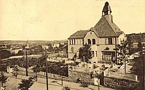Café Hohendölzschen: Oberhalb des Bienertparks befand sich ab 1911 das beliebte Café Hohendölzschen _(Nr. 1- Foto)_, von dem aus sich ein herrlicher Fernblick über die Umgebung bot. Die kleine Gaststätte erfreute sich als Ausflugsziel, aber auch als Tanzlokal großer Beliebtheit. 1949 übernahm die HO die Bewirtschaftung, bevor der Gastronomiebetrieb in den 1960er Jahren eingestellt wurde. Danach befand sich hier eine Kindertagesstätte. 1990 wurde das Gebäude an die Alteigentümer zurückgegeben und wenig später abgerissen. Heute steht auf dem Grundstück ein modernes Einfamilienhaus.

## Hultschiner Straße

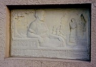
Die Hultschiner Straße entstand in den Jahren nach dem Ersten Weltkrieg und wurde nach der Stadt Hultschin (tschechisch Hlu¥ín) benannt. Die Kleinstadt in der Nähe von Ostrava
gehörte bis 1920 zum Deutschen Reich und wurde dann in Folge des Versailler Vertrages gemeinsam mit dem “Hultschiner Ländchen” an die Tschechoslowakei angegliedert. Anfang der Dreißiger Jahre ließ der Dresdner Spar- und Bauverein
an der Hultschiner Straße eine Wohnanlage mit 192 Wohnungen errichten. Architekt war Walter Jähnig. Weitere Gebäude entstanden bis zum Beginn des Zweiten Weltkriegs in unmittelbarer Umgebung.
Kriegsbedingt konnte diese Siedlung jedoch nur zur Hälfte fertiggestellt werden.

## Luftbadstraße

Die heutige Luftbadstraße wurde 1918 auf Beschluss des Gemeinderates von Dölzschen Mäserstraße genannt. Mit dieser
Namensgebung sollte der Vorsitzende der Dölzschener Eigenheimgesellschaft Reinhold Mäser geehrt werden, auf dessen
Initiative die ausgedehnte Siedlung an der Hohendölzschener Straße entstand. Am Ende der früheren Mäserstraße befindet sich seit 1885 das [Luftbad Dölzschen](../../../sudwest/dolzschen/).

## Robert-Weber-Straße

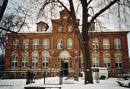
Die Robert-Weber-Straße wurde 1935 nach dem verdienstvollen Dölzschener Pädagogen Robert Weber (1849-1924) benannt. Weber war von 1878 bis 1915 als
Lehrer an der örtlichen Schule tätig, die er ab 1898 auch leitete. Maßgeblich setzte er sich für einen nach modernen pädagogischen Konzepten gestalteten Unterricht ein, organisierte Schulkonzerte und gründete 1890
eine öffentlich zugängliche Schulbibliothek. 1923 wurde ihm zu Ehren die Robert-Weber-Stiftung ins Leben gerufen. Die Namensgebung erfolgte, da sich an dieser Straße seit 1898 die Schule des Ortes befindet (heute 81. Grundschule _\- Foto)_.

## Rudi-Lattner-Straße

Die ursprünglich nach dem sächsischen General und Festungskommandanten von Königstein Caspar Wilhelm Philipp von Zastrow
benannte Zastrowtraße im Villenviertel Hohendölzschen erhielt 1962 den Namen Rudi-Lattner-Straße. Rudi Lattner
(1904-1944) gehörte der Vereinigten Kletterabteilung und dem Bergsteigerchor an und beteiligte sich an illegalen Aktionen der
Bergsteiger gegen das nationalsozialistische Regime. Mehrfach verhaftet, musste er später im Strafbataillon 999 Dienst leisten und kam dort 1945 in Jugoslawien ums Leben.

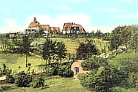

**_Foto:_** _Blick nach Hohendölzschen um 1920_

## Serpentinstraße

Die kurvenreiche Serpentinstraße wurde 1889 als Verbindung zwischen dem Dorfkern und dem [Plauenschen Grund](../../../sud/plauen/plauenscher_grund/)
angelegt, um diese beiden Ortsteile besser miteinander zu verbinden. Niederdölzschen war einst wichtiges Weinbaugebiet und später Standort mehrerer Steinbrüche. Außerdem existierten im Tal das [Eisenhammerwerk](../../../sud/plauen/plauenscher_grund/eisenhammerwerk/) und weitere gewerbliche Unternehmungen.
Nach dem Straßenbau entstanden in diesem Areal an Stelle früherer Weinbergsterrassen Wohnhäuser. 1946 wurde die zuvor
Bergstraße genannte Straße in Serpentinstraße umbenannt. In ihrer Nähe überspannt seit 2002 die neue Autobahnbrücke der A 17 das Weißeritztal.

## [Tharandter Straße](../../../sudwest/lobtau/strassen_lobtau/tharandter_strasse/)

## Wurgwitzer Straße

Die früher Pesterwitzer Straße genannte Straße führt von Dölzschen nach dem Nachbarort Pesterwitz, mit dem das Dorf über
seine Grundherrschaft jahrhundertelang eng verbunden war. Ihren heutigen Namen erhielt sie 1946 nach dem kleinen Ort Wurgwitz, seit 1974 Stadtteil von Freital.

Unterhalb der Wurgwitzer Straße lagen einst die Weinberge des Ortes, was zum Bau mehrerer Winzerhäuser führte.
Markantestes ist das heute als Altersheim genutzte Jochhöhschlösschen auf Freitaler Flur. Das letzte Winzerhaus in Dölzschen
wurde 1994 wegen Baufälligkeit abgerissen und durch einen Neubau ersetzt. 1817 entstand in einem Wohnhaus an dieser
Straße die erste Dölzschener Schulstube, welche die Kinder des Ortes und der Nachbarsiedlungen Naußlitz, Roßthal und Jochhöh besuchten. 1840 wurde hier auch das erste reguläre [Schulhaus](../../../sudwest/dolzschen/) erbaut (1978 abgerissen). Auf dem Gelände einer
ehemaligen Fabrik für Bremstechnik (Nr. 6) entstand 2015 eine kleine Wohnanlage.

Schweinemastanlage:
Die Schweinemastanlage Dölzschen entstand in den 1960er Jahren außerhalb des Ortes an der Wurgwitzer Straße in Richtung Pesterwitz. Insgesamt gab es 21 Ställe mit Platz für Tausende Tiere, hinzu kamen verschiedene
Nebengebäude. 1990 wurde der Zuchtbetrieb geschlossen. Teile der Anlage dienten danach noch gewerblichen Zwecken.
Später war hier ein Freizeitpark mit Sommerrodelbahn und Wildgehege geplant. Die stark verfallenen Gebäude wurden 2013 abgerissen und die Fläche anschließend renaturiert.

[Dölzschen auf OpenStreetMap](https://www.openstreetmap.org/search?query=Dresden+D%C3%B6lzschen)

* * *

 \[ [Home](../../../index.html)\] \[ [Nord](../../../nord/)\] \[ [Nordwest](../../../nordwest/)\] \[ [Neustadt](../../../neustadt/)\] \[ [Nordost](../../../nordost/)\] \[ [West](../../../west/)\] \[ [Zentrum](../../../zentrum/)\] \[ [Südwest](../../../sudwest/)\] \[ [Süd](../../../sud/)\] \[ [Südost](../../../sudost/)\] \[ [Ost](../../../ost/)\] \[ [Register](../../../Register/register.html)\] \[ [Kontakt](../../../Kontakt/kontakt.html)\] \[ [Impressum](../../../impressum/)\]
