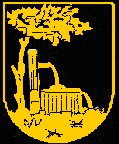
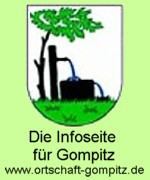
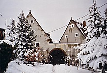
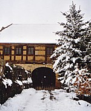
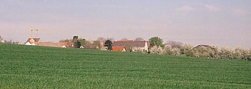
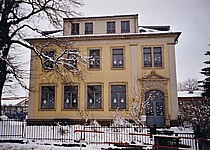
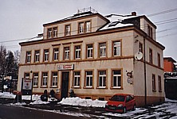

* * *

**Gemeindesiegel von Gompitz**

* * *

**Gompitzer Ortsteile:**

* * *

* * *

**Gompitzer Stadtteilseiten**

* * *

**Schulen in Gompitz**

Die Fluren um Gompitz waren bereits um 200 v. Chr. besiedelt, wie archäologische Funde beweisen. Beim Bau der Gorbitzer Nordtangente wurden in den Jahren 1995 und 1996 Gebäudereste, Keramik und Gusstiegel
für Kupfer entdeckt, die auf eine frühgeschichtliche Handwerkersiedlung an dieser Stelle hinweisen.

Die spätere slawische Siedlung Gompitz entstand vermutlich im 11. Jahrhundert und wurde 1206 erstmals urkundlich erwähnt. Der Ort war vermutlich ein
Herrensitz, da ein Hildebrand von Gonpitz als Zeuge eines Rechtsstreites genannt wurde. Gleichzeitig taucht in dieser Urkunde auch der Name Dresdens zum
ersten Mal auf, so dass Gompitz und die Landeshauptstadt heute ihr Ortsjubiläum auf die gleiche Quelle zurückführen. Gompitz unterstand vermutlich dem
Burgward Pesterwitz, kam später jedoch zum Amt Dresden. Die Herkunft des Ortsnamens ist umstritten. So könnte der Name vom slawischen konop = Hanf
abgeleitet sein, da in Gompitz noch im 14. Jahrhundert der Hanfanbau verbreitet war. Auch die Begriffe humpac (= Rohrdommel) und gonoti (= hetzen, jagen) werden mit Gompitz in Verbindung gebracht.

Im Jahr 1404 gelangte das Dorf durch eine Schenkung des Dresdner Ratsherren Lorenz Busmann in den Besitz des Klosters Altzella. Busmanns Schenkung war
mit der Einrichtung eines “Seelenbades” auf der Schreibergasse verbunden, eine im Mittelalter übliche Stiftung zugunsten armer Mitbürger, die zugleich der körperlichen und seelischen
Reinigung der Betroffenen dienen sollte. In den Hussitenkriegen wurde Gompitz wahrscheinlich zerstört, da 1458 der
Hinweis “hat gebernth” (hat gebrannt) in den Urkunden auftaucht. 1500 erwarb das Kloster Altzella auch den verbliebenen Teil des Ortes, welches nun bis 1534 dem Leubnitzer Klostergut unterstand. Nach dessen Auflösung
wurde Gompitz dem Leubnitzer Ratsamt der Stadt Dresden zugeordnet. Die Bewohner lebten vom Ackerbau. Wiederholt mussten Gompitzer Bauern um Steuererleichterungen nachsuchen, da die vorbeiführende Landstraße nach
Freiberg ebenso zu Schäden an den Feldfrüchten geführt hatte, wie eine Mäuseplage 1597. Die verheerendsten
Auswirkungen hatte jedoch 1745 die Schlacht von Kesselsdorf, während der die Familien den Ort fluchtartig verlassen hatten.

Zum Zeitpunkt der Bildung der Landgemeinde Gompitz im Zusammenhang mit den bürgerlichen Reformen in Sachsen 1838/39 bestand der Ort aus sechs Bauerngütern _(Fotos)_
und einem Freigut. Neben der Landwirtschaft wurde auch etwas Obst- und Weinbau betrieben. Außerdem entstanden im 19. Jahrhundert einige Gärtnereien, die ihre Produkte vorrangig im benachbarten Dresden absetzten.

Enge Verbindungen bestanden traditionell mit dem Nachbarort Pennrich. 1859 gründeten Gompitz und Pennrich einen Heimatbezirk, eine Art Verwaltungsgemeinschaft, die sich u.a.
der Armenpflege, dem Schulwesen und der Bildung einer Ortsfeuerwehr widmete. Auch die kleine Gemeinde Zöllmen trat diesem Verband später bei. Kirchlich unterstand Gompitz der [Briesnitzer Kirche](../../west/briesnitz/briesnitzer_kirche/), bis 1913 im Nachbarort Gorbitz eine eigene Kirche gebaut werden
konnte. 1895 wurde eine Poststelle im Ort eingerichtet. 1902 entstand das neue Schulhaus.

Gompitz blieb auch nach 1945 vorrangig von der Landwirtschaft geprägt. Zur besseren Verkehrsanbindung nach
Dresden wurde am 24. Oktober 1949 die Buslinie A zwischen Wölfnitz und Gompitz in Betrieb genommen, esrte Kraftomnibuslinie nach dem Zweiten Weltkrieg in Dresden. 1950 wurden Pennrich und Zöllmen nach Gompitz
eingemeindet. 1974 kamen auch Unkersdorf, Steinbach, Roitzsch und 1993 Ockerwitz zur Gemeinde. Vor allem in den
stadtnahen Ortsteilen entstanden ab 1990 neue Wohngebiete, Gewerbeparks und ein modernes Hotel in der Nähe der
Bundesstraße. Überregionale Bedeutung hat die Gompitzer Reithalle, die den Ort in den letzten Jahren zum Ziel vieler
Reitsportfreunde machte und größte in Sachsen ist. Am 1. Januar 1999 wurde Gompitz mit seinen Ortsteilen nach Dresden eingemeindet. 2008 erhielt Gompitz Anschluss an das Dresdner Straßenbahnnetz. Außerdem wurden in den
letzten Jahren weitere Wohnsiedlungen, u.a. an der Altnossener Straße (“Alte Gärtnereien”) gebaut.

**_Foto:_** _Blick von der Gorbitzer Höhe zum Dorfkern von Gompitz_

Schulen in Gompitz:

Nachdem Gompitz und Pennrich bereits seit 1790 einen gemeinsamen
Schulverband gebildet hatten, besuchten die Kinder des Ortes zunächst die dortige Schule, für die 1879 ein Schulhaus an der Ortsgrenze entstand. 1901 entschloss
sich die Gemeinde jedoch wegen der gewachsenen Einwohnerzahl zum Bau eines eigenen Schulhauses. Das neue Gebäude an der Ockerwitzer Allee wurde am 21.
April 1902 eingeweiht und war ab 1903 zugleich Domizil der Gemeindebücherei. Der spätere Schulleiter, ein Jugendfreund des Grafen Luckner, trug in den Dreißiger Jahren eine Sammlung über dessen Leben zusammen, die heute
verschollen ist. 1945 fanden im Schulhaus vorübergehend Flüchtlinge und Ausgebombte Unterkunft. Da unmittelbar neben der Schule in den letzten Kriegstagen ein militärischer
Beobachtungsposten eingerichtet wurde, erlitt das Gebäude bei Kampfhandlungen schwere Schäden, die nur mühsam wieder beseitigt werden konnten.

Ab Juli 1946 bildeten Gompitz und Pennrich eine Einheitsschule mit sechs Klassen, wobei beide Schulhäuser für den
Unterricht genutzt wurden. 1960 erfolgte der  Zusammenschluss mit den Schulen von Gompitz, Niedergorbitz und
Obergorbitz, so dass in Gompitz nur noch die Klassen 1-3 unterrichtet wurden. 1998/99 wurde das Gebäude saniert und um einem modernen Anbau erweitert. Zugleich entstand eine moderne Schulturnhalle. Heute nutzt die 74.
Grundschule das Haus.

Gasthof Gompitz:

Der erste Gasthof des Ortes entstand 1864 und befand sich zunächst direkt am Dorfplatz (heute Altgompitz 9). Zuvor gab es auch in Gompitz den in vielen
Dörfern üblichen Reiheschank, bei dem die Bauern reihum das Schankrecht für eine gewisse Zeit erhielten. Viele Jahre blieb der Gasthof  im Besitz der Familie
Weber. Die deshalb auch als “Webers Gasthaus” bezeichnete Gaststätte diente zugleich als Veranstaltungs- und Versammlungslokal. Der Sohn des ersten Besitzers Johann Weber konnte 1870 für 600 Mark den Reiheschank
erwerben. 1897 erfolgte ein kompletter Neubau des Gasthofes außerhalb des Ortskerns an der Kesselsdorfer Straße 312 _(Foto)_. Nach 1990 wurde das
Gebäude rekonstruiert und wird seit 2007 als Schnitzelrestaurant “Schnizz” fortgeführt.

Kleingartenverein “Bergfrieden”:

Die Gartensparte am Kohlsdorfer Weg entstand als Reaktion auf die Weltwirtschaftskrise, um Arbeitslosen und armen
Bevölkerungskreisen eine Möglichkeit zum Anbau von Kartoffeln und Gemüse für den Eigenbedarf zu schaffen. Dafür erwarb der
Verein 1929 ca. 4 Hektar Land des Altfrankener Rittergutes und legte darauf die ersten Parzellen an. Bis Mitte der Dreißiger Jahre wurde das Areal erschlossen und mit Lauben bebaut, von denen noch heute eine aus dem
Jahr 1935 erhalten geblieben ist. Zur Wasserversorgung der Kleingartenanlage sprengte man 1932 zwei Brunnen in den Fels. Teile des Areals mussten 2000 für den Neubau der Autobahn A 17 abgegeben werden. Heute gehören zum
Verein “Bergfrieden e. V.” 98 Parzellen. Außerdem gibt es ein auch öffentlich zugängliches Spartenheim.

[_Weiterführende Literatur und Quellen_](../../impressum/quellenverzeichnis/)

 \[ [Home](../../index.html)\] \[ [Nord](../../nord/)\] \[ [Nordwest](../../nordwest/)\] \[ [Neustadt](../../neustadt/)\] \[ [Nordost](../../nordost/)\] \[ [West](../../west/)\] \[ [Zentrum](../../zentrum/)\] \[ [Südwest](../../sudwest/)\] \[ [Süd](../../sud/)\]
 \[ [Südost](../../sudost/)\] \[ [Ost](../../ost/)\] \[ [Register](../../Register/register.html)\] \[ [Kontakt](../../Kontakt/kontakt.html)\] \[ [Impressum](../../impressum/)\]
