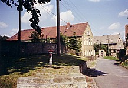
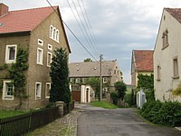
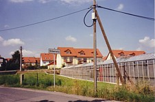

* * *

**Gemeindesiegel von Ockerwitz**

* * *

Ockerwitz entstand als slawische Siedlung im 11. Jahrhundert und weist noch heute die typische Dorfform eines Rundlings auf. Bereits 1071 wurde ein Ort Oicice in einer Urkunde des Bischofs Benno genannt,
wobei die Identität mit Ockerwitz allerdings umstritten ist. 1371 wird “Ogranwitz” im Verzeichnis der Orte des Amtes Dresden erstmals erwähnt. Der Name ist entweder von einem slawischen Personennamen abgeleitet (okor -
novici = neues Dorf des Oker) oder aber vom slawischen Wort okraj (über dem Rande), was auf die Lage des Dorfes oberhalb des Zschonergrundes hinweisen könnte.

1408 erhielten drei Dresdner Bürgersöhne, die Brüder Vincenz, Hans Alexius und
Jorge Busmann, Güter und Zinsen in Ockerwitz zum Lehen. Einige Jahre später kam das Dorf unter die Herrschaft des Rittergutes Pegenau bei Scharfenberg, welches der Familie Miltitz gehörte. Neben den Gehöften im Ortskern
_(Foto)_ gehörten auch einige Wiesen des untergegangenen Ortes Wernten bei Cotta zur Ockerwitzer Flur, die jedoch nach Gründung des Ostravorwerkes an den
Kurfürsten abgetreten werden mussten. 1580 erwarb Kurfürst August den Ort gemeinsam mit sechs weiteren Dörfern und machte Ockerwitz zum unmittelbaren
Amtsdorf. Für die Bewohner bedeutete das eine Veränderung der Dienstpflichten, die schrittweise durch Geldleistungen abgegolten werden konnten. 1611 gab der Kurfürst die verbliebenen Dienste an
den Besitzer des Rittergutes Nöthnitz ab, der die Bauern bei Bedarf auf seinen Äckern einsetzte.

1762 wurde Ockerwitz bei einem Dorfbrand zum Teil zerstört, jedoch schon bald wieder aufgebaut. Neben der Landwirtschaft gewann der Obstbau an Bedeutung, für den die Hänge des [Zschonergrundes](../../../west/kemnitz/zschonergrund/) teilweise gerodet wurden. Diese Nutzung schränkte jedoch die herrschaftliche Jagd ein, weshalb es wiederholt zu
Beschwerden der Jagdhüter beim Kurfürsten über die “Ungehörigkeit” der Ockerwitzer Bauern kam. Im 19. Jahrhundert entstanden außerdem einige
Plänersteinbrüche und Gärtnereien in und um den Ort. Nachdem im Zuge der Landgemeindeordnung bis 1852 auch die letzten Dienst- und Geldleistungen abgelöst worden waren, entwickelte sich Ockerwitz zur Stadtrandgemeinde
Dresdens. 1876 entstand in [Leutewitz](../../../west/leutewitz/) ein gemeinsames Schulhaus für Ockerwitz, Leutewitz und Omsewitz. 1904
errichtete die Gemeinde ein Wasserwerk mit Hochbehälter, vor allem um die zahlreichen gärtnerischen Betriebe versorgen zu können. Einige Siedlungshäuser wurden in den Dreißiger Jahren und nach 1945 errichtet.

1993 kam Ockerwitz als Ortsteil zu Gompitz und ist seit 1999 Stadtteil
Dresdens. In den letzten Jahren entstanden weitere Wohnsiedlungen zwischen Dorfkern und Zschonergrund, die Ockerwitz zum beliebten Wohnvorort der Landeshauptstadt machten _(Foto)_
. Zu den prominenten Einwohnern gehörte der spätere sächsische Staatsminister Arnold Vaatz, der im Wohnhaus Am Zschoner Berg Nr. 1 lebte. Einige historische Bauernhöfe befinden sich an der [Ockerwitzer Dorfstraße.](../../../sudwest/gompitz/pennrich/strassen_gompitz/)

Burgwall Ockerwitz:

Die Burg von Ockerwitz entstand als frühdeutsche Wehranlage auf einem Bergsporn über dem Zschonergrund. Vermutlich diente sie dem Schutz der vorbeiführenden alten Straße von Meißen nach Briesnitz. 1223 verkaufte der hier ansässige Ritter Berthold von Sconowe den Ort Cossebaude an das Meißner Domstift. Die Familie Sconowe könnte mit dem untergegangenen Dorf Zschon bei Steinbach in Verbindung gestanden haben. Die Anlage bestand aus einem kleinen Hügel mit ca. sechs bis acht Metern Durchmesser, der von einem kleinen Wall mit Graben umgeben war. Außerdem soll sich hier ein turmartiges, hölzernes Gebäude befunden haben, dessen letzter Bewohner, ein roher Kriegsknecht von den Bauern der Umgebung gefürchtet war. Der Legende nach wurde er später Opfer eines Wolfes, als er beim Kampf mit dem Tier in seinen eigenen Speer stürzte.

Nach dem Tod des Burgherrn rissen die Bauern die Wehranlage ab. Im Volksmund wurde die Stelle wegen ihrer Form als “der Teller” bezeichnet. Durch die spätere landwirtschaftliche Nutzung und Bebauung des Areals sind heute kaum noch Spuren auffindbar. Allerdings wurden hier einige Keramikfunde gemacht. Der heute bis auf geringe Reste verschwundene Burgwall steht seit 1937 als Bodendenkmal unter Schutz.

Wasserbehälter Ockerwitz:

Das Ockerwitzer Wasserwerk entstand 1901 unter Regie des Gemeindevorstands Winkler, woran heute noch eine Inschrift über dem Eingang hinweist. Als Standort wählte man die Ockerwitzer Höhe (Ockerwitzer Str. 14) etwas außerhalb des Ortes. Zur Anlage gehörte ein Hochbehälter mit zwei Wasserkammern, von denen das Wasser über Rohrleitungen in die Häuser befördert wurde. Das Wasserwerk war bis 1970 in Betrieb und steht seit 2008 unter Denkmalschutz. Nach dem Erwerb durch private Besitzer ließen diese den historischen Gewölbekeller als Partyraum ausbauen und auf den Behälter einen modernen Aufbau setzen, der als Ferienhaus vermietet wird. Teile der technischen Ausstattung blieben dabei erhalten.

Schimmrichs Gastwirtschaft:

Der Gasthof des Ortes ging aus dem früheren Reiheschank hervor und entstand im 19. Jahrhundert. Um 1900 wurde er nach seinem Besitzer Schimmrichs Gastwirtschaft genannt. Gastwirt Schimmrich war zugleich Gemeindevorstand des Ortes und Mitglied des Vereins der Gast- und Schankwirte der Dresdner Westvororte. Hochgeachtet verstarb er 1910 und wurde am 31. Juli 1910 auf dem Briesnitzer Friedhof beigesetzt. In den 1920er Jahren hieß die kleine Dorfschänke Wegners Gasthaus.

[_Weiterführende Literatur und Quellen_](../../../impressum/quellenverzeichnis/)

 \[ [Home](../../../index.html)\] \[ [Nord](../../../nord/)\] \[ [Nordwest](../../../nordwest/)\] \[ [Neustadt](../../../neustadt/)\] \[ [Nordost](../../../nordost/)\] \[ [West](../../../west/)\] \[ [Zentrum](../../../zentrum/)\] \[ [Südwest](../../../sudwest/)\] \[ [Süd](../../../sud/)\] \[ [Südost](../../../sudost/)\] \[ [Ost](../../../ost/)\] \[ [Register](../../../Register/register.html)\] \[ [Kontakt](../../../Kontakt/kontakt.html)\] \[ [Impressum](../../../impressum/)\]
